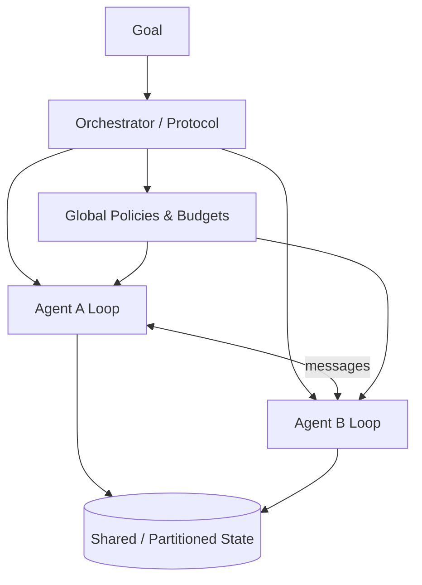
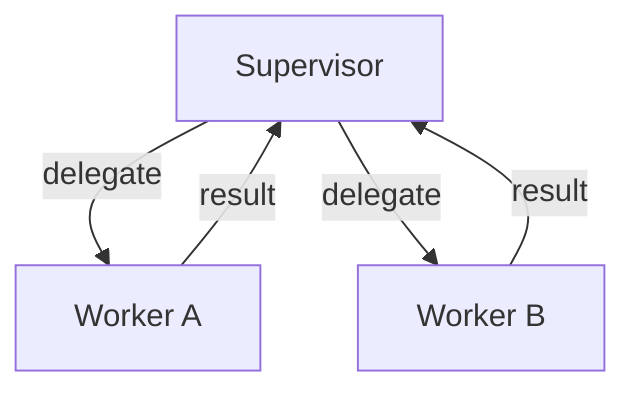

# Multi-Agent（Canonical）

> **一句话主题**：Multi-Agent 回答何时把工作拆成多个可独立 Loop 的 Agent、它们如何分工与通信、如何共享/隔离状态、如何处理冲突与编排——以及**为什么默认仍应是单 Agent**。
>
> **状态**：Canonical · **Last reviewed**: 2026-10  
> **受众**：在单 Agent 已穷尽后考虑协作拓扑的系统设计与 Runtime 工程师  
> **硬前置**：[Agent Architecture](../../core/agent-architecture/agent-architecture.md)、[Reasoning & Planning](../../core/reasoning-planning/reasoning-planning.md)  
> **软前置**：[Agent Loop](../../core/agent-loop/agent-loop.md)、[Memory](../../core/memory/memory.md)、[`production/evaluation`](../../production/evaluation/README.md)

---

## 范围 / 非目标

**范围**：定义与「默认单 Agent」立场；何时用/不用；角色分工；通信；共享状态；冲突与仲裁；编排（Supervisor / Peer / Pipeline）；失败模式；与 Architecture/Loop 边界；评测归因；面试。

**非目标（只链接，不写深文）**：

| 主题 | 位置 |
|------|------|
| 单次 run 决策→行动→观察回路 | [Agent Loop](../../core/agent-loop/agent-loop.md) — **禁止复写** |
| 组件组装、Control/Data Plane | [Agent Architecture](../../core/agent-architecture/agent-architecture.md) |
| 计划/反思/校验策略语义 | [Reasoning & Planning](../../core/reasoning-planning/reasoning-planning.md) |
| 工具调用与 ACI | [Tool Use](../../core/tool-use/tool-use.md) |
| Memory / Context 实现 | [memory.md](../../core/memory/memory.md) · [context-engineering](../../core/context-engineering/context-engineering.md) |
| 模式清单长文 / 框架 API 手册 | [`design-patterns`](../../production/design-patterns/README.md)；框架 = example |

---

## 0. 开篇立场：默认单 Agent

**Multi-Agent 是可选复杂度，不是成熟度勋章。**

Anthropic 主张简单可组合、按评测再加复杂度（[article-anthropic-building-effective-agents-2024](../../references/articles.md#article-anthropic-building-effective-agents-2024)）。本仓库默认值：

| 顺序 | 先做什么 | 为何 |
|------|----------|------|
| 1 | **Single Agent + 好工具面** | 调试最短；归因清晰 |
| 2 | Router / 工具子集 / Agentic Workflow | 压缩决策面，不必多个 Loop |
| 3 | Planner-Executor / Evaluator-Optimizer（可仍单身份） | 策略分层 ≠ 多 Agent |
| 4 | **经评测证明后**再上 Multi-Agent | 通信税、状态税、归因税须被收益覆盖 |

**反模式**：「先设计五个专家 Agent。」——常在掩饰烂工具、烂上下文或缺失验证门闩。

```text
Single Agent Loop
  → 仍失败？先修 Tools / Context / Policies / Verification
  → 仍有稳定、可命名的职责冲突？再评估 Multi-Agent
```

能单则单；拆分必须可测。

---

## 1. 定义：什么算 Multi-Agent？

### 1.1 工程定义

**Multi-Agent（本仓库）**：同一目标下存在 **≥2 个带独立决策权的 Agent 身份**，各自可推进（或被调度推进）自己的 **Agent Loop**，并通过 **显式消息、共享状态或工具中介** 协作，且对副作用有可审计责任边界。

**不算 Multi-Agent**：

| 现象 | 实际是 |
|------|--------|
| 同调用多模型投票 | Ensemble |
| Prompt 多角色但一个 Loop、一套工具 | 角色扮演的单 Agent |
| 固定 DAG 每节点一次 LLM | Workflow / Agentic Workflow |
| Planner 与 Executor 同 Runtime、同 run State | 策略分层（Reasoning），可仍单 Agent |
| 调「子 Agent」工具但无独立预算与身份生命周期 | Tool 化子过程 |

**判别**：是否存在多个可独立终止/计费/归因的决策主体，且主体间协议是否成为正确性的一部分。

### 1.2 生产最低完备

1. 稳定 `agent_id` / 角色契约  
2. 各自 Loop 或 Orchestrator 明确代跑的子 Loop  
3. 消息 schema、共享状态规则、冲突策略  
4. 全局与局部预算  
5. 跨 Agent 因果链可重建  

缺任一项先当 Demo。



Orchestrator 可以是代码图、Supervisor Agent 或总线——**必须显式**，不能靠共用超长 prompt。

---

## 2. 何时用 / 何时不该用

### 2.1 值得考虑（多数同时满足）

| 判据 | 说明 |
|------|------|
| 职责可命名且稳定 | 边界清晰，重叠可治理 |
| 单上下文冲突 | 专家知识/工具 schema 互扰或爆炸 |
| 异构工具面/权限 | 高危工具须隔离到窄身份 |
| 并行收益可测 | 独立子任务真并行，汇合简单 |
| 失败隔离有价值 | 一身份崩溃不污染全部工作记忆 |
| 评测净增益 | 成功率↑ 覆盖 成本/延迟/调试税↑ |

### 2.2 默认拒绝

| 场景 | 更好替代 |
|------|----------|
| 短任务、路径可枚举 | Workflow / 单次 LLM |
| 工具少、领域单一 | Single Agent |
| 「想更智能」无失败证据 | 先 Verification / 更好 ACI |
| 仅想用不同模型 | Router + 模型网关 |
| 跟风竞品「多智能体」 | 政治 ≠ 工程 |
| 无法定义冲突规则或跨 Agent 归因 | 不可运维 |

### 2.3 决策树

```text
单 Agent + 工具/上下文/验证是否穷尽？
  ├─ 否 → 先修单 Agent
  └─ 是 → 稳定职责切分 + 可测收益？
        ├─ 否 → 单 Agent 或 Agentic Workflow
        └─ 是 → Pipeline / Supervisor / Peer
              → 状态所有权 + 冲突策略 → 小流量评测；无增益回滚
```

Architecture 的 Router / Supervisor 模式位见 [Architecture §5](../../core/agent-architecture/agent-architecture.md)；本文展开多身份协作机制，不重复「Supervisor 不一定更好」的架构层论证。

---

## 3. 分工（Role & Skill Design）

### 3.1 角色契约

| 字段 | 含义 |
|------|------|
| `agent_id` / `role` | 稳定标识 |
| `mission` | 可验收的一句话职责 |
| `inputs` / `outputs` | 消息与产物 schema |
| `tool_allowlist` | 允许工具（硬约束） |
| `write_scope` | 可写状态分区 / Memory 命名空间 |
| `escalation` | 不确定时交给谁 |
| `budget` | 局部步数/费用/墙钟上限 |
| `non_goals` | 明确不做（防漂移） |

好分工像接口；差分工大家都是「全能助手」。

### 3.2 能力重叠治理

1. **主责**：一类动作只有一个 Writer  
2. **工具独占**：写仓库只给 Coding；Research 只有检索  
3. **产出类型隔离**：A 产 `EvidencePack`，B 产 `Draft`  
4. **仲裁者**：Supervisor / Verifier  

重叠无规则 = 隐性竞争 = 不可复现。

### 3.3 粒度

过粗：五「专家」工具相同。过细：一步一 Agent（通信爆炸）。  
**法则**：一身份 ≈ 一类权限面 + 一类可验证产出。HITL 占拓扑节点时同样要超时与默认可编辑字段（人不算 LLM Agent，但占协议位）。

---

## 4. 通信（Communication）

### 4.1 通道

| 通道 | 优点 | 代价 |
|------|------|------|
| 直接消息 | 因果清晰 | 路由与背压 |
| 黑板/共享文档 | 解耦 | 竞态、脏读 |
| 工具中介（派发给 B） | 复用 Tool 鉴权 | 易丢预算语义 |
| 事件总线 | 适异步长任务 | 顺序/exactly-once 难 |
| 共享 Memory | 长程协作 | 污染与权限风险高 |

生产偏好：**结构化消息 + 明确共享分区**；慎用无限共享 transcript。

### 4.2 消息 Envelope（最小集）

```text
Message {
  id, correlation_id, causation_id,
  from, to, type,           # request|response|event|vote|escalate
  schema_version, payload,  # 结构化；禁止纯散文当契约
  created_at, budget_hint?, auth_context
}
```

### 4.3 同步 vs 异步 · 协议阶梯

同步适短委派；异步适长任务——须声明超时、重试、幂等键、取消传播。

```text
L0 仅传产物句柄 → L1 单向交接 → L2 有限来回 ≤N
L3 自由 Peer 互聊 → L4 市场/竞价（罕用）
```

**默认 L0–L2。** L3+ 需要更强冲突与终止规则。  
MCP 等解决工具发现/调用（[`protocols/mcp`](../../protocols/mcp/README.md)）；**Agent 业务协议 ≠ MCP**，不要用「都接到 MCP」假装完成协作设计。

---

## 5. 共享状态（Shared State）

| 层 | 所有者建议 | 注意 |
|----|------------|------|
| 全局 Run State | Orchestrator | 目标、全局预算、拓扑阶段、汇合 |
| Agent-local State | 各 Loop | transcript/局部计划——默认不共享全文 |
| 共享工作区 | 显式 schema | 产物带版本与锁 |
| Memory | 命名空间 ACL | 防交叉污染 |
| 业务 DB | 权威系统 | 经 Tool；不以记忆当账本 |

**原则**：共享结构化产物，不是彼此完整思维链。

**写入**：每键单写多读为默认；Peer 并行改同一文档用乐观版本；阶段汇合可用 Orchestrator 栅栏。  
Context 仍是**投影**（Context Engineering）；压缩某 Agent 窗口不得偷偷改写他人未消费的共享对象。  
Checkpoint：拓扑阶段边界强制全局点；各 Loop 步语义链 [Agent Loop](../../core/agent-loop/agent-loop.md)，**本文不复述**。

---

## 6. 冲突（Conflict & Consensus）

| 类型 | 例子 | 缓解 |
|------|------|------|
| 目标 | 速度 vs 完备审查 | 权威角色 / 政策 |
| 事实 | 证据矛盾 | 出处优先 + Verifier |
| 动作 | 同改一文件 | 锁 / 版本 |
| 资源 | 争预算 | 账户切片 |
| 政策 | 满足用户 vs 合规 | 硬规则 > 任何意见 |

| 策略 | 适用 |
|------|------|
| Supervisor/Verifier 终裁 | 有可信审查面 |
| 政策优先 | 安全/合规 |
| 证据优先 | 研究/客服事实 |
| 投票 | 低风险创意；高风险慎用 |
| HITL | 高后果 |
| 隔离重做 | 振荡失控 |

**禁止**同等权威无限互辩当共识。生产共识最低：结构化提案、可执行接受条件、超时平局、审计日志。  
Verifier 优先确定性程序；窄身份审查应只读、无副作用。避免生成者与吹捧式评价者闭环。

---

## 7. 编排模式（Orchestration Topologies）

### 7.1 Pipeline


固定顺序、版本化产物；每阶段可内嵌 Single Loop。通信最简、归因易。前段错误会放大；回跳过多则滑向 Supervisor。适合研究→起草→审查→发布。

### 7.2 Supervisor



主管分解/委派/汇合/常对外发言；工人窄工具面。中心化裁决清晰，但跳数、费用、主管上下文瓶颈、级联等待显著。意图可枚举时用 **Router** 更便宜。**不是默认升级路径。**

### 7.3 Peer

无单一永久主管；协议协商或黑板推进。适红队/蓝队等多视角，须强终止与验证。终止难、轨迹爆炸、归因最难——**慎上稳定 SLA 主路径**。

### 7.4 选择与变体

| 模式 | 通信 | 冲突 | 延迟 | 调试 | 建议 |
|------|------|------|------|------|------|
| Pipeline | 低 | 低 | 中 | 易 | **首选多身份** |
| Supervisor | 中 | 中 | 高 | 中-难 | 需动态委派 |
| Peer | 高 | 高 | 高 | 很难 | 探索/对抗 |
| Router+Single | 极低 | 低 | 低-中 | 易 | 常可替代 MA |

变体（接口级）：多层 Hierarchical（预算层层克扣）、Router→Specialist、跨身份 Evaluator-Optimizer、Agentic Workflow 内嵌多 Loop。

```python
# 示意：编排边界；Worker.run 内部 = 标准 Loop（见 Loop Canonical）
def run_supervised(goal, workers, budget):
    state = GlobalState(goal=goal, budget=budget)
    while not state.done and state.budget.remaining():
        plan = supervisor.decide(state)
        if plan.type == "respond":
            return plan.answer
        if plan.type == "delegate":
            result = workers[plan.worker_id].run(
                task=plan.task,
                shared=state.shared.view(plan.read_keys),
                local_budget=plan.slice_budget,
            )
            state.shared.commit(plan.write_keys, result.artifacts)
        if plan.type == "escalate_human":
            state = await_hitl(state, plan.payload)
    return state.abort_reason()
```

---

## 8. 与 Architecture / Loop 的边界（硬约束）

| 问题 | 归属 |
|------|------|
| 如何组装 Model/Tools/Memory/Runtime… | **Architecture** |
| 单身份如何逐步决策与终止 | **Loop**（不在此复写） |
| 计划/反思/校验策略 | **Reasoning** |
| 多身份分工、通信、共享、冲突、拓扑 | **本文** |

多 Agent 只增加：跨 Loop 调度与协议、全局 vs 局部预算、共享状态所有权、跨身份归因与冲突。若正文开始逐步讲解「LLM → tool_calls → observations」，即为范围污染。

```text
GlobalBudget = { steps, cost, wall_time, high_risk_ops }
LocalBudget(agent_id) ⊆ 从 Global 切片
局部耗尽 → Orchestrator 换人/重试/降级/失败
全局耗尽 → 取消传播，终止所有子 Loop
禁止子 Agent 私自透支全局预算
```

| | Workflow | Multi-Agent |
|--|----------|-------------|
| 控制权 | 代码/图预定义 | 多决策主体 + 协议 |
| 失败 | 边与补偿 | 另含协商/共识失败 |

Agentic Workflow 可含 Multi-Agent 节点；默认先单 Loop 节点。

---

## 9. 失败模式

| 失败模式 | 症状 | 缓解 |
|----------|------|------|
| 通信风暴 | 消息涨、无进展 | 轮次上限、L0–L2、静默检测 |
| 职责漂移 | 越权副作用 | allowlist、non_goals、政策门 |
| 级联幻觉 | 错前提被当真 | 证据 schema、Verifier |
| 共享污染 | 一脏俱脏 | 分区、版本、单写多读 |
| 死锁等待 | A 等 B 等 A | 超时、无环委派、破环 |
| 预算吸血 | 主管空转耗尽全局 | 主管步数硬顶 |
| 归因黑洞 | 不知谁导致错 | correlation_id、产物谱系 |
| 友好串通 | 生成/评价互抬 | 客观校验、盲评 |
| 权限穿透 | 低权诱使高权 | 委派带 authz 票据 |
| 拓扑震荡 | 频繁重派不收敛 | 重委派上限、阶段冻结 |
| 假 Multi-Agent | 多角色无多 Loop | 架构评审打回 |

**检测**：消息数/有效产物比、版本冲突率、子取消/超时率、单位成功调用次数 vs 单 Agent 基线。  
**回滚**：Peer→Supervisor→Pipeline→Single；配置开关，不必删代码。

---

## 10. 评测、归因与可观测

多 Agent 轨迹分支汇合 → 必须有关联 ID 与产物谱系。

| 类型 | 问什么 |
|------|--------|
| 任务成功 | 端到端 vs 单 Agent 基线 |
| 成本/延迟 | 是否超过复杂度税预算 |
| 协作必要性 | 消融：去掉某身份是否掉点 |
| 冲突/权限/取消 | 注入矛盾、越权、全局取消后无孤儿副作用 |
| 归因 | 故障注入后能否定位责任身份 |

建议字段：`run_id`, `agent_id`, `parent_span`, `message_id`, `artifact_id@version`, `delegate_depth`, `local_budget_remaining`, `conflict_events[]`（链 [`observability`](../../production/observability/README.md)）。

变更纪律：单 Agent 基线、收益假设、消融计划、回滚开关。无基线的「上了多智能体」不计进展。

---

## 11. 生产清单与实践

| 关注点 | 要求 |
|--------|------|
| 身份注册表 | 契约版本化；allowlist 配置化 |
| 委派深度 | 硬上限 |
| 取消传播 | 全局取消 → 子终止 + 工具尽力取消 |
| 幂等 / 租户隔离 | 跨 Agent 重放安全；黑板按租户分区 |
| 安全 | 注入可经「同事 Agent」传播——跨身份也要消毒 |
| 成本账户 | 按 `agent_id` 记账 |
| 配置开关 | `topology=single\|pipeline\|supervisor` |

**建议**：先写单 Agent 失败案例 → 第一拓扑用 Pipeline → 每身份一张契约 → 共享区单写多读 → 冲突预设平局 → Verifier 程序化 → 评测不过就降级。

**反模式**：五角色共享全部工具；自由聊天主路径；Supervisor 自己干完（工人摆设）；用 MA 弥补缺失测试；把 Loop 教程复制进本文。

| 概念 | 是否 MA | 说明 |
|------|---------|------|
| Single + 多工具 | 否 | 默认 |
| Router → 子系统 | 通常否 | 除非独立身份生命周期 |
| 多模型 fallback | 否 | 网关策略 |
| Pipeline 多阶段独立身份 | 可是 | 需契约 |
| 群聊 Demo | 弱是 | 缺协议/预算则非生产 |

---

## 12. 面试题（45）

> 短答 · 详解 · 追问 · 常见错误 · 相关。强调机制与权衡。

### 基础与立场

**Q1. 本仓库为什么默认单 Agent？**  
- **短答**：通信/状态/归因/成本税默认高于收益。  
- **详解**：先穷尽单 Loop + 工具面；对齐按需加复杂度。  
- **追问**：什么证据推翻默认？  
- **常见错误**：多 Agent = 高级架构。  
- **相关**：§0。

**Q2. 如何判别是否真 Multi-Agent？**  
- **短答**：≥2 独立决策身份 + 协议 + 可归因生命周期。  
- **详解**：多角色 prompt ≠ 多 Agent。  
- **追问**：Planner-Executor 算吗？  
- **常见错误**：按营销文案分类。  
- **相关**：§1。

**Q3. 列举三种误判。**  
- **短答**：多模型投票、固定 Workflow 多 LLM 节点、单 Loop 角色扮演。  
- **详解**：看决策主体与协议是否成为正确性条件。  
- **追问**：Agentic Workflow 边界？  
- **常见错误**：节点数=Agent 数。  
- **相关**：§1.1、§8。

**Q4. 与 Architecture 中 Supervisor 条目的关系？**  
- **短答**：Architecture 给模式位与警告；本文给协作机制。  
- **详解**：不重复组件组装与 Loop。  
- **追问**：为何禁止复写 Loop？  
- **常见错误**：两处两套循环定义。  
- **相关**：§8。

**Q5. 「简单可组合」如何约束设计？**  
- **短答**：能 Pipeline 不 Peer；能 Router 不雇主管；协议从 L0 升。  
- **详解**：见 building-effective-agents。  
- **追问**：组合单元是什么？  
- **常见错误**：一上来自由群聊。  
- **相关**：§0、§4、References。

### 何时用 / 不用

**Q6. 上 Multi-Agent 前检查清单？**  
- **短答**：单 Agent 穷尽、职责稳定、权限/上下文冲突、可测增益、冲突规则、归因。  
- **详解**：缺一则推迟。  
- **追问**：哪条最常被跳过？  
- **常见错误**：只有组织热情。  
- **相关**：§2。

**Q7. 何时明确拒绝？**  
- **短答**：短任务、工具面小、无冲突规则、无评测归因、纯跟风。  
- **详解**：给 Router/Workflow/单 Agent 替代。  
- **追问**：竞品有多智能体怎么办？  
- **常见错误**：对等群聊上支付主路径。  
- **相关**：§2.2。

**Q8. 为何先考虑 Router？**  
- **短答**：压缩决策面，常不必多 Loop。  
- **详解**：成本与延迟更低。  
- **追问**：Router 失败如何回退？  
- **常见错误**：10 工具就上 Supervisor。  
- **相关**：§2、Architecture §5.4。

**Q9. 并行子任务是否等于 Multi-Agent？**  
- **短答**：否；单 Agent 也可并行只读工具。  
- **详解**：多身份用于权限/上下文隔离或真多决策者。  
- **追问**：并行写怎么处理？  
- **常见错误**：fan-out 工具调用叫多智能体。  
- **相关**：§2。

**Q10. 「看起来该上、其实不该」的案例？**  
- **短答**：客服退款——Workflow+HITL，而非五专家群聊。  
- **详解**：高危靠政策与幂等，不靠互辩。  
- **追问**：哪步可嵌单 Agent？  
- **常见错误**：话术与退款共享支付工具。  
- **相关**：§2。

### 分工

**Q11. 角色契约最少字段？**  
- **短答**：使命、IO schema、工具允许集、写范围、升级、预算、非目标。  
- **详解**：契约版本化。  
- **追问**：如何防漂移？  
- **常见错误**：只有人设文案。  
- **相关**：§3.1。

**Q12. 如何治理能力重叠？**  
- **短答**：主责、工具独占、产出隔离、仲裁者。  
- **详解**：重叠无规则=竞争。  
- **追问**：总结能力怎么切？  
- **常见错误**：靠提示「别做别人的工作」。  
- **相关**：§3.2。

**Q13. 拆分过细的危害？**  
- **短答**：通信爆炸、延迟费用升、归因碎片化。  
- **详解**：对齐权限面与可验证产出。  
- **追问**：如何合并身份？  
- **常见错误**：一步一 Agent。  
- **相关**：§3.3。

**Q14. HITL 如何建模？**  
- **短答**：显式节点：超时、默认动作、可编辑字段。  
- **详解**：占协议位，不是聊天里 @人工。  
- **追问**：超时默认拒绝还是保留？  
- **常见错误**：无状态人工插话。  
- **相关**：§3.3。

**Q15. 为何高危工具绑定窄身份？**  
- **短答**：硬 allowlist；缩小爆破半径。  
- **详解**：权限不靠系统提示。  
- **追问**：临时提权？  
- **常见错误**：Supervisor 持全部高危且自己上手。  
- **相关**：§3、§9。

### 通信

**Q16. 比较消息、黑板、工具中介。**  
- **短答**：消息因果清；黑板解耦但竞态；工具中介复用鉴权易丢预算语义。  
- **详解**：生产常用消息+分区共享。  
- **追问**：事件总线何时？  
- **常见错误**：无限共享 transcript。  
- **相关**：§4.1。

**Q17. 为何接口要结构化？**  
- **短答**：区分契约失败与模型失败；可测可版本化。  
- **详解**：envelope 字段。  
- **追问**：schema 如何演进？  
- **常见错误**：散文交接。  
- **相关**：§4.2。

**Q18. 同步委派死锁如何防？**  
- **短答**：超时、禁止环状等待、破环、长任务异步化。  
- **详解**：取消传播。  
- **追问**：如何测死锁？  
- **常见错误**：无限等「对方还在想」。  
- **相关**：§4.3、§9。

**Q19. L0–L4 如何选用？**  
- **短答**：默认 L0–L2；L3+ 需强终止与冲突规则。  
- **详解**：自由对话主路径危险。  
- **追问**：红队能否 L3？  
- **常见错误**：Demo 群聊直接生产。  
- **相关**：§4.3。

**Q20. MCP 能否替代协作协议？**  
- **短答**：不能；MCP=工具面，协作=目标/委派/共识。  
- **详解**：可叠加。  
- **追问**：工具中介委派注意什么？  
- **常见错误**：接了 MCP 就宣称完成。  
- **相关**：§4.3。

### 状态与冲突

**Q21. 全局 State 与 local State 如何划分？**  
- **短答**：全局=目标/预算/阶段/汇合；局部=transcript/局部计划。  
- **详解**：默认不共享全文思维链。  
- **追问**：调试如何抽样局部？  
- **常见错误**：合并所有 messages。  
- **相关**：§5。

**Q22. 为何共享区默认单写多读？**  
- **短答**：避免最后写入者获胜。  
- **详解**：并行写则版本/锁。  
- **追问**：证据包如何 append-only？  
- **常见错误**：无版本黑板。  
- **相关**：§5。

**Q23. Context 投影与共享真相混淆的后果？**  
- **短答**：压缩视图被当成协作事实变更。  
- **详解**：投影可重建；共享对象需显式 commit。  
- **追问**：checkpoint 顺序？  
- **常见错误**：prompt 当唯一状态。  
- **相关**：§5。

**Q24. 五类冲突及缓解？**  
- **短答**：目标/事实/动作/资源/政策→权威、证据、锁、账户、硬政策。  
- **详解**：高后果 HITL。  
- **追问**：事实冲突谁裁决？  
- **常见错误**：无限互辩。  
- **相关**：§6。

**Q25. 生产级共识最低标准？**  
- **短答**：结构化提案、接受条件、超时平局、审计。  
- **详解**：感觉一致不算。  
- **追问**：投票适用边界？  
- **常见错误**：多数模型决定支付。  
- **相关**：§6。

**Q26. 如何避免生成-评价串通？**  
- **短答**：客观校验器、盲评、评价侧无利益工具。  
- **详解**：对齐 Evaluator-Optimizer 警告。  
- **追问**：必须用模型评价时？  
- **常见错误**：两专家互夸。  
- **相关**：§6、§9。

### 编排模式

**Q27. Pipeline 机制与适用？**  
- **短答**：固定阶段+版本化产物；有序要门禁时首选。  
- **详解**：回跳过多改 Supervisor。  
- **追问**：阶段失败如何补偿？  
- **常见错误**：阶段间传长散文。  
- **相关**：§7.1。

**Q28. Supervisor 的主要税？**  
- **短答**：跳数、费用、主管上下文瓶颈、级联等待。  
- **详解**：动态委派与权限分层时才值得。  
- **追问**：主管空转如何检测？  
- **常见错误**：默认升级到主管。  
- **相关**：§7.2、§9。

**Q29. Peer 何时可、何时禁主路径？**  
- **短答**：可：对抗视角+强终止；禁：稳定 SLA 主路径。  
- **详解**：归因与终止最难。  
- **追问**：轮值主持人解决什么？  
- **常见错误**：群聊即架构。  
- **相关**：§7.3。

**Q30. Router / Pipeline / Supervisor 如何选？**  
- **短答**：可枚举意图→Router；稳定阶段→Pipeline；动态多职责→Supervisor。  
- **详解**：先便宜后贵。  
- **追问**：如何灰度开关？  
- **常见错误**：直接 Peer。  
- **相关**：§7.4、§11。

**Q31. 委派深度上限为何必要？**  
- **短答**：防递归雇工与预算碎至不可用。  
- **详解**：与全局取消联动。  
- **追问**：深度=2 vs=5？  
- **常见错误**：Worker 再雇同等权限 Worker。  
- **相关**：§7、§11。

**Q32. Hierarchical 预算如何设计？**  
- **短答**：层层切片且总和≤全局；自留应急须记账。  
- **详解**：禁止下层透支。  
- **追问**：下层耗尽怎么办？  
- **常见错误**：每层各自「差不多 100 步」。  
- **相关**：§8。

### 失败、评测、生产

**Q33. 什么是级联幻觉？如何打断？**  
- **短答**：错前提被下游当真；证据 schema+Verifier。  
- **详解**：阶段门拒绝无出处声明。  
- **追问**：评测如何注入？  
- **常见错误**：只看最终答案。  
- **相关**：§9。

**Q34. 权限穿透如何表现？**  
- **短答**：低权用自然语言诱使高权执行。  
- **详解**：委派带 authz 票据；高危不听同事散文。  
- **追问**：与间接注入关系？  
- **常见错误**：信任「内部 Agent」。  
- **相关**：§9、Security。

**Q35. 设计消融实验。**  
- **短答**：端到端指标下依次去掉身份/改单 Agent/改 Pipeline。  
- **详解**：控模型与工具质量。  
- **追问**：霍桑效应？  
- **常见错误**：只晒成功对话。  
- **相关**：§10。

**Q36. 跨 Agent 归因最少字段？**  
- **短答**：run/agent/message/artifact 版本/correlation/委派深度。  
- **详解**：才能定位责任。  
- **追问**：采样策略？  
- **常见错误**：只存最终回答。  
- **相关**：§10。

**Q37. 净增益为负如何回滚？**  
- **短答**：配置降级至 Single/Pipeline；保留契约资产。  
- **详解**：不必删代码。  
- **追问**：如何避免来回抖动？  
- **常见错误**：拓扑写死无法关。  
- **相关**：§9、§11。

**Q38. 多租户共享黑板隔离要点？**  
- **短答**：按租户分区；禁跨租户检索；审计读取。  
- **详解**：Memory 命名空间 ACL。  
- **追问**：运营跨租户调试？  
- **常见错误**：全局一块黑板。  
- **相关**：§5、§11。

**Q39. 取消传播失败后果？**  
- **短答**：孤儿副作用、继续计费、状态分叉。  
- **详解**：租约、尽力取消、对账。  
- **追问**：已提交支付？  
- **常见错误**：只取消父 HTTP。  
- **相关**：§8、§11。

**Q40. 审核开源多智能体框架看什么？**  
- **短答**：契约、状态所有权、预算、取消、冲突、观测、单 Agent 降级。  
- **详解**：有群聊 UI ≠ 成熟。  
- **追问**：缺哪项不可生产？  
- **常见错误**：只看「能否加 Agent」。  
- **相关**：§11。

### System Design

**Q41. 设计研究→起草→合规审查文档系统。**  
- **短答**：Pipeline 三身份；Evidence/Draft/Approval 单写；程序化合规+HITL。  
- **详解**：对照单 Agent 基线。  
- **追问**：审查失败如何回跳？  
- **常见错误**：对等改同一文档无版本。  
- **相关**：§7.1、§5。

**Q42. 设计动态工具专家的 Supervisor 平台。**  
- **短答**：主管只委派；专家注册表+契约；预算切片；深度上限=2。  
- **详解**：专家可热插拔。  
- **追问**：未知任务如何降级？  
- **常见错误**：主管持有全部工具。  
- **相关**：§7.2。

**Q43. 设计可终止的红队/蓝队 Peer 评审。**  
- **短答**：固定轮次、独立证据通道、程序裁判、超时偏保守。  
- **详解**：禁止无限互辩；明确 Publisher。  
- **追问**：如何防串通？  
- **常见错误**：无裁判自由群聊。  
- **相关**：§7.3、§6。

**Q44. Single → Pipeline → Supervisor 演进里程碑。**  
- **短答**：P0 基线与失败分类→P1 产物 schema→P2 Pipeline 门禁→P3 条件性 Supervisor→开关与消融。  
- **详解**：每步评测门禁。  
- **追问**：哪步不可妥协？  
- **常见错误**：第一周 Peer 五人组。  
- **相关**：§0、§2、§11。

**Q45. 设计可关停的多 Agent 运维控制面。**  
- **短答**：topology 配置、按 agent 杀预算、全局取消、冲突告警、一键 single 降级。  
- **详解**：控制面与执行面分离（Architecture）。  
- **追问**：如何影子流量对比？  
- **常见错误**：拓扑写死在提示词。  
- **相关**：§10–§11。

---

## 13. Cross References

```text
Architecture → Multi-Agent（本文）→ 各身份内部 Loop（不复写）
            → Tools / Reasoning / Memory / Context
            → Evaluation / Observability / Security
```

- [Agent Architecture](../../core/agent-architecture/agent-architecture.md)  
- [Agent Loop](../../core/agent-loop/agent-loop.md)  
- [Reasoning & Planning](../../core/reasoning-planning/reasoning-planning.md)  
- [Tool Use](../../core/tool-use/tool-use.md)  
- [Memory](../../core/memory/memory.md) · [Context Engineering](../../core/context-engineering/context-engineering.md)  
- [Evaluation](../../production/evaluation/README.md) · [Observability](../../production/observability/README.md)  
- [Security](../../production/security/README.md) · [Design Patterns](../../production/design-patterns/README.md)  
- [MCP](../../protocols/mcp/README.md) · [Coding Agent](../coding-agent/README.md) · [agent-types/](../README.md)

---

## 14. References

- [article-anthropic-building-effective-agents-2024](../../references/articles.md#article-anthropic-building-effective-agents-2024) — 简单可组合、workflows vs agents、按需加复杂度  
- 机制依赖：[Agent Architecture](../../core/agent-architecture/agent-architecture.md) · [Agent Loop](../../core/agent-loop/agent-loop.md) · [Reasoning & Planning](../../core/reasoning-planning/reasoning-planning.md) · [Tool Use](../../core/tool-use/tool-use.md)

> 框架群聊/委派默认预算与取消语义：`TODO: Verify`，留待 open-source-analysis / industry-practices。

---

## 15. Self-review / TODOs

- [x] 开篇强调默认单 Agent；MA = 可选复杂度  
- [x] 分工、通信、共享状态、冲突、Supervisor/Peer/Pipeline  
- [x] 何时不该用；失败模式；评测归因  
- [x] 与 Architecture/Loop 边界清晰；**未复写 Loop**  
- [x] 45 面试题；References 含 anthropic building-effective-agents  
- [ ] TODO: Verify — 主流框架委派默认预算与取消语义  
- [ ] TODO: Verify — 托管 Multi-Agent 是否暴露全局/局部预算切开  
