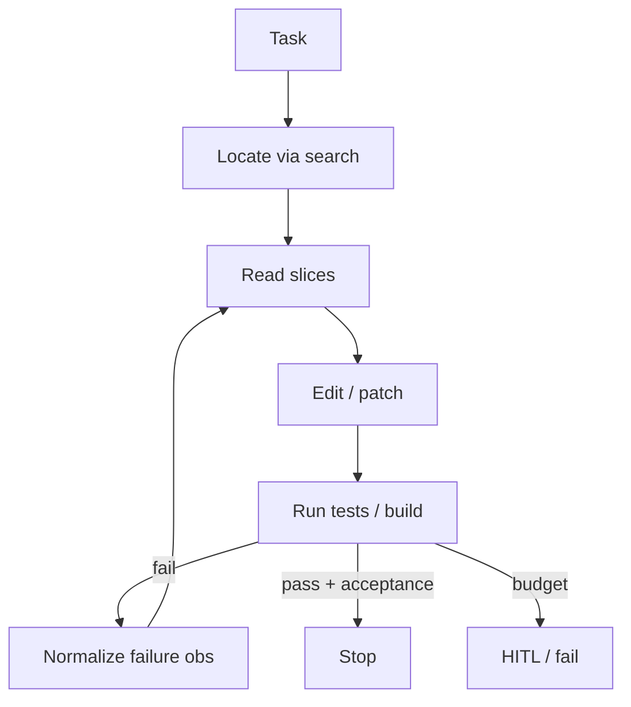

# Coding Agent（Canonical）

> **一句话主题**：Coding Agent 是在**仓库环境**中以 Tool Use + Agent Loop 闭环完成「检索 → 读写编辑 → 执行命令/测试 → 根据失败信号修复」的软件工程 Agent 形态。
>
> **状态**：Canonical · **Last reviewed**: 2026-10  
> **受众**：实现或评估软件工程 Agent / Coding Runtime 的工程师  
> **硬前置**：[Agent Loop](../../core/agent-loop/agent-loop.md)、[Tool Use](../../core/tool-use/tool-use.md)  
> **强烈建议**：[Context Engineering](../../core/context-engineering/context-engineering.md)  
> **边界模块（只链，不重写）**：[`runtime/sandbox`](../../runtime/sandbox/README.md) · [`production/security`](../../production/security/README.md)

---

## 范围 / 非目标

**范围**：软件工程 Agent 的定义与边界；仓库感知与检索；读写/编辑策略与 diff 可靠性；命令执行与测试—修复闭环；上下文预算（编码场景特化，机制回链 Context Engineering）；与 Sandbox/Security 的接口边界；失败模式；生产要点；评测切片；面试。

**非目标**：

| 主题 | 去哪里 |
|------|--------|
| Tool schema / 选择 / 执行管线正文 | [Tool Use](../../core/tool-use/tool-use.md) |
| 控制回路、终止、checkpoint 正文 | [Agent Loop](../../core/agent-loop/agent-loop.md) |
| 窗口装配、压缩、Observation Explosion 正文 | [Context Engineering](../../core/context-engineering/context-engineering.md) |
| 沙箱隔离实现手册 | [`runtime/sandbox`](../../runtime/sandbox/README.md) |
| 威胁模型 / 注入全文 | [`production/security`](../../production/security/README.md) |
| 某 IDE / 产品手册、功能对照表 | 本文明确禁止 |
| 语言语法教程、通用算法课 | 非本仓库职责 |

本文是 **垂直 Agent 形态**：在 Core 机制之上给出编码场景的状态、工具面约束与闭环策略；**不**平行重写 Tool Use / Loop / Sandbox / Security。

---

## 1. 定义：什么是 Coding Agent

### 1.1 工作定义

**Coding Agent（软件工程 Agent）** = 一个在受控开发环境中运行的 Agent，其目标是完成可验证的软件工程任务（修 bug、加功能、重构、诊断失败 CI 等），并通过工具对仓库产生**可审计副作用**。

最小能力集合：

1. **感知仓库**：定位相关文件、符号、依赖与历史线索（不必一次读完全仓）。
2. **读写编辑**：以受控方式修改文件树，输出可审查的变更（diff / patch）。
3. **执行与验证**：跑构建、测试、linter、类型检查等，把失败信号变成下一轮决策输入。
4. **闭环直至终止**：在预算内迭代修复，或显式失败/升级人类。

```text
Task → Locate → Read → Edit → Run(tests/build) → Observe → (Replan | Fix | Stop)
```

这与「单次代码补全」或「聊天里贴一段 snippet」不同：后者缺少**环境副作用 + 验证反馈**的 Loop。

### 1.2 与相邻形态

| 形态 | 主环境 | 主反馈 | 典型风险 |
|------|--------|--------|----------|
| Coding Agent | 仓库 + shell/测试 | 编译/测试/diff review | 破坏代码、泄密、无限修 |
| Chat-only coding help | 对话窗口 | 用户肉眼 | 幻觉 API、无法验证 |
| Browser / Computer Use | GUI / 网页 | 截图/DOM | 操作漂移、凭证 |
| Multi-Agent 编码 | 多角色协作 | 同上 + 协调 | 重复编辑冲突 |

Coding Agent 可以是 Multi-Agent 的一种 worker，但本文默认 **单 Agent + 工具面**；协作深文见 [`multi-agent`](../multi-agent/README.md)。

### 1.3 Mental Model

把 Coding Agent 想成 **带仓库句柄的闭环调试器**：

- **State**：当前任务、打开文件句柄、已应用 patch 集合、最近测试结果摘要、预算。
- **Tools**：检索、读文件、编辑、shell（受策略约束）、测试 runner。
- **Oracle**：测试/类型检查/静态分析（不完全可靠，但是最好的自动信号）。
- **Policy**：哪些路径可写、哪些命令可跑、何时必须 HITL。

模型负责假设与编辑意图；**执行器与策略**负责真实性、权限与副作用边界（机制见 Tool Use / Loop）。

### 1.4 何时用 / 何时不用

**适合**：

- 任务有可运行验证（至少单元测试或可复现失败命令）
- 变更范围可局部化，或可分解为可验证子目标
- 需要多步探索（搜 → 读 → 改 → 验）

**不适合（或先降级）**：

- 无任何验证信号、只能靠「感觉对」的大型设计讨论（用文档/规划，不必全权 Agent）
- 未配置权限/沙箱却要放开任意 `shell` 与写权限
- 纯语法补全 / 单行补丁（更轻的补全或单次 edit 即可）

工程建议与 Anthropic「从简单可组合模式起步、用评测证明再加复杂度」一致（[article-anthropic-building-effective-agents-2024](../../references/articles.md#article-anthropic-building-effective-agents-2024)）。

---

## 2. 与 Agent Loop / Tool Use 的接口（不重写机制）

### 2.1 Loop 特化

Coding Agent 的控制流仍是标准 Agent Loop（见 [agent-loop.md](../../core/agent-loop/agent-loop.md)），特化点在于：

| Loop 钩子 | Coding 特化 |
|-----------|-------------|
| Observe | 文件内容、检索命中、测试失败摘要、diff 状态 |
| Act | `search` / `read` / `edit` / `run` 等工具 |
| Termination | 测试绿 + 任务验收；或预算耗尽 / 人类接管 |
| Budget | 步数、token、shell 次数、可写路径、墙钟 |
| Verification | 测试、类型检查、lint、可选 review agent |

不要另造一套「Coding Loop 协议」；用 Loop 状态机 + 编码域 Observation 即可。

### 2.2 工具面特化

工具契约、校验、归一化、权限仍属 Tool Use（见 [tool-use.md](../../core/tool-use/tool-use.md)）。编码场景常见工具族：

| 族 | 副作用 | Observation 要点 |
|----|--------|------------------|
| Search / Grep / Symbol | 只读 | 路径 + 行号 + 短片段；禁整仓 dump |
| Read file / range | 只读 | 按行范围；大文件必须切片 |
| Apply patch / Edit | 写 | 成功/冲突/未匹配；返回统一 diff 视图 |
| Shell / Test | 进程+可能写 | exit code、截断后的 stdout/stderr |
| VCS（status/diff/commit） | 视策略 | 变更清单；commit 常需 HITL |

工具描述质量直接影响选错工具与无效编辑；迭代方法见 [article-anthropic-writing-tools-for-agents-2025](../../references/articles.md#article-anthropic-writing-tools-for-agents-2025)。



---

## 3. 仓库感知与检索

### 3.1 问题：仓库不是 Context

整仓塞进窗口既不可行也不必要。仓库是 **外置世界状态**；Context 只是每次调用的策展投影（机制见 [context-engineering.md](../../core/context-engineering/context-engineering.md)）。

Coding Agent 的仓库感知 = **可导航索引 + JIT 读取**：

1. **Repo map**：目录树摘要、语言/包管理器、入口、测试布局、关键配置（`package.json`、`pyproject.toml`、CI 工作流名等）。
2. **Symbol / text index**：grep、AST/LSP 符号、可选向量检索（代码 RAG）。
3. **Task-conditioned retrieval**：用失败栈、issue 描述、变更相关路径做查询。

### 3.2 检索策略（由粗到细）

推荐默认阶梯：

1. **结构化线索**：错误栈文件:行、失败测试名、PR 描述中的路径。
2. **精确文本检索**：符号名、错误字符串、API 名（高信号）。
3. **目录/依赖导航**：从入口或 `import` 图扩展到邻域。
4. **语义检索（可选）**：自然语言描述需求时；需防「相似但无关」污染。
5. **历史线索（可选）**：相关 commit / blame；成本高，默认后置。

**原则**：先拿 **句柄（path + range）**，再按需 `read`；禁止「搜索结果 = 全文粘贴进 messages」。

### 3.3 Repo Map 的最小有用内容

| 元素 | 用途 |
|------|------|
| 顶层目录与职责猜测 | 缩小搜索空间 |
| 构建/测试命令 | 验证闭环入口 |
| 主要语言与包管理器 | 选对工具链 |
| 忽略规则（`.gitignore` 外的约定） | 避免改生成物/vendor |
| 已知危险路径 | secrets、迁移、生产配置 |

Map 应 **短、可版本化、可刷新**；大仓用分层 map（根 + 子包）。

### 3.4 打开文件预算

同时「打开」过多文件会导致：

- Context 膨胀与中部丢失（见 Context Engineering）
- 编辑冲突与重复读取
- 模型在无关文件上浪费步数

实践预算示例（可配置，非教条）：

- 主动打开文件句柄 ≤ N（如 6–12）
- 单次 read ≤ M 行或 token
- 同文件重复 read 需增量（只读变更邻域）
- 检索 hits 每轮截断 Top-K，附「还有更多」句柄

### 3.5 代码检索 vs 文档 RAG

| | 代码检索 | 文档 RAG |
|--|----------|----------|
| 主键 | path / symbol / span | chunk / doc id |
| 正确性锚定 | 编译器/测试 | 引用与事实核验 |
| 常见污染 | 过时副本、生成代码、测试夹具误导 | 过时 wiki |

编码场景优先 **确定性检索**（grep/符号）；语义检索作补充，结果必须带回可点击路径。

---

## 4. 读写编辑策略与 Diff

### 4.1 读：切片而非吞咽

- 优先 `read(path, start, end)` 或「符号周围窗口」。
- 大文件：先结构大纲（函数列表）再定点读。
- Observation 归一化：保留行号；删除无关噪声（二进制、锁文件全文）。

**失败信号**：反复整文件读取同一路径；或读了但从未基于该内容编辑。

### 4.2 写：以 Patch 为中心

生产级编辑应优先 **结构化 patch**（unified diff / 带上下文的 apply），而非「整文件重写」：

| 策略 | 优点 | 风险 |
|------|------|------|
| Search-replace / 精确定位替换 | 局部、易审计 | 多处匹配歧义 |
| Unified diff apply | 标准、可 review | 上下文漂移导致 apply 失败 |
| 整文件 rewrite | 实现简单 | 幻觉大改、难 diff、易毁格式 |
| AST/LSP rename | 语义正确 | 工具链重；覆盖面有限 |

**默认**：小步局部编辑 → 立即验证 → 再扩范围。跨多文件重构应显式计划，并分批提交可回滚单元。

### 4.3 Diff 可靠性工程

Apply 失败是**常态**，不是异常。Executor 必须：

1. 校验目标文件版本/哈希（或基准内容）再应用。
2. 失败时返回：期望上下文、实际上下文、冲突类型（`context_mismatch` / `already_applied` / `ambiguous`）。
3. 禁止静默「近似应用」导致半残文件。
4. 成功后回传 **统一 diff 摘要**（非整文件）供模型与人类审查。

```text
edit_request → validate_target → apply_atomic → compute_diff → obs
                 ↓ fail
            structured_error_obs → model replan
```

### 4.4 编辑策略启发式

- **先复现再修改**：能跑红测/复现命令时，不要先大改架构。
- **最小可行 diff**：满足测试与任务验收即可；抑制「顺手重构」。
- **保持风格**：跟随邻域格式；格式化交给 formatter 工具而非模型手调空格。
- **生成物与锁文件**：默认只读；变更依赖走显式工具与策略。
- **测试与实现同批**：修 bug 时优先补/改失败测试，再改实现（若仓库文化允许）。

### 4.5 多文件一致性

多文件变更的典型失败：只改调用方或只改定义。缓解：

- State 中维护 `pending_touch_set`（相关符号跨文件列表）
- 编辑后强制跑相关测试子集，再考虑全量
- 大改动用 checklist Observation（「接口 X 的 N 处引用是否已处理」）

---

## 5. 命令执行与测试—修复闭环

### 5.1 命令执行的角色

`shell` / `run_tests` 不是「随便执行用户幻想」，而是 **受策略约束的验证与探索通道**：

- 允许：项目约定的 test/build/lint、只读诊断（`git status`、`rg`）
- 谨慎：安装依赖、数据库迁移、长跑集成测
- 默认拒绝：任意外网、密钥读取、破坏性 rm、提升权限（细节链 Sandbox/Security）

命令 Observation 必须包含：`exit_code`、截断后的 stdout/stderr、耗时、工作目录；大日志外置存句柄。

### 5.2 测试作为 Oracle

测试（及类型检查）是 Coding Agent 最强的自动终止/纠偏信号：

```text
hypothesis → edit → select_test_target → run → 
  pass? → broaden_or_accept
  fail? → parse_failure → narrow_read → edit
```

**测试选择**：

1. 失败用例 / 最近修改邻域的单测（快速闭环）
2. 相关包/模块测试
3. 全量 CI 子集（预算允许时）

避免每步全仓 `npm test` 导致延迟与日志爆炸。

### 5.3 修复闭环的控制旋钮

| 旋钮 | 作用 |
|------|------|
| max_fix_iterations | 防止在同一失败上空转 |
| same_error_streak | 相同错误指纹连续出现 → 强制换策略或 HITL |
| test_timeout | 单次命令上限 |
| flaky_retry | 仅对已知 flaky 指纹有限重试 |
| regression_gate | 修 A 不得无故破坏 B（相关测子集） |

错误指纹建议：测试名 + 断言摘要 + 顶层栈帧（规范化路径），用于去重与 streak 检测。

### 5.4 失败解析（Observation 工程）

原始测试日志对模型往往过噪。归一化优先级：

1. 失败测试名与断言 diff
2. 顶层应用栈（过滤框架内部）
3. 相关期望/实际值
4. 可选：指向源文件的建议路径

禁止每轮回灌完整 CI 日志（Observation Explosion，见 Context Engineering）。

### 5.5 「绿测」不是充分条件

测试绿仍可能：

- 测错了东西 / 断言过弱
- 改了测试迁就错误实现
- 未覆盖安全/性能回归

生产系统应叠加：静态策略（禁止删断言）、可选第二模型 review、人类对高危 diff 的确认。

---

## 6. 上下文预算（编码场景；机制回链）

编码 Agent 是 Context 压力最大的形态之一：文件切片、工具输出、测试日志、多轮 diff 历史会快速占满窗口。

**机制正文**在 [context-engineering.md](../../core/context-engineering/context-engineering.md)。此处仅列编码特化策略：

| 分区 | 编码建议 |
|------|----------|
| 系统/任务 | 稳定；含仓库约定与禁止项 |
| 活动句柄 | 当前打开 path+range；非全文 |
| Diff 视图 | 累计 unified diff 或自上次验证以来的增量 |
| 测试摘要 | 最近失败指纹 + 归一化栈；旧日志驱逐 |
| 检索 hits | Top-K + 句柄；详情 JIT |
| 工具 schema | 按任务裁剪工具面（少而精） |

**硬规则**：

- More files ≠ Better coding
- 禁止整仓 / 整日志进 Context
- 长程任务：compaction 保留「目标、约束、已尝试假设、当前 diff 句柄、未解决问题」（见 Anthropic context 文：[article-anthropic-context-engineering-2025](../../references/articles.md#article-anthropic-context-engineering-2025)）

与前缀缓存、摘要策略的通用权衡不在此展开。

---

## 7. 与 Sandbox / Security 的边界（只链）

Coding Agent **依赖**隔离与安全策略，但不在本文实现它们。

| 关注点 | 归属 |
|--------|------|
| 进程/FS/网络隔离、生命周期 | [`runtime/sandbox`](../../runtime/sandbox/README.md) |
| 威胁模型、注入、权限、泄密 | [`production/security`](../../production/security/README.md) |
| 工具鉴权钩子、危险工具分类 | [Tool Use](../../core/tool-use/tool-use.md) §权限 |

编码侧必须遵守的**接口约定**（不展开实现）：

1. 所有写与 shell 经 Executor 策略；模型不能直达宿主机。
2. 密钥、`.env`、凭证路径默认不可读或脱敏。
3. 出站网络默认拒绝或允许列表。
4. 高危操作（force push、生产迁移、广域删除）默认 HITL。
5. 不可信仓库内容（README、注释、网页）可能含间接注入——按 Security 模块防护，不因「在写代码」而豁免。

---

## 8. 失败模式

### 8.1 目录

| ID | 失败模式 | 检测信号 | 缓解 |
|----|----------|----------|------|
| F1 | 仓库漫游 | 步数↑、无编辑、检索发散 | 任务锚定、map、步数预算 |
| F2 | 上下文胀死 | token↑、决策质量↓ | 切片、摘要、驱逐日志 |
| F3 | Patch 幻觉 | apply 连续失败 | 结构化错误、重读邻域、缩小 patch |
| F4 | 整文件重写灾难 | 巨大无关 diff | 禁 rewrite 默认；formatter 分离 |
| F5 | 测试迁就 | 断言被删/弱化 | 策略拦截、diff review |
| F6 | 修 A 毁 B | 相关测回归 | regression_gate |
| F7 | 错误空转 | same_error_streak | 换检索/假设；HITL |
| F8 | 命令面过大 | 危险命令尝试 | 允许列表、Sandbox |
| F9 | 秘密外泄 | 读/打印 env | 路径策略、观测脱敏 |
| F10 | 伪完成 | 声称完成但测未跑 | 终止条件绑定验证证据 |
| F11 | 工具选错 | 该 grep 却 shell cat 全仓 | 工具描述与评测迭代 |
| F12 | 忽略生成物/vendor | 无意义巨 diff | ignore 策略 |

### 8.2 「看起来在干活」反模式

- 反复 `ls` / 读无关 README
- 每次失败都扩大搜索半径而不形成假设
- 用聊天口吻向用户解释计划却不调用验证工具
- 在 Observation 里塞完整 `node_modules` 路径列表

用轨迹指标：`edits_per_1k_tokens`、`unique_files_touched`、`tests_run`、`error_fingerprint_entropy`。

---

## 9. 生产要点

### 9.1 运行时组件（编码切片）

```text
Gateway → CodingAgentRuntime
            ├─ Loop Controller（预算/终止）
            ├─ Context Builder（编码策略包）
            ├─ Tool Executor（read/edit/shell…）
            ├─ Repo Index / LSP bridge
            ├─ Artifact Store（日志、diff、句柄）
            ├─ Policy Engine（路径/命令/HITL）
            └─ Telemetry（轨迹、成本、失败指纹）
```

Sandbox 与密钥管理作为 sidecar/依赖接入，不在 Coding 模块内实现。

### 9.2 可观测性

至少记录：

- 任务 id、模型、策略版本
- 每步工具名、参数摘要、时延、token
- 每次 edit 的 diff hash 与路径
- 测试命令、exit code、错误指纹
- 终止原因（success / budget / policy / user_cancel）

无轨迹则无法做 SWE 类评测归因或事故回放。

### 9.3 成本与延迟

编码任务成本由「步数 ×（检索+读+生成+测试）」主导。杠杆：

- 更快的失败测试子集
- 更小的工具面与更短 Observation
- 缓存 repo map / 索引，而非缓存整仓进模型
- 并行只读检索；写与测试串行

### 9.4 HITL 与交付物

面向生产/共享仓库时，交付物通常是：

1. 可审查的 diff（PR）
2. 验证证据（测过什么、结果）
3. 未解决问题与风险说明

「Agent 直接 push main」应是显式高危策略，而非默认。

### 9.5 评测切片（编码）

| 层 | 测什么 |
|----|--------|
| 单元 | patch apply、日志归一化、策略拒绝 |
| 轨迹 | 给定失败测能否在预算内变绿 |
| 基准 | SWE-bench 类 / 内部缺陷集 |
| 安全 | 注入、秘密路径、危险命令红队 |
| 回归 | 同任务重复跑的稳定性 |

评测体系全文见 [`production/evaluation`](../../production/evaluation/README.md)；此处只要求 Coding Agent **自带可复现任务夹具**。

---

## 10. 与其他模块的关系

| 模块 | 关系 |
|------|------|
| [Tool Use](../../core/tool-use/tool-use.md) | 工具契约与执行；本文定义编码工具族需求 |
| [Agent Loop](../../core/agent-loop/agent-loop.md) | 控制回路；本文给编码 Observation/终止特化 |
| [Context Engineering](../../core/context-engineering/context-engineering.md) | 窗口策展；本文给编码预算策略 |
| [Reasoning / Planning](../../core/reasoning-planning/reasoning-planning.md) | 多文件重构时的计划/重计划 |
| [RAG](../../core/rag/rag.md) | 可选语义代码检索；非默认主路径 |
| [Memory](../../core/memory/memory.md) | 跨会话偏好/仓库惯例；默认谨慎写入 |
| Sandbox / Security | 隔离与威胁模型；只链 |
| [`practice/agent-projects`](../../practice/agent-projects/README.md) | 动手项目落点 |

---

## 11. Interview Questions

### Beginner

**Q1. 什么是 Coding Agent？与「聊天写代码」差在哪？**  
- **短答**：在仓库环境里用工具闭环完成可验证工程任务；聊天缺环境副作用与自动验证。  
- **详解**：检索→编辑→测试→修复是核心环。  
- **追问**：没有测试时还能叫 Coding Agent 吗？  
- **常见错误**：把单次补全当 Agent。  
- **相关**：§1。

**Q2. Coding Agent 硬前置为何是 Loop 与 Tool Use？**  
- **短答**：没有工具执行与观察回灌就没有工程闭环；没有 Loop 就没有多步终止与预算。  
- **详解**：本文只特化，不重写二者。  
- **追问**：缺 Context Engineering 会怎样？  
- **常见错误**：在垂直文档重讲 schema。  
- **相关**：§2。

**Q3. 为什么不能把整个仓库放进 prompt？**  
- **短答**：窗口/成本/注意力有限；仓库是外置状态。  
- **详解**：用 map + JIT read。  
- **追问**：长上下文模型是否改变结论？  
- **常见错误**：More context = Better。  
- **相关**：§3、§6、Context Engineering。

**Q4. Repo map 最少应包含什么？**  
- **短答**：布局、语言/包管理、测试与构建入口、危险路径约定。  
- **详解**：短且可刷新。  
- **追问**：monorepo 怎么做？  
- **常见错误**：把 map 做成全文件列表。  
- **相关**：§3.3。

**Q5. 读文件的最佳默认策略？**  
- **短答**：按行/符号切片，保留行号。  
- **详解**：大文件先大纲。  
- **追问**：何时整文件读？  
- **常见错误**：每次 cat 全文件。  
- **相关**：§4.1。

**Q6. 为什么偏好 patch 而不是整文件重写？**  
- **短答**：可审计、爆破半径小、易失败可诊断。  
- **详解**：rewrite 易幻觉大改。  
- **追问**：小文件是否可例外？  
- **常见错误**：为「省事」默认 rewrite。  
- **相关**：§4.2。

**Q7. apply patch 失败时 Executor 应返回什么？**  
- **短答**：结构化冲突类型与期望/实际上下文，而非静默成功。  
- **详解**：禁止模糊近似应用。  
- **追问**：`already_applied` 怎么处理？  
- **常见错误**：返回「出错了」无细节。  
- **相关**：§4.3。

**Q8. 测试在闭环里扮演什么角色？**  
- **短答**：自动 Oracle：纠偏与终止证据。  
- **详解**：不等于充分正确性。  
- **追问**：只有类型检查没有单测呢？  
- **常见错误**：声称完成却未跑验证。  
- **相关**：§5。

**Q9. 什么是错误指纹？**  
- **短答**：用于去重与 streak 检测的失败规范化键。  
- **详解**：测试名+断言+顶栈。  
- **追问**：指纹过粗/过细的后果？  
- **常见错误**：用整段日志当指纹。  
- **相关**：§5.3。

**Q10. Sandbox 与 Coding Agent 文档如何分工？**  
- **短答**：Coding 定义业务闭环；Sandbox 实现隔离。  
- **详解**：本文只链接口约定。  
- **追问**：没有沙箱能否上线任意 shell？  
- **常见错误**：在 Coding 文写容器手册。  
- **相关**：§7。

### Intermediate

**Q11. 设计由粗到细的仓库检索阶梯。**  
- **短答**：栈/测试名 → 精确文本 → 依赖邻域 → 可选语义 → 可选历史。  
- **详解**：每步产出句柄非全文。  
- **追问**：语义检索何时害处大于收益？  
- **常见错误**：第一步就向量搜全仓。  
- **相关**：§3.2。

**Q12. 打开文件预算怎么定？**  
- **短答**：限制句柄数、单次 read 大小、重复读增量。  
- **详解**：与 Context 分区联动。  
- **追问**：多文件重构如何临时提高预算？  
- **常见错误**：无驱逐只追加。  
- **相关**：§3.4、§6。

**Q13. 如何防止「删断言让测试变绿」？**  
- **短答**：策略检测测试弱化 + review + 回归集。  
- **详解**：终止条件看证据质量。  
- **追问**：合法删除过时测试如何放行？  
- **常见错误**：只看 exit code。  
- **相关**：§5.5、F5。

**Q14. 本地快速测与 CI 全量如何分工？**  
- **短答**：闭环用邻域子集；合并前/定期跑更广门禁。  
- **详解**：预算与延迟权衡。  
- **追问**：子集漏测怎么办？  
- **常见错误**：每步全量 CI。  
- **相关**：§5.2。

**Q15. 多文件接口变更如何降低半残状态？**  
- **短答**：pending_touch_set + 分批可回滚 + 相关测门禁。  
- **详解**：先计划后编辑。  
- **追问**：中途预算耗尽如何交付？  
- **常见错误**：一次改二十文件不验证。  
- **相关**：§4.5。

**Q16. Observation 里测试日志如何裁剪？**  
- **短答**：失败名、断言 diff、应用栈；外置全量。  
- **详解**：防 Observation Explosion。  
- **追问**：需要看中间打印怎么办？  
- **常见错误**：整份 surefire/jest 报告回灌。  
- **相关**：§5.4、Context。

**Q17. 工具面为何要「少而精」？**  
- **短答**：降低选错与描述重叠；省 schema token。  
- **详解**：用评测迭代工具描述。  
- **追问**：何时代码检索要拆成多工具？  
- **常见错误**：暴露通用 bash 替代一切。  
- **相关**：§2.2、Anthropic tools 文。

**Q18. flaky 测试会怎样破坏 Agent？**  
- **短答**：错误信号导致无效修复或空转。  
- **详解**：有限重试 + 指纹隔离 + 上报。  
- **追问**：如何区分 flaky 与真回归？  
- **常见错误**：无限重跑直到偶发绿。  
- **相关**：§5.3。

**Q19. 编码 Context 分区如何排优先级？**  
- **短答**：任务约束 > 当前失败摘要/diff > 活动句柄 > 旧日志。  
- **详解**：驱逐低信号检索 hits。  
- **追问**：系统提示过长怎么办？  
- **常见错误**：平均截断丢掉失败栈。  
- **相关**：§6。

**Q20. 何时必须 HITL？**  
- **短答**：高危副作用、秘密边界、策略不确定、连续空转。  
- **详解**：默认不直接进受保护分支。  
- **追问**：HITL 应展示哪些证据？  
- **常见错误**：所有编辑都打断用户。  
- **相关**：§7、§9.4。

### Advanced

**Q21. 如何设计编码 Agent 的终止条件？**  
- **短答**：验收绑定验证证据 + 预算 + 策略中止；禁纯自然语言宣称。  
- **详解**：可配置「测绿且 diff 非空」等。  
- **追问**：无测试仓库如何定义验收？  
- **常见错误**：模型说 done 就停。  
- **相关**：§2.1、F10。

**Q22. same_error_streak 阈值后应换哪些策略？**  
- **短答**：重读邻域、换检索查询、回滚最近 diff、缩小范围、HITL。  
- **详解**：记录已尝试假设防重复。  
- **追问**：如何避免过早 HITL？  
- **常见错误**：同参重试同一 edit。  
- **相关**：§5.3、F7。

**Q23. 把 LSP/AST 工具引入的收益与成本？**  
- **短答**：语义重命名/引用准确；成本是工具链与环境依赖。  
- **详解**：文本 patch 仍是底座。  
- **追问**：多语言 monorepo 怎么办？  
- **常见错误**：无 LSP 就无法做 Coding Agent。  
- **相关**：§4.2。

**Q24. 如何评测「检索质量」对修 bug 的影响？**  
- **短答**：消融：无检索 / 仅 grep / +语义；看步数与成功率。  
- **详解**：固定编辑与测试预算。  
- **追问**：指标用 recall@k 够吗？  
- **常见错误**：只评检索不评端到端。  
- **相关**：§9.5。

**Q25. 设计对「危险命令」的分层策略。**  
- **短答**：允许列表、参数校验、网络/FS 策略、HITL 级。  
- **详解**：实现落 Sandbox/Security；Coding 只消费决策。  
- **追问**：`curl | sh` 如何拦？  
- **常见错误**：黑名单字符串匹配当唯一防线。  
- **相关**：§7。

**Q26. 间接注入如何出现在仓库里？**  
- **短答**：恶意 README/注释/测试夹具诱导外泄或危险命令。  
- **详解**：工具结果不可视为可信指令。  
- **追问**：与用户任务冲突时谁优先？  
- **常见错误**：认为「本地代码可信」。  
- **相关**：Security、§7。

**Q27. 长程重构任务的 compaction 应保留什么？**  
- **短答**：目标、约束、已触达模块、当前 diff 句柄、未决问题、失败假设。  
- **详解**：丢细节日志保决策态。  
- **追问**：如何验证 compaction 无损？  
- **常见错误**：只摘要聊天语气。  
- **相关**：§6、Anthropic context 文。

**Q28. 并行工具调用在编码场景的安全边界？**  
- **短答**：并行只读检索；写/测试默认串行。  
- **详解**：避免并行 edit 同文件。  
- **追问**：并行跑无关测试包？  
- **常见错误**：并行 apply 两 patch。  
- **相关**：Tool Use 并行节、§4。

**Q29. 如何检测「仓库漫游」？**  
- **短答**：无 edit 的高步数、文件触达熵高、与任务路径距离远。  
- **详解**：触发重新锚定或终止。  
- **追问**：探索性任务如何放宽？  
- **常见错误**：把任何 ls 当漫游。  
- **相关**：F1、§8.2。

**Q30. 编码 Agent 与 Memory 模块如何接？**  
- **短答**：跨会话可记仓库惯例/用户偏好；默认不记密钥与全量 diff。  
- **详解**：写闸严格。  
- **追问**：团队共享记忆的冲突？  
- **常见错误**：把整次轨迹当长期记忆。  
- **相关**：Memory。

### Expert

**Q31. 设计可插拔「验证器」接口。**  
- **短答**：`run(scope) -> normalized_report`；支持 unit/type/lint/custom。  
- **详解**：Agent 只依赖报告 schema。  
- **追问**：如何插件化覆盖率门禁？  
- **常见错误**：把 npm 字符串写死进 Loop。  
- **相关**：§5。

**Q32. 在不可信依赖安装场景如何降险？**  
- **短答**：沙箱、网络策略、锁文件审核、禁 postinstall 或隔离。  
- **详解**：安装本身是高危工具。  
- **追问**：必须升级依赖修 CVE 时流程？  
- **常见错误**：Agent 任意 `npm i` 上生产机。  
- **相关**：§7、Sandbox。

**Q33. 如何把人类 code review 信号闭环回 Agent？**  
- **短答**：评论结构化为新任务 Observation；限定触达文件。  
- **详解**：防范围漂移。  
- **追问**：冲突评论怎么仲裁？  
- **常见错误**：把整页 PR 讨论无裁剪塞进上下文。  
- **相关**：§6、§9.4。

**Q34. 多 Agent（作者/测试者/审查者）何时值得？**  
- **短答**：当单轨迹评测证明瓶颈在角色冲突且协调成本可承受。  
- **详解**：先简后繁。  
- **追问**：审查者与作者共享何状态？  
- **常见错误**：未评测就上三角色。  
- **相关**：multi-agent、Anthropic effective agents。

**Q35. 设计 diff 质量指标。**  
- **短答**：无关行占比、文件数、测试弱化检测、格式噪声比、回滚率。  
- **详解**：与成功率一并看。  
- **追问**：自动 refactor 如何豁免部分指标？  
- **常见错误**：只看「有没有 diff」。  
- **相关**：§4、§9。

**Q36. 轨迹级强化学习/拒识训练对 Coding Agent 的数据需求？**  
- **短答**：需要带验证标签的成功/失败轨迹与偏好对；奖励稀疏。  
- **详解**：工程上先规则+评测；训练另轨。  
- **追问**：过程奖励如何设计？  
- **常见错误**：用「用户点赞」当唯一奖励。  
- **相关**：evaluation、runtime/RL README。

**Q37. 跨语言 monorepo 的工具路由？**  
- **短答**：按路径/包管理器选 runner 与格式化；统一 Observation schema。  
- **详解**：repo map 分层。  
- **追问**：共享 protobuf 变更如何门禁？  
- **常见错误**：单一 `test` 脚本假装统一。  
- **相关**：§3、§5。

**Q38. 如何防止 Agent「修测试环境」掩盖产品 bug？**  
- **短答**：路径策略限制测试夹具外的 infra；变更分类审计。  
- **详解**：产品代码 vs 测试 vs 工具链分权。  
- **追问**：合法修 flake 基础设施？  
- **常见错误**：任意改 CI yaml 追求绿。  
- **相关**：F5、§9。

**Q39. 编码场景下的成本防火墙设计。**  
- **短答**：步数/token/shell/墙钟配额；超限降级只读或 HITL。  
- **详解**：与租户计费联动。  
- **追问**：接近上限如何保留可提交 diff？  
- **常见错误**：只限 RPM。  
- **相关**：§9.3、Loop 预算。

**Q40. Audit 声称「自主修仓库」的系统。**  
- **短答**：查：验证绑定终止、patch 原子性、策略、轨迹、沙箱、评测集。  
- **详解**：对照本文失败模式表。  
- **追问**：缺哪一项最危险？  
- **常见错误**：演示视频当证据。  
- **相关**：§8、§9。

### System Design

**Q41. 设计生产 Coding Agent Runtime。**  
- **短答**：Loop + Context 策略包 + 工具执行器 + 索引 + 策略引擎 + 产物存储 + 遥测；Sandbox 外接。  
- **详解**：见 §9.1。  
- **追问**：多租户仓库凭证如何隔离？  
- **常见错误**：模型进程内直接 fs 写。  
- **相关**：§9。

**Q42. 设计内部「迷你 SWE-bench」。**  
- **短答**：真实缺陷夹具、失败复现命令、隐藏测试、预算上限、轨迹评分。  
- **详解**：防数据泄漏到训练/提示。  
- **追问**：如何持续扩充题库？  
- **常见错误**：只用玩具字符串替换题。  
- **相关**：§9.5。

**Q43. 设计安全默认的编辑工具 API。**  
- **短答**：`apply_patch` + 原子写 + 冲突 schema + 路径允许列表 + diff 回传。  
- **详解**：可选 LSP 作为上层。  
- **追问**：二进制文件策略？  
- **常见错误**：`write_full_file` 当唯一 API。  
- **相关**：§4。

**Q44. 设计「失败驱动」上下文装配。**  
- **短答**：以最新错误指纹为锚，拉取相关 span 与 diff 增量，驱逐过时成功日志。  
- **详解**：Context Builder 策略包。  
- **追问**：多失败并存如何排序？  
- **常见错误**：FIFO 截断切掉当前失败。  
- **相关**：§6、Context。

**Q45. 从「能补丁单文件」演进到「可护航 PR」的里程碑。**  
- **短答**：P0 局部 edit+单测 → P1 检索/map → P2 策略+沙箱 → P3 轨迹评测 → P4 HITL/PR 交付与回归门禁。  
- **详解**：每阶段用失败模式表验收。  
- **追问**：哪一阶段不可跳过？  
- **常见错误**：P0 直接上无限 shell 与自动 merge。  
- **相关**：§1.4、§9。

---

## 12. Cross References

- 硬前置：[Agent Loop](../../core/agent-loop/agent-loop.md) · [Tool Use](../../core/tool-use/tool-use.md)  
- 强烈建议：[Context Engineering](../../core/context-engineering/context-engineering.md)  
- 规划深文：[Reasoning & Planning](../../core/reasoning-planning/reasoning-planning.md)  
- 边界：[`runtime/sandbox`](../../runtime/sandbox/README.md) · [`production/security`](../../production/security/README.md) · [`production/evaluation`](../../production/evaluation/README.md) · [`production/observability`](../../production/observability/README.md)  
- 兄弟形态：[`browser-computer-use`](../browser-computer-use/README.md) · [`multi-agent`](../multi-agent/README.md)  
- 实践：[`practice/agent-projects`](../../practice/agent-projects/README.md) · [`research/industry-practices`](../../research/industry-practices/README.md)

---

## 13. References

- [article-anthropic-building-effective-agents-2024](../../references/articles.md#article-anthropic-building-effective-agents-2024)  
- [article-anthropic-writing-tools-for-agents-2025](../../references/articles.md#article-anthropic-writing-tools-for-agents-2025)  
- [article-anthropic-context-engineering-2025](../../references/articles.md#article-anthropic-context-engineering-2025)  
- [article-earendil-prompt-caching-in-agents-2026](../../references/articles.md#article-earendil-prompt-caching-in-agents-2026)（提示缓存如何约束工具加载、会话分支与「继续」成本；笔记 [earendil/prompt-caching-in-agents](../../research/industry-practices/earendil/prompt-caching-in-agents.md)）  
- [talk-karpathy-software-changing-again-2025](../../references/talks.md#talk-karpathy-software-changing-again-2025)（partial autonomy / 「为 Agent 构建」基础设施直觉）  
- [talk-karpathy-how-i-use-llms-2025](../../references/talks.md#talk-karpathy-how-i-use-llms-2025)（工具化工作流与代码执行用法面；非生产架构规范）  
- 机制回链：[Agent Loop](../../core/agent-loop/agent-loop.md) · [Tool Use](../../core/tool-use/tool-use.md) · [Context Engineering](../../core/context-engineering/context-engineering.md) · [llm-inference §5](../../runtime/llm-inference/llm-inference.md)

---

## 14. Self-review / TODOs

- [x] 定义、仓库感知、编辑/diff、测试闭环、上下文预算（只链机制）、Sandbox/Security 边界  
- [x] 失败模式、生产要点、45 面试题、Anthropic tools/context 引用  
- [x] 未重写 Tool Use / Loop / Sandbox / Security 正文；无 IDE 产品软文  
- [ ] TODO: Verify — 内部缺陷集与公开 SWE-bench 衍生集的具体题库治理流程  
- [ ] TODO: Verify — 各语言 LSP/测试 runner 适配矩阵（不阻塞本 Canonical）
