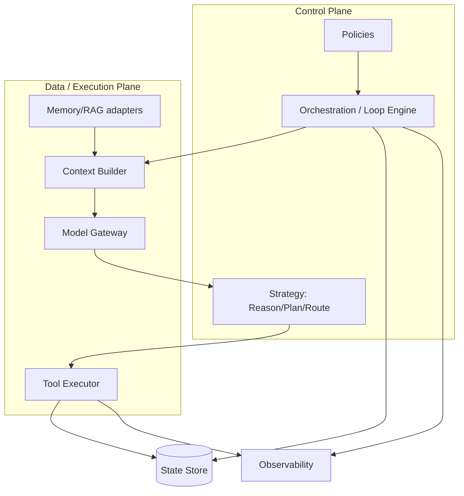
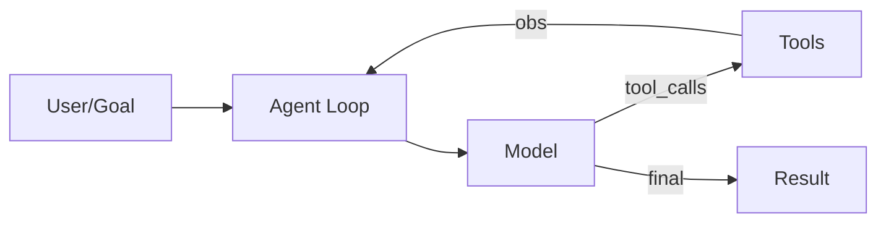
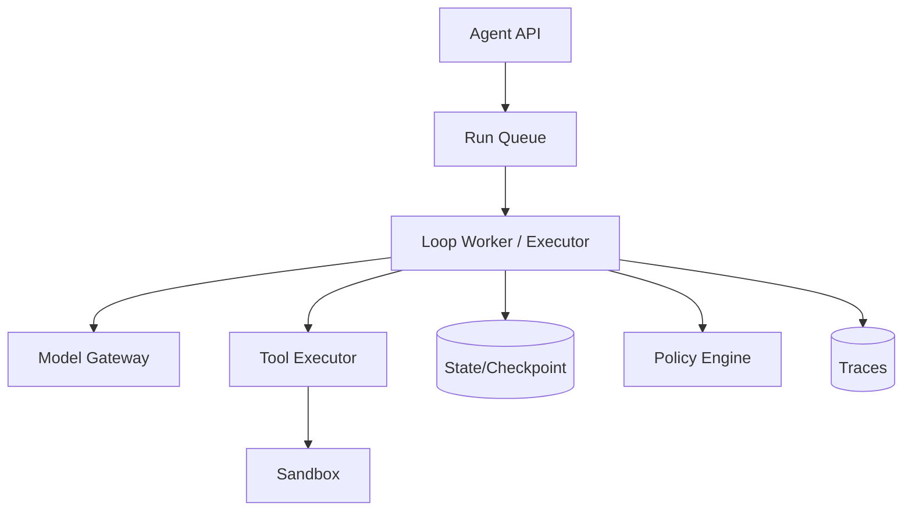
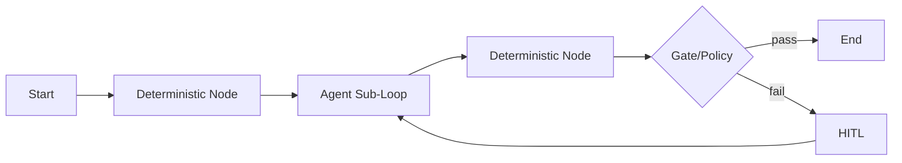
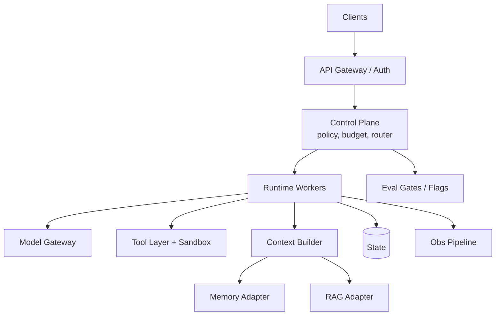

# Agent Architecture（Canonical）

> **一句话主题**：Agent Architecture 回答如何把 Model、Context、Reasoning/Planning、Tools、Memory、Runtime、State、Policies、Observability **组装成可运行、可演化、可运维的 Agent System**——而不是某个框架的 API 说明书。
>
> **状态**：Canonical · **Last reviewed**: 2026-10  
> **受众**：做系统设计、Runtime 选型与生产落地的工程师  
> **硬前置**：[Tool Use](../tool-use/tool-use.md) · [Agent Loop](../agent-loop/agent-loop.md) · [Reasoning & Planning](../reasoning-planning/reasoning-planning.md)  
> **路径说明**：模块目录为 `core/agent-architecture/`（仓库基线）；本文即该模块 Source of Truth。

---

## 范围 / 非目标

**范围**：架构定义；Agent vs LLM App vs Workflow；单 Agent 与常见拓扑；Runtime / State / Control-Data Plane；生产关注点（隔离、恢复、并发、扩展、成本）；架构权衡；评测与面试。

**非目标（只链接接口，不写深文）**：

| 主题 | 位置 |
|------|------|
| 工具执行管线 | [Tool Use](../tool-use/tool-use.md) |
| 控制回路细节 | [Agent Loop](../agent-loop/agent-loop.md) |
| 计划/反思/校验策略 | [Reasoning & Planning](../reasoning-planning/reasoning-planning.md) |
| Memory 实现深文 | [Memory Canonical](../memory/memory.md) |
| RAG 实现深文 | [RAG Canonical](../rag/rag.md) |
| Context 实现 | [`context-engineering`](../context-engineering/context-engineering.md) |
| MCP 协议 | [`protocols/mcp`](../../protocols/mcp/README.md) |
| Multi-Agent 深潜 | [`multi-agent.md`](../../agent-types/multi-agent/multi-agent.md) |
| 模式清单长文 | [`design-patterns`](../../production/design-patterns/README.md) |
| 部署拓扑百科 | [`infrastructure`](../../production/infrastructure/README.md) |
| RL 训练 | [`reinforcement-learning`](../../runtime/reinforcement-learning/README.md) |

**框架立场**：LangGraph / Agents SDK / 厂商「agent patterns」= **implementation examples**，映射回本文概念；不以框架 API 当理论。细节未核实处标 `TODO: Verify`。

---

## 1. Agent Architecture Definition

**Agent Architecture** = 系统组件、控制流、数据流、状态所有权与策略边界的稳定结构，使得：

1. 模型能在受控动作空间中决策（Tools）  
2. 决策在受预算约束的回路中推进（Loop）  
3. 可选策略层改善决策（Reasoning/Planning）  
4. 运行时可恢复、可观测、可隔离失败（Runtime）  

```text
Agent
├── Model              # 生成决策 / 结构化调用
├── Context            # 进入模型窗口的信息装配
├── Reasoning          # 决策前/中的信息加工（策略）
├── Planning           # 可选的显式意图结构（策略）
├── Tools              # 动作面 + 执行
├── Memory             # 跨回合/长期状态延伸
├── Runtime            # 托管循环、队列、超时、恢复
├── State              # 单次 run 的真相载体
├── Policies           # 权限、预算、安全、路由规则
└── Observability      # 轨迹、指标、审计
```

Anthropic 将 **workflows**（预定义编排）与 **agents**（模型动态决定过程与工具使用）区分，并主张简单可组合、按评测加复杂度（[article-anthropic-building-effective-agents-2024](../../references/articles.md#article-anthropic-building-effective-agents-2024)）。本文把这些选择上升为 **架构决策**。

---

## 2. 分层职责、边界、输入输出

| 层 | 职责 | 边界（不做什么） | 输入 | 输出 | 依赖 |
|----|------|------------------|------|------|------|
| **Model** | 在给定 Context+Tools schema 下生成决策 | 不直接执行副作用 | messages, tools, params | text / tool_calls | Inference 网关 |
| **Context** | 选择/压缩/排列进入窗口的信息 | 不是长期存储本体 | State, Memory hit, RAG hit, tool obs | prompt 视图 | Context Eng.（待 Canonical） |
| **Reasoning** | 改变决策分布的信息加工 | 不是 Loop；不是 CoT 堆砌 | State, Goal | 中间结论 / 决策倾向 | [Reasoning](../reasoning-planning/reasoning-planning.md) |
| **Planning** | 构造/更新可选 Plan 对象 | 不是控制回路 | Goal, Constraints, State | Plan | 同上 |
| **Tools** | 声明、鉴权、执行、观察归一化 | 不是 MCP 协议全文 | tool_calls | observations | [Tool Use](../tool-use/tool-use.md) |
| **Memory** | 跨 run/长程读写 | 不是本 run transcript 全部 | 查询/写入请求 | 记忆切片 | [memory.md](../memory/memory.md) |
| **Runtime** | 生命周期、调度、持久化、取消 | 不是业务策略本身 | run 请求 | run 状态机推进 | Loop + Infra |
| **State** | 单 run 可序列化真相 | 不是全部企业知识库 | 事件 | 新 State | Checkpoint store |
| **Policies** | 硬约束与路由 | 不是模型「自觉」 | decision 候选 | allow/deny/HITL/rewrite | Security/Authz |
| **Observability** | 使行为可追责可调试 | 不是评测数据集本身 | spans/events | traces/metrics/logs | obs README |



---

## 3. Agent vs LLM Application vs Workflow

| | LLM Application | Workflow | Agent |
|--|-----------------|----------|-------|
| 控制权 | 多为单次/固定提示 | **代码/图预先定义路径** | **模型在回路中动态选动作** |
| 工具 | 可选、常单次 | 节点上固定调用 | 模型选择 + 执行器执行 |
| 状态 | 会话或无 | 工作流引擎状态 | Agent run state + 可选 Memory |
| 终止 | 一次生成结束 | 图到达终态 | 预算/目标/策略终止（见 Loop） |

**Agentic Workflow**：在 Workflow 的预定义骨架中嵌入局部 Agent 回路（某些节点是「迷你 Loop」）。适合：整体合规路径固定，局部需要智能探索。

### 何时用 Workflow / Agent / 混合？

| 选择 | 条件 |
|------|------|
| **Workflow** | 步骤稳定、合规要求路径可审计、失败分支可枚举、延迟敏感 |
| **Agent** | 路径不可穷举、需工具探索、目标开放但可验证 |
| **混合（Agentic Workflow）** | 主干固定 + 局部开放（例如：固定「受理→核查→执行」，核查节点内 Agent） |

**默认不要上 Multi-Agent**：通信、归因、调试、成本显著上升；先穷尽 Single Agent + 好工具面 + 好策略层（见 [multi-agent README](../../agent-types/multi-agent/README.md)）。

---

## 4. 五个核心架构图

### 4.1 Minimal Agent



最小完备：Goal → Loop → Model ↔ Tools → Result。无独立 Planner/Memory 也可成为 Agent。

### 4.2 Agent Runtime



Runtime = 托管 Loop 的运维外壳（排队、超时、多租户、恢复）。概念见 [Agent Loop · Runtime](../agent-loop/agent-loop.md)。

### 4.3 Agent + Workflow（Agentic Workflow）



### 4.4 Control Plane / Data Plane

见 §2 图。摘要：

- **Control Plane**：策略、编排、预算、准入、路由  
- **Data/Execution Plane**：Context 装配、模型推理、工具执行、记忆读写  

分离收益：策略变更不重新部署执行器；执行器扩缩不影响政策逻辑。

### 4.5 Production Agent Architecture



---

## 5. 架构模式目录（Single → 组合）

以下模式均是 **Loop + 策略/拓扑** 的变体；机制细节链回已有 Canonical。

### 5.1 Single Agent

一个模型（或一个主决策者）+ 工具集 + 一个 Loop。  
**默认起点。** 复杂度最低、调试最直接。

### 5.2 ReAct Agent

交错 Reason 与 Act，观察驱动下一步（[paper-react-2022](../../references/papers.md#paper-react-2022)）。  
架构上：仍是 Single Agent；策略=interleaved reasoning。详见 [Reasoning §ReAct](../reasoning-planning/reasoning-planning.md)。

### 5.3 Planner-Executor

独立计划组件与执行组件。适合计划稳定、执行可降本；代价=延迟与状态同步。详见 [Reasoning §Planner/Executor](../reasoning-planning/reasoning-planning.md)。

### 5.4 Router

先分类再进入工具子集 / 子工作流 / 子策略。  
**何时优于 Planner**：意图空间可枚举、完整计划无必要、要降上下文与误调用。Router 是决策压缩，不是长程计划替代品。

### 5.5 Supervisor

上层 Agent 委派下层 Agent/工人。  
**不一定更好**：增加握手、归因、级联失败与成本。仅当单一上下文/工具面无法覆盖清晰职责边界时考虑。深文 → Multi-Agent 模块。

### 5.6 Evaluator-Optimizer

产出后进入评价/校验节点，失败则再生成或再行动。架构上要保证 **Evaluator 尽量客观**（[Verification](../reasoning-planning/reasoning-planning.md)），避免双模型互相吹捧。

### 5.7 Graph-based Agent

显式节点与边（含条件、并行、汇合）。  
**图仍是调度表象**：环的语义仍是 Loop。适合分支复杂、需可视化治理；Hello World 不必上重图框架。

### 5.8 Event-driven Agent

由队列/webhook/HITL 事件 `resume(run_id)`。适合长任务与人工门闩。依赖 Persistent State。

### 5.9 Stateful / Stateless / Persistent

| | 含义 | 适用 |
|--|------|------|
| Stateless | 单请求内完成 | Demo、短工具链 |
| Stateful（进程内） | 内存保存 run | 短会话服务 |
| Persistent | 状态外置可恢复 | 生产默认推荐 |

State 放哪：见 §7。

---

## 6. Runtime、Executor、各层架构要点

### 6.1 Runtime Architecture

职责：接收 run、入队、租约、超时、取消、多租户隔离、与模型/工具网关集成。  
不负责：业务领域规则的「正确答案」。

### 6.2 Agent Executor

推进单次 run 状态机的引擎（常与 Loop 同进程）。调用：Context → Model → Policy → Tools → State commit → Obs emit。

### 6.3 State Architecture

**State** = 单次 run 的可序列化真相：messages、scratchpad、plan、预算计数、status、pending HITL。

**所有权建议**：

| 数据 | 所有者 |
|------|--------|
| transcript / step / budgets | Run State |
| 跨会话用户偏好、长期事实 | Memory（见 [memory.md](../memory/memory.md)） |
| 企业文档知识 | RAG 语料（只读知识面） |
| 当前窗口视图 | Context Builder（派生态，可重建） |

### 6.4 Context Architecture（接口级）

Context = **从 State+Memory+RAG+Tools 结果投影到窗口的视图**。  
可重建 ⇒ 不要把 Context 当唯一持久化。深文 → Context Engineering（待 Canonical）。

### 6.5 Control Plane vs Execution（Data）Plane

见 §2、§4.4。政策与编排在控制面；模型/工具/IO 在执行面。

### 6.6 Model / Tool / Memory / Policy / Execution / Observability Layers

- **Model Layer**：路由、降级、限流、schema 适配（链 Inference）  
- **Tool Layer**：Registry、执行、沙箱（链 Tool Use / Sandbox）  
- **Memory Layer**：读写 API；失败是否阻断 Loop 需政策声明  
- **Policy Layer**：authz、预算、工具允许集、HITL 规则  
- **Execution Layer**：实际副作用发生处  
- **Observability Layer**：run/step/tool/model spans（链 Observability）

---

## 7. 关键边界问题（必须答清）

### State 应该放在哪里？

生产：**外置 State Store**（DB/对象存储+缓存），以 `run_id` 为键；Worker 无状态化。进程内状态仅作热缓存。

### Memory 与 State 的边界？

| | State | Memory |
|--|-------|--------|
| 生命期 | 单 run（可跨中断恢复） | 跨 run / 长期 |
| 内容 | 轨迹、计划、预算、临时变量 | 稳定偏好、摘要事实、情节 |
| 失败 | run 失败可保留用于审计 | 写失败策略显式（阻断 vs 降级） |

### Context 与 State 的边界？

Context 是 **只读投影**；State 是 **可提交真相**。压缩 Context 不应默默丢掉尚未 checkpoint 的关键 State。

### Control Plane 与 Execution Plane 如何分离？

- 控制面发：`Allow tool X` / `strategy=PlanVerify` / `budget=…`  
- 执行面做：实际推理与调用  
- 执行面回报：结构化事件；控制面更新 run 策略状态  

### 为什么 Supervisor 不一定更好？

额外跳数、错误归因模糊、双倍延迟与费用；除非职责切分带来可测收益。

### 为什么 Router 有时优于 Planner？

意图可分类、完整计划易过时或过度约束时，路由到子系统更便宜、更稳。

### 为什么 Multi-Agent 不应默认？

复杂度税 > 默认收益；先 Single Agent。深文留给 Multi-Agent 模块。

---

## 8. 架构比较表（定性）

| Architecture | Complexity | Flexibility | Latency | Reliability* | Debugging | Cost | Scalability | Suitable |
|--------------|------------|-------------|---------|--------------|-----------|------|-------------|----------|
| **Workflow** | 低-中 | 低 | 低-中 | 高（路径固定） | 易 | 低-中 | 高 | 稳定流程、强合规 |
| **Single Agent** | 低 | 高 | 中 | 中-高 | 易 | 中 | 中-高 | 默认起点 |
| **Agentic Workflow** | 中 | 中-高 | 中 | 高 | 中 | 中 | 高 | 主干固定+局部智能 |
| **ReAct-style Single** | 低-中 | 高 | 中 | 中-高 | 中 | 中 | 中-高 | 探索型工具任务 |
| **Planner-Executor** | 中 | 中 | 中-高 | 中-高 | 中 | 中-高 | 中 | 计划可复用/分层模型 |
| **Router** | 低-中 | 中 | 低-中 | 高（若类稳） | 易 | 低-中 | 高 | 意图可枚举 |
| **Supervisor** | 高 | 高 | 高 | 中 | 难 | 高 | 中 | 清晰多职责且单上下文不够 |
| **Multi-Agent** | 很高 | 很高 | 高 | 变化大 | 很难 | 很高 | 中 | 经评测证明需要后 |

\*Reliability：在预算、鉴权、验证到位前提下的相对判断；不是绝对数值。

---

## 9. Failure Isolation、Recovery、Checkpoint、Concurrency、Cancellation

| 关注点 | 架构要求 |
|--------|----------|
| **Failure Isolation** | 工具失败不拖垮 Worker；租户隔离；沙箱炸舱不扩散 |
| **Recovery** | 从 checkpoint 恢复；工具幂等；策略层 Replan（链 Reasoning） |
| **Checkpointing** | 每 step / 工具批后提交 State；写操作前后强制点 |
| **Concurrency** | 并行只读工具；写串行；多 run 并行靠队列与租约 |
| **Cancellation** | 协作式 cancel token 传到 Tool 层；已副作用靠补偿 |

细节机制：Loop / Tool Use；本文只定 **所有权与放置位置**。

---

## 10. Security Boundaries（架构视角）

```text
Untrusted: user input, tool outputs, retrieved docs
Semi-trusted: model decisions
Trusted: policy engine, authz, sandbox policy, secret store
```

高危副作用必须经过：**Policy →（可选 HITL）→ Sandboxed Tool**。  
链：[Tool Use](../tool-use/tool-use.md) · [`security`](../../production/security/README.md) · [`sandbox`](../../runtime/sandbox/README.md)。

---

## 11. Scalability、Latency、Cost

| 维度 | 架构杠杆 |
|------|----------|
| **Scalability** | Stateless workers + 外置 state；模型/工具网关水平扩展；按租户限流 |
| **Latency** | 减步数；并行只读；Router 缩工具面；避免默认 Supervisor |
| **Cost** | 策略自适应（Direct vs Plan）；观察压缩；缓存；预算熔断 |

推理成本曲线见 [Reasoning Budget](../reasoning-planning/reasoning-planning.md)。

---

## 12. Architecture Trade-offs（决策清单）

1. **简单 vs 能力**：先 Single Agent，评测驱动加节点  
2. **显式图 vs 隐式循环**：治理需要可视化再用图  
3. **同步请求 vs 异步 run**：长任务/HITL 走 Persistent + 事件  
4. **计划深度 vs 过时风险**：近窗优于一次全计划  
5. **集中式上帝 Agent vs 路由**：工具面爆炸时 Router 优先于 Multi-Agent  

坏味道（smell）：上帝 Prompt、无终止、隐式唯一状态在上下文里、政策写在散文里、无 checkpoint、用 Multi-Agent 掩饰烂工具。

---

## 13. Production Checklist（挂钩）

| 项 | 要求 | 深文 |
|----|------|------|
| State management | 外置、版本化、可回放 | Loop |
| Checkpoint / Retry / Timeout / Cancel | 硬性具备 | Loop + Tool Use |
| Concurrency | 租约、幂等、写串行 | Tool Use |
| Observability | run/step/tool/model | [`observability`](../../production/observability/README.md) |
| Security / Sandbox | 政策面+执行面分离 | Security / Sandbox |
| Cost | 统一记账与熔断 | Loop budgets + Infra |
| Deployment / Scaling | Worker 无状态、网关拆分 | [`infrastructure`](../../production/infrastructure/README.md) |

---

## 14. Evaluation（架构层）

架构是否合格，不只看 demo 成功率：

| 类 | 例子 |
|----|------|
| Outcome | 任务成功 / partial |
| Process | 平均跳数、跨组件重试、策略切换次数 |
| Efficiency | 成本/成功、p95 延迟 |
| Operability | 恢复成功率、重复投递安全性、追踪完整率 |
| Safety | 政策拦截率、越权尝试 |

深体系 → [`evaluation`](../../production/evaluation/README.md)。

---

## 15. 伪代码：组装一个生产骨架

```text
component AgentSystem:
  control: PolicyEngine, StrategySelector, BudgetService
  runtime: Queue, WorkerPool, StateStore, TraceSink
  exec: ContextBuilder, ModelGateway, ToolExecutor

algorithm HandleRequest(req):
  run ← StateStore.create(req.goal, budgets=BudgetService.issue(req))
  strategy ← StrategySelector.choose(req)   # Direct|ReAct|Plan|...
  enqueue(run.id, strategy)
  return Accepted(run.id)

algorithm Worker.tick(run_id):
  run ← StateStore.lock(run_id)
  if run.cancelled: return
  if BudgetService.exhausted(run): finalize(run, partial); return
  ctx ← ContextBuilder.build(run)           # 投影，非持久本体
  decision ← ModelGateway.generate(ctx, run.tools_view)
  decision ← PolicyEngine.gate(decision, run)
  if decision.denied_or_hitl:
     StateStore.checkpoint(run); return
  if decision.tool_calls:
     obs ← ToolExecutor.execute_many(decision.tool_calls, run.cancel_token)
     run.apply(obs)
  else:
     run.finalize(decision.text)
  TraceSink.emit(run, decision, obs?)
  StateStore.checkpoint(run)
  if not run.terminal: requeue(run)
```

---

## 16. Interview Questions

### Beginner

**Q1. 什么是 Agent Architecture？**  
- **短答**：组件与控制/数据流的稳定结构，支撑可控的模型-工具回路。  
- **详解**：含 State、Policy、Runtime、Obs。  
- **追问**：和写个 while-true 调模型有何不同？  
- **常见错误**：把框架教程当架构。  
- **相关**：§1。

**Q2. Agent 和 Workflow 怎么选？**  
- **短答**：路径可枚举用 Workflow；需动态工具探索用 Agent。  
- **详解**：可混合。  
- **追问**：合规审计更偏向谁？  
- **常见错误**：全部做成自主 Agent。  
- **相关**：§3。

**Q3. Minimal Agent 最少要有什么？**  
- **短答**：Goal、Loop、Model、Tools（或等价动作）、终止条件。  
- **详解**：Memory/Planner 可选。  
- **追问**：没有工具算不算 Agent？  
- **常见错误**：先上 Supervisor。  
- **相关**：§4.1。

**Q4. State 和 Context 区别？**  
- **短答**：State 是可提交真相；Context 是窗口投影。  
- **详解**：Context 可重建。  
- **追问**：只存 Context 有何风险？  
- **常见错误**：两者混为一个 blob。  
- **相关**：§7。

**Q5. Control Plane 做什么？**  
- **短答**：政策、预算、编排、路由。  
- **详解**：不执行工具副作用。  
- **追问**：鉴权属于哪一平面？  
- **常见错误**：政策写在 prompt 里。  
- **相关**：§2。

**Q6. 为什么说 ReAct 是策略不是新架构物种？**  
- **短答**：仍是 Single Agent Loop 上的交错推理行动。  
- **详解**：拓扑未 intrinsically 变。  
- **追问**：何时要另加 Planner 节点？  
- **常见错误**：把模式名当产品架构。  
- **相关**：§5.2。

**Q7. Router 解决什么问题？**  
- **短答**：意图分流、缩工具面、降误调用。  
- **详解**：非长程计划。  
- **追问**：与 Plan 如何组合？  
- **常见错误**：10 个工具就上 Multi-Agent。  
- **相关**：§5.4。

**Q8. Persistent Agent 为何重要？**  
- **短答**：支撑 HITL、长任务、崩溃恢复。  
- **详解**：外置 State。  
- **追问**：Stateless demo 的极限？  
- **常见错误**：生产仍只靠进程内存。  
- **相关**：§5.9。

**Q9. Supervisor 为何不默认？**  
- **短答**：延迟、成本、调试、归因变差。  
- **详解**：需评测证明。  
- **追问**：什么信号表明该引入？  
- **常见错误**：跟风多智能体。  
- **相关**：§7。

**Q10. Observability 在架构哪一层？**  
- **短答**：横切；从 Control 与 Execution 发射。  
- **详解**：至少 run/step/tool/model。  
- **追问**：没有追踪能否做生产？  
- **常见错误**：只 log 最终回复。  
- **相关**：§6.6。

### Intermediate

**Q11. 设计 Agentic Workflow 的门闩。**  
- **短答**：确定节点夹住 Agent 子环；出环前 Policy/Verify。  
- **详解**：失败回 HITL 或确定分支。  
- **追问**：如何防子环耗尽全局预算？  
- **常见错误**：子环无独立预算。  
- **相关**：§4.3。

**Q12. State 外置的一致性要点？**  
- **短答**：乐观锁/租约；checkpoint 原子；工具幂等。  
- **详解**：至少一次投递下安全。  
- **追问**：双 Worker 抢同一 run？  
- **常见错误**：无锁更新 transcript。  
- **相关**：§9。

**Q13. Memory 写失败是否应失败整个 run？**  
- **短答**：看政策：关键记忆可阻断；分析型可降级。  
- **详解**：显式声明。  
- **追问**：与审计日志的优先级？  
- **常见错误**：静默丢写。  
- **相关**：§6.6、§7。

**Q14. 何时用图编排？**  
- **短答**：分支/并行/汇合复杂且要治理可视化。  
- **详解**：简单 ReAct 用循环即可。  
- **追问**：图如何表达预算？  
- **常见错误**：Demo 上重框架。  
- **相关**：§5.7。

**Q15. Model Gateway 的架构职责？**  
- **短答**：路由、限流、超时、降级、用量计量、schema 适配。  
- **详解**：对 Loop 暴露稳定接口。  
- **追问**：多供应商差异放哪？  
- **常见错误**：业务 Worker 直连各厂商 SDK 四处开。  
- **相关**：§6.6。

**Q16. 比较 Planner-Executor 与 Single ReAct 的运维差异。**  
- **短答**：前者多组件同步与版本钉扎；后者轨迹更扁更好读。  
- **详解**：见表。  
- **追问**：如何度量同步故障？  
- **常见错误**：无 plan_id。  
- **相关**：§8。

**Q17. 取消如何穿过架构层？**  
- **短答**：API→State.status→Worker→Tool cancel token→补偿。  
- **详解**：协作式。  
- **追问**：不可取消的支付？  
- **常见错误**：只取消 HTTP 不管工具。  
- **相关**：§9、Tool Use。

**Q18. 安全边界如何画在图上？**  
- **短答**：Untrusted 输入/检索/工具输出；Trusted 政策与密钥。  
- **详解**：副作用只在 Trusted 门后。  
- **追问**：模型属于哪一类？  
- **常见错误**：信任模型决策等于信任政策。  
- **相关**：§10。

**Q19. 成本治理挂在哪？**  
- **短答**：Control Plane 的 BudgetService + 执行面计量回传。  
- **详解**：统一模型+工具成本。  
- **追问**：如何按策略熔断？  
- **常见错误**：只限 RPM。  
- **相关**：§11。

**Q20. 架构层评测看什么？**  
- **短答**：恢复率、追踪完整率、政策拦截、成本/成功、跨组件重试。  
- **详解**：不止最终答案。  
- **追问**：如何做混沌？  
- **常见错误**：只晒 demo。  
- **相关**：§14。

### Advanced

**Q21. 给出多区域 Active-Active 的 State 方案要点。**  
- **短答**：run 亲和或全局一致性存储；禁止双活无仲裁写同一 run。  
- **详解**：队列分区。  
- **追问**：HITL 跨区延迟？  
- **常见错误**：两区各改 transcript。  
- **相关**：§6.1、Infra。

**Q22. Control/Data 分离后的配置下发。**  
- **短答**：版本化政策包；Worker 热加载；失败回滚。  
- **详解**：与 feature flag 结合。  
- **追问**：政策与工具 schema 版本漂移？  
- **常见错误**：改政策需全量发版执行器。  
- **相关**：§2。

**Q23. 设计失败隔离的「舱壁」。**  
- **短答**：进程/容器级沙箱、租户队列、依赖熔断、批量限制。  
- **详解**：单工具风暴不拖垮集群。  
- **追问**：共享模型网关的吵闹邻居？  
- **常见错误**：全租户单队列。  
- **相关**：§9–10。

**Q24. 事件驱动与同步 API 的统一对外模型。**  
- **短答**：对外一律 run_id；短任务可同步等终态，长任务轮询/webhook。  
- **详解**：同一 State 机。  
- **追问**：超时返回 partial？  
- **常见错误**：两套语义。  
- **相关**：§5.8。

**Q25. 图引擎中如何防止隐式无限环？**  
- **短答**：图级步数/时间预算+访问次数上限+与 Loop 预算对齐。  
- **详解**：编译期检测强连通可疑环。  
- **追问**：合法重试边怎么标？  
- **常见错误**：只靠模型自己停。  
- **相关**：Loop 终止。

**Q26. 将 RAG/Memory 适配器做成可插拔的架构约束。**  
- **短答**：ContextBuilder 依赖接口；超时与空结果政策；不把实现泄漏进 Loop。  
- **详解**：便于单测。  
- **追问**：检索失败是否改策略？  
- **常见错误**：Loop 内写死向量库 SDK。  
- **相关**：§6.4。

**Q27. Supervisor 的预算与终止权层级。**  
- **短答**：子 Agent 本地预算 + 根强杀；防委派环。  
- **详解**：链 Reasoning/Multi-Agent。  
- **追问**：如何检测委派环？  
- **常见错误**：只给子无限预算。  
- **相关**：§5.5。

**Q28. 架构上如何支持策略 A/B？**  
- **短答**：Selector 按实验桶选策略；统一轨迹 schema 对比过程指标。  
- **详解**：影子流量。  
- **追问**：如何避免实验污染 State？  
- **常见错误**：改 prompt 无实验框架。  
- **相关**：§14。

**Q29. 背压设计。**  
- **短答**：队列深度、租户配额、模型/工具限流联动；过载降级 Direct 或拒绝。  
- **详解**：保护依赖。  
- **追问**：降级对 SLA 的沟通？  
- **常见错误**：无限排队。  
- **相关**：§11。

**Q30. 审计「不可抵赖」需要哪些架构证据链？**  
- **短答**：谁发起、政策版本、决策、工具 IO 摘要、HITL、最终态，防篡改存储。  
- **详解**：与支付对账。  
- **追问**：PII 如何平衡？  
- **常见错误**：只存最终自然语言。  
- **相关**：Obs + Security。

### Expert

**Q31. 论证「框架锁死」的架构风险与防腐层。**  
- **短答**：以内部 IR（State/Decision/ToolCall）防腐；框架只适配。  
- **详解**：可替换图引擎。  
- **追问**：测试如何写？  
- **常见错误**：领域逻辑写进框架 API。  
- **相关**：框架立场。

**Q32. 形式化「政策是状态机守卫」。**  
- **短答**：每个迁移 `(state, decision)→state'` 经 Policy 谓词。  
- **详解**：非法决策不可执行。  
- **追问**：与工具 authz 双层关系？  
- **常见错误**：政策仅日志。  
- **相关**：§2、§10。

**Q33. 大规模下 Trace 采样与完备审计的张力。**  
- **短答**：安全关键全量；其余采样；衍生指标。  
- **详解**：分级存储。  
- **追问**：如何事后提升采样？  
- **常见错误**：全量热存。  
- **相关**：Obs。

**Q34. 多租户嘈杂下的 SLO 拆分。**  
- **短答**：控制面/模型/工具分项 SLO；按租户错误预算。  
- **详解**：拒绝对全局单一数字。  
- **追问**：依赖供应商时如何定？  
- **常见错误**：只盯平均延迟。  
- **相关**：§11、§14。

**Q35. 何时架构应禁止模型自选高危工具？**  
- **短答**：政策层强制 allowlist；策略选择器永不暴露该工具 schema。  
- **详解**：即使用户诱导。  
- **追问**：临时授权流程？  
- **常见错误**：靠系统提示「不要调用」。  
- **相关**：§10。

**Q36. 讨论「可演化性」：加 Context 压缩节点的挂载点。**  
- **短答**：ContextBuilder 管道钩子；由预算事件触发；不改 Tool 层。  
- **详解**：保持单向依赖。  
- **追问**：压缩与 checkpoint 顺序？  
- **常见错误**：到处插入 ad-hoc 摘要。  
- **相关**：§6.4。

**Q37. Active-Passive 故障转移时 in-flight tool 的处理。**  
- **短答**：租约过期回收；幂等重放或标记未知；人工对账队列。  
- **详解**：禁止假设成功。  
- **追问**：如何暴露给用户？  
- **常见错误**：自动再打一枪无幂等键。  
- **相关**：Tool Use 幂等。

**Q38. 评估是否引入 Multi-Agent 的架构评审表。**  
- **短答**：单 Agent 失败模式是否因上下文/工具冲突；职责是否稳定；评测是否显示增益>税。  
- **详解**：默认拒绝。  
- **追问**：试点范围？  
- **常见错误**：组织政治驱动。  
- **相关**：§7、Multi-Agent README。

**Q39. 将 Verification 做成同步门 vs 异步审计的架构后果。**  
- **短答**：同步增延迟但阻副作用；异步保吞吐但有窗口风险。  
- **详解**：按风险分级。  
- **追问**：支付用哪个？  
- **常见错误**：一律异步。  
- **相关**：Reasoning Verification。

**Q40. 你如何 audit 开源 Agent 框架的架构成熟度？**  
- **短答**：State/Checkpoint/Budget/Policy/Obs/取消/幂等/多租户。  
- **详解**：对照本文清单。  
- **追问**：缺哪项不可生产？  
- **常见错误**：只看是否支持多智能体营销点。  
- **相关**：open-source-analysis 规范。

### System Design

**Q41. 设计 SaaS Agent Platform 的逻辑架构。**  
- **短答**：控制面（租户政策/预算/实验）+ 执行面 Worker + 模型/工具网关 + State/Obs。  
- **详解**：对外 run API。  
- **追问**：如何插拔企业工具？  
- **常见错误**：单单体万能服务。  
- **相关**：§4.5。

**Q42. 设计「客服 + 退款」Agentic Workflow。**  
- **短答**：确定受理→Agent 核查→HITL→确定执行退款→对账节点。  
- **详解**：Agent 不得直达支付。  
- **追问**：部分退款失败补偿？  
- **常见错误**：单 Agent 全权。  
- **相关**：§3、§10。

**Q43. 设计低延迟工具路由架构。**  
- **短答**：边缘 Router（规则/小模型）→ 缩工具 schema → Single Loop。  
- **详解**：缓存路由结果。  
- **追问**：路由错误回退？  
- **常见错误**：每请求 Supervisor 多跳。  
- **相关**：§5.4。

**Q44. 设计可恢复的研究型长程 Agent。**  
- **短答**：Persistent State、近窗计划、定期 checkpoint、异步运行、产物外置。  
- **详解**：防目标漂移政策。  
- **追问**：如何展示进度？  
- **常见错误**：单 HTTP 同步堵死。  
- **相关**：§5.8–5.9。

**Q45. 从 Minimal Agent 演进到 Production 的架构里程碑。**  
- **短答**：P0 Loop+Tools → P1 预算/重试 → P2 外置 State → P3 Policy/Obs → P4 策略选择/HITL → 评测门禁。  
- **详解**：对齐 practice-paths；迟上 Multi-Agent。  
- **追问**：哪一步不可妥协？  
- **常见错误**：先画宏伟多智能体图。  
- **相关**：§12、practice。

---

## 17. Cross References

- [Tool Use](../tool-use/tool-use.md)  
- [Agent Loop](../agent-loop/agent-loop.md)  
- [Reasoning & Planning](../reasoning-planning/reasoning-planning.md)  
- [Memory](../memory/memory.md) · [RAG](../rag/rag.md) · [Context Engineering](../context-engineering/context-engineering.md)  
- [MCP](../../protocols/mcp/README.md)  
- [Multi-Agent](../../agent-types/multi-agent/README.md)  
- [Evaluation](../../production/evaluation/README.md) · [Observability](../../production/observability/README.md)  
- [Security](../../production/security/README.md) · [Sandbox](../../runtime/sandbox/README.md) · [Infrastructure](../../production/infrastructure/README.md)  
- [Design Patterns](../../production/design-patterns/README.md)  
- [Phase 2 Audit](../../docs/phase-2-canonical-audit.md)

---

## 18. References

- [article-anthropic-building-effective-agents-2024](../../references/articles.md#article-anthropic-building-effective-agents-2024)  
- [paper-react-2022](../../references/papers.md#paper-react-2022)  
- [doc-openai-function-calling](../../references/docs.md#doc-openai-function-calling)  
- [doc-anthropic-tool-use](../../references/docs.md#doc-anthropic-tool-use)  
- 机制依赖：[Tool Use](../tool-use/tool-use.md) · [Agent Loop](../agent-loop/agent-loop.md) · [Reasoning & Planning](../reasoning-planning/reasoning-planning.md)

> 不为凑数添加框架白皮书；框架行为以官方文档核实后另记。  
> TODO: Verify — LangGraph / OpenAI Agents SDK / 厂商 Managed Agents 的「状态持久化默认值、人机节点语义」对照表，留待 open-source-analysis / industry-practices。

---

## 19. Self-review / TODOs

- [x] 未新建 `core/architecture/`；落在基线 `core/agent-architecture/`  
- [x] 5+ 架构图；比较表；生产清单；45 面试题  
- [x] 与 Tool/Loop/Reasoning 边界清晰  
- [x] Multi-Agent/Memory/RAG/Context/MCP/RL 仅接口级  
- [ ] TODO: Verify — 具体框架持久化与人机节点默认行为  
- [ ] TODO: Verify — 托管 Agent 运行时是否暴露完整 Control/Data 分离  
