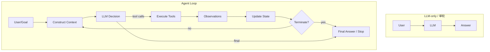
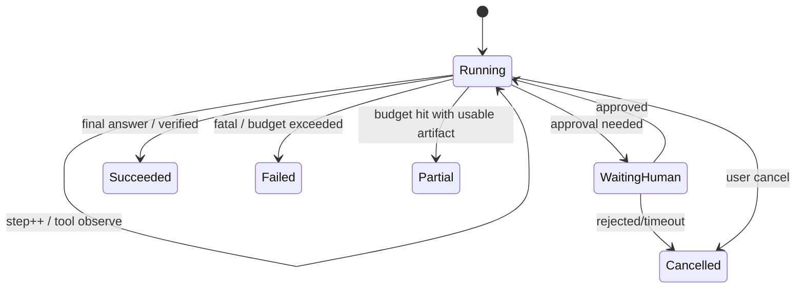
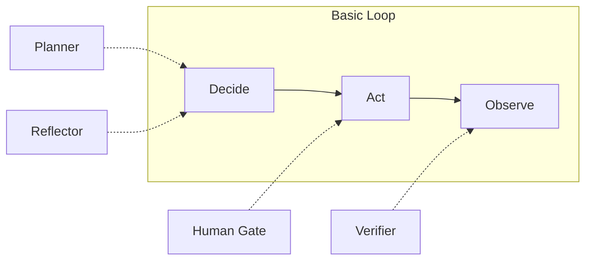
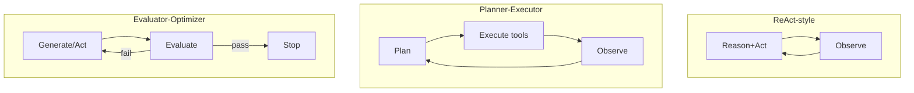
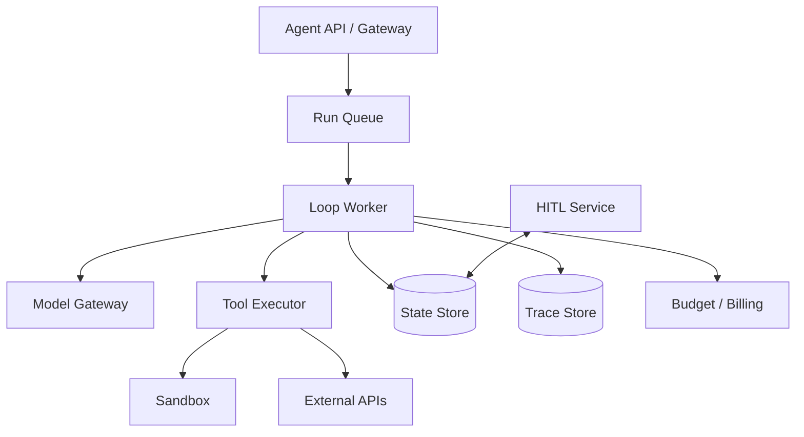

# Agent Loop（Canonical）

> **一句话主题**：Agent Loop 是围绕「决策 → 行动 → 观察 → 状态更新 → 再决策」的**受预算约束的控制回路**，把 LLM 与 Tool Use 组织成可终止、可恢复、可观测的运行时行为。
>
> **状态**：Canonical · **Last reviewed**: 2026-10  
> **受众**：要实现 Agent Runtime / Executor 的工程师  
> **硬前置**：[Tool Use Canonical](../tool-use/tool-use.md)  
> **软前置**：Prompt 基础；后续与 Reasoning/Memory/Context 交叉

---

## 范围 / 非目标

**范围**：Loop 定义与动机、基本循环、状态与消息、终止与预算、重试恢复、计划/反思/校验在回路中的位置、并行与事件/图变体、checkpoint/中断恢复、失败模式、生产运行时架构，以及 ReAct / Planner-Executor 等作为控制流变体的统一视角。

**非目标**：

- 规划 / 反思 / 校验策略深文 → [reasoning-planning.md](../reasoning-planning/reasoning-planning.md)
- 组件拓扑长文 → [agent-architecture.md](../agent-architecture/agent-architecture.md)
- Memory/RAG 实现 → 各自模块（本文只定义 Loop 如何调用它们的钩子）
- 评测体系全文 → [`evaluation`](../../production/evaluation/README.md)

---

## 1. 知识模型：什么是 Agent Loop

### 1.1 定义

**Agent Loop** 是一个显式控制的循环：

1. 从当前 **State** 构造 **Context**（消息/工具 schema/记忆切片…）
2. 调用 **LLM** 得到 **Decision**（最终回答 和/或 Tool Calls）
3. 若有 Tool Calls → **Tool Executor** 执行 → 得到 **Observations**
4. **更新 State**，必要时重建 Context
5. 检查 **Termination**；未终止则回到 1

没有「可行动作 + 观察回灌 + 再决策」，就只是单轮 LLM 调用或固定工作流，而不是 Agent Loop。

### 1.2 为什么存在 Agent Loop

| 仅 LLM / 单轮 | Agent Loop |
|---------------|------------|
| 一次生成结束 | 多步与环境交互 |
| 无法可靠获取实时事实 | 通过工具观察修正信念 |
| 副作用难控 | 每步可鉴权、可审计、可熔断 |
| 失败即整段重来 | 可局部重试、重计划、人工介入 |

**要解决的问题**：在不确定环境中，用有限预算完成目标，同时保持可控性。

### 1.3 LLM-only workflow vs Agent Loop



Anthropic 将 **workflows**（预定义代码路径编排 LLM/工具）与 **agents**（模型动态决定工具与过程）区分，并建议从简单模式按需升级（见 [article-anthropic-building-effective-agents-2024](../../references/articles.md#article-anthropic-building-effective-agents-2024)）。两者都可以有循环；差别在**控制权在代码图还是在模型决策**。

### 1.4 核心数据流（必须记住）

```text
LLM
 ↓
Context
 ↓
Decision
 ↓
Tool Call(s)
 ↓
Tool Execution
 ↓
Observation(s)
 ↓
State Update
 ↓
Context Reconstruction
 ↓
Next Decision
```

```mermaid
sequenceDiagram
  participant R as Runtime/Loop
  participant L as LLM
  participant X as Tool Executor
  R->>R: build context from state
  R->>L: messages + tools
  L-->>R: assistant message (text and/or tool_calls)
  alt has tool_calls
    R->>X: execute_many(calls)
    X-->>R: observations
    R->>R: append observations; update state
    R->>R: check budgets / termination
  else final answer
    R->>R: terminate success
  end
```

### 1.5 Mental Model

把 Agent Loop 想成 **带智能控制器的状态机**：

- State = 会话真相（消息、中间产物、预算计数器、checkpoint）
- LLM = 策略网络（不可靠，需约束）
- Tools = 动作空间
- Budgets = 硬护栏
- Termination = 接受条件

---

## 2. 基本循环：Observe → Think/Plan → Act → Observe

经典叙事（含 ReAct 思想，见 [paper-react-2022](../../references/papers.md#paper-react-2022)）：

1. **Observe**：感知用户目标与工具结果  
2. **Think/Plan**：推理或显式计划（可隐式在模型内部）  
3. **Act**：发出 tool calls 或最终回答  
4. **Observe**：摄入新 observation  

工程实现上，「Think」不一定单独 API 调用；可能是同一轮生成中的推理痕迹，或独立 planner 节点。

**伪代码（最小可运行 Loop）**：

```python
def run_agent(goal, tools, llm, executor, limits):
    state = State(messages=[{"role": "user", "content": goal}],
                  step=0, cost=0, tokens=0, started_at=now())
    while True:
        if hit_limits(state, limits):
            return finalize(state, reason="budget")

        context = build_context(state, tools)          # Context Engineering 钩子
        decision = llm.generate(context)              # Decision
        state.messages.append(decision.message)
        state.step += 1
        accounting(state, decision.usage)

        if decision.final_text and not decision.tool_calls:
            return finalize(state, reason="final")

        if not decision.tool_calls:
            return finalize(state, reason="empty_decision")

        obs_list = executor.execute_many(decision.tool_calls, state.ctx)
        for obs in obs_list:
            state.messages.append(to_tool_message(obs))
            state.apply_observation(obs)              # State Update

        if should_stop_on_policy(state, obs_list):
            return finalize(state, reason="policy")
```

---

## 3. State、Messages、Tool Calls、Observations

### 3.1 State

生产 State 建议显式字段：

| 字段 | 含义 |
|------|------|
| `run_id` | 一次运行身份 |
| `messages` / `transcript` | 对模型可见的对话轨迹 |
| `scratchpad` | 不对用户暴露的中间结构（计划、变量） |
| `artifacts` | 文件句柄、检索句柄等 |
| `step` / `tool_call_count` | 进度计数 |
| `budgets` | 剩余步数/时间/token/成本 |
| `status` | `running|waiting_human|succeeded|failed|cancelled` |
| `checkpoint_meta` | 恢复点 |

**Stateful vs Stateless vs Persistent**：

| 模式 | 含义 | 适用 |
|------|------|------|
| Stateless 单请求 | 状态仅在一次 HTTP 内 | Demo |
| Stateful 进程内 | 服务内存保存 run | 短任务 |
| Persistent | 状态外置（DB/队列）可恢复 | 生产长任务 / HITL |

### 3.2 Messages

消息是 Context 的主要载体。供应商角色名不同，但逻辑角色稳定：

- system / developer 指令
- user 目标
- assistant 决策（可含 tool_calls）
- tool / tool_result 观察

**不变式**：每个 tool result 必须能关联到 `tool_call_id`。

### 3.3 Tool calls & Observations

Loop 不重新实现 Tool Use；它调用 [Tool Executor](../tool-use/tool-use.md)。  
Loop 要决定：并行还是串行执行本轮 calls、失败是否重试、如何写入 transcript。

---

## 4. 终止与预算（无限循环防护）

### 4.1 Termination 条件

| 条件 | 说明 |
|------|------|
| 最终回答 | 模型不再调用工具并给出完成态输出 |
| 目标达成检测 | 外部 verifier / 测试通过（Coding Agent 常见） |
| 用户取消 | cancel token |
| 策略拒绝 | 安全策略要求停止 |
| 预算耗尽 | 见下 |
| 不可恢复失败 | fatal tool / model errors 超阈值 |

### 4.2 Budgets

| 预算 | 防什么 | 典型做法 |
|------|--------|----------|
| **Maximum steps** | 空转、来回查询 | 硬上限 + 近上限提醒消息 |
| **Time budget** | 长尾挂死 | deadline；超时→`failed/partial` |
| **Token budget** | context 爆炸与账单 | 累计 prompt+completion；超限先压缩再停 |
| **Cost budget** | 金额爆炸 | 工具单价+模型单价统一记账 |



**Infinite-loop prevention 清单**：

1. 硬 step cap  
2. 检测重复 tool call 签名（name+args hash）连续重复  
3. 检测「无新信息」observation  
4. 近预算时注入系统提示要求收束  
5. 熔断器：同一工具错误率过高则禁用本 run  

---

## 5. Retry、Failure Recovery、Loop Control

### 5.1 分层重试

| 层 | 重试什么 | 注意 |
|----|----------|------|
| Tool 层 | 网络抖动、5xx | 仅幂等；见 Tool Use |
| Model 层 | 空响应、无效 JSON、短暂 429 | 退避；换模型需契约兼容 |
| Loop 层 | 换策略/重计划/缩工具集 | 计入 step 预算 |

### 5.2 Model failure / Tool failure / Context overflow

| 失败 | 症状 | Loop 动作 |
|------|------|-----------|
| Tool failure | error observation | 有限次修正；否则降级或问人 |
| Model failure | 超时、空决策、格式坏 | 重试生成；失败则 abort |
| Context overflow | 超窗/超预算 | 触发压缩/摘要/外置记忆钩子；仍超则停 |
| Partial completion | 预算到但有中间产物 | 返回 `partial` + artifacts |

Context 压缩的算法细节 → [`context-engineering`](../context-engineering/context-engineering.md)。Loop 只定义**何时触发钩子**。

### 5.3 Loop control knobs

- `tool_choice` 强制/禁止工具  
- 温度与采样（稳定性）  
- 允许工具子集（路由后）  
- 是否启用并行执行  
- verifier 开关  

---

## 6. Planning、Replanning、Reflection、Verification、HITL

这些不是「另一个产品」，而是 **Loop 上的控制流装饰**：



| 机制 | 在 Loop 中的位置 | 何时用 | 何时不用 |
|------|------------------|--------|----------|
| **Planning** | Decide 前生成计划 | 长任务、多约束 | 单步工具足够时 |
| **Replanning** | 观察与计划偏差时 | 环境变化、工具失败 | 每次 step 都重计划（贵） |
| **Reflection** | 对上一步批判 | 高错误成本 | 低价值闲聊 |
| **Verification** | 行动后独立检查 | 代码测试、政策合规 | 无客观判据时硬上自动 verifier |
| **Human approval** | Act 前门闩 | 支付、外发、删数 | 所有步骤都人工（失去自动化） |

深规划 / 反思 / 校验策略 → [Reasoning & Planning Canonical](../reasoning-planning/reasoning-planning.md)。

---

## 7. 执行形态：并行 / 串行 / 事件驱动 / 图

### 7.1 Sequential vs Parallel

- **Sequential steps**：step N 依赖 N-1 的观察（默认心智模型）  
- **Parallel tool calls within a step**：无依赖只读（Tool Use 已述）  
- **Parallel branches**：多子目标并行（常进入 Multi-Agent 或图 fan-out）

### 7.2 Event-driven loops

由 webhook/队列事件唤醒：`resume(run_id, event)`。适合 HITL、长工具、人机协作。

### 7.3 Graph-based loops

把节点（LLM、tool、router、human）与边（条件）显式化。  
**关键认知**：图仍是 Agent Loop 的调度表象——只要存在「模型决策→工具→回写→再决策」的环，核心语义不变。

### 7.4 控制流变体 = Loop 的特化（统一视角）

| 模式 | 相对基本 Loop 的变化 |
|------|----------------------|
| **ReAct** | 同一生成中交织推理痕迹与行动；强调观察纠正幻觉（[paper-react-2022](../../references/papers.md#paper-react-2022)） |
| **Planner / Executor** | 计划节点与执行节点分离；执行可少推理 |
| **Router** | 先分类再进入子 Loop 或工具子集 |
| **Supervisor** | 上层 Loop 委派下层 Loop（Multi-Agent 常见） |
| **Evaluator / Optimizer** | 产出后进入评价节点，不通过则再生成/再行动 |



不要把它们当成互不相关的「框架品牌」；先问：**谁做决策、环在哪里、预算与终止在哪一层**。

---

## 8. Runtime、Executor、Checkpoint、Interrupt/Resume、Cancellation

### 8.1 Agent Runtime vs Agent Executor

| 组件 | 职责 |
|------|------|
| **Runtime** | 托管 run 生命周期、队列、超时、持久化、多租户隔离 |
| **Executor / Loop engine** | 推进单次 run 的状态机：调模型、调工具、写状态 |
| **Tool Executor** | 工具子系统（见 Tool Use） |

### 8.2 Checkpointing

每隔 step 或每个工具批处理后保存：

- messages / scratchpad  
- budgets 快照  
- 待审批项  
- 幂等键进度  

用于：进程崩溃恢复、HITL 跨小时、蓝绿发布中的在途 run。

### 8.3 Interrupt / Resume / Cancellation

```text
interrupt(run_id, reason) -> status=waiting_human|paused
resume(run_id, input)     -> continue loop
cancel(run_id)            -> cooperative cancel token -> tools abort
```

取消必须**协作式**：已发出的不可取消副作用靠补偿；工具层要听 cancel token。

---

## 9. 生产架构



**生产考量清单**：

1. 每个 run 有硬预算与租户配额  
2. 全轨迹可回放（Obsrv）  
3. 工具默认最小权限 + 沙箱  
4. Checkpoint 外置  
5. 模型网关统一超时/降级  
6. 部分完成与失败有稳定错误模型给客户端  
7. 评测门禁：改 prompt/工具后回归 Loop 任务集  

延迟含义：每多一轮 = 一次模型 RTT + 工具 RTT；优化靠减少步数、并行只读、缓存、更好工具（而非盲目加大模型）。  
Token/成本含义：transcript 增长近似 O(steps)；必须压缩与外置。  
安全含义：假设模型可被注入，Loop 的闸在工具鉴权与预算。

---

## 10. 与其他模块的关系（链接，不重复正文）

| 模块 | 关系 |
|------|------|
| [Tool Use](../tool-use/tool-use.md) | Loop 的动作系统；无工具则多为单轮生成 |
| [Reasoning / Planning](../reasoning-planning/reasoning-planning.md) | Decide 阶段的策略 Source of Truth；重计划/反思/校验语义在彼，触发与预算护栏在 Loop |
| [Memory](../memory/README.md) | State 的跨 run 延伸；Loop 在 build_context 时读取/在结束时写入 |
| [Context Engineering](../context-engineering/context-engineering.md) | `build_context` / 溢出压缩的主责 |
| [Evaluation](../../production/evaluation/README.md) | 以轨迹与任务成功评价 Loop |
| [Observability](../../production/observability/README.md) | run/step/tool span 模型 |
| [Sandbox](../../runtime/sandbox/README.md) | Act 阶段隔离 |
| [Security](../../production/security/README.md) | 注入、权限、数据泄漏的威胁模型 |
| [Design Patterns](../../production/design-patterns/README.md) | Planner-Executor 等模式的生产写法 |

---

## 11. 评测切片（Loop）

- 任务成功率 / 部分成功率  
- 平均步数、无效步比例、重复调用率  
- 预算耗尽率、人工介入率  
- 从错误观察中恢复的比例  
- 成本 per successful task  

---

## 12. Interview Questions

### Beginner

**Q1. 什么是 Agent Loop？**  
- **短答**：决策-行动-观察-更新状态的受控循环。  
- **详解**：直到终止条件或预算耗尽。  
- **追问**：没有工具的多轮聊天是 Agent Loop 吗？  
- **常见错误**：把任意 while True 调用模型都叫 Agent。  
- **相关**：Tool Use。

**Q2. 为什么需要 Loop 而不是一次 prompt？**  
- **短答**：环境信息与副作用需要多步获取与确认。  
- **详解**：观察可纠正幻觉。  
- **追问**：何种任务应保持单轮？  
- **常见错误**：所有产品都做成自主 Agent。  
- **相关**：LLM-only vs Loop。

**Q3. Observation 在 Loop 里扮演什么角色？**  
- **短答**：行动后的感知输入，驱动下一决策。  
- **详解**：写回 messages/state。  
- **追问**：用户消息算 observation 吗？  
- **常见错误**：执行工具但不回灌。  
- **相关**：Tool Use Observation。

**Q4. 如何防止无限循环？**  
- **短答**：步数/时间/成本上限 + 重复检测。  
- **详解**：近上限强制收束。  
- **追问**：重复检测用什么键？  
- **常见错误**：只靠模型「自己停下」。  
- **相关**：Budgets。

**Q5. final answer 与 tool call 如何区分？**  
- **短答**：看决策是否包含 tool_calls；无则尝试结束。  
- **详解**：也可由 verifier 决定是否真结束。  
- **追问**：模型边说话边调工具怎么办？  
- **常见错误**：有 tool_calls 仍当最终答复返回用户。  
- **相关**：Termination。

**Q6. step 计数应该计什么？**  
- **短答**：至少计模型决策轮次；也可另计工具次数。  
- **详解**：两者都要有预算。  
- **追问**：并行三个工具算几步？  
- **常见错误**：不计工具次数导致刷爆上游。  
- **相关**：Budgets。

**Q7. ReAct 和 Agent Loop 什么关系？**  
- **短答**：ReAct 是强调推理与行动交织的一种 Loop 风格。  
- **详解**：不是对立概念。  
- **追问**：ReAct 一定要输出 Thought 文本吗？  
- **常见错误**：以为不用 ReAct 就不算 Agent。  
- **相关**：[paper-react-2022](../../references/papers.md#paper-react-2022)。

**Q8. 状态里最少要存什么？**  
- **短答**：messages、step/预算、status、run_id。  
- **详解**：生产还要 checkpoint 元数据。  
- **追问**：为什么要 run_id？  
- **常见错误**：只存最终答案。  
- **相关**：State。

**Q9. 工具失败后 Loop 该立刻终止吗？**  
- **短答**：不一定；可修正重试或重计划，设上限。  
- **详解**：fatal/forbidden 应快速失败。  
- **追问**：如何避免对着同一错误死磕？  
- **常见错误**：无限换参重打。  
- **相关**：Recovery。

**Q10. workflows 与 agents 的差别（Anthropic 口径）？**  
- **短答**：workflow 路径偏预定义；agent 由模型动态决定过程。  
- **详解**：可组合；从简单开始。  
- **追问**：图编排是否还算 agent？  
- **常见错误**：用词争论代替终止与预算设计。  
- **相关**：[article-anthropic-building-effective-agents-2024](../../references/articles.md#article-anthropic-building-effective-agents-2024)。

### Intermediate

**Q11. 解释 Context Reconstruction。**  
- **短答**：每轮根据 state 重新装配模型输入，而非无脑追加一切。  
- **详解**：可摘要、裁剪、注入记忆。  
- **追问**：与「只 append」的权衡？  
- **常见错误**：永不压缩导致溢出。  
- **相关**：Context Engineering。

**Q12. 设计最大步数到达时的产品行为。**  
- **短答**：返回 partial + 已收集信息 + 可续跑句柄。  
- **详解**：不要只抛 500。  
- **追问**：如何计费已消耗预算？  
- **常见错误**：静默截断对用户说「完成」。  
- **相关**：Partial completion。

**Q13. Planner-Executor 何时优于单 Loop？**  
- **短答**：计划稳定且执行阶段需要更便宜/更严约束模型时。  
- **详解**：增加延迟与复杂度，需评测证明。  
- **追问**：计划过时如何发现？  
- **常见错误**：无评测先上多节点。  
- **相关**：控制流变体。

**Q14. HITL 审批如何做 interrupt/resume？**  
- **短答**：持久化 waiting 状态；审批事件唤醒 worker。  
- **详解**：超时拒绝；幂等继续。  
- **追问**：审批期间工具 schema 变更怎么办？  
- **常见错误**：同步阻塞线程等人类。  
- **相关**：Persistent loops。

**Q15. 如何检测空转（no-progress）？**  
- **短答**：重复 call 签名、observation 哈希不变、计划无更新。  
- **详解**：触发反思或终止。  
- **追问**：误杀合法轮询怎么办？  
- **常见错误**：只看步数不看信息增益。  
- **相关**：Infinite-loop prevention。

**Q16. 并行子任务在单 Agent Loop 里怎么做？**  
- **短答**：单 step 并行工具，或图 fan-out 后 join。  
- **详解**：写冲突要串行化。  
- **追问**：join 失败如何部分提交？  
- **常见错误**：无汇合语义。  
- **相关**：Multi-Agent（更深协作用那边）。

**Q17. token budget 与 context window 不是一回事？**  
- **短答**：window 是硬容量；budget 是产品/成本策略。  
- **详解**：可在未满窗时因成本停止。  
- **追问**：两者同时触及时优先级？  
- **常见错误**：只检查 window。  
- **相关**：Budgets。

**Q18. Evaluator-Optimizer 如何避免抖振？**  
- **短答**：评价次数上限、改进阈值阈值、冻结条件。  
- **详解**：评价器也要校准。  
- **追问**：评价器被攻击（注入）怎么办？  
- **常见错误**：无限 refine。  
- **相关**：Verification。

**Q19. Checkpoint 频率如何选？**  
- **短答**：每 step 或每工具批；权衡写放大与丢失窗口。  
- **详解**：关键写操作前后强制 checkpoint。  
- **追问**：如何做幂等恢复？  
- **常见错误**：只在结束时存。  
- **相关**：Runtime。

**Q20. 事件驱动 Loop 的幂等消费？**  
- **短答**：事件 id 去重；handler 幂等；状态机合法迁移。  
- **详解**：重复 resume 不双执行。  
- **追问**：乱序事件？  
- **常见错误**：队列至少一次投递当恰好一次。  
- **相关**：Infrastructure。

### Advanced

**Q21. 给出 Loop 的形式化状态迁移。**  
- **短答**：`(state, event) -> state'`，事件含 model_result/tool_result/human/cancel/timeout。  
- **详解**：非法迁移拒绝。  
- **追问**：如何测试状态机？  
- **常见错误**：隐式状态散落变量。  
- **相关**：State diagram。

**Q22. 模型返回「空洞成功」如何用 verifier 挡？**  
- **短答**：目标可检验时跑测试/规则；失败则继续 Loop。  
- **详解**：不可检验时降级为人工抽检。  
- **追问**：verifier 与主模型同质化风险？  
- **常见错误**：相信模型自报完成。  
- **相关**：Coding Agent 测试闭环。

**Q23. 多预算冲突时的裁决策略？**  
- **短答**：安全 > 租户硬配额 > 任务质量目标；显式优先级表。  
- **详解**：记录停止原因码。  
- **追问**：如何向用户解释？  
- **常见错误**：不同服务各停各的无统一原因。  
- **相关**：Production architecture。

**Q24. Context overflow 中途发生，如何保证工具幂等安全？**  
- **短答**：压缩前 flush checkpoint；未确认写操作不重放。  
- **详解**：恢复时从最后成功 tool 边界继续。  
- **追问**：压缩丢掉了关键约束怎么办？  
- **常见错误**：溢出异常后盲目重放全部 calls。  
- **相关**：Context、Tool idempotency。

**Q25. Supervisor 模式的终止权应在哪一层？**  
- **短答**：每层有本地预算，全局有根预算；根可强杀。  
- **详解**：避免子 Agent 无限委派。  
- **追问**：如何防止委派环？  
- **常见错误**：只给子 Agent 预算。  
- **相关**：Multi-Agent。

**Q26. 设计 Loop 的可回放调试。**  
- **短答**：记录模型输入输出、工具 IO、随机种子/采样、schema 版本。  
- **详解**：支持离线再执行工具沙箱。  
- **追问**：非确定性工具怎么回放？  
- **常见错误**：只存最终 transcript 文本。  
- **相关**：Observability。

**Q27. 何时该把 Loop 写成显式图框架？**  
- **短答**：分支/并行/人机节点复杂且需可视化治理时。  
- **详解**：简单 ReAct 用 100 行循环即可。  
- **追问**：框架抽象泄漏如何处理？  
- **常见错误**：Hello World 就上重框架。  
- **相关**：Anthropic simplicity 建议。

**Q28. 部分工具结果延迟到达（异步）如何纳入同步决策模型？**  
- **短答**：状态机支持 `pending_tools`；完成事件触发 resume。  
- **详解**：决策时避免对 pending 假设成功。  
- **追问**：UI 如何展示？  
- **常见错误**：同步阻塞等长任务。  
- **相关**：Event-driven。

**Q29. 将 Memory 写入放在 Loop 的哪一拍？**  
- **短答**：关键事实在 step 后异步写；会话结束做汇总写；需事务则先写日志。  
- **详解**：错误记忆固化是风险。  
- **追问**：写失败是否阻断 Loop？  
- **常见错误**：每句都同步写向量库。  
- **相关**：Memory。

**Q30. 成本爆炸的根因分析框架？**  
- **短答**：拆 steps × tokens/step × price + tools；找无效步与肥 observation。  
- **详解**：用轨迹切片。  
- **追问**：如何设自动熔断？  
- **常见错误**：只怪模型贵。  
- **相关**：Evaluation。

### Expert

**Q31. 在形式化上，Agent Loop 与 MDP 的对应与不等价处？**  
- **短答**：可把 state/action/reward 类比，但 LLM 策略非平稳、观察是文本、奖励稀疏且常事后。  
- **详解**：勿假装已求解 MDP。  
- **追问**：这如何影响 RL for agents？  
- **常见错误**：直接套 RL 术语掩盖工程缺失。  
- **相关**：RL 模块（后续）。

**Q32. 设计对抗「目标漂移」的 Loop 约束。**  
- **短答**：目标锁定、偏离检测、工具允许集冻结、定期对照验收标准。  
- **详解**：注入会导致目标被改写。  
- **追问**：合法重计划与漂移如何区分？  
- **常见错误**：任由 transcript 中的新指令覆盖系统目标。  
- **相关**：Security。

**Q33. 大规模多租户下 Loop worker 的隔离级别？**  
- **短答**：至少租户级凭证与配额；高危工具容器级；拒绝跨租户 state 引用。  
- **详解**：吵闹邻居用队列隔离。  
- **追问**：冷启动延迟？  
- **常见错误**：共享全局工具进程无鉴权上下文。  
- **相关**：Infrastructure、Sandbox。

**Q34. 讨论「让模型决定何时停」与「外部终止器」的安全权衡。**  
- **短答**：模型可建议；硬停止必须外部。  
- **详解**：双通道：模型 end + policy end。  
- **追问**：外部终止器误杀？  
- **常见错误**：完全信任 stop token。  
- **相关**：Termination。

**Q35. 如何对 Loop 做混沌工程？**  
- **短答**：注入工具超时、错误观测、模型空响应、重复事件，看状态机是否安全。  
- **详解**：断言无双写、可恢复。  
- **追问**：在生产流量比例？  
- **常见错误**：只测 happy path。  
- **相关**：Reliability。

**Q36. 轨迹级评测指标如何避免奖励黑客？**  
- **短答**：多指标（成功、安全、成本、人类偏好）；隐藏测试；定期换题。  
- **详解**：过程约束与结果并重。  
- **追问**：代理指标例子？  
- **常见错误**：优化步数导致偷懒放弃。  
- **相关**：Evaluation。

**Q37. 跨模型热切换对 Loop 正确性的破坏模式？**  
- **短答**：工具并行语义、严格 JSON、拒绝模式不同导致状态机分叉。  
- **详解**：适配层+契约测试。  
- **追问**：中途切换是否允许？  
- **常见错误**：同一 run 混用无注解。  
- **相关**：Model gateway。

**Q38. 给出 Loop 与工作流引擎（BPM）集成的边界。**  
- **短答**：BPM 管人工流程与合规；Loop 管局部智能决策。  
- **详解**：避免两套状态真相对撕。  
- **追问**：主状态放哪？  
- **常见错误**：双向同步无仲裁。  
- **相关**：Architecture。

**Q39. 长程研究型 Agent 的 Loop 退化问题？**  
- **短答**：上下文腐化、目标漂移、成本非线性。  
- **详解**：分层摘要、子目标 Loop、定期 verifier。  
- **追问**：何时拆 Multi-Agent？  
- **常见错误**：单会话硬撑百万 token 叙事。  
- **相关**：Context、Memory。

**Q40. 你如何 review 一个开源 Agent 框架的 Loop 实现？**  
- **短答**：找状态、终止、预算、重试、HITL、checkpoint、工具鉴权挂钩。  
- **详解**：对照本 Canonical 清单打分。  
- **追问**：缺哪项不可上生产？  
- **常见错误**：只看是否支持「多智能体」营销点。  
- **相关**：open-source-analysis 规范。

### System Design

**Q41. 设计可恢复的 Production Agent Runtime。**  
- **短答**：队列+worker+状态库+轨迹库+预算服务+工具执行器。  
- **详解**：画出故障恢复路径与 HITL。  
- **追问**：如何做多区域？  
- **常见错误**：无 checkpoint。  
- **相关**：生产架构图。

**Q42. 设计 Coding Agent 的 Loop 与测试终止。**  
- **短答**：编辑→运行测试→失败观察→再编辑；测试通过或预算停。  
- **详解**：沙箱与 repo 上下文策略链接。  
- **追问**：flaky test 怎么办？  
- **常见错误**：无测试靠模型自宣告成功。  
- **相关**：Coding Agent、Sandbox。

**Q43. 设计带退款 HITL 的客服 Agent Loop。**  
- **短答**：查询只读自主；退款进入 waiting_human；超时策略。  
- **详解**：审计与幂等。  
- **追问**：欺诈检测夹在哪一层？  
- **常见错误**：模型直接调支付 API。  
- **相关**：Tool permissions。

**Q44. 设计 Evaluator-Optimizer 内容生成系统的停止条件。**  
- **短答**：分数阈值、最大轮数、人工抽检门。  
- **详解**：防抖振与成本帽。  
- **追问**：评价器与生成器是否必须不同模型？  
- **常见错误**：无限润色。  
- **相关**：控制流变体。

**Q45. 设计从 Demo Loop 迁移到 Persistent Loop 的里程碑。**  
- **短答**：P0 同步循环→P1 预算/重试→P2 外置状态→P3 HITL→P4 观测与评测门禁。  
- **详解**：对齐 practice-paths。  
- **追问**：哪一步是上生产的不可妥协项？  
- **常见错误**：先做 Multi-Agent。  
- **相关**：docs/practice-paths。

---

## 13. References

- [paper-react-2022](../../references/papers.md#paper-react-2022)
- [article-anthropic-building-effective-agents-2024](../../references/articles.md#article-anthropic-building-effective-agents-2024)
- [doc-openai-function-calling](../../references/docs.md#doc-openai-function-calling)
- [doc-anthropic-tool-use](../../references/docs.md#doc-anthropic-tool-use)
- [doc-anthropic-how-tool-use-works](../../references/docs.md#doc-anthropic-how-tool-use-works)
- 机制依赖：[Tool Use Canonical](../tool-use/tool-use.md)

---

## 14. Self-review / TODOs

- [x] 与 Tool Use 边界清晰；未复制 MCP/Memory/RAG 正文
- [x] 控制流变体统一到 Loop 视角
- [x] 预算、恢复、生产架构、失败模式已覆盖
- [ ] TODO: Verify — 具体开源框架（LangGraph/Agents SDK 等）节点语义对照表，留待 open-source-analysis
- [ ] TODO: Verify — 各云「托管 Agent 循环」产品是否代表本手册意义上的完整 Runtime（避免把托管黑盒写成通用真理）
