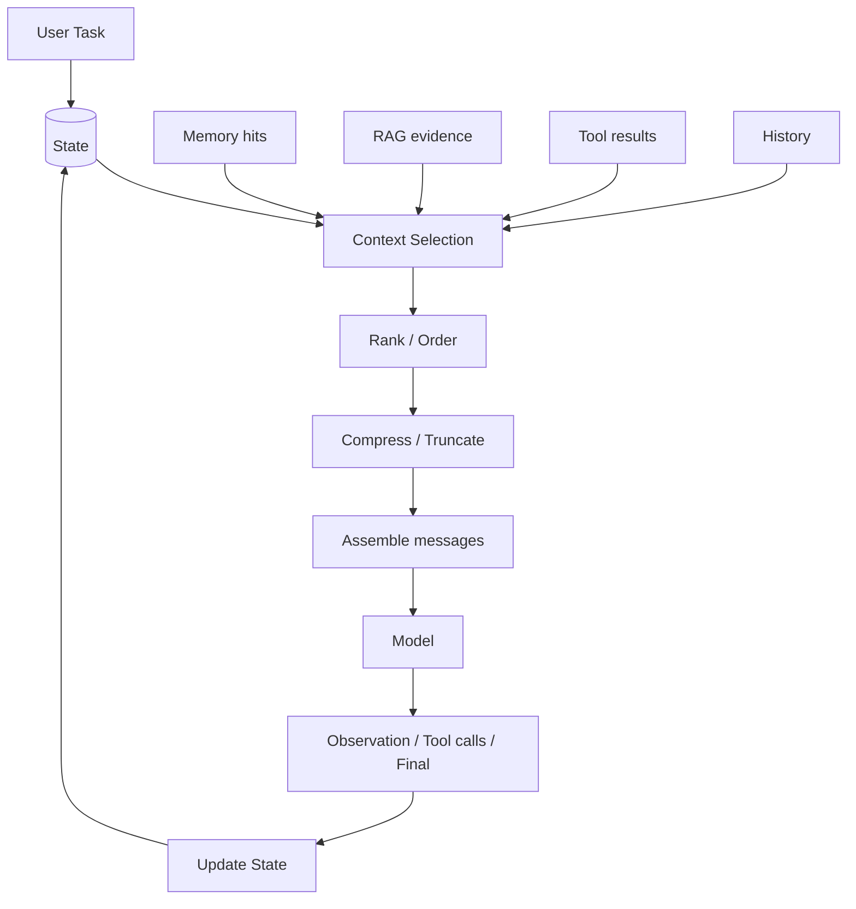
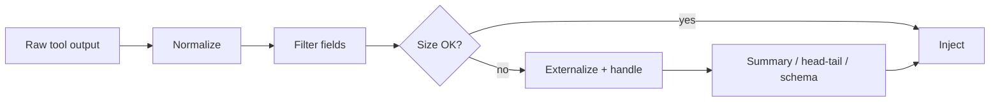
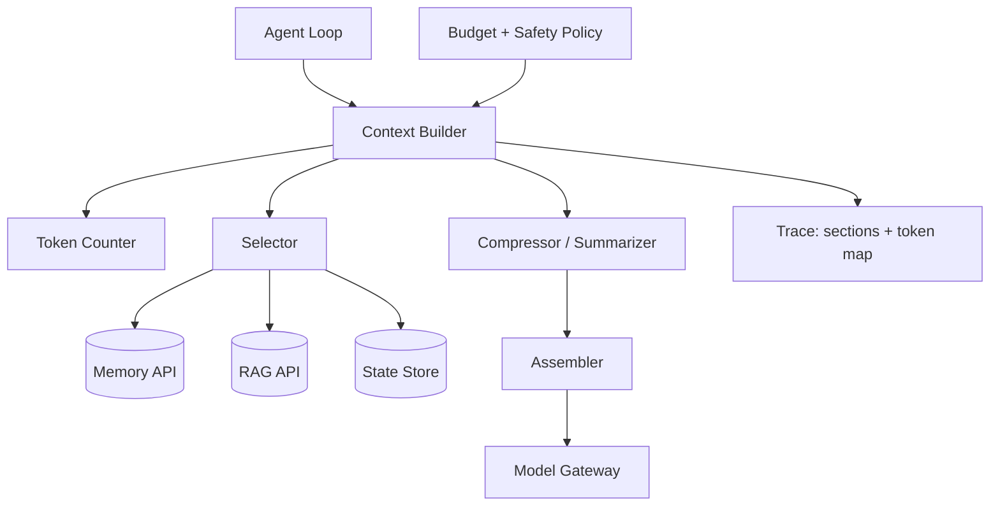

# Context Engineering（Canonical）

> **一句话主题**：Context Engineering 是 **Agent Runtime 中对每次模型调用可见信息集合的构建、选择、排序、压缩、更新与预算管理**——回答「这次调用该放什么、不该放什么」，而不是 Prompt 措辞技巧的改名。
>
> **状态**：Canonical · **Last reviewed**: 2026-10  
> **受众**：实现 Context Builder / 长程 Agent 窗口治理的工程师  
> **硬前置**：[Agent Loop](../agent-loop/agent-loop.md)、[Tool Use](../tool-use/tool-use.md)  
> **源系统（只链接，不重写）**：[Memory](../memory/memory.md) · [RAG](../rag/rag.md) · [Reasoning](../reasoning-planning/reasoning-planning.md) · [Architecture](../agent-architecture/agent-architecture.md)

---

## 范围 / 非目标

**范围**：Context 与 Context Engineering 定义；与 Prompt/State/Memory/RAG/History/Tool Results 的边界；上下文来源；选择/排序/压缩/截断/滑动窗；预算与优先级；污染与膨胀；Observation Explosion；Lost in the Middle；注入与投毒；动态/增量上下文；生产管道；评测；安全；面试。

**非目标**：

| 主题 | 去哪里 |
|------|--------|
| 工具执行、鉴权、幂等 | [Tool Use](../tool-use/tool-use.md) |
| 控制回路、终止、checkpoint | [Agent Loop](../agent-loop/agent-loop.md) |
| 记忆写闸/遗忘 | [Memory](../memory/memory.md) |
| 语料索引/检索管道 | [RAG](../rag/rag.md) |
| 指令措辞与 few-shot 配方深文 | [`prompt-engineering`](../prompt-engineering/README.md) |
| MCP | [`protocols/mcp`](../../protocols/mcp/README.md) |

Anthropic 将 Context Engineering 描述为在推理时策展最优 token 集、相对 Prompt Engineering 的扩展（[article-anthropic-context-engineering-2025](../../references/articles.md#article-anthropic-context-engineering-2025)）。本手册进一步钉死：**它属于 Runtime / Context Management**，每次 `build_context(state)` 都要运行。

---

## 1. Definitions

### 1.1 Context

**Context** = **一次模型调用时，模型实际可见的动态信息集合**（通常体现为 messages / 多模态块 / 工具 schema 等输入），由多个来源装配而成。

### 1.2 Context Engineering

**Context Engineering** = 对 Context 的：

**构建 · 选择 · 压缩 · 排序 · 更新 · 预算管理**

目标：在有限注意力/窗口预算下，放入 **最小高信号集合**，最大化期望任务结果（与 Anthropic「smallest high-signal set」一致，见上文引用）。

### 1.3 Prompt vs Context

| | Prompt | Context |
|--|--------|---------|
| 角色 | **Instruction**：角色、规则、输出协议、（部分）静态示例 | **Invocation 可见全集**：含指令 + 历史 + 工具结果 + 检索 + 记忆切片… |
| 变化频率 | 相对稳定（版本化配置） | **每步可变** |
| 工程焦点 | 写清楚约束 | **策展与预算** |

```text
Prompt ⊂（通常）Context 中的指令分区
Context Engineering ⊃ Prompt Engineering（但绝不等于「更好的措辞」）
```

---

## 2. 与 State / Memory / RAG / History / Tool Results

| 概念 | 是什么 | 与 Context 关系 |
|------|--------|-----------------|
| **State** | 当前 run 真相（可持久） | Context 的 **主要原料**；Context 是投影 |
| **Memory** | 跨会话可召回资产 | 经 Retrieve 后 **可选注入** |
| **RAG** | 语料检索机制 | 产出 Evidence Pack → **可选注入** |
| **Conversation History** | 消息序列 | 常为 Context 大头；需截断/摘要 |
| **Tool Results** | 工具观察 | 必须 **归一化后** 再注入 |
| **Runtime State** | 预算、status、plan 句柄 | 常以摘要/结构化字段进入 |
| **Intermediate Results** | 子步骤产物 | 存 State/外置；Context 只留句柄或摘要 |

**More Context ≠ Better Context**  
**Longer Context ≠ Better Agent**

依据包括：注意力预算有限（Anthropic）；长上下文中部信息利用变差（[paper-lost-in-the-middle-2023](../../references/papers.md#paper-lost-in-the-middle-2023)）；更长输入本身可损害表现。膨胀还带来延迟、成本、注入面与调试难度。

---

## 3. 统一模型

```text
User Task
 ↓
State
 ↓
Memory ──┐
RAG ─────┼→ candidates
Tool Results ─┤
Conversation ─┤
Runtime / Intermediate ─┘
 ↓
Context Selection
 ↓
Context Ranking / Ordering
 ↓
Compression / Truncation
 ↓
Context Assembly
 ↓
LLM
 ↓
Observation / Decision
 ↓
Context Update（写入 State；可选巩固 Memory）
```



每次 Loop 迭代：`context ← ContextBuilder.build(state, budgets)`（见 [Agent Loop](../agent-loop/agent-loop.md)）。

---

## 4. Context Sources（必须枚举）

| 来源 | 内容 | 默认信任 | 处理要点 |
|------|------|----------|----------|
| **System Instructions** | 角色、硬约束、工具用法 | 高（自有） | 短、稳、版本化；勿塞动态数据 |
| **User Input** | 本轮目标/消息 | 半信 | 不可直接升权 |
| **Conversation History** | 既往 turns | 混合 | 滑动/摘要/分层 |
| **Tool Results** | 观察 | **低/不可信** 直到校验 | 归一化、截断、外置 |
| **Retrieved Documents** | RAG 命中 | 视来源 | 引用、ACL、标 untrusted |
| **Memory** | 偏好/事实/教训 | 视 confidence | 写闸在 Memory；注入要 rank |
| **Runtime State** | 预算、plan 状态 | 高 | 结构化短字段 |
| **Intermediate Results** | 子任务产物 | 视类型 | 句柄优先 |

---

## 5. Selection · Ordering · Prioritization

### 5.1 Selection（该放 / 不该放）

**放入**：当前目标、硬约束、下一步决策必需证据、活跃 plan 摘要、最近失败观察（已压缩）。  
**排除**：过期工具 dump、无关检索、重复历史、可再取回的全文（JIT：先句柄后工具再取，见 Anthropic JIT 思路）、已完成子任务的原始日志。

评分因子（与 Memory/RAG rank 对齐）：**Relevance · Recency · Importance · Provenance · Freshness · Permission**。

### 5.2 Ordering

常见策略：

1. 系统指令置顶（稳定前缀利于缓存）  
2. 高重要约束靠近决策点  
3. 最新观察靠近末尾  
4. 长证据中部风险高 → 控制长度或拆多轮（Lost in the Middle）

**剪枝 / 压缩 vs 缓存**（Coding Agent 工程权衡，见 [article-earendil-prompt-caching-in-agents-2026](../../references/articles.md#article-earendil-prompt-caching-in-agents-2026)）：

- 默认偏好 **稳定追加** 的 transcript；中间删除会改变前缀，编辑点之后保留内容常需按未缓存价重算。  
- 粗算：一次性重写成本 ≈ 编辑点后保留 token ×（未缓存价 − 缓存读价）；每轮未来节省 ≈ 被删 token × 缓存读价——短会话乱剪可能更贵。  
- **Compaction** 是有意重建前缀（腾窗口），应记为缓存重置，而非神秘 miss；目标不是「提示尽可能短」，而是窗口、命中、延迟、价格的平衡。

> 具体模型对位置的敏感度会变；以评测校准，勿教条。  
> TODO: Verify — 当前主力模型的位置偏差曲线需用内部评测刷新。

### 5.3 Prioritization / Allocation

在 token budget `B` 下分配：

```text
B = B_system + B_user + B_history + B_tools + B_rag + B_memory + B_scratch + B_reserve
```

**Reserve**：留给模型输出与工具 schema。超支时按优先级驱逐：先砍低分 RAG/旧工具结果，再摘要历史，最后才动系统硬约束。

---

## 6. Compression · Summarization · Truncation · Compaction · Sliding Window

| 技术 | 做什么 | 风险 |
|------|--------|------|
| **Truncation** | 硬切尾/头 | 丢关键否定句 |
| **Sliding Window** | 只留最近 N turn | 丢早期约束 |
| **Summarization** | 历史→摘要 | 摘要错误固化 |
| **Compaction** | 整段对话压缩后续跑 | 有损；需保留决策/未决问题 |
| **Tool clearing** | 可再取回的旧 tool_result 清空为句柄 | 需能重新 fetch |
| **结构化压缩** | JSON 精简、表头+抽样 | 信息损失可控 |

**原则**：可再获取的（文件、API）优先 **句柄化**；不可再获取的（用户口述约束）优先 **保留或进 Memory（经写闸）**。

**厂商服务端机制（高阶字段/行为，Evergreen 2026-10-07）** — 经适配层使用，**不绑死**单一字段名；**价目不抄**：

| 厂商 | Compaction | Tool / 相关 clearing |
|------|------------|----------------------|
| **OpenAI Responses** | (1) 创建时 `context_management: [{ type: "compaction", compact_threshold }]`：渲染 token 过阈则服务端压缩，流中出现 **加密** compaction item；(2) 独立 `POST /responses/compact`：送入完整窗，返回含加密 compaction 的**规范下一窗**（勿自行裁剪 compact 输出）。见 [doc-openai-compaction](../../references/docs.md#doc-openai-compaction) | 文档主推整窗 compaction；细粒度 tool_result 清空以自研/适配为准 |
| **Anthropic** | `context_management.edits` 含 `compact_20260112`：input token 过 `trigger`（默认量级文档写 150k，**下限 50k**）则生成 `compaction` block；后续请求传回该块后，API **忽略其前内容**。可选 `pause_after_compaction`、自定义 `instructions`。见 [doc-anthropic-compaction](../../references/docs.md#doc-anthropic-compaction) | `clear_tool_uses_20250919`：过阈清旧 tool result（占位文本）；可配 `keep` / `clear_tool_inputs` 等。见 [doc-anthropic-context-editing](../../references/docs.md#doc-anthropic-context-editing) |

> TODO: Verify — 精确默认阈值、模型支持矩阵与 **caching/compaction 价目表数字**。

分层记忆/虚拟上下文见 [paper-memgpt-2023](../../references/papers.md#paper-memgpt-2023)（机制启发，不等于照搬产品）。

---

## 7. Token Budget & Context Budget

| 预算 | 含义 |
|------|------|
| **Token budget** | 窗口硬上限与每来源配额 |
| **Latency / Cost** | 更长上下文 → 更高预填成本与延迟 |
| **Relevance budget** | 「低分命中」直接丢弃，不占窗 |
| **Update budget** | 每步允许的摘要/巩固调用次数 |

**Allocation strategy（示例政策）**：

1. 保证 system + 当前 user + reserve  
2. 注入最新 tool 错误（压缩）  
3. 注入 top-k memory/rag（有分）  
4. 用剩余填历史（从新到旧，直到满则摘要更旧段）

---

## 8. Observation Explosion（重点）

```text
Tool1 → Huge Output
Tool2 → Huge Output
Tool3 → Huge Output
→ Context Overflow / 决策淹没
```

**正确管道**（与 Tool Use 归一化衔接，深文不重复）：

```text
Observation
 → Normalize（结构信封）
 → Filter（字段白名单）
 → Summarize / Sample（必要时）
 → Store（State 外置或对象存储句柄）
 → Inject Relevant Portion only
```



**失败信号**：单步 tool tokens 占比过高、重复粘贴同一大对象、模型开始忽略指令。

---

## 9. Context Pollution / Bloat / Injection / Poisoning

| 模式 | 含义 | 缓解 |
|------|------|------|
| **Pollution** | 噪声、冲突、过时信息混入 | 选择/衰减/版本 |
| **Bloat** | 体积无信息增益膨胀 | 预算、驱逐、JIT |
| **Context Injection** | 不可信内容诱导行为 | 分区标记、政策门、最小权限工具 |
| **Poisoning** | 检索/记忆/工具输出长期污染决策 | 来源信任、写闸、红队 |
| **Lost in the Middle** | 中部关键信息被忽略 | 缩短、重排、拆步（[paper](../../references/papers.md#paper-lost-in-the-middle-2023)） |

### 9.1 Security（Context 面威胁）

| 威胁 | 典型路径 | Context 侧控制 |
|------|----------|----------------|
| **Prompt injection** | 用户/历史中的指令覆盖 | 分区；硬策略不依赖模型服从 |
| **Retrieved content injection** | RAG 命中含「忽略规则」 | Evidence 标 untrusted；禁止升权 |
| **Tool output injection** | 工具返回诱导文本 | 归一化信封 + 字段白名单 |
| **Memory poisoning** | 污染长期记忆再注入 | 写闸在 Memory；注入前再 rank |
| **Context poisoning** | 多源噪声/冲突长期主导决策 | 衰减、版本、驱逐、红队 |
| **Malicious documents** | 语料/附件恶意载荷 | ACL、扫描、最小注入、句柄 JIT |

**原则**：信任边界在 **Assembler 之前**划清；高危副作用靠 Tool authz / Sandbox，不靠「提示模型别听」。  
深文 → [`security`](../../production/security/README.md)；写闸 → [Memory](../memory/memory.md)；语料 → [RAG](../rag/rag.md)。

---

## 10. Dynamic & Incremental Context

- **Dynamic**：每步根据 goal/失败模式切换来源权重（如刚 tool 失败 → 提高观察优先级）  
- **Incremental**：只追加增量摘要，避免每步重塞全历史原文  
- **JIT**：上下文中放指针，需要时再 tool 读取（Anthropic 所述 coding/agent 实践方向）

---

## 11. Production Context Pipeline



| 组件 | 职责 |
|------|------|
| **Context Builder** | 编排选择→排序→压缩→装配 |
| **Context Manager** | 跨步策略、何时 compaction |
| **Token Counter** | 精确计数（含工具 schema） |
| **Truncator / Summarizer** | 执行有损策略 |
| **Observation Normalizer** | 工具结果进窗前处理 |
| **Provenance 标签** | 每段来源与信任级 |
| **Tracing** | 分段 token 图，可调试「为何塞了 X」 |

调试：能回答「这一步每个来源占多少 token、驱逐了什么、摘要前后差异」。链 [`observability`](../../production/observability/README.md)。

> 机制概要已写入 §6（Evergreen 2026-10-07）。实现仍经适配层；**价目与完整模型矩阵** TODO: Verify。

---

## 12. Evaluation

| 指标 | 含义 |
|------|------|
| **Context relevance** | 注入段与任务相关比例 |
| **Context completeness** | 必需约束是否缺失 |
| **Context redundancy** | 重复信息占比 |
| **Token efficiency** | 成功任务 / 平均 context tokens |
| **Task success** | 端到端 |
| **Latency / Cost** | 与上下文长度相关 |
| **Context failure rate** | 溢出、丢失硬约束、污染导致的失败 |

评测设计：消融（无摘要 / 无 RAG / 全量历史）对比；位置敏感性探针（中部关键事实）。  
端到端框架 → [`evaluation`](../../production/evaluation/README.md)。

---

## 13. 伪代码

```text
algorithm BuildContext(state, policy, budgets):
  sections ← []
  sections += SystemSection(policy.system_prompt)           # capped
  sections += UserSection(state.current_user_message)

  tool_obs ← NormalizeAndSelect(state.recent_observations, budgets.tools)
  sections += tool_obs

  mem ← Memory.Retrieve(state, k=policy.mem_k)
  rag ← RAG.Retrieve(state, k=policy.rag_k)                 # may be empty
  sections += RankAndTake(mem + rag, budgets.knowledge)

  hist ← SelectHistory(state.messages, budgets.history)     # slide + summarize older
  sections += hist

  sections += RuntimeScratch(state.plan_summary, state.budgets_left)

  assembled ← Assemble(sections, ordering=policy.order)
  while TokenCount(assembled) > budgets.hard_limit:
    assembled ← EvictLowestPriority(assembled) or Compact(assembled)
    if cannot_evict_without_breaking_invariants:
      return Error("context_budget_exhausted")

  Trace(assembled.token_map)
  return assembled
```

**不变式**：系统硬约束与当前用户目标不可被低优先级内容挤出；不可信内容不可进入「trusted policy」分区。

---

## 14. Trade-offs（定性）

| 策略 | 信号密度 | 风险 | 成本 | 适用 |
|------|----------|------|------|------|
| 全量历史 | 低 | 高膨胀/中部丢失 | 高 | 极短会话 |
| 滑动窗 | 中 | 丢早期约束 | 低 | 短任务 |
| 摘要+句柄 JIT | 高 | 摘要误差 | 中 | **生产默认倾向** |
| 激进 compaction | 中-高 | 丢细节 | 中 | 长程 |
| 无压缩大窗模型 | 不定 | 仍可能中部丢失 | 很高 | 需评测证明 |

---

## 15. Interview Questions

### Beginner

**Q1. Context Engineering 是什么？**  
- **短答**：管理每次模型调用可见信息的选择、压缩与预算。  
- **详解**：Runtime 能力，非措辞升级。  
- **追问**：和 Prompt Engineering 关系？  
- **常见错误**：当成写更好的 system prompt。  
- **相关**：§1。

**Q2. Prompt vs Context？**  
- **短答**：Prompt≈指令；Context≈当次可见全集。  
- **详解**：Context 含历史/工具/检索等。  
- **追问**：tool schema 算哪类？  
- **常见错误**：混用两个词。  
- **相关**：§1.3。

**Q3. 为什么 More Context ≠ Better？**  
- **短答**：注意力有限、噪声、成本、中部丢失。  
- **详解**：Lost in the Middle + 预算。  
- **追问**：如何证明？  
- **常见错误**：盲目开最大窗。  
- **相关**：§2、[`paper-lost-in-the-middle-2023`](../../references/papers.md#paper-lost-in-the-middle-2023)。

**Q4. Context vs State？**  
- **短答**：State 持久真相；Context 可重建投影。  
- **详解**：压缩 Context 不该丢未 checkpoint 的 State。  
- **追问**：只存 Context？  
- **常见错误**：把窗口当数据库。  
- **相关**：Architecture/Memory。

**Q5. 主要 Context 来源？**  
- **短答**：系统、用户、历史、工具、RAG、Memory、运行时。  
- **详解**：信任级不同。  
- **追问**：哪个默认 untrusted？  
- **常见错误**：工具输出当系统指令。  
- **相关**：§4。

**Q6. Observation Explosion？**  
- **短答**：多步大工具输出撑爆窗口。  
- **详解**：归一化→外置→只注入相关部分。  
- **追问**：如何检测？  
- **常见错误**：原样回灌。  
- **相关**：§8。

**Q7. Truncation vs Summarization？**  
- **短答**：硬切 vs 有损提炼。  
- **详解**：可再取回的宜句柄。  
- **追问**：用户「永远用中文」被切掉？  
- **常见错误**：只从头部切。  
- **相关**：§6。

**Q8. Token budget 分配原则？**  
- **短答**：硬约束与当前目标优先，低分知识先驱逐。  
- **详解**：留 reserve。  
- **追问**：工具 schema 很大？  
- **常见错误**：平均分配。  
- **相关**：§7。

**Q9. Context Injection？**  
- **短答**：不可信内容进入窗诱导行为。  
- **详解**：分区+政策。  
- **追问**：与 Memory poisoning 关系？  
- **常见错误**：检索文本当系统。  
- **相关**：§9。

**Q10. JIT Context 是什么？**  
- **短答**：窗内放句柄，需要时再取。  
- **详解**：Anthropic 所述方向。  
- **追问**：何时必须预取？  
- **常见错误**：任何东西都预加载。  
- **相关**：§10、[`article-anthropic-context-engineering-2025`](../../references/articles.md#article-anthropic-context-engineering-2025)。

### Intermediate

**Q11. 设计 Assembler 的分区。**  
- **短答**：trusted policy / user / evidence(untrusted) / history / scratch。  
- **详解**：标签进 trace。  
- **追问**：跨区引用？  
- **常见错误**：单一纯文本糊。  
- **相关**：§11。

**Q12. 历史摘要的验收标准？**  
- **短答**：保留目标、约束、未决、关键 ID；丢可再取日志。  
- **详解**：抽样人工评。  
- **追问**：摘要否定句丢失？  
- **常见错误**：无评测上摘要。  
- **相关**：§6、§12。

**Q13. 如何缓解 Lost in the Middle？**  
- **短答**：缩短、重要信息两端、多轮聚焦、少塞填充物。  
- **详解**：位置探针评测。  
- **追问**：是否永远两端？  
- **常见错误**：无限加窗。  
- **相关**：§5.2、paper。

**Q14. 工具结果进窗的默认管道？**  
- **短答**：normalize→filter→size gate→handle/summarize→inject。  
- **详解**：链 Tool Use。  
- **追问**：二进制文件？  
- **常见错误**：base64 整段。  
- **相关**：§8。

**Q15. Compaction 何时触发？**  
- **短答**：接近预算阈值或质量下降信号。  
- **详解**：保留决策与未决。  
- **追问**：与 checkpoint 顺序？  
- **常见错误**：每步都压。  
- **相关**：§6、§11。

**Q16. 度量 token efficiency？**  
- **短答**：成功数 / 平均上下文 token（或 $）。  
- **详解**：分任务切片。  
- **追问**：与延迟权衡？  
- **常见错误**：只看准确率。  
- **相关**：§12。

**Q17. Memory 与 RAG 同時命中如何排序？**  
- **短答**：统一 rank：权限→相关性→置信/来源→新鲜度；用户确认事实可优先。  
- **详解**：冲突显式展示。  
- **追问**：偏好 vs 政策文档冲突？  
- **常见错误**：两路原样双倍塞。  
- **相关**：§5、Memory、RAG。

**Q18. Context completeness 失败例子？**  
- **短答**：摘要掉「禁止发邮件」导致误发。  
- **详解**：硬约束清单不可驱逐。  
- **追问**：如何编码硬约束？  
- **常见错误**：全靠模型记住。  
- **相关**：§7、§12。

**Q19. 动态提高工具观察权重的时机？**  
- **短答**：刚失败、校验未过、用户纠正后。  
- **详解**：政策表驱动。  
- **追问**：如何防止观察淹没指令？  
- **常见错误**：永远追加全量。  
- **相关**：§10。

**Q20. 调试「模型忽略系统规则」？**  
- **短答**：查 token 图、是否被挤出、中部淹没、注入覆盖。  
- **详解**：复现装配快照。  
- **追问**：温度问题？  
- **常见错误**：只改措辞。  
- **相关**：§11。

### Advanced

**Q21. 给出 EvictLowestPriority 算法约束。**  
- **短答**：永不驱逐 hard invariants；先低分 evidence；再旧 tool；再旧历史。  
- **详解**：记录驱逐原因。  
- **追问**：并列最低分？  
- **常见错误**：随机切。  
- **相关**：§13。

**Q22. 前缀缓存与 Context 设计。**  
- **短答**：稳定 system 前缀；变动大的放后；避免每步打散前缀。  
- **详解**：降成本。  
- **追问**：多租户不同政策？  
- **常见错误**：把用户名塞 system 最前每请求变。  
- **相关**：Inference 缓存。  
- **TODO: Verify** — 网关前缀缓存命中规则。

**Q23. 多 Agent 汇总进主 Context？**  
- **短答**：子 Agent 只返回短摘要+句柄；禁原轨迹。  
- **详解**：Anthropic 子代理摘要思路。  
- **追问**：摘要撒谎？  
- **常见错误**：合并全部子 transcript。  
- **相关**：§6、Multi-Agent README。

**Q24. 安全分区强制执行点。**  
- **短答**：Assembler 后、Model 前；政策扫描不可信区。  
- **详解**：高危工具仍靠 Tool authz。  
- **追问**：模型自我「提升」信任？  
- **常见错误**：提示「请忽略用户注入」当唯一防护。  
- **相关**：§9。

**Q25. 评测 context redundancy。**  
- **短答**：近重复 ngram/嵌入聚类占比；消融去重后看任务变化。  
- **详解**：与效率联合。  
- **追问**：故意重复强调？  
- **常见错误**：去重掉关键重申。  
- **相关**：§12。

**Q26. Incremental assembly 的一致性。**  
- **短答**：基于 State 版本哈希；增量补丁可重放。  
- **详解**：防漂移。  
- **追问**：并发 resume？  
- **常见错误**：无版本拼字符串。  
- **相关**：§10–11。

**Q27. 大表/日志的注入策略。**  
- **短答**：schema+统计+抽样+查询句柄；禁止全表。  
- **详解**：JIT SQL/工具。  
- **追问**：用户要「全部」？  
- **常见错误**：CSV 整贴。  
- **相关**：§8。

**Q28. Compaction 与 Memory 巩固分工。**  
- **短答**：Compaction 服务本 run 续航；Memory 服务跨 run；产物进 Memory 需写闸。  
- **详解**：链 Memory。  
- **追问**：巩固失败？  
- **常见错误**：压缩摘要直接永久记忆。  
- **相关**：§6、Memory。

**Q29. 多模态上下文预算。**  
- **短答**：图/音按厂商计价折算 token；限额与降分辨率。  
- **详解**：优先描述句柄。  
- **追问**：截图泄密？  
- **常见错误**：无视图像成本。  
- **相关**：§7。  
- **TODO: Verify** — 各模型图像 token 计价。

**Q30. 设计「上下文回归」测试套件。**  
- **短答**：硬约束保留、位置探针、爆炸观察、注入、预算耗尽行为。  
- **详解**：CI 门禁。  
- **追问**：如何金样？  
- **常见错误**：只测最终答案。  
- **相关**：§12。

### Expert

**Q31. 形式化 Context 为带信任标签的区段序列。**  
- **短答**：`[(role, trust, prov, tokens, eviction_class)]` + invariants。  
- **详解**：类型检查装配。  
- **追问**：跨区合并？  
- **常见错误**：无类型 blob。  
- **相关**：§13。

**Q32. 注意力预算的产品化 SLO。**  
- **短答**：p95 context tokens、溢出率、硬约束丢失率、$/成功。  
- **详解**：与任务 SLA 联动。  
- **追问**：如何报警？  
- **常见错误**：只报警 5xx。  
- **相关**：§7、§12。

**Q33. 对抗「上下文填满逼模型提前收工」。**  
- **短答**：评测是否过早 final；compaction/reset 策略；预算展示。  
- **详解**：Anthropic harness 讨论 context anxiety 类现象——实现需自测。  
- **追问**：reset vs compact？  
- **常见错误**：无视行为只加窗。  
- **相关**：§6。  
- **TODO: Verify** — 特定模型是否表现 context anxiety 以评测为准。

**Q34. 跨模型切换时的 Context IR。**  
- **短答**：内部区段 IR → 各供应商消息适配；计数器分模型。  
- **详解**：防锁定。  
- **追问**：工具结果角色名差异？  
- **常见错误**：直接存供应商 JSON。  
- **相关**：Architecture。

**Q35. 证明压缩不损关键法律披露。**  
- **短答**：披露字段进 hard invariants；压缩前后自动核对清单。  
- **详解**：合规测试。  
- **追问**：多语言披露？  
- **常见错误**：靠摘要「大概提到」。  
- **相关**：§7、§12。

**Q36. Observation 与 Retrieval 争用预算的控制论。**  
- **短答**：状态机：探索期偏检索，执行期偏观察，失败期偏错误观察。  
- **详解**：显式政策。  
- **追问**：如何防抖？  
- **常见错误**：固定 50/50。  
- **相关**：§5、§10。

**Q37. 大规模下 Summarizer 异步化。**  
- **短答**：临界路径用快截断；摘要异步回填 State。  
- **详解**：可见「摘要 pending」。  
- **追问**：回填前决策？  
- **常见错误**：同步重摘要堵 Loop。  
- **相关**：§11。

**Q38. 红队：检索文档要求忽略政策。**  
- **短答**：untrusted 区；政策扫描；工具鉴权不靠模型服从。  
- **详解**：期望拒绝副作用。  
- **追问**：多跳间接？  
- **常见错误**：相信「我是好人文档」。  
- **相关**：§9、Security。

**Q39. 将 Context Builder 做成可插拔策略包。**  
- **短答**：政策版本、A/B、租户覆盖；统一 trace schema。  
- **详解**：实验门禁。  
- **追问**：错误策略回滚？  
- **常见错误**：硬编码 if-else 散落。  
- **相关**：§11、§14。

**Q40. Audit「声称 Context Engineering」的项目。**  
- **短答**：有无 Builder、预算、驱逐、归一化、trace、评测消融。  
- **详解**：对照本文。  
- **追问**：只有更大 context 模型？  
- **常见错误**：改名 prompt 文件。  
- **相关**：open-source-analysis。

### System Design

**Q41. 设计生产 ContextBuilder 服务。**  
- **短答**：输入 State 视图→多源拉取→rank→compress→assemble→token 校验→trace。  
- **详解**：超时降级。  
- **追问**：依赖 Memory 超时？  
- **常见错误**：同步串联无预算。  
- **相关**：§11、§13。

**Q42. 设计 Coding Agent 的窗口策略。**  
- **短答**：系统+当前 diff/错误日志压缩+文件句柄 JIT+测试摘要；禁整仓。  
- **详解**：链 Sandbox/Coding。  
- **追问**：多文件重构？  
- **常见错误**：粘贴全文件多次。  
- **相关**：§8、§10。

**Q43. 设计超长研究任务的 compaction 计划。**  
- **短答**：阈值触发、保留问题清单与来源句柄、可选 reset+handoff。  
- **详解**：评测信息保留。  
- **追问**：用户可见摘要？  
- **常见错误**：一次压没证据。  
- **相关**：§6。

**Q44. 设计上下文成本防火墙。**  
- **短答**：每 run/用户 token 配额、驱逐告警、强制摘要、拒绝过肥工具。  
- **详解**：与计费联动。  
- **追问**：企业包月？  
- **常见错误**：只限模型 RPM。  
- **相关**：§7。

**Q45. 从「拼接 messages」演进到 Context Engineering 的里程碑。**  
- **短答**：P0 计数+截断 → P1 工具归一化 → P2 rank 多源 → P3 摘要/JIT → P4 消融评测+红队。  
- **详解**：对齐 practice。  
- **追问**：不可妥协项？  
- **常见错误**：P0 直接上复杂多智能体上下文。  
- **相关**：§14。

---

## 16. Cross References

- [Agent Loop](../agent-loop/agent-loop.md) · [Tool Use](../tool-use/tool-use.md)  
- [Memory](../memory/memory.md) · [RAG](../rag/rag.md)  
- [Reasoning & Planning](../reasoning-planning/reasoning-planning.md) · [Agent Architecture](../agent-architecture/agent-architecture.md)  
- [`prompt-engineering`](../prompt-engineering/README.md)  
- [Evaluation](../../production/evaluation/README.md) · [Observability](../../production/observability/README.md) · [Security](../../production/security/README.md)

---

## 17. References

- [article-anthropic-context-engineering-2025](../../references/articles.md#article-anthropic-context-engineering-2025)  
- [article-earendil-prompt-caching-in-agents-2026](../../references/articles.md#article-earendil-prompt-caching-in-agents-2026)（剪枝/压缩与前缀缓存的成本权衡）  

- [paper-lost-in-the-middle-2023](../../references/papers.md#paper-lost-in-the-middle-2023)  
- [paper-memgpt-2023](../../references/papers.md#paper-memgpt-2023)  
- [article-anthropic-building-effective-agents-2024](../../references/articles.md#article-anthropic-building-effective-agents-2024)  
- [doc-openai-compaction](../../references/docs.md#doc-openai-compaction) · [doc-anthropic-compaction](../../references/docs.md#doc-anthropic-compaction) · [doc-anthropic-context-editing](../../references/docs.md#doc-anthropic-context-editing)  
- 源系统：[Memory](../memory/memory.md) · [RAG](../rag/rag.md) · [Tool Use](../tool-use/tool-use.md)

---

## 18. Self-review / TODOs

- [x] 非「Prompt 升级版」；Runtime / 预算 / 装配定位明确  
- [x] 未重写 Tool/Loop/Memory/RAG 正文  
- [x] Observation Explosion、Lost in the Middle、More≠Better  
- [x] 生产管道、评测、安全、45 题  
- [x] Evergreen 2026-10-07：前缀缓存设计原则已与 OpenAI/Anthropic 文档对齐（稳定前缀在前）  
- [x] Evergreen 2026-10-07：OpenAI/Anthropic compaction 与 Anthropic tool clearing **机制级**字段/行为（§6）  
- [ ] TODO: Verify — compaction/caching **价目**与完整模型支持矩阵  
- [ ] TODO: Verify — 图像 token 计价与特定模型位置偏差刷新评测  
