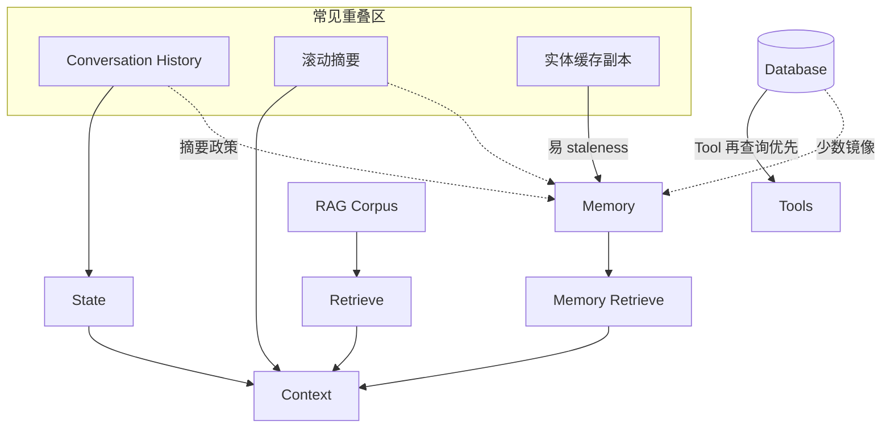
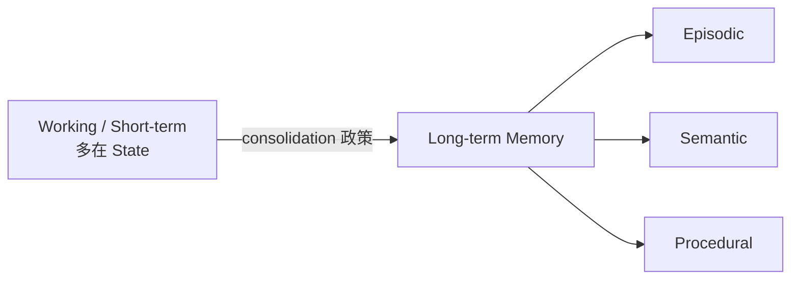
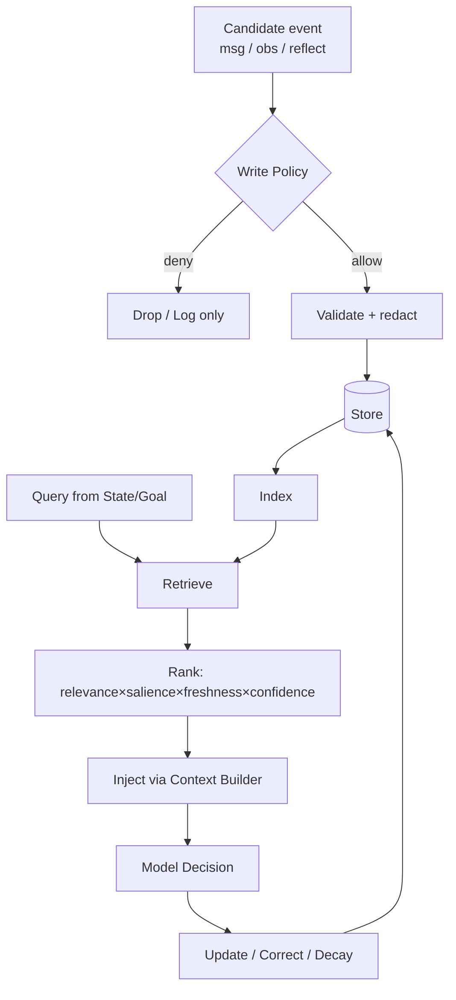
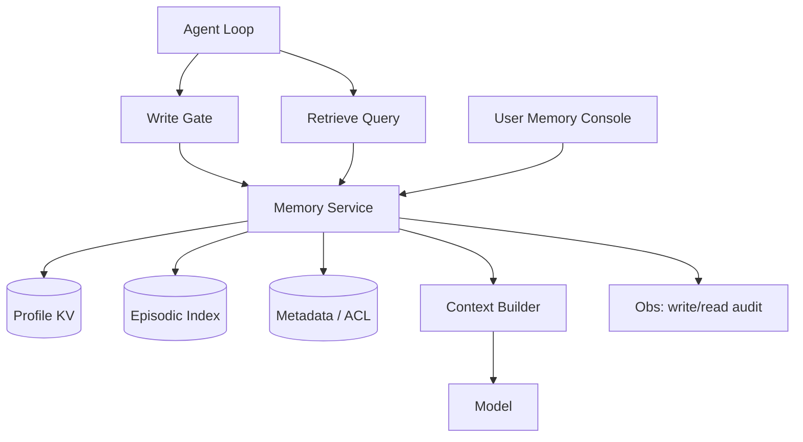

# Memory（Canonical）

> **一句话主题**：Memory 回答 **Agent 应该记住什么、如何写入/检索/更新/遗忘**，以及它与 State、Context、RAG、对话历史、数据库的边界——默认 **不该全写**。
>
> **状态**：Canonical · **Last reviewed**: 2026-10  
> **受众**：设计长程 Agent、会话连续性与隐私合规的工程师  
> **硬前置**：[Agent Loop](../agent-loop/agent-loop.md)；建议 [Agent Architecture](../agent-architecture/agent-architecture.md)  
> **软前置**：[Reasoning & Planning](../reasoning-planning/reasoning-planning.md)（反思写入）、[Tool Use](../tool-use/tool-use.md)

---

## 范围 / 非目标

**范围**：Memory 定义与动机；与 State/Context/RAG/History/DB 的边界与 overlap；记忆类型；读写更新巩固压缩遗忘；冲突/过时/出处/权限/隐私/安全；架构与生产；失败模式；评测；面试。

**非目标**：

| 主题 | 去哪里 |
|------|--------|
| 检索流水线、切分、引用、Agentic RAG | [RAG Canonical](../rag/rag.md) |
| 窗口装配、压缩进 prompt 的总责 | [`core/context-engineering`](../context-engineering/context-engineering.md) |
| Run 状态机、checkpoint | [Agent Loop](../agent-loop/agent-loop.md) |
| 组件拓扑 | [Agent Architecture](../agent-architecture/agent-architecture.md) |
| 向量库运维百科 | 不写 |

---

## 1. Memory Definition：Agent 到底应该记住什么？

**工程定义**：Memory 是一套 **跨步骤、跨任务、跨会话（可选）持久化信息** 的策略与系统，使 Agent 在未来决策中可 **有选择地召回** 过去经验、用户事实、任务产物与程序性偏好——且带有 **写入政策、出处、权限与遗忘**。

**应该记住的（高杠杆）**：

| 类别 | 例子 | 为何 |
|------|------|------|
| 稳定用户偏好/约束 | 语言、过敏、禁止渠道 | 跨会话一致 |
| 已确认事实 | 账户 ID、项目代号（经校验） | 减少重复询问 |
| 可迁移失败教训 | 「该 API 需幂等键」 | 改进后续决策（可链 Reflection） |
| 任务产物句柄 | 报告 URL、工单号 | 续跑与审计 |
| 程序性偏好 | 「先跑测试再提交」 | 降低重复规划成本 |

**默认不该记住的**：

- 原始全量 transcript / 工具 dump  
- 未验证的模型臆测  
- 密钥、完整支付信息、敏感 PII（或仅密存+强权限）  
- 一次性噪声、情绪宣泄、过期临时状态  
- 可随时从权威系统（DB/API）实时读到的真相（优先 **再查询**，而非固化副本）

**核心答案**：**记住「对未来决策有持久价值、且写入时可信」的最小信息集**——不是「发生过的一切」。

---

## 2. Why Agents Need Memory

没有 Memory，Agent 仍可在单次 run 内靠 State + Tools 工作；但会出现：

1. **跨会话失忆**：每次重问偏好与身份  
2. **长程目标断裂**：多日任务无法接续  
3. **重复犯错**：同类工具失败无沉淀  
4. **个性化缺失**：无法形成稳定用户模型  
5. **窗口不够**：单靠塞满 Context 不可扩展（分层记忆思想见 [paper-memgpt-2023](../../references/papers.md#paper-memgpt-2023)）

Generative Agents 展示：经历存储 + 检索 + 反思合成，对可信长期行为很关键（[paper-generative-agents-2023](../../references/papers.md#paper-generative-agents-2023)）。Reflexion 用情节缓冲承载语言反思以改进后续 trial（[paper-reflexion-2023](../../references/papers.md#paper-reflexion-2023)）——属 Memory 写入的一种策略，不是训练式 RL。

---

## 3. 关键边界（含现实 overlap）

### 3.1 工作定义（起点，非教条）

| 概念 | 工作定义 |
|------|----------|
| **State** | **当前任务 run** 的可序列化真相（messages、plan、预算、status） |
| **Memory** | **跨步骤/跨任务/跨会话** 保存、可检索的信息资产 |
| **Context** | **当前模型调用可见** 的信息视图（投影） |
| **RAG** | 从 **外部知识语料** 检索以增强生成/决策 |
| **Conversation History** | 对话消息序列；常是 State 的一部分，也可被摘要进 Memory |
| **Database** | 业务系统的权威结构化存储；Agent 通过 Tool 访问 |

### 3.2 对比表

| | State | Memory | Context | RAG | History | Database |
|--|-------|--------|---------|-----|---------|----------|
| 生命期 | 单 run（可恢复） | 跨 run/长期 | 单次调用 | 语料生命期 | 会话/run | 业务生命期 |
| 权威性 | run 内真相 | 可错、需出处 | 派生态 | 文档/语料 | 原始交互 | **常为业务权威** |
| 写入 | 每步强制 | **有政策的选择性写** | 一般不「持久写」 | 索引管道 | append | 业务事务 |
| 用途 | 推进 Loop | 个性化/长程/教训 | 喂模型 | 知识 grounding | 连贯对话 | 交易/实体 |

### 3.3 Overlap（现实系统）



**实践规则**：

1. **能权威再查的，不优先记成 Memory**（记句柄/查询键即可）  
2. **History 全量 ≠ Memory**；摘要进 Memory 要标 confidence/provenance  
3. **RAG 语料 ≠ 用户 Memory**；一个是共享知识，一个是主体专属经历/偏好  
4. **进 Context 的 Memory 命中仍是投影**；删改 Memory 后下次重建 Context  

架构层接口描述见 [Agent Architecture · State/Memory/Context](../agent-architecture/agent-architecture.md)。

---

## 4. 记忆类型（认知标签 → 工程映射）

> 下列名称借自认知科学习惯用语，**不声称** LLM 具有生物记忆；仅为工程分类。

| 类型 | 工程含义 | 典型存储 | 注意 |
|------|----------|----------|------|
| **Working Memory** | 当前任务即时工作集 | 常在 State/scratchpad | 别与长期 Memory 混淆 |
| **Short-term Memory** | 会话/近期窗口内可快速用的信息 | State + 热缓存 | 可随会话结束丢弃或巩固 |
| **Long-term Memory** | 跨会话持久 | DB/向量/KV | 需遗忘与权限 |
| **Episodic** | 「发生过什么」事件轨迹摘要 | 事件日志+摘要 | 易膨胀；要压缩 |
| **Semantic** | 「世界/用户是什么」事实 | KV/图谱/结构化 | 冲突与 staleness 高发 |
| **Procedural** | 「怎么做」偏好/套路 | 策略片段、playbook | 勿绕过 Policy/Tool 鉴权 |
| **Conversation Memory** | 对话连贯所需 | 摘要+关键指代 | ≠ 全量聊天记录 |
| **User Memory** | 用户主体档案 | 分租户加密存储 | 隐私核心 |
| **Task Memory** | 跨 run 任务进度/产物 | 任务库 | 与 State 交接要清晰 |
| **Agent Memory** | Agent 自身配置/教训/人设约束 | 配置+教训库 | 防自我人设漂移 |



---

## 5. 核心流水线

```text
Write
 ↓
Store
 ↓
Index
 ↓
Retrieve
 ↓
Rank
 ↓
Inject（进入 Context 装配）
 ↓
Use（影响 Decision）
 ↓
Update / Forget
```



**Inject 的实现细节**（如何裁剪进窗口）→ Context Engineering；本文只要求 Memory 返回 **带元数据的记忆项**。

---

## 6. Write / Read / Retrieve / Update / Consolidation / Compression / Forgetting

### 6.1 不应该全部写

**Write Policy 维度**（全部通过才写，或加权阈值）：

| 维度 | 问题 |
|------|------|
| **Relevance** | 对未来任务是否可能有用？ |
| **Salience** | 用户是否显式要求记住 / 高影响？ |
| **Freshness** | 是否会被更快过时？ |
| **Confidence** | 是否经工具/用户确认？ |
| **Provenance** | 来源是否可追溯？ |
| **Permissions** | 当前主体是否有权持久化？ |
| **Privacy** | 是否含敏感数据？需否加密/拒绝？ |
| **User control** | 用户是否可查看/删除/更正？ |

候选写入源：用户显式「请记住」、确认后的槽位填充、验证通过的实体、Reflection 教训（有上限）、任务完成摘要。

**禁止默认**：每条 assistant 消息、每个 tool 原始输出自动入库。

### 6.2 Read / Retrieval / Rank

- **Read**：按 id/键直接读（档案字段）  
- **Retrieve**：相似度/关键词/时间/图谱邻域  
- **Rank**：`score = f(relevance, salience, freshness, confidence, permission)`  
- 返回 **top-k + 理由元数据**；禁止静默塞入无关记忆

### 6.3 Update / Conflicts / Staleness

| 问题 | 策略 |
|------|------|
| 冲突 | 版本化；新值需更高 confidence 或用户确认；保留历史 |
| Staleness | TTL、source refresh、定期「再验证」任务 |
| 更正 | 用户更正优先；标记 superseded |

### 6.4 Consolidation / Compression

- **Consolidation**：短 → 长（会话结束摘要、日终反思合成）  
- **Compression**：多条情节 → 高层语义；保留指针可回放  
Generative Agents 的 reflection 合成是巩固的一种研究形态（[paper-generative-agents-2023](../../references/papers.md#paper-generative-agents-2023)）。

### 6.5 Forgetting / Decay / Deletion

| 机制 | 用途 |
|------|------|
| TTL / decay score | 自动淡出低价值项 |
| 用户删除 | 合规（被遗忘权） |
| 容量驱逐 | LRU/最低 salience |
| 法律保留例外 | 与产品政策对齐 |

遗忘必须 **可审计**：谁、何时、删了什么类别（未必保留原文）。

---

## 7. Provenance、Permissions、Privacy、Security

### 7.1 Provenance（出处）

每条记忆最小元数据：

```text
MemoryItem {
  id, subject_id, type,
  content,                       # 最小化、已脱敏
  provenance: {source, run_id?, tool?, quote_span?},
  confidence, created_at, last_verified_at,
  permissions, sensitivity,
  version, superseded_by?
}
```

### 7.2 Permissions

- 租户/用户隔离（默认）  
- Agent 间共享需显式 ACL（Multi-Agent 深文另述）  
- 工具不得因「记忆里有」而绕过运行时鉴权  

### 7.3 Privacy

- 最小化采集；敏感字段加密；展示前脱敏  
- 导出/删除 API；保留期限  
- 训练二次使用默认 **禁止** 除非独立合规流程  

### 7.4 Security：Injection / Poisoning

| 威胁 | 含义 | 缓解 |
|------|------|------|
| **Memory Injection** | 不可信内容被写入并在未来召回，劫持目标 | Write 政策；分隔 untrusted；高危动作不靠记忆升权 |
| **Memory Poisoning** | 恶意/错误长期污染用户模型 | 确认门、置信度、用户可更正、异常检测 |
| 间接注入经检索 | 记忆命中含「忽略政策」 | Inject 时标记 untrusted；Policy 仍为准 |

工具输出投毒链 [Tool Use](../tool-use/tool-use.md)；系统威胁模型链 [`security`](../../production/security/README.md)。

---

## 8. Memory Architecture（生产草图）



**与 MemGPT 的关系**：MemGPT 强调窗口内/外分层调度（[paper-memgpt-2023](../../references/papers.md#paper-memgpt-2023)）。生产上可借鉴「热/温/冷」层级，但 **写入政策、ACL、遗忘、出处** 仍需显式工程，不能只靠模型「自己管记忆」。

> TODO: Verify — 各托管「memory」产品是否暴露用户删除/出处字段，以官方文档为准。

---

## 9. Production Design

| 主题 | 要求 |
|------|------|
| **Storage** | 按类型分存（KV 档案 vs 事件索引）；加密 at rest |
| **Indexing** | 嵌入/关键词/结构化过滤；租户分区 |
| **Retrieval latency** | 同步路径设超时；失败降级为空命中而非阻塞写工具 |
| **Cost** | 控制写入率、top-k、嵌入调用；巩固批处理 |
| **Consistency** | 同键更新的版本；跨副本最终一致需声明 |
| **Versioning** | 冲突与回滚可查 |
| **Deletion** | 硬删/软删政策；索引同步删除 |
| **Privacy** | 见上 |
| **Observability** | write_allowed/denied、retrieve_k、hit 贡献、更正事件 |
| **Evaluation** | 见下 |

Memory 失败是否阻断 Loop：由 Policy 声明（档案关键写失败可阻断；分析型情节写失败可降级）。

---

## 10. Failure Modes

| 模式 | Symptom | Cause | Impact | Detection | Mitigation |
|------|---------|-------|--------|-----------|------------|
| Over-write | 库膨胀、噪声召回 | 无写政策 | 差决策/成本 | write_rate | 严格闸门 |
| Under-write | 反复重问 | 闸过严/无显式记住 | UX 差 | re-ask rate | 槽位+显式记住 |
| Wrong memory | 坚持错误事实 | 未验证写入 | 错误行动 | 用户更正、对账 | confidence+再验证 |
| Stale memory | 用过期地址/价格 | 无 TTL | 失败/投诉 | freshness 检查 | TTL+权威再查 |
| Conflict thrash | 来回改 | 无版本策略 | 抖动 | version churn | 确认门 |
| Poisoning | 行为突变 | 注入写入 | 安全事故 | 异常召回审核 | ACL+审核 |
| Privacy leak | 日志/召回泄露 PII | 未脱敏 | 合规风险 | DLP 扫描 | 最小化+加密 |
| Retrieve miss | 该记的召不回 | 索引差 | 失忆 | 任务评测 | 混合检索 |
| Context flood | 命中过多塞窗 | 无 rank/top-k | 延迟/糊决策 | token 占用 | rank+预算 |
| Ghost memory | 删了仍召回 | 索引不同步 | 合规失败 | 删除校验 | 事务删除 |

---

## 11. Trade-offs（定性）

| 策略 | 个性化 | 风险 | 成本 | 复杂度 | 适用 |
|------|--------|------|------|--------|------|
| 无 Memory | 低 | 低 | 低 | 低 | 单次工具任务 |
| 仅 State/History | 会话内中 | 中 | 中 | 低 | 短会话 |
| 用户显式 Memory | 高 | 中 | 低-中 | 中 | 助手产品默认推荐 |
| 自动情节+巩固 | 高 | 高 | 高 | 高 | 长程仿真/研究型 |
| 全量记一切 | 虚高 | 很高 | 很高 | 高 | **不推荐** |

---

## 12. Evaluation

不要只问「记没记住」。

| 类 | 指标例子 |
|----|----------|
| Outcome | 跨会话任务成功率、减少重问次数 |
| Process | 有用命中率、有害命中率、更正率 |
| Efficiency | 写入率、检索延迟、token 占比 |
| Safety | 注入召回拦截、PII 泄漏事件、删除完备性 |
| Quality | 过时率、冲突率、用户满意度 |

与端到端 Agent 评测衔接 → [`evaluation`](../../production/evaluation/README.md)。  
RAG 检索质量指标 → [rag.md](../rag/rag.md)（勿混为「记忆好」）。

---

## 13. 与 Loop / Architecture 的挂钩

```text
Loop step end
  → candidate memories → Write Gate → Store
Loop build_context
  → Retrieve/Rank → Context Builder → Model
User/Admin
  → list / correct / delete
```

Reflection 写入教训：见 [Reasoning · Reflection](../reasoning-planning/reasoning-planning.md)；必须有条数/置信门槛。

---

## 14. 伪代码

```text
algorithm MaybeWrite(event, subject, policy):
  if not policy.allows(event, subject): return Denied
  item ← Redact(Normalize(event))
  if item.confidence < policy.min_confidence: return Denied
  if contains_forbidden_pii(item): return Denied_or_EncryptSlot
  item.provenance ← event.source
  Store.upsert(item)   # versioned
  Index.update(item)
  Audit.write(item.id, "upsert")
  return OK

algorithm RetrieveForTurn(state, goal, k):
  q ← BuildQuery(state, goal)
  cands ← Index.search(q, acl=state.subject, limit=k*5)
  ranked ← Rank(cands, freshness, confidence, salience)
  return ranked[:k]   # Context Builder 决定如何注入

algorithm Consolidate(session):
  raw ← session.episodic_buffer
  summary ← Summarize(raw)          # 可模型辅助，但结果需政策审查
  MaybeWrite(summary, type=semantic_or_episodic_high)
  Decay(raw, policy)
```

---

## 15. Interview Questions

### Beginner

**Q1. Agent 应该记住什么？**  
- **短答**：对未来决策有持久价值且可信的最小信息。  
- **详解**：非全量历史。  
- **追问**：举例不该记的三样。  
- **常见错误**：全量 transcript 入库。  
- **相关**：§1。

**Q2. Memory 和 State 区别？**  
- **短答**：State=当前 run 真相；Memory=跨任务/会话可召回资产。  
- **详解**：有 overlap（摘要）。  
- **追问**：plan 属于谁？  
- **常见错误**：混为一个表。  
- **相关**：§3。

**Q3. Memory 和 Context 区别？**  
- **短答**：Memory 是存储；Context 是本次可见投影。  
- **详解**：命中后经 Context Builder 注入。  
- **追问**：删 Memory 后 Context？  
- **常见错误**：把窗口当记忆本体。  
- **相关**：§3。

**Q4. Memory 和 RAG 区别？**  
- **短答**：Memory 多属主体经历/偏好；RAG 是外部知识语料检索。  
- **详解**：管道可相似，所有权不同。  
- **追问**：公司政策文档放哪？  
- **常见错误**：一个向量库打天下且不分 ACL。  
- **相关**：§3、rag README。

**Q5. 为什么不要全部写入？**  
- **短答**：噪声、过时、隐私、投毒、成本。  
- **详解**：Write Policy。  
- **追问**：显式「请记住」如何处理？  
- **常见错误**：tool 输出全记。  
- **相关**：§6。

**Q6. Episodic vs Semantic？**  
- **短答**：情节=事件经历；语义=稳定事实。  
- **详解**：巩固可从情节提炼语义。  
- **追问**：各举一例。  
- **常见错误**：只堆情节不提炼。  
- **相关**：§4。

**Q7. Provenance 是什么？**  
- **短答**：记忆从哪来、何时、靠什么证据。  
- **详解**：支持更正与审计。  
- **追问**：缺出处的风险？  
- **常见错误**：只存文本。  
- **相关**：§7。

**Q8. Forgetting 为何必要？**  
- **短答**：容量、隐私、减少过时与噪声。  
- **详解**：TTL/用户删/衰减。  
- **追问**：与合规保留冲突？  
- **常见错误**：只增不减。  
- **相关**：§6.5。

**Q9. Memory Poisoning 是什么？**  
- **短答**：恶意或错误内容污染长期记忆并影响未来行为。  
- **详解**：写闸+确认+可更正。  
- **追问**：与 prompt injection 关系？  
- **常见错误**：检索命中即信任。  
- **相关**：§7.4。

**Q10. 无 Memory 能否做 Agent？**  
- **短答**：能；单 run + Tools 即可。  
- **详解**：Memory 服务长程/个性化。  
- **追问**：何时必须上？  
- **常见错误**：Day1 就上自动情节记忆。  
- **相关**：§2、§11。

### Intermediate

**Q11. 设计 Write Policy 的判定顺序。**  
- **短答**：权限→隐私→置信→显著性→相关性→容量。  
- **详解**：短路径拒绝。  
- **追问**：用户显式记住但含 PII？  
- **常见错误**：只靠模型决定写不写。  
- **相关**：§6.1。

**Q12. History 摘要进 Memory 的风险？**  
- **短答**：摘要错误固化、丢失否定句。  
- **详解**：低 confidence、可回放原文句柄。  
- **追问**：如何评测摘要保真？  
- **常见错误**：摘要覆盖原事实无版本。  
- **相关**：§3.3。

**Q13. 何时记句柄而非记值？**  
- **短答**：权威系统可再查、值易变、敏感。  
- **详解**：记 order_id 不记全地址副本（或短 TTL）。  
- **追问**：离线场景例外？  
- **常见错误**：缓存价格当长期语义。  
- **相关**：§1、§3。

**Q14. Rank 函数应含哪些因子？**  
- **短答**：relevance、salience、freshness、confidence、permission。  
- **详解**：可解释 top-k。  
- **追问**：如何防只靠余弦相似度？  
- **常见错误**：只按时间倒序。  
- **相关**：§5–6。

**Q15. 冲突如何解决？**  
- **短答**：版本化+更高证据覆盖+用户确认。  
- **详解**：保留历史。  
- **追问**：两来源同置信？  
- **常见错误**：静默覆盖。  
- **相关**：§6.3。

**Q16. Memory 与 Reflection 如何衔接？**  
- **短答**：反思产物经 Write Gate 才入库；有上限。  
- **详解**：链 Reasoning。  
- **追问**：空反思怎么办？  
- **常见错误**：每轮反思都永久写。  
- **相关**：Reflexion、§13。

**Q17. 多租户隔离要点？**  
- **短答**：检索强制 subject/tenant 过滤；防 IDOR。  
- **详解**：测跨租户召回。  
- **追问**：共享组织记忆？  
- **常见错误**：全局向量库无过滤。  
- **相关**：§7.2。

**Q18. 删除如何保证索引一致？**  
- **短答**：同一事务/工作流出主存与索引；校验任务。  
- **详解**：软删窗口。  
- **追问**：异步删除失败？  
- **常见错误**：只删 DB 留 embedding。  
- **相关**：§9、§10。

**Q19. 检索超时对 Loop 的影响？**  
- **短答**：降级空命中继续；或短重试；不无限堵。  
- **详解**：政策声明。  
- **追问**：关键用户约束检索失败？  
- **常见错误**：拖垮整步。  
- **相关**：§9。

**Q20. 如何度量「有害命中」？**  
- **短答**：标注集+线上更正/拦截事件率。  
- **详解**：与成功命中分开。  
- **追问**：谁来标？  
- **常见错误**：只看召回率。  
- **相关**：§12。

### Advanced

**Q21. 设计用户可解释的 Memory Console。**  
- **短答**：列表/来源/时间/编辑/删除；高敏字段掩码。  
- **详解**：每次变更审计。  
- **追问**：程序性记忆是否展示？  
- **常见错误**：黑盒不可删。  
- **相关**：§7、§8。

**Q22. 热/温/冷分层怎么映射？**  
- **短答**：热=State/工作集；温=近期情节；冷=长期语义档案。  
- **详解**：借鉴 MemGPT 思想但加政策。  
- **追问**：晋升/降级触发？  
- **常见错误**：一层向量打全。  
- **相关**：[`paper-memgpt-2023`](../../references/papers.md#paper-memgpt-2023)、§8。

**Q23. 程序性记忆与 Policy 冲突？**  
- **短答**：Policy/鉴权永远优先；程序性记忆不可授特权。  
- **详解**：记忆只建议顺序。  
- **追问**：用户教「跳过审批」？  
- **常见错误**：把 playbook 当允许列表。  
- **相关**：§4、§7。

**Q24. 巩固任务的批处理设计。**  
- **短答**：会话结束入队；限频；失败可重试；产出进 Write Gate。  
- **详解**：避免在线关键路径做重摘要。  
- **追问**：如何控成本？  
- **常见错误**：每 step 全量巩固。  
- **相关**：§6.4。

**Q25. 记忆注入导致目标漂移的检测。**  
- **短答**：goal_ref 固定；召回内容含改目标指令则剥离；行为突变告警。  
- **详解**：链 Security/Reasoning。  
- **追问**：灰色「用户改偏好」？  
- **常见错误**：召回文本直接当系统目标。  
- **相关**：§7.4。

**Q26. 跨 Agent 共享记忆的最小可行？**  
- **短答**：显式共享空间+ACL+类型限制；默认不共享。  
- **详解**：深文留给 Multi-Agent。  
- **追问**：冲突合并？  
- **常见错误**：全局黑板。  
- **相关**：multi-agent README。

**Q27. 评估 Memory 对端到端增益的实验。**  
- **短答**：同任务跨会话：无记忆 vs 显式记忆 vs 自动记忆；看成功/重问/有害。  
- **详解**：预注册指标。  
- **追问**：霍桑效应？  
- **常见错误**：只展示能记住名字。  
- **相关**：§12。

**Q28. 嵌入漂移导致召回变差如何治理？**  
- **短答**：模型版本钉扎；重建索引任务；双索引过渡。  
- **详解**：监控命中率。  
- **追问**：在线切换？  
- **常见错误**：静默换嵌入模型。  
- **相关**：§9。

**Q29. 法律「被遗忘」与审计日志张力。**  
- **短答**：内容删、审计留类别/时间戳；或分域保留。  
- **详解**：法务政策化。  
- **追问**：备份怎么删？  
- **常见错误**：忽略备份残留。  
- **相关**：§6.5、§7.3。

**Q30. Tool 结果进记忆的安全管道。**  
- **短答**：先归一化脱敏→置信打分→政策→入库；原始 dump 外置句柄。  
- **详解**：链 Tool Use。  
- **追问**：错误 observation？  
- **常见错误**：字符串直写。  
- **相关**：§5、Tool Use。

### Expert

**Q31. 形式化 MemoryItem 不变量。**  
- **短答**：有 subject、provenance、version；召回必过 ACL；敏感字段不可明文日志。  
- **详解**：写入拒绝缺字段。  
- **追问**：如何测试？  
- **常见错误**：自由 JSON 无 schema。  
- **相关**：§7.1。

**Q32. 对抗性用户教 Agent「记住错误事实」？**  
- **短答**：显式记住进待确认队列；影响高危动作前再验证；可举报。  
- **详解**：社会工程面。  
- **追问**：儿童账号？  
- **常见错误**：用户说什么记什么立即生效。  
- **相关**：§6–7。

**Q33. 大规模下写放大与检索 SLA。**  
- **短答**：采样写、合并巩固、异步索引；在线检索隔离池。  
- **详解**：背压。  
- **追问**：尖峰会话？  
- **常见错误**：同步嵌所有写。  
- **相关**：§9。

**Q34. 将「可信记忆」与「假设记忆」分信道。**  
- **短答**：confirmed vs hypothesized；仅 confirmed 可驱动副作用。  
- **详解**：假设可进 Context 但标注。  
- **追问**：升级门槛？  
- **常见错误**：混信道。  
- **相关**：§6.3。

**Q35. Memory 在 Control/Data Plane 的归属？**  
- **短答**：政策在控制面；存储/检索执行在数据面；审计横切。  
- **详解**：链 Architecture。  
- **追问**：谁发写许可？  
- **常见错误**：Worker 自决永久写。  
- **相关**：Architecture。

**Q36. 长期人设（persona）记忆的漂移控制。**  
- **短答**：人设基线只读；增量教训分区；定期对齐评测。  
- **详解**：防逐渐越狱。  
- **追问**：产品运营改人设？  
- **常见错误**：人设与用户记忆混写。  
- **相关**：§4 Agent Memory。

**Q37. 多模态记忆（截图/语音）的最小政策。**  
- **短答**：存句柄+描述摘要；原件强 ACL/TTL；检索用描述。  
- **详解**：成本与隐私更高。  
- **追问**：OCR 错误？  
- **常见错误**：原图永久可被任意召回。  
- **相关**：§7、§9。  
- **TODO: Verify** — 具体产品多模态 memory API。

**Q38. 设计红队题库针对记忆面。**  
- **短答**：投毒写入、跨租户召回、删除残留、用记忆升权、过时关键事实。  
- **详解**：期望拦截/更正。  
- **追问**：回归频率？  
- **常见错误**：只测「能记住名字」。  
- **相关**：§10、§12。

**Q39. 与数据库 CDC 同步「语义镜像」是否该做？**  
- **短答**：默认不；易 stale。若做：短 TTL+版本+失效总线。  
- **详解**：优先 Tool 再查。  
- **追问**：搜索体验例外？  
- **常见错误**：全表镜像进向量。  
- **相关**：§3。

**Q40. 开源 Agent「memory」模块 audit 清单。**  
- **短答**：写闸、ACL、出处、删除、衰减、评测、与 Context 分离。  
- **详解**：对照本文。  
- **追问**：只有向量 store 包装？  
- **常见错误**：有 store 就叫 memory。  
- **相关**：open-source-analysis。

### System Design

**Q41. 设计助手产品的 Memory 系统。**  
- **短答**：显式记住+档案 KV+情节索引+用户控制台+Write Gate+审计。  
- **详解**：默认不开全自动狂写。  
- **追问**：企业租户？  
- **常见错误**：ChatGPT 式黑盒。  
- **相关**：§8–9。

**Q42. 设计长程项目管理 Agent 的 Task Memory。**  
- **短答**：任务实体库存进度/产物句柄；run State 交接；完成巩固。  
- **详解**：与票务系统二选一权威。  
- **追问**：并行子任务？  
- **常见错误**：只靠聊天摘要。  
- **相关**：§4 Task Memory。

**Q43. 设计可被遗忘合规的全球部署。**  
- **短答**：分区存储、删除编排含备份、审计最小化、DPA。  
- **详解**：法务嵌入政策。  
- **追问**：多区域副本？  
- **常见错误**：忽略日志与仓库。  
- **相关**：§7.3。

**Q44. 设计 Memory 对 Coding Agent 的最小集。**  
- **短答**：用户偏好（风格/测试命令）、仓库惯例摘要、失败教训；不记 secrets。  
- **详解**：代码真相以仓库+检索为准。  
- **追问**：.env 被读？  
- **常见错误**：索引全部文件当用户记忆。  
- **相关**：coding-agent README、RAG。

**Q45. 从「会话摘要」演进到完整 Memory 的里程碑。**  
- **短答**：P0 显式记住 → P1 出处/删除 → P2 检索 rank → P3 巩固/衰减 → P4 评测与红队。  
- **详解**：对齐 practice；迟上全自动。  
- **追问**：哪步不可妥协？  
- **常见错误**：直接 MemGPT 全抄无政策。  
- **相关**：§11、[`paper-memgpt-2023`](../../references/papers.md#paper-memgpt-2023)。

---

## 16. Cross References

- [Agent Loop](../agent-loop/agent-loop.md) · [Agent Architecture](../agent-architecture/agent-architecture.md)  
- [Reasoning & Planning](../reasoning-planning/reasoning-planning.md) · [Tool Use](../tool-use/tool-use.md)  
- [RAG](../rag/rag.md) · [Context Engineering](../context-engineering/context-engineering.md)  
- [Evaluation](../../production/evaluation/README.md) · [Observability](../../production/observability/README.md)  
- [Security](../../production/security/README.md)  
- [Multi-Agent](../../agent-types/multi-agent/README.md) · [Coding Agent](../../agent-types/coding-agent/README.md)

---

## 17. References

- [paper-generative-agents-2023](../../references/papers.md#paper-generative-agents-2023)  
- [paper-memgpt-2023](../../references/papers.md#paper-memgpt-2023)  
- [paper-reflexion-2023](../../references/papers.md#paper-reflexion-2023)  
- [article-anthropic-building-effective-agents-2024](../../references/articles.md#article-anthropic-building-effective-agents-2024)（简单可组合；记忆亦应按需增加）  
- 边界依赖：Architecture / Loop / RAG README / Context README

---

## 18. Self-review / TODOs

- [x] 「不该全写」与 Write Policy 明确  
- [x] State/Context/RAG/History/DB 边界含 overlap  
- [x] 未写 RAG/Context Canonical 正文  
- [x] 安全：injection/poisoning/privacy  
- [x] 45 面试题；生产与失败模式  
- [ ] TODO: Verify — 托管 Memory 产品的删除/出处能力  
- [ ] TODO: Verify — 多模态 memory API  
