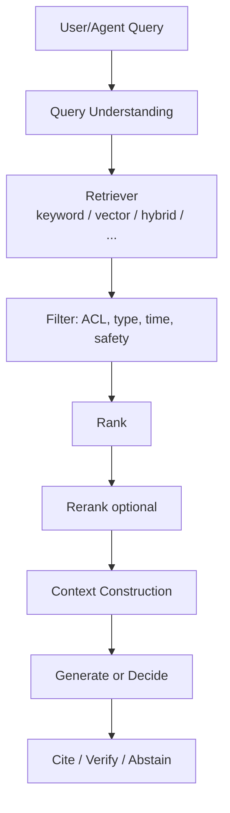
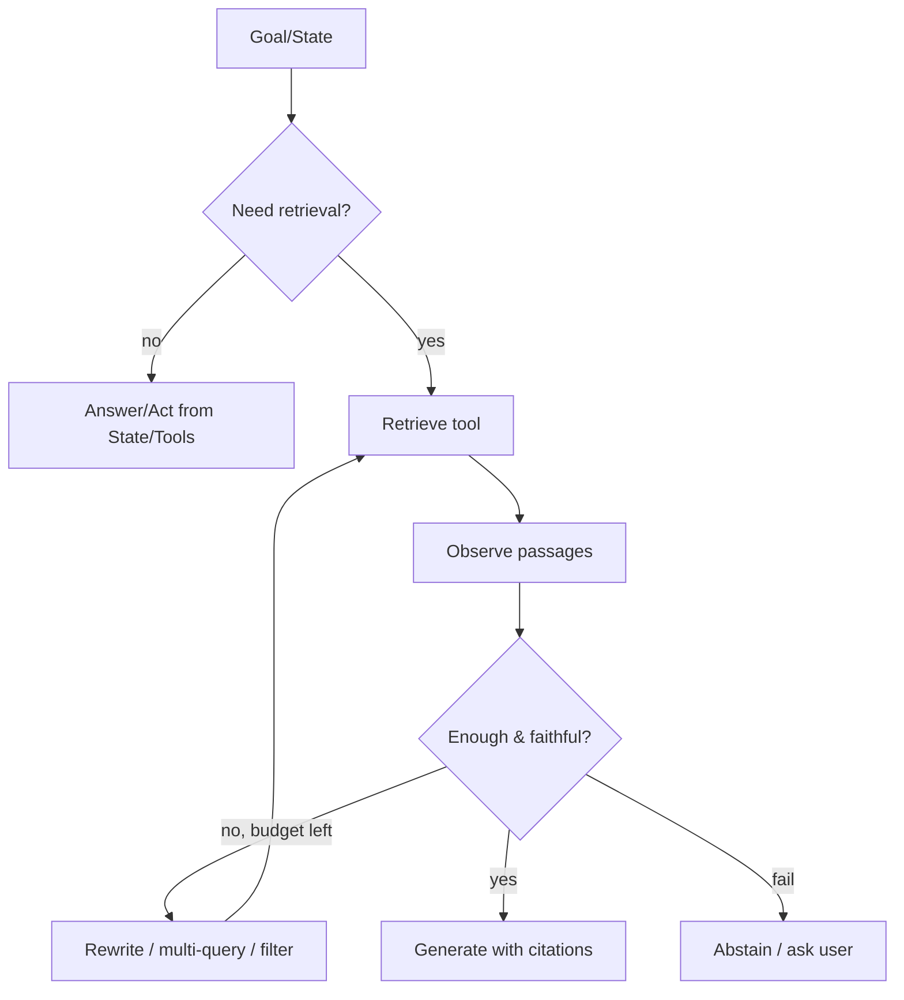
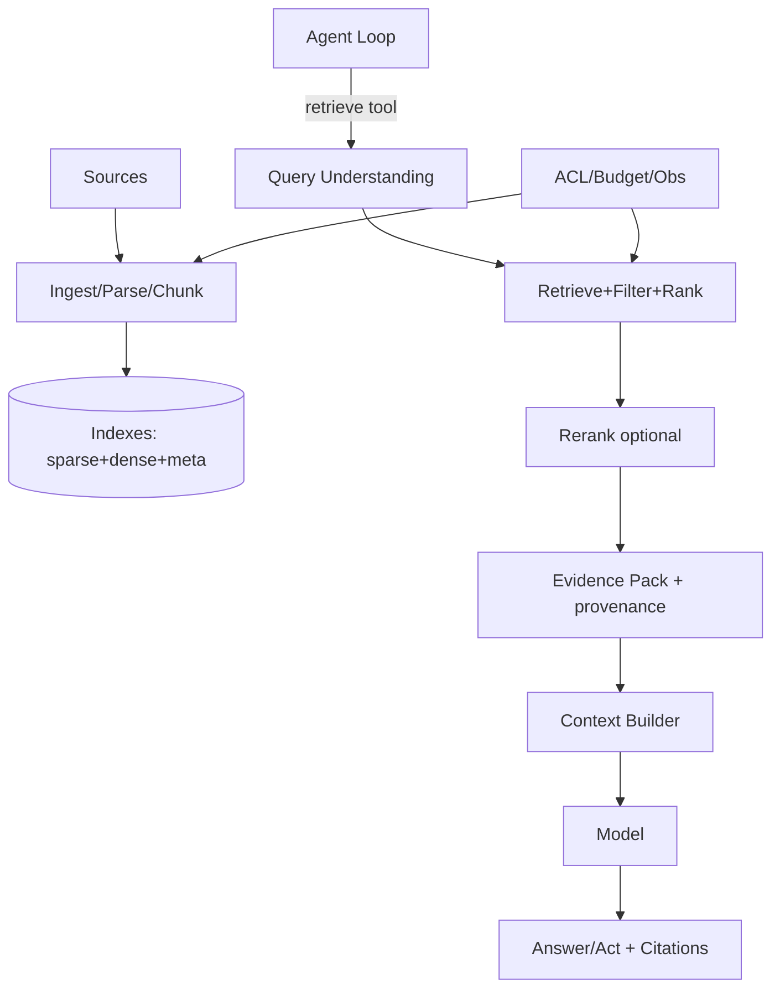

# RAG（Canonical）

> **一句话主题**：RAG（Retrieval-Augmented Generation）回答 **当当前 Context 中不存在所需外部知识时，如何检索语料、构造可追溯证据并增强生成/决策**——它是检索增强机制，不是 Memory、不是通用 Search、不是 Database、也不是 Context Engineering 本身。
>
> **状态**：Canonical · **Last reviewed**: 2026-10  
> **受众**：构建知识密集型 Agent / 问答与 grounding 系统的工程师  
> **硬前置**：[Agent Loop](../agent-loop/agent-loop.md)、[Tool Use](../tool-use/tool-use.md)（检索常以工具形式接入）  
> **边界对照**：[Memory](../memory/memory.md) · [`context-engineering`](../context-engineering/context-engineering.md)

---

## 范围 / 非目标

**范围**：RAG 定义与动机；端到端检索管道（摄入→切分→嵌入→索引→检索→过滤→排序/重排→上下文构造→生成→引用）；查询改写/多查询/HyDE/混合检索；结构化与图谱检索接口；Agentic/迭代检索；失败、幻觉、过时；评测；延迟成本安全；生产架构；与 Memory/Search/Agent 的关系；面试。

**非目标**：

| 主题 | 去哪里 |
|------|--------|
| 用户/情节记忆写闸与遗忘 | [Memory](../memory/memory.md) |
| 窗口预算总装配（多源合并策略） | [`context-engineering`](../context-engineering/context-engineering.md) |
| MCP 协议 | [`protocols/mcp`](../../protocols/mcp/README.md) |
| 向量数据库运维百科、厂商控制台教程 | 不写 |
| 训练式检索器微调深水 | 可链 Fine-tuning；本文以在线系统为主 |

---

## 1. RAG Definition

**RAG** = 在生成（或 Agent 决策）前，从 **外部非参数化知识语料** 检索相关片段，将证据注入模型输入，以增强事实性、可更新性与可追溯性的机制。

术语源自 Lewis 等（2020）：参数化模型 + 非参数化检索记忆的检索增强生成（[paper-rag-2020](../../references/papers.md#paper-rag-2020)）。工程上「RAG」已泛化为 **检索管道 + 增强生成/行动** 的系统模式，不必绑定该论文的可微端到端训练设定。

**核心问题**：Agent 如何获取 **当前 Context 中不存在** 的外部知识？

答案形态：

1. **索引语料检索（RAG）**  
2. **实时工具/API/DB 查询**（Tool Use；权威动态数据常更优）  
3. **Memory 召回**（主体经历/偏好，非共享语料）  
4. **拒答 / 澄清**（检索失败时的正确行为）

---

## 2. Why RAG

| 仅靠参数知识 | + RAG |
|--------------|-------|
| 知识截止、难更新 | 换索引即可更新 |
| 难指出处 | 可带 citation / provenance |
| 领域私有知识弱 | 可索引内部文档 |
| 易幻觉事实 | 可 grounding（非自动消灭幻觉） |

**何时不该硬上 RAG**：答案已在 State/工具实时结果中；需要事务权威（下单、余额）应 Tool→DB；只需用户偏好应 Memory。

---

## 3. 不等式与边界

```text
RAG ≠ Memory
RAG ≠ Search（单纯搜索可不生成）
RAG ≠ Database（DB 是权威存储；RAG 是检索增强生成机制）
RAG ≠ Context Engineering（Context 管「如何塞进窗口」；RAG 管「从语料取什么证据」）
```

| | RAG | Memory | Search | Database | Context Eng. |
|--|-----|--------|--------|----------|--------------|
| 对象 | 共享/领域语料 | 主体经历与偏好 | 查询→文档列表 | 结构化权威数据 | 多源窗口投影 |
| 典型写 | 离线/近线索引管道 | 在线写闸 | 爬取/索引 | 业务事务 | 通常不持久写语料 |
| 输出 | 证据片段→生成/决策 | 记忆项 | 排名列表 | 行/对象 | prompt 视图 |
| 权威 | 语料版本 | 可错需确认 | 视语料 | **常最高** | 派生态 |

**Overlap**：Memory 也可能用向量检索；RAG 命中要经 Context Builder 注入；Search 是 RAG 的检索子步骤。所有权仍按上表划分（见 [Memory §边界](../memory/memory.md)）。

---

## 4. 端到端流程

```text
Query
 ↓
Query Understanding（改写 / 多查询 / 路由）
 ↓
Retrieval（候选生成）
 ↓
Filtering（ACL / 元数据 / 安全）
 ↓
Ranking
 ↓
Reranking（可选）
 ↓
Context Construction（选段、去重、预算）
 ↓
Generation / Agent Decision
 ↓
Citation / Verification
```



---

## 5. 摄入管道：Ingestion → Parsing → Chunking → Metadata → Embedding → Indexing

### 5.1 Document Ingestion

来源：Wiki、PDF、工单、代码、网页、表格导出……  
要求：去重、版本、租户、许可、增量更新、删除同步。

### 5.2 Parsing

提取正文与结构（标题、表、代码块）；保留页码/锚点。  
坏解析 = 后续全错。扫描件 OCR 错误需标 confidence。

### 5.3 Chunking

| 策略 | 要点 |
|------|------|
| 定长 / 滑动窗 | 简单；易切断语义 |
| 结构感知 | 按标题/段落/函数 |
| 父子 / 小块+大块 | 检索用小块，生成带回父块 |
| 语义切分 | 成本较高 |

**工程要点**：chunk 带稳定 `chunk_id`；重叠防边界丢失；表格/代码慎切碎。

### 5.4 Metadata

`source, version, updated_at, acl, lang, doc_type, section_path, tenant_id, sensitivity`  
元数据驱动 **Filtering**，往往比「更大嵌入模型」更管用。

### 5.5 Embedding

稠密向量表示；版本必须钉扎；换模型要重建索引。  
> TODO: Verify — 具体商用 embedding 模型名单与维度以当前供应商文档为准，本文不绑死型号。

### 5.6 Indexing

ANN 向量索引、倒排（关键词）、可选列存过滤索引、图谱节点边。  
删除/更新必须 **索引一致**（与 Memory 删除同理）。

---

## 6. Retrieval 子系统

### 6.1 Candidate Generation → Filtering → Ranking → Reranking

1. **Candidate Generation**：召回 top-N（偏 recall）  
2. **Filtering**：ACL、时间、类型、安全黑名单  
3. **Ranking**：融合分数（向量/词法/业务先验）  
4. **Reranking**：交叉编码器或 LLM 精排 top-n→top-k（偏 precision，增延迟）

### 6.2 Keyword / Vector / Metadata / Hybrid

| 方式 | 擅长 | 弱点 |
|------|------|------|
| **Keyword（稀疏）** | 专有名词、错误拼写容忍视实现、可解释 | 语义同义弱 |
| **Vector（稠密）** | 语义相似 | 专名、精确约束弱 |
| **Metadata** | 强过滤 | 不解决语义 |
| **Hybrid** | 多数生产默认 | 调权成本 |

### 6.3 Structured / Graph Retrieval

- **Structured**：SQL/ORM 查询、目录树、API（常表现为 Tool，结果可再进 Context）  
- **Graph**：实体关系邻域扩展；适合强关系问题  

> 图谱/SQL 细节不在本文展开运维；强调它们是 **检索通道**，最终仍要证据化注入。

---

## 7. Query 侧技术

### 7.1 Query Rewriting

把对话指代、口语改成可检索查询；可规则或模型。  
风险：改写跑偏 → 检索失败。

### 7.2 Multi-query Retrieval

同一信息需求生成多个查询并合并去重候选，提高召回。  
成本：×查询数的检索与嵌入。

### 7.3 HyDE

生成「假设文档」再嵌入检索，以文档邻域锚定语料（[paper-hyde-2022](../../references/papers.md#paper-hyde-2022)）。  
风险：假设文档的错误细节；依赖后续真实文档 grounding。  
**不是**默认必选。

---

## 8. Context Construction → Generation → Citation

### 8.1 Context Construction

在检索结果上：去重、多样性、按预算截断、保留引用锚点、标注 untrusted。  
**总窗口与多源优先级** → Context Engineering；RAG 负责提供 **带 provenance 的证据包**。

### 8.2 Generation

模型基于证据生成答案或决定下一步工具。  
指令应要求：**无证据则拒答/澄清**；禁止无视检索空结果硬编。

### 8.3 Citation / Provenance / Verification

- 每条关键陈述尽量对齐 `chunk_id` / URL / 页码  
- 校验：引用是否真在命中集；可选 NLI/规则 faithfulness 检查  
- Verification ≠「再问模型你对吗」（见 [Reasoning · Verification](../reasoning-planning/reasoning-planning.md)）

---

## 9. Agentic RAG（可选形态，非唯一正解）

### 9.1 传统 RAG

```text
Query → Retrieve → Generate
```

适合：单跳事实、语料干净、查询清晰、延迟敏感。

### 9.2 Agentic RAG

检索成为 Agent Loop 中的 **工具化、可迭代** 行为：

```text
Goal
 → Decide whether retrieval is needed
 → Search
 → Observe
 → Evaluate（足够？冲突？过时？）
 → Refine Query
 → Search again
 → Generate / Act / Abstain
```



**要点**：

- Agentic RAG **建立在** Loop + Tool Use 上，不是替代它们  
- **不是**唯一正确形式：多跳/模糊查询时收益大；简单 FAQ 可能更差（延迟/成本/不稳定）  
- 必须有 **检索步数预算** 与无进展熔断（链 [Agent Loop](../agent-loop/agent-loop.md) / [Reasoning Budget](../reasoning-planning/reasoning-planning.md)）

---

## 10. Iterative Retrieval 与 Retrieval Failure

| 失败 | 表现 | 处置 |
|------|------|------|
| 空召回 | 无候选 | 改写、扩召回、换通道、拒答 |
| 错召回 | 高分无关 | 过滤、重排、元数据约束 |
| 部分证据 | 缺关键块 | 多查询/父块扩展 |
| 冲突证据 | 多源矛盾 | 展示冲突、标版本、勿静默融合 |
| 权限过滤后空 | ACL 过严或越权尝试 | 审计；对用户可解释「无权限」 |

**Hallucination**：模型在无/弱证据时仍断言。缓解：强制引用、空结果拒答、后验 faithfulness、降低温度；**RAG 不自动消灭幻觉**。

**Stale Data**：索引落后于源。缓解：增量更新、`updated_at` 过滤、对权威动态数据改走 Tool/DB。

---

## 11. Evaluation

**retrieval quality ≠ generation quality** —— 必须拆开测。

| 指标 | 测什么 | 层 |
|------|--------|-----|
| **Recall@k / Precision@k** | 命中集质量 | Retrieval |
| **MRR** | 首个相关位置 | Retrieval |
| **nDCG** | 排序质量 | Retrieval |
| **Retrieval Accuracy** | 任务定义下的检索正确率 | Retrieval |
| **Context Relevance** | 注入上下文是否相关 | Mid |
| **Faithfulness** | 生成是否忠实于证据 | Generation |
| **Answer Accuracy** | 最终对错 | End-to-end |
| **Latency / Cost** | p95、$/query、检索次数 | Ops |

实践：先修检索指标，再看端到端；否则优化生成 prompt 会掩盖烂召回。  
端到端 Agent 评测框架 → [`evaluation`](../../production/evaluation/README.md)。

---

## 12. Latency、Cost、Security

| 维度 | 杠杆 |
|------|------|
| **Latency** | 缓存、ANN、缩 N、条件化重排、并行多查询有上限 |
| **Cost** | 嵌入/重排/LLM 改写次数；Agentic 步数帽 |
| **Security** | 索引 ACL；防检索投毒；敏感语料隔离；引用不泄露无权片段；查询日志脱敏 |

投毒文档进语料 ≈ 间接注入源；过滤与来源信任级别必要。链 [`security`](../../production/security/README.md)。

---

## 13. Production Architecture



**Agent + RAG**：检索工具返回 **Evidence Pack**（文本+metadata+score），不返回「已经是最终答案」的黑盒（除非明确的 QA 子服务）。决策仍在 Loop。

---

## 14. Trade-offs（定性）

| 模式 | 延迟 | 成本 | 鲁棒 | 适用 |
|------|------|------|------|------|
| 单次 Hybrid RAG | 低-中 | 低-中 | 中 | FAQ、文档助手默认 |
| + Rerank | 中 | 中 | 中-高 | 精度敏感 |
| Multi-query / HyDE | 中-高 | 高 | 视任务 | 难查询、冷启动 |
| Agentic 迭代检索 | 高 | 高 | 高（有预算时） | 多跳、调研 |
| 纯 Tool/DB | 视 API | 视 API | 高（权威） | 交易/实时状态 |

---

## 15. 伪代码

```text
algorithm ClassicRAG(query, user, k):
  q ← Rewrite(query)                    # optional
  cands ← HybridRetrieve(q, N=50)
  cands ← FilterACL(cands, user)
  cands ← Rank(cands)
  cands ← Rerank(cands, n=k)            # optional
  if cands empty: return Abstain("no evidence")
  pack ← BuildEvidencePack(cands, budget_tokens)
  ans ← Generate(query, pack, require_citations=true)
  if not FaithfulEnough(ans, pack): return Abstain_or_Repair
  return ans

algorithm AgenticRetrieve(goal, state, budgets):
  while budgets.retrieval_steps_left:
    need ← DecideNeedRetrieval(state, goal)
    if not need: break
    q ← FormulateQuery(state, goal)
    pack ← ClassicRAG.retrieve_only(q, state.user)  # no final generate
    state ← Observe(state, pack)
    if Enough(state, pack): break
    if NoProgress(state): break
  return state
```

---

## 16. Interview Questions

### Beginner

**Q1. 什么是 RAG？**  
- **短答**：检索外部语料证据再增强生成/决策。  
- **详解**：非参数化知识 + 生成。  
- **追问**：和微调灌知识区别？  
- **常见错误**：有向量库就叫 Memory。  
- **相关**：§1、paper-rag-2020。

**Q2. RAG 解决什么问题？**  
- **短答**：Context/参数中没有的外部知识、可更新与可追溯。  
- **详解**：私有文档等。  
- **追问**：何时不该用？  
- **常见错误**：查余额也走 RAG。  
- **相关**：§2。

**Q3. RAG ≠ Memory？**  
- **短答**：语料知识 vs 主体记忆；写政策不同。  
- **详解**：见边界表。  
- **追问**：都能向量检索为何还分？  
- **常见错误**：一个集合混存。  
- **相关**：§3、Memory。

**Q4. 完整 RAG 流程？**  
- **短答**：理解查询→检索→过滤→排序→构上下文→生成→引用。  
- **详解**：可加重排/迭代。  
- **追问**：过滤为何在排序前？  
- **常见错误**：跳过 ACL。  
- **相关**：§4。

**Q5. Chunking 为何重要？**  
- **短答**：切太碎丢上下文，太粗噪声大。  
- **详解**：结构感知/父子块。  
- **追问**：代码如何切？  
- **常见错误**：固定 500 字符不管结构。  
- **相关**：§5.3。

**Q6. Keyword vs Vector？**  
- **短答**：专名/精确 vs 语义相似；常 hybrid。  
- **详解**：见对比表。  
- **追问**：法规条文编号？  
- **常见错误**：只上向量。  
- **相关**：§6.2。

**Q7. 什么是 citation？**  
- **短答**：答案对齐到具体 chunk/来源。  
- **详解**：支撑审计与验真。  
- **追问**：无命中还生成？  
- **常见错误**：假引用。  
- **相关**：§8.3。

**Q8. RAG 能消灭幻觉吗？**  
- **短答**：不能自动；可降低并配合拒答/校验。  
- **详解**：无证据仍可能编。  
- **追问**：如何强制 grounding？  
- **常见错误**：上了 RAG 就宣称零幻觉。  
- **相关**：§10。

**Q9. 传统 RAG vs Agentic RAG？**  
- **短答**：单次检索生成 vs 回路中迭代检索。  
- **详解**：后者非唯一正解。  
- **追问**：FAQ 用哪种？  
- **常见错误**：处处 Agentic。  
- **相关**：§9。

**Q10. retrieval ≠ generation quality？**  
- **短答**：召回好答案仍可能不忠实；召回差也可能碰运气。  
- **详解**：分层指标。  
- **追问**：先优化哪层？  
- **常见错误**：只看最终准确率。  
- **相关**：§11。

### Intermediate

**Q11. Metadata 过滤的价值？**  
- **短答**：时间、类型、租户、语言约束，降噪提权。  
- **详解**：常优于盲目增大 k。  
- **追问**：更新时间字段缺失？  
- **常见错误**：无 meta 只靠相似度。  
- **相关**：§5.4。

**Q12. 何时加重排？**  
- **短答**：精排 top 精度敏感且可接受延迟。  
- **详解**：先召回后精排。  
- **追问**：重排模型故障降级？  
- **常见错误**：对 1000 条全交叉编码。  
- **相关**：§6.1。

**Q13. Query rewriting 失败模式？**  
- **短答**：丢失约束、引入幻觉实体。  
- **详解**：保留原查询并行检索。  
- **追问**：如何评测改写？  
- **常见错误**：只保留改写查询。  
- **相关**：§7.1。

**Q14. HyDE 原理与风险？**  
- **短答**：假设文档嵌入找邻域；假细节风险。  
- **详解**：[`paper-hyde-2022`](../../references/papers.md#paper-hyde-2022)。  
- **追问**：与 multi-query 比？  
- **常见错误**：把假设文档当证据引用。  
- **相关**：§7.3。

**Q15. 索引更新与删除一致性？**  
- **短答**：源删则索引删；版本化；校验任务。  
- **详解**：防幽灵文档。  
- **追问**：双索引切换？  
- **常见错误**：只更新对象存储。  
- **相关**：§5.6、§10 Stale。

**Q16. 空召回产品行为？**  
- **短答**：拒答/澄清/换通道；禁止瞎编。  
- **详解**：可提示上传文档。  
- **追问**：ACL 导致空？  
- **常见错误**：用参数知识顶上并假装引用。  
- **相关**：§10。

**Q17. Faithfulness 怎么测？**  
- **短答**：人工/自动判定陈述是否被证据支持。  
- **详解**：与 answer accuracy 分开。  
- **追问**：自动指标局限？  
- **常见错误**：BLEU 当忠实度。  
- **相关**：§11。

**Q18. Agentic 检索预算？**  
- **短答**：最大检索步、无进展停止、成本帽。  
- **详解**：链 Loop。  
- **追问**：如何定义足够？  
- **常见错误**：直到模型说停。  
- **相关**：§9.2。

**Q19. 冲突文档如何呈现？**  
- **短答**：并列引用、标版本/时间、勿静默选边。  
- **详解**：高风险升级人类。  
- **追问**：政策类冲突？  
- **常见错误**：平均嵌入当真理。  
- **相关**：§10。

**Q20. RAG 安全：文档投毒？**  
- **短答**：恶意文进索引诱导行为。  
- **详解**：来源信任、审核、注入检测。  
- **追问**：与工具投毒异同？  
- **常见错误**：内网文档全信任。  
- **相关**：§12。

### Advanced

**Q21. 设计父子索引。**  
- **短答**：小块召回、回取父块/邻段生成。  
- **详解**：平衡精确与完整。  
- **追问**：父块超窗？  
- **常见错误**：只存小块无父指针。  
- **相关**：§5.3。

**Q22. Hybrid 分数融合策略。**  
- **短答**：加权、RRF、学习融合；按查询类型路由。  
- **详解**：专名查询抬 lex。  
- **追问**：如何调权？  
- **常见错误**：固定 0.5/0.5。  
- **相关**：§6.2。

**Q23. 多租户 RAG ACL 实施。**  
- **短答**：检索前/后强制 tenant 过滤；测跨租户泄漏。  
- **详解**：索引分区更佳。  
- **追问**：共享知识库？  
- **常见错误**：先召回再在应用层碰运气过滤。  
- **相关**：§6.1 Filter、§12。

**Q24. 评估集构造陷阱。**  
- **短答**：题目泄漏进语料、时间穿越、只含易题。  
- **详解**：隐藏集、定期轮换。  
- **追问**：如何测 stale？  
- **常见错误**：用训练集当语料又当题。  
- **相关**：§11。

**Q25. 延迟分解与 SLO。**  
- **短答**：改写/嵌入/ANN/重排/生成分项；p95。  
- **详解**：缓存查询嵌入。  
- **追问**：重排超时策略？  
- **常见错误**：只盯总时间。  
- **相关**：§12。

**Q26. 结构化查询与向量的编排。**  
- **短答**：路由器：ID/编号走 structured；开放问题 hybrid。  
- **详解**：结果统一 Evidence Pack。  
- **追问**：半结构 PDF 表？  
- **常见错误**：一切塞向量。  
- **相关**：§6.3。

**Q27. 引用校验算法。**  
- **短答**：解析引用 id ∈ 命中集；跨句支持检测；失败降级。  
- **详解**：防假引用。  
- **追问**：合并多 chunk 的句子？  
- **常见错误**：只看有无数字。  
- **相关**：§8.3。

**Q28. Agentic RAG 的可观测性。**  
- **短答**：每步 query、命中、分数、停止原因、成本。  
- **详解**：链 Obs。  
- **追问**：如何发现抖动？  
- **常见错误**：只存最终答案。  
- **相关**：§9、Observability。

**Q29. 冷启动无点击日志时怎么办？**  
- **短答**：hybrid、HyDE/多查询、人工种子、小流量标注。  
- **详解**：再进学习排序。  
- **追问**：领域术语表？  
- **常见错误**：傻等用户数据。  
- **相关**：§7。

**Q30. 生成后「检索验证」回路。**  
- **短答**：主张→再检索反证/支持→修正或拒答。  
- **详解**：增延迟；高风险启用。  
- **追问**：与 Reflection 区别？  
- **常见错误**：无限互博。  
- **相关**：§9–10、Reasoning。

### Expert

**Q31. 形式化 Evidence Pack schema。**  
- **短答**：id、text、score、source、acl、ts、hash；不可缺 provenance。  
- **详解**：跨工具稳定。  
- **追问**：大二进制？  
- **常见错误**：纯字符串列表。  
- **相关**：§13。

**Q32. 对抗查询与越权检索红队。**  
- **短答**：提示注入式查询、租户穿越、敏感文件名猜测。  
- **详解**：期望空/拒。  
- **追问**：日志是否泄露？  
- **常见错误**：只测友好问题。  
- **相关**：§12。

**Q33. 索引版本与在线问答一致性。**  
- **短答**：查询钉版本或双读；切换蓝绿。  
- **详解**：嵌入型号进版本号。  
- **追问**：长会话跨版本？  
- **常见错误**：静默换模。  
- **相关**：§5.5–5.6。

**Q34. 论证「Agentic 非默认」的数据。**  
- **短答**：同题对照单次 vs 迭代：准确↑不足抵消延迟/成本则不用。  
- **详解**：分片任务类型。  
- **追问**：谁审批加迭代？  
- **常见错误**：博客安利即上线。  
- **相关**：§9、§14。

**Q35. RAG 与 Fine-tuning 边界。**  
- **短答**：易变事实/出处→RAG；稳定风格/格式/工具语法→FT。  
- **详解**：可组合。  
- **追问**：政策条文？  
- **常见错误**：事事微调。  
- **相关**：fine-tuning README。

**Q36. 长文档「先目录再段」检索。**  
- **短答**：两阶段：章节路由→段召回。  
- **详解**：降噪。  
- **追问**：目录质量差？  
- **常见错误**：整书一切块平铺。  
- **相关**：§5、§6。

**Q37. 多模态 RAG 最小政策。**  
- **短答**：图文分别索引；引用模态与权限；OCR 置信。  
- **详解**：成本高。  
- **追问**：截图中的秘密？  
- **常见错误**：盲嵌像素。  
- **相关**：§12。  
- **TODO: Verify** — 具体多模态检索产品能力。

**Q38. 度量「检索导致的错误行动」率。**  
- **短答**：Agent 轨迹中因错误证据触发的写操作占比。  
- **详解**：比单纯 QA 更贴近 Agent。  
- **追问**：如何归因？  
- **常见错误**：只评聊天正确。  
- **相关**：§11、Evaluation。

**Q39. 跨语言检索架构。**  
- **短答**：多语嵌入或翻译桥；元数据语言过滤。  
- **详解**：评测分语言。  
- **追问**：专有名词？  
- **常见错误**：全翻译丢实体。  
- **相关**：§6。  
- **TODO: Verify** — 选定嵌入模型的语种矩阵。

**Q40. Audit 开源「RAG 框架」成熟度。**  
- **短答**：摄入版本、ACL、混合检索、引用、评测分层、删除一致、Agent 工具接口。  
- **详解**：对照本文。  
- **追问**：只有 notebook？  
- **常见错误**：demo 当生产。  
- **相关**：open-source-analysis。

### System Design

**Q41. 设计企业文档助手。**  
- **短答**：权限索引、hybrid、引用、拒答、增量同步、Obs。  
- **详解**：高风险领域加强排+人工。  
- **追问**：与工单系统集成？  
- **常见错误**：一个大公开向量库。  
- **相关**：§13。

**Q42. 设计调研型 Agentic RAG。**  
- **短答**：Loop+检索工具+步数预算+证据包合并+最终带引用报告。  
- **详解**：对照单次基线。  
- **追问**：停止条件？  
- **常见错误**：无预算深搜。  
- **相关**：§9。

**Q43. 设计代码库问答。**  
- **短答**：按符号/文件结构切；关键词+向量；链到路径；变更增量。  
- **详解**：执行性问题走 Coding Agent 工具而非只 RAG。  
- **追问**：生成补丁？  
- **常见错误**：整仓当纯文本块。  
- **相关**：coding-agent README。

**Q44. 设计可废弃语料的合规删除。**  
- **短答**：源删除事件→索引清除→缓存失效→审计。  
- **详解**：备份策略。  
- **追问**：已生成答案缓存？  
- **常见错误**：只删对象留向量。  
- **相关**：§5.6、§10。

**Q45. 从 Naive RAG 到生产的里程碑。**  
- **短答**：P0 hybrid+引用 → P1 ACL/meta → P2 分层评测 → P3 重排/改写 → P4 可选 Agentic 预算。  
- **详解**：迟上复杂。  
- **追问**：哪步不可妥协？  
- **常见错误**：P0 直接上多智能体检索。  
- **相关**：§14。

---

## 17. Cross References

- [Memory](../memory/memory.md) · [`context-engineering`](../context-engineering/context-engineering.md)  
- [Agent Loop](../agent-loop/agent-loop.md) · [Tool Use](../tool-use/tool-use.md) · [Reasoning](../reasoning-planning/reasoning-planning.md)  
- [Agent Architecture](../agent-architecture/agent-architecture.md)  
- [Evaluation](../../production/evaluation/README.md) · [Observability](../../production/observability/README.md) · [Security](../../production/security/README.md)

---

## 18. References

- [paper-rag-2020](../../references/papers.md#paper-rag-2020)  
- [paper-hyde-2022](../../references/papers.md#paper-hyde-2022)  
- [article-anthropic-building-effective-agents-2024](../../references/articles.md#article-anthropic-building-effective-agents-2024)（按需增加复杂度；简单检索优先）  
- 边界：[Memory](../memory/memory.md)

---

## 19. Self-review / TODOs

- [x] RAG≠Memory≠Search≠DB≠Context Eng.  
- [x] 完整管道 + Agentic 非唯一正解  
- [x] 评测分层：retrieval ≠ generation  
- [x] 未写 Memory/Context/MCP Canonical  
- [x] 45 面试题；生产架构；安全与过时  
- [ ] TODO: Verify — 商用 embedding/多模态检索产品能力矩阵  
- [ ] TODO: Verify — 选定交叉编码器重排的延迟基数（环境相关）  
