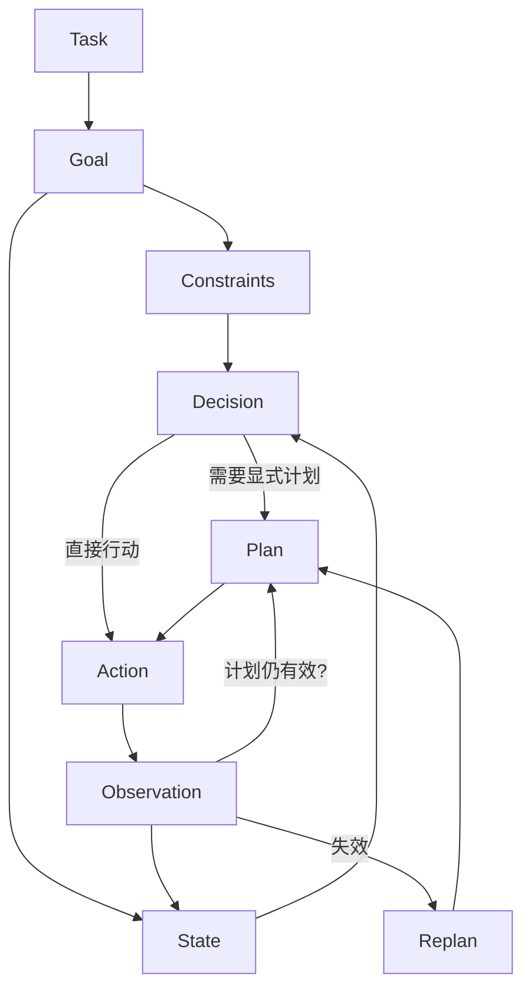
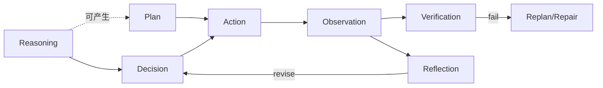
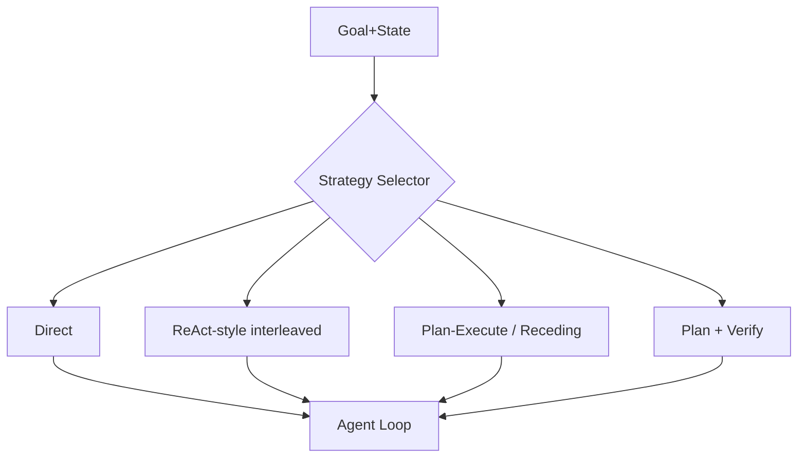

# Reasoning & Planning（Canonical）

> **一句话主题**：Reasoning / Planning 是 Agent Loop 内的 **决策策略层**——决定「想什么、是否显式计划、何时重计划/反思/校验」，而不是替代控制回路本身。
>
> **状态**：Canonical · **Last reviewed**: 2026-10  
> **受众**：设计 Agent 决策策略、控制推理成本与失败恢复的工程师  
> **硬前置**：[Agent Loop](../agent-loop/agent-loop.md)、[Tool Use](../tool-use/tool-use.md)  
> **下游**：[Agent Architecture](../agent-architecture/agent-architecture.md)、复杂 Coding / Multi-Agent

---

## 范围 / 非目标

**范围**：Reasoning、Planning、Replanning、Reflection、Verification 的严格定义与边界；在 Loop 中的位置；何时用/不用；模式比较；预算与自适应策略；失败模式；生产架构挂钩；相关论文的工程映射；面试题。

**非目标（只链接，不复制正文）**：

| 主题 | 去哪里 |
|------|--------|
| 控制回路、预算硬护栏、checkpoint | [Agent Loop](../agent-loop/agent-loop.md) |
| 工具执行、鉴权、幂等 | [Tool Use](../tool-use/tool-use.md) |
| 记忆存储 | [Memory Canonical](../memory/memory.md) |
| 检索子系统 | [`rag`](../rag/README.md) |
| 窗口编排 | [`context-engineering`](../context-engineering/context-engineering.md) |
| 任务评测体系 | [`evaluation`](../../production/evaluation/README.md) |
| 训练式 RL / RLHF | [`reinforcement-learning`](../../runtime/reinforcement-learning/README.md) |
| 多智能体分工 | [`multi-agent`](../../agent-types/multi-agent/README.md) |

---

## 1. Overview：在系统中的位置

```text
Tool Use          = 动作能力
Agent Loop        = 控制结构（何时停、如何记账、如何恢复）
Reasoning/Planning= 决策策略（如何选下一步、是否先计划）
```

```text
LLM
 ↓
Context
 ↓
Reasoning / Decision
 ↓
Planning（可选）
 ↓
Action（Tool Call / 最终回答）
 ↓
Observation
 ↓
Update State
 ↓
Verify / Reflect / Replan（可选）
 ↓
Next Decision
```

**为什么需要这一层**：仅有 Loop + Tools，Agent 已经能「动」；但长程、有依赖、不可逆、昂贵动作时，缺少显式（或受控的）推理/计划会导致：盲动、重复劳动、目标漂移、失败后无系统性恢复。

**与 Agent Loop 的关系（一句话）**：

> Loop 提供 **控制结构**；Reasoning/Planning 提供 **控制策略（policy）的一部分**。  
> Planning ≠ Agent Loop。没有 Loop 的「先写个计划」只是提示技巧。

Anthropic 强调从简单可组合模式起步、按评测加复杂度（见 [article-anthropic-building-effective-agents-2024](../../references/articles.md#article-anthropic-building-effective-agents-2024)）——本文把「何时加计划/反思/校验」做成可工程决策。

---

## 2. Mental Model：统一对象

```text
Task
 ↓
Goal
 ↓
State
 ↓
Decision
 ↓
Plan（可选）
 ↓
Action
 ↓
Observation
 ↓
State Update
 ↓
Next Decision
```

| 对象 | 定义 | 工程含义 |
|------|------|----------|
| **Task** | 外部交付的工作描述 | 产品入口；可拆成目标+约束 |
| **Goal** | 可判定的成功条件 | 终止与评测锚点；应尽量可检验 |
| **State** | 当前信念与进度真相 | messages、scratchpad、plan、预算计数器（见 Loop） |
| **Constraint** | 硬/软限制 | 权限、合规、预算、不可逆动作政策 |
| **Decision** | 本轮策略输出 | 最终回答 / tool calls / 需要计划 / 需要人类 |
| **Plan** | 面向目标的动作意图序列（可部分） | 应可版本化、可失效、可重规划 |
| **Action** | 对世界的操作意图 | 通常是 Tool Call；执行在 Tool Use |
| **Observation** | 行动后的感知 | 驱动下一决策；可能使计划失效 |
| **Outcome** | 相对 Goal 的结果 | success / partial / fail；不等于「模型说完成了」 |



**可选步骤**：Planning、Reflection、Verification、Replanning、Search/Exploration —— 默认关闭，按任务复杂度与风险打开。

---

## 3. 概念边界（严格定义）

| 概念 | 是什么 | 不是什么 |
|------|--------|----------|
| **Reasoning** | 从当前 State/Context 推导出对下一行动有用的中间结论 | 「让模型多想几次」；不等于 Planning |
| **Planning** | 构造（部分）未来动作意图结构以服务 Goal | 不等于 CoT 文本；不等于 Loop |
| **Decision Making** | 在动作空间中做出可执行选择 | 可含 reasoning；最终必须落到 Action/Stop |
| **Execution** | 把 Action 变成 Observation | 属 Tool Use / Runtime，不属本文深文 |
| **Reflection** | 对轨迹/结果做批判性语言反馈以改进后续决策 | 不等于 Verification；不等于 Evaluation |
| **Verification** | 用尽可能独立/可判定的检查判定是否满足约束或目标片段 | 不等于「再问一次模型对不对」；不等于离线评测 |
| **Replanning** | 在计划失效或偏差时更新/替换计划 | 不等于每步都重写完整计划 |
| **Search / Exploration** | 在候选思维/动作路径上系统探索 | 成本高；ToT 类方法属此（见后） |
| **Optimization** | 在目标函数下改进策略或产物 | 训练式 RL ≠ 运行时 Optimizer 节点 |

**关键不等式**：

```text
Reasoning ≠ Planning
Planning ≠ Agent Loop
Planning ≠ Chain-of-Thought
Reflection ≠ Verification
Verification ≠ Evaluation
Evaluation ≠ RL
Reasoning ≠ more tokens automatically
```



---

## 4. Reasoning：控制视角

### 4.1 定义

在 Agent Engineering 中，**Reasoning** 是：在发出 Action 之前或之后，对 State、Goal、Constraints、工具结果进行的**信息加工**，其产物改变 **Decision 的分布**（选哪个工具、何参数、是否停止、是否升级人类）。

### 4.2 Reasoning 到底改变了什么？

从控制视角，它改变的是：

1. **动作选择**：在工具集中选哪一个（或都不选）  
2. **参数填充**：如何从观察中提取真实 ID/约束  
3. **信息请求**：下一步是「再观察」还是「提交副作用」  
4. **终止判断**：是否认为 Goal 已达成（仍应用 Verification 约束）  
5. **风险态度**：是否触发 HITL / 拒绝不安全计划  

它 **不** 自动改变：工具权限、沙箱策略、硬预算——那些是 Loop/Runtime 护栏。

### 4.3 与相关概念

| 关系 | 说明 |
|------|------|
| vs Prediction | 预测下一 token ≠ 对任务状态的有用推理；工程关心的是决策后果 |
| vs Action selection | Reasoning 服务选择；没有落到 Action/Stop 的「长篇思考」是成本 |
| vs Tool Use | 工具结果进入 Context 后，推理决定如何使用；执行细节见 Tool Use |
| vs Planning | 推理可局部、即时；计划是（半）持久的意图结构 |

CoT 表明：诱导中间步骤可提升若干推理任务表现（[paper-cot-2022](../../references/papers.md#paper-cot-2022)）。对 Agent 而言，这只说明「中间计算可能有用」，**不是**「必须暴露长思维链」或「CoT = Planning」。

---

## 5. Planning

### 5.1 定义

**Planning** = 在行动前（或滚动窗口内）生成 **Plan 对象**：面向 Goal、遵守 Constraints、相对 Current State 的动作意图结构。

### 5.2 输入 / 输出

**输入**：Goal、Constraints、Current State、可用工具摘要、（可选）先验计划模板。  
**输出**：Plan —— 建议最小字段：

```text
Plan {
  plan_id, version,
  goal_ref,
  steps: [{id, intent, tool_hint?, preconditions?, success_criteria?}],
  assumptions: [...],
  status: draft|active|stale|completed|aborted,
  created_at_step, last_validated_step
}
```

### 5.3 粒度与生命周期

| 粒度 | 例子 | 风险 |
|------|------|------|
| 粗目标层 | 「调研→起草→校验」 | 执行时仍需即时推理 |
| 工具步层 | 「get_order → create_refund」 | 易过时 |
| 参数级 | 填死所有 args | 过度约束、幻觉参数 |

**生命周期**：`draft → active → (stale) → updated/replaced → completed|aborted`

### 5.4 显式保存？是否必须完整？

| 问题 | 建议 |
|------|------|
| 是否显式保存 | **长程 / 不可逆 / 需审计** 的任务：是。纯短问答：否 |
| 是否必须完整 | **否**。Partial planning / receding horizon 通常更稳 |
| Hierarchical | Goal→Subgoal→Subtask→Action；适合可分解目标 |
| Dynamic | 计划随观察演化；把「计划」当假设而非契约 |

```text
Goal
 ↓
Constraints
 ↓
Current State
 ↓
Candidate Plan
 ↓
Action
 ↓
Observation
 ↓
Plan Update / Invalidate
```

---

## 6. When Planning Helps

| 任务特征 | 为何规划有价值 |
|----------|----------------|
| Long-horizon | 需要跨多观察保持全局意图，防局部贪心 |
| Multi-step + 依赖 | 步骤顺序错误会导致不可用中间态 |
| Irreversible actions | 先规划可插入 Verification/HITL 门闩 |
| Expensive actions | 减少盲目试错的金钱/延迟成本 |
| Global consistency | 风格、约束、多文件一致性需先对齐 |
| Multiple tools | 降低工具选择抖动与重复调用 |
| Explicit constraints | 把约束编译进计划假设，便于校验 |

收益本质：**用「前瞻结构」换「更少盲动与更可恢复的失败」**——前提是计划可失效、可重规划。

---

## 7. When Planning Hurts

| 问题 | 机制 |
|------|------|
| Unnecessary planning | 单步工具即可，却先写长计划 |
| Overhead | 额外模型调用 → 延迟与 token |
| Stale plans | 环境已变，仍执行旧步骤 |
| Plan hallucination | 计划引用不存在的工具/资源 |
| False certainty | 「有计划」被误当成「已验证可行」 |
| Over-constrained execution | 计划过细，无法适应观察 |
| Plan/execution divergence | 执行路径与计划脱节且无人察觉 |
| Premature planning | 信息不足时锁死错误路线 |

```text
Task Complexity
       │
       ├── Low ───────→ Direct Execution
       │
       ├── Medium ────→ Lightweight / Receding-Horizon Planning
       │
       └── High ──────→ Explicit Plan + Verify + Replan hooks
```

**原则：不是所有 Agent 都应该先生成完整计划。** 默认 Direct 或轻量滚动规划；用评测证明收益再加重。

---

## 8. Planning Patterns

### 8.1 No Planning（Observe → Act → Observe）

适合：短任务、工具后果可逆、信息在观察中逐步揭示。  
风险：长程一致性差。

### 8.2 Plan-Then-Execute

```text
Goal → Plan → Step1 → Step2 → Step3 → Done
```

优点：可审计、易解释。  
问题：stale plan、execution divergence。应用：静态环境或强验证门。

### 8.3 Receding Horizon Planning

```text
Current State → Plan next N steps → Execute → Observe → Replan
```

只承诺近窗，远窗保持开放。**生产上常比一次规划全部步骤更稳健**：降低过时与过度约束。

### 8.4 Iterative Planning

规划→执行→更新→再规划；与 Loop 同构，强调 Plan 对象显式更新。

### 8.5 Hierarchical Planning

```text
Goal → Subgoal → Subtask → Action
```

适合可分解工程任务（例如 Coding Agent 的「修测试→改模块→跑套件」）。子目标失败应局部重规划，不宜总是推翻根目标。

### 8.6 Planner / Executor

**Planner ≠ Executor**。

| | 优点 | 缺点 |
|--|------|------|
| 分离 | 可用更强/更贵模型规划、更便宜模型执行；权限可分层 | 延迟↑；状态同步难；计划语义漂移 |
| 失败恢复 | Executor 失败可回 Planner | 需明确 plan_id 与假设失效协议 |

### 8.7 Router-Based Decision

不生成完整 plan，只选择：tool / workflow / agent / strategy。  
**关系**：Router 是 **决策压缩**；可视为单步「元规划」。复杂任务上常与轻量计划组合。



---

## 9. Reflection（Canonical Concept）

### 9.1 定义

**Reflection** = 基于反馈信号（工具错误、测试失败、评审意见、自评）生成 **语言化批判**，并写入后续决策可用的状态（常为 scratchpad / episodic buffer），以改变下一轮决策。

Reflexion 用语言反馈与情节记忆改进后续 trial，而非更新权重（[paper-reflexion-2023](../../references/papers.md#paper-reflexion-2023)）。Self-Refine 在生成后自我反馈并迭代精炼（[paper-self-refine-2023](../../references/papers.md#paper-self-refine-2023)）。

### 9.2 Reflection ≠ Verification ≠ Evaluation

| | Reflection | Verification | Evaluation |
|--|------------|--------------|------------|
| 目的 | 改进后续决策质量 | 判定是否满足判据 | 系统/策略整体好坏（常离线或批量） |
| 信号 | 常为自然语言批判 | 尽量确定性/外部证据 | 指标与数据集 |
| 失败 | 空转自我肯定 | 假阴性/假阳性 | 指标黑客 |

### 9.3 何时值得 / 何时浪费

**值得**：高错误成本、有外部反馈（测试/编译器）、重复失败模式可总结。  
**浪费**：无新信息的自我背书、低价值闲聊、无终止的精炼。

```text
Action → Observation → Critique → Revision → Action
```

**失败模式**：endless reflection、self-confirmation、无用批判、重复犯错、延迟爆炸 —— 必须有 **次数上限 + 无进展检测**（与 Loop 预算联动）。

---

## 10. Verification（Canonical Concept）

### 10.1 原则

Verification 应优先使用：

- deterministic checks（schema、不变量、允许列表）  
- tool/execution outcomes（测试、编译、HTTP 状态、余额校验）  
- external evidence（单据、审计记录）

**避免**把「再问 LLM：你对吗？」当作唯一验证。LLM 自评可作为弱信号，不能当安全门。

### 10.2 类型

| 类型 | 时机 | 例子 |
|------|------|------|
| Pre-action | Act 前 | 权限、金额上限、路径沙箱策略 |
| Post-action | Act 后 | 测试套件、行数/影响面检查 |
| Invariant / Constraint | 持续 | 租户隔离、只读承诺 |
| Test / Execution-based | 后 | `pytest`、dry-run |

```text
Plan → Execute → Verify → Success?
         ├── Yes → Continue
         └── No  → Repair / Replan / HITL
```

Evaluator-Optimizer 控制流变体见 [Agent Loop §控制流变体](../agent-loop/agent-loop.md)；本文定义 **Verify 节点应尽量客观**。

---

## 11. Replanning

### 11.1 为何需要

世界会变：工具失败、观察意外、约束违反、外部状态变化、部分完成——旧计划成为负债。

### 11.2 触发条件

tool failure · unexpected observation · state change · constraint violation · environment change · plan invalidation · partial completion · 重复无进展

```text
Plan → Execute → Observation → Is Plan Still Valid?
         ├── Yes → Continue
         └── No  → Replan（local / partial / global）
```

| 类型 | 含义 |
|------|------|
| Local | 只修当前失败步 |
| Partial | 重写近窗，保留远景子目标 |
| Global | 推翻根计划（昂贵；需预算门） |
| Rollback | 对可逆动作回退；不可逆则补偿 |

与 Loop 的 retries 分层：工具层重试 ≠ 策略层重规划（见 [Agent Loop](../agent-loop/agent-loop.md)）。

---

## 12. 与 Agent Loop 的统一模型

```text
┌───────────────────────────┐
│        Agent Loop         │
│ Context                   │
│   ↓                       │
│ Reason / Decide           │
│   ↓                       │
│ Plan (optional)           │
│   ↓                       │
│ Act                       │
│   ↓                       │
│ Observe                   │
│   ↓                       │
│ Verify / Reflect / Replan │
│         (optional)        │
└───────────────────────────┘
```

- **Loop**：状态机、预算、终止、checkpoint、取消  
- **本文**：Decide 内的策略选择与可选装饰节点语义  

不在此重复 Loop 的生产队列/worker 细节。

---

## 13. 与 ReAct 的关系

ReAct：**交错生成推理痕迹与任务动作**，并用观察纠正幻觉传播（[paper-react-2022](../../references/papers.md#paper-react-2022)）。

**ReAct ≠ Agent。** ReAct 是一种 **reasoning/action interleaving pattern**，运行在 Loop 之上。

| 模式 | 适应性 | 长程 | 延迟 | 错误恢复 |
|------|--------|------|------|----------|
| Plan → Execute | 低（计划固定时） | 依赖计划质量 | 规划一次性成本 | 差除非加 Replan |
| Reason → Act → Observe → …（ReAct-style） | 高 | 中（易局部） | 每步模型成本 | 好（观察驱动） |
| Plan → Execute → Verify → Replan | 中高 | 高 | 较高 | 好（显式失效） |

生产上常见组合：**近窗计划 + ReAct 式即时推理 + 关键点 Verification**。

---

## 14. Chain-of-Thought 边界

| 概念 | 工程态度 |
|------|----------|
| CoT prompting | 研究/提示技术：中间步骤可提升某些任务（[paper-cot-2022](../../references/papers.md#paper-cot-2022)） |
| Reasoning models | 模型族能力差异属供应方；**勿臆测内部机制** |
| Agent reasoning | 关心决策记录、结构化计划、可观测摘要 |
| Hidden CoT | **Agent Engineering 不应依赖暴露模型隐藏思维链** |

推荐持久化：**decision records**（选了什么、假设是什么、验证结果），而非原始长思维文本（隐私、不稳定、难测）。

> TODO: Verify — 各厂商对 reasoning traces / 隐藏链的产品策略与 API 暴露面以官方文档为准，本文不绑定具体产品行为。

---

## 15. Reasoning Budget

与 Loop 预算对齐并专账：

| 预算 | 控制什么 |
|------|----------|
| Token / Time / Cost | 推理与规划调用本身 |
| Step / Tool | 行动次数（Loop） |
| Reflect / Verify / Replan counts | 装饰节点爆炸 |

```text
Task Value
   ↑
   │        ______
   │      /
   │    /   ← diminishing returns
   │  /
   │ /
   └────────────→ Reasoning Cost
```

**more reasoning ≠ always better**：过推理增加延迟、过时风险与自我确认。应用 **无进展熔断** 与 **任务价值门控**。

---

## 16. Adaptive Reasoning

```text
Task → Estimate Complexity / Risk
        ├── Low      → Direct
        ├── Medium   → Lightweight / Receding plan
        ├── High     → Explicit plan + interleaved act
        └── Critical → Plan + Verify (+ HITL on irreversible)
```

复杂度估计可以是：规则（工具数、是否写操作）、轻量分类器、或主模型一次路由。  
> TODO: Verify — 具体产品是否内置「自适应思考长度」属厂商能力，需对照官方说明；实现上以显式策略选择器为准更可控。

---

## 17. Failure Modes（Symptom / Cause / Impact / Detection / Mitigation）

| 模式 | Symptom | Root Cause | Impact | Detection | Mitigation |
|------|---------|------------|--------|-----------|------------|
| Over-planning | 长计划后才第一次行动 | 默认全量规划 | 延迟、过时 | 首动前 token 高 | 默认 Direct/近窗 |
| Under-planning | 混乱试错 | 无结构长程任务 | 成本高、失败 | 高重复工具调用 | 显式子目标 |
| Stale plan | 执行不存在资源 | 未校验失效 | 硬错误 | plan_version vs state | 观察后 validate |
| Plan drift / Goal drift | 做着做着换目标 | 注入/无目标锁定 | 错误交付 | goal_ref 校验 | 冻结 Goal+允许集 |
| Reasoning loop | 只想不动 | 无行动门控 | 耗尽预算 | 无 tool/final 轮次 | 强制 act-or-stop |
| Reflection loop | 反复自评 | 无上限/无新信号 | 延迟 | reflect_count | hard cap |
| Premature termination | 假完成 | 无 Verification | 错误成功 | verifier 失败率 | 测试/不变量 |
| Local optimum | 局部修修补补 | 缺全局重规划门 | 质量差 | 进展指标平坦 | 偶发 global replan |
| Replan explosion | 每步重写计划 | 触发过敏 | 成本爆 | replan_rate | 冷却+局部优先 |
| False verification | 绿勾但错 | LLM 自评当门 | 安全事故 | 独立检查缺失 | 确定性 verifier |
| Budget exhaustion | partial | 策略过重 | 差体验 | 预算事件 | 自适应降级 |
| Invalid assumptions | 隐含前提错 | 计划未列 assumptions | 连锁失败 | 假设显式化 | 观察打脸即失效 |

---

## 18. Production Architecture（挂钩，不复制）

```text
Task
 ↓
Task Analyzer（复杂度/风险/可逆性）
 ↓
Strategy Selector（Direct / ReAct / Plan / Plan+Verify）
 ↓
Agent Loop  ←── 见 agent-loop.md
 ↓
Tool Execution ←── 见 tool-use.md（+ sandbox/security 链接）
 ↓
Observation
 ↓
Verification / Reflection（可选，有上限）
 ↓
Replan if needed
 ↓
Final Result / Partial
```

需要的状态扩展：`plan`、`assumptions`、`strategy`、`reflect_count`、`verify_results`。  
Checkpoint / 取消 / 追踪：遵循 Loop 与 [`observability`](../../production/observability/README.md)。

---

## 19. 算法伪代码

```text
algorithm AdaptiveAgentPolicy(task, state, budgets):
  strategy ← SelectStrategy(task, state)   # Direct | ReAct | Plan | PlanVerify
  plan ← ∅
  while not Terminated(state, budgets):
    context ← BuildContext(state, plan)    # Context Engineering 钩子
    if strategy ∈ {Plan, PlanVerify} and plan = ∅:
      plan ← MakePlan(context, horizon=N)
      if budgets.exceeded: return Partial(state)

    decision ← ReasonAndDecide(context, plan)  # 可含轻量推理痕迹摘要
    Account(budgets, decision)

    if decision.is_final:
      if strategy = PlanVerify and not Verify(decision, state):
         ReflectOrReplan(...)
         continue
      return Success(decision)

    if decision.needs_plan_update:
      plan ← Replan(plan, decision.reason, mode=local|global)
      continue

    obs ← ExecuteTools(decision.calls)     # Tool Use
    state ← Update(state, obs)
    if plan ≠ ∅ and not PlanValid(plan, state, obs):
      plan ← Replan(...)
    if ShouldReflect(obs) and budgets.reflect_left:
      state ← ApplyReflection(state, Reflect(obs))
    if ShouldVerify(obs) and not Verify(obs, state):
      RepairOrReplan(...)
  return FinalizeByBudget(state)
```

**不变式**：任何 Reflect/Replan/Verify 循环必须检查 budgets 与无进展条件。

---

## 20. Trade-offs（定性）

| Strategy | Planning Cost | Adaptability | Long Horizon | Latency | Reliability* |
|----------|---------------|--------------|--------------|---------|--------------|
| Direct | 低 | 中（靠即时推理） | 弱 | 低 | 任务简单时高 |
| ReAct-style | 低-中 | 高 | 中 | 中（多步） | 观察可纠正时高 |
| Plan-Execute | 高（一次性） | 低 | 高（若环境稳） | 中 | 静环境+验证时高 |
| + Replanning | 中-高 | 高 | 高 | 高 | 较高 |
| Planner-Executor | 高 | 中 | 高 | 高 | 依赖同步质量 |
| Plan + Verify | 高 | 中高 | 高 | 高 | 有客观 verifier 时最高 |

\*Reliability 相对「目标可检验且护栏到位」而言；无 verifier 时任何策略都可「自信地错」。

---

## 21. Security（仅策略层）

| 风险 | 含义 | 缓解要点 |
|------|------|----------|
| Goal hijacking | 注入改写目标 | 冻结 goal_ref；系统目标优先 |
| Planning 被注入污染 | 恶意内容写入计划步骤 | 计划步骤经过工具允许集过滤 |
| 恶意 observation | 诱导危险重规划 | 工具输出 untrusted；高危动作 HITL |
| Unsafe plans | 计划直接含破坏性序列 | pre-action verification |
| 权限升级 via planning | 「下一步用 admin 工具」 | 鉴权在 Tool Use，不在计划文本 |
| Verification bypass | 只靠自评 | 独立确定性检查 |
| Plan poisoning | 投毒计划模板/记忆中的计划 | 签名、来源、审计（链 Security） |

工具面细节 → [Tool Use](../tool-use/tool-use.md)；威胁模型全文 → [`security`](../../production/security/README.md)。

---

## 22. Evaluation（过程指标）

不要只看最终答案。

| 类 | 指标例子 |
|----|----------|
| Outcome | task success / partial |
| Process | 平均步数、replan_rate、reflect_count、计划遵守率、无效推理轮次 |
| Efficiency | 成本/成功、延迟、unnecessary_planning_rate、工具效率 |
| Safety | 高危动作前验证通过率、目标漂移事件、假验证率 |

深体系 → [`production/evaluation`](../../production/evaluation/README.md)。

---

## 23. 相关研究（工程映射）

| 工作 | Problem | Core Idea | 与本章关系 | Limitation |
|------|---------|-----------|------------|------------|
| [CoT](../../references/papers.md#paper-cot-2022) | 多步推理准确率 | 中间步骤提示 | Reasoning 痕迹有用 | 不是 Agent 计划状态机 |
| [ReAct](../../references/papers.md#paper-react-2022) | 推理与行动割裂 | 交错 Reason+Act+Observe | Interleaving 模式 | ≠ 完整 Runtime |
| [Plan-and-Solve](../../references/papers.md#paper-plan-and-solve-2023) | Zero-shot-CoT 缺步 | 先计划再执行的提示 | Plan-then-solve 直觉 | Prompting ≠ 生产 Plan 对象 |
| [ToT](../../references/papers.md#paper-tot-2023) | 需探索/回溯的题 | Thought 树搜索 | Search/Exploration | 成本高；未必适合工具副作用场景 |
| [Reflexion](../../references/papers.md#paper-reflexion-2023) | 试错学习贵 | 语言反思+情节缓冲 | Reflection 模式 | 不是权重 RL；需防反思空转 |
| [Self-Refine](../../references/papers.md#paper-self-refine-2023) | 首解不优 | 自反馈迭代精炼 | Reflection/精炼 | 必须硬停止 |

Graph of Thoughts / SayCan / LLM+P / Toolformer / Voyager 等可作为扩展阅读；**未经验证不写入伪链接**。  
> TODO: Verify — 若后续收录，按 `standards/paper-analysis.md` 单独立条并映射模块。

---

## 24. Framework 视角（概念映射，非教程）

| 抽象 | 对应本章 |
|------|----------|
| 图节点：agent / tool / condition | Loop 调度表象 + 策略节点 |
| Planner 节点 / Executor 节点 | Planner-Executor 模式 |
| 分支路由 | Router-based decision |
| 循环边 + 退出条件 | Loop 终止与预算 |

**框架 API ≠ 理论。** LangGraph、厂商 Agents SDK、Anthropic 模式文章，应映射回 Loop + 本策略层。  
> TODO: Verify — 各框架默认是否持久化 plan 对象、是否内置 verifier 节点，以当前官方文档/代码为准，不做版本绑死描述。

---

## 25. Interview Questions

### Beginner

**Q1. Reasoning 和 Planning 有何区别？**  
- **短答**：Reasoning 是加工信息以改决策；Planning 是构造（部分）未来动作结构。  
- **详解**：可有推理无显式计划；计划通常要可保存/失效。  
- **追问**：CoT 文本是计划吗？  
- **常见错误**：把两者当同义词。  
- **相关**：§3–5。

**Q2. Planning 是 Agent Loop 吗？**  
- **短答**：不是。Loop 是控制结构；Planning 是可选策略。  
- **详解**：见统一模型图。  
- **追问**：没有工具只有计划还是 Agent 吗？  
- **常见错误**：先写计划框架再谈终止条件。  
- **相关**：Agent Loop。

**Q3. 为什么需要 Reasoning？**  
- **短答**：改变动作选择、参数、终止与风险态度。  
- **详解**：控制视角，不是「想得更好」空话。  
- **追问**：哪些推理不改变决策应被剪掉？  
- **常见错误**：无行动的长思考。  
- **相关**：§4。

**Q4. Reflection 和 Verification 区别？**  
- **短答**：反思改进后续决策；验证判定是否满足判据。  
- **详解**：验证应尽量客观。  
- **追问**：能否只用模型自评当验证？  
- **常见错误**：混用三个词。  
- **相关**：§9–10。

**Q5. 什么任务适合 Direct？**  
- **短答**：低复杂度、可逆、单步或短链工具。  
- **详解**：见复杂度树。  
- **追问**：如何用数据证明不该升级计划？  
- **常见错误**：所有请求先规划。  
- **相关**：§7。

**Q6. ReAct 等于 Agent 吗？**  
- **短答**：否；是交错推理与行动的模式。  
- **详解**：需 Loop/预算/工具执行才完整。  
- **追问**：与 Plan-Execute 对比？  
- **常见错误**：实现了 Thought 字段就自称生产 Agent。  
- **相关**：§13，[`paper-react-2022`](../../references/papers.md#paper-react-2022)。

**Q7. Plan 必须一次性完整吗？**  
- **短答**：不必；partial / receding horizon 常更稳。  
- **详解**：完整计划易 stale。  
- **追问**：N 如何选？  
- **常见错误**：生成 20 步未验证计划。  
- **相关**：§5、§8.3。

**Q8. 重规划何时触发？**  
- **短答**：计划失效、意外观察、约束违反、工具失败等。  
- **详解**：优先 local。  
- **追问**：如何防 replan 爆炸？  
- **常见错误**：任何小误差都全局重规划。  
- **相关**：§11。

**Q9. 为什么 more reasoning 不总是更好？**  
- **短答**：边际收益递减，增加延迟与过时/空转风险。  
- **详解**：预算与无进展熔断。  
- **追问**：如何画成本-价值曲线？  
- **常见错误**：无上限开反思。  
- **相关**：§15。

**Q10. Evaluation 和 Verification 区别？**  
- **短答**：验证是单次运行中的门；评测是系统级度量。  
- **详解**：评测可包含过程指标。  
- **追问**：过程指标举三例。  
- **常见错误**：只看最终答案准确率。  
- **相关**：§22。

### Intermediate

**Q11. 设计 Plan 对象最小字段。**  
- **短答**：goal_ref、steps、assumptions、status、version。  
- **详解**：服务失效检测与审计。  
- **追问**：assumptions 如何被观察打脸？  
- **常见错误**：只存一段自然语言。  
- **相关**：§5.2。

**Q12. Receding horizon 为何更稳？**  
- **短答**：只承诺近窗，降低过时与过度约束。  
- **详解**：每观察后滚动。  
- **追问**：与 MPC 直觉类比的限度？  
- **常见错误**：N=全任务长度。  
- **相关**：§8.3。

**Q13. Planner/Executor 的状态同步问题？**  
- **短答**：双方对 plan_id/version/state 认知不一致。  
- **详解**：执行前校验版本；失败回传结构化原因。  
- **追问**：跨服务延迟下如何避免双执行？  
- **常见错误**：Executor 静默改计划。  
- **相关**：§8.6。

**Q14. 不可逆动作前应放什么？**  
- **短答**：Pre-action verification + 常配 HITL。  
- **详解**：计划不能替代鉴权。  
- **追问**：只读规划阶段能否调用写工具？  
- **常见错误**：计划里写了就执行。  
- **相关**：§10、Tool Use。

**Q15. 如何检测 reasoning loop？**  
- **短答**：连续轮次无 tool/final；或重复决策签名。  
- **详解**：强制 act-or-stop。  
- **追问**：与「合法长分析」如何区分？  
- **常见错误**：只靠更大 token 上限。  
- **相关**：§17。

**Q16. Reflection 何时该写进 Memory？**  
- **短答**：可迁移的失败教训；非一次性噪音。  
- **详解**：链 Memory 模块；防错误记忆固化。  
- **追问**：Reflexion 的 trial 边界？  
- **常见错误**：每句反思都永久写入。  
- **相关**：[`paper-reflexion-2023`](../../references/papers.md#paper-reflexion-2023)、memory README。

**Q17. Router 与 Planning 如何组合？**  
- **短答**：Router 选策略/工具子集；再决定是否近窗计划。  
- **详解**：降低上下文与误用。  
- **追问**：路由错误如何降级？  
- **常见错误**：路由替代一切计划。  
- **相关**：§8.7。

**Q18. Plan-and-Solve 论文对生产的启示与局限？**  
- **短答**：启示=先分解再执行；局限=提示≠状态机。  
- **详解**：要显式 Plan 对象与失效。  
- **追问**：与 Plan-Execute 模式异同？  
- **常见错误**：把论文提示当 Runtime。  
- **相关**：[`paper-plan-and-solve-2023`](../../references/papers.md#paper-plan-and-solve-2023)。

**Q19. 假验证的危害？**  
- **短答**：系统「以为」安全/正确并继续副作用。  
- **详解**：必须独立检查。  
- **追问**：如何度量 false verification？  
- **常见错误**：二次 LLM 投票当门禁。  
- **相关**：§10、§17。

**Q20. 如何定义 unnecessary_planning_rate？**  
- **短答**：计划未改善成功/成本的比例（对照实验）。  
- **详解**：A/B：Direct vs Plan。  
- **追问**：切片哪些任务类型？  
- **常见错误**：无对照就加计划。  
- **相关**：§22。

### Advanced

**Q21. 给出 PlanValid 谓词的设计。**  
- **短答**：检查假设、资源存在、权限、未超预算、步骤前置。  
- **详解**：任一失败→stale。  
- **追问**：软失败 vs 硬失败？  
- **常见错误**：只检查计划文本非空。  
- **相关**：§11。

**Q22. 分层规划中局部失败如何不上溢？**  
- **短答**：子目标重试/局部重规划；超阈值才上溢。  
- **详解**：类似异常处理边界。  
- **追问**：与 Multi-Agent 委派的关系？  
- **常见错误**：任何测试红就推翻整棵目标树。  
- **相关**：§8.5。

**Q23. ToT 何时不该用于工具 Agent？**  
- **短答**：高副作用、探索会触发真实写操作时。  
- **详解**：搜索应在模拟/只读空间；成本高。  
- **追问**：如何沙箱化探索？  
- **常见错误**：在生产库上做思维树试错。  
- **相关**：[`paper-tot-2023`](../../references/papers.md#paper-tot-2023)、Sandbox。

**Q24. 设计策略选择器特征。**  
- **短答**：步数估计、写操作、可逆性、工具数、合规级、历史失败。  
- **详解**：输出 Direct/ReAct/Plan/PlanVerify。  
- **追问**：如何在线学习选择器？  
- **常见错误**：仅按用户会员等级选。  
- **相关**：§16。

**Q25. Decision record 应包含什么？**  
- **短答**：goal、strategy、所选动作、假设、验证结果、预算快照。  
- **详解**：可回放、可审计。  
- **追问**：与隐藏 CoT 的关系？  
- **常见错误**：只存最终自然语言。  
- **相关**：§14、Observability。

**Q26. 目标锁定与合法重规划如何共存？**  
- **短答**：Goal 冻结；手段计划可变；变更 Goal 需显式授权。  
- **详解**：防劫持。  
- **追问**：用户追加需求算不算改 Goal？  
- **常见错误**：transcript 后写覆盖系统目标。  
- **相关**：§21。

**Q27. 将 Verification 做成独立服务的利弊？**  
- **短答**：利：独立、可复用；弊：延迟、一致性。  
- **详解**：同步门 vs 异步审计。  
- **追问**：支付场景选哪个？  
- **常见错误**：验证服务也调同一无约束模型。  
- **相关**：§10。

**Q28. 量化 diminishing returns。**  
- **短答**：固定任务集上画 success vs reflect/replan 次数曲线。  
- **详解**：找肘点设默认上限。  
- **追问**：不同任务肘点不同怎么办？  
- **常见错误**：全局统一无限。  
- **相关**：§15。

**Q29. Self-Refine 无外部反馈时的风险？**  
- **短答**：自我确认偏差。  
- **详解**：有外部 verifier 时更稳。  
- **追问**：如何混合外部测试与自评？  
- **常见错误**：纯自评三轮当质检。  
- **相关**：[`paper-self-refine-2023`](../../references/papers.md#paper-self-refine-2023)。

**Q30. 计划投毒的检测信号？**  
- **短答**：计划突然引入高危工具、越权资源、与 goal 无关步骤。  
- **详解**：diff 审计+允许集。  
- **追问**：来自 Memory 的旧计划？  
- **常见错误**：信任历史计划模板。  
- **相关**：§21。

### Expert

**Q31. 形式化「策略节点」与 Loop 状态机的合成。**  
- **短答**：策略选择为状态机边上的守卫/动作；预算为全局状态。  
- **详解**：模型输出需经合法迁移过滤。  
- **追问**：如何模型检测？  
- **常见错误**：策略散落在 prompt 无结构。  
- **相关**：Loop + §12。

**Q32. 讨论搜索（ToT）与带副作用工具的兼容架构。**  
- **短答**：双世界：符号/模拟层搜索，提交层才副作用。  
- **详解**：提交前 Verification。  
- **追问**：模拟保真不足？  
- **常见错误**：搜索直接打生产 API。  
- **相关**：ToT、Sandbox。

**Q33. 多租户下策略选择器的隔离。**  
- **短答**：租户策略包、预算、允许工具集分离。  
- **详解**：防跨租户目标/计划泄漏。  
- **追问**：共享基础策略如何定制？  
- **常见错误**：全局单例策略。  
- **相关**：Infrastructure。

**Q34. 过程奖励与运行时 Reflection 的边界（对 RL 模块）。**  
- **短答**：运行时反思改上下文；RL 改权重/策略参数。  
- **详解**：勿把 Reflexion 叫训练完成。  
- **追问**：轨迹如何进 RL 数据？  
- **常见错误**：术语混用。  
- **相关**：RL README。

**Q35. 设计对抗 goal hijacking 的红队题。**  
- **短答**：间接注入改目标、计划中塞外联、验证器社会工程。  
- **详解**：期望：拒绝或 HITL。  
- **追问**：如何回归？  
- **常见错误**：只测良性任务。  
- **相关**：§21、Security。

**Q36. 长程研究 Agent 的策略退化。**  
- **短答**：上下文腐化、计划膨胀、重规划震荡。  
- **详解**：分层摘要+近窗+定期 verifier。  
- **追问**：何时拆 Multi-Agent？  
- **常见错误**：单会话硬撑。  
- **相关**：Context README。

**Q37. 证明「加规划」因果有效的实验设计。**  
- **短答**：同任务集随机 Direct vs Plan，控模型与工具；看成功/成本/延迟。  
- **详解**：预注册指标。  
- **追问**：霍桑效应？  
- **常见错误**：只展示成功案例。  
- **相关**：§22。

**Q38. Decision 与 Action 之间的政策引擎位置。**  
- **短答**：模型决策后、执行前：规则/OPA 类门闩。  
- **详解**：计划文本不可越过政策。  
- **追问**：与 tool authz 重复吗？  
- **常见错误**：只信模型自我约束。  
- **相关**：Tool Use 鉴权。

**Q39. 部分完成时计划如何归档。**  
- **短答**：标记 aborted/partial、保留已验证步骤产物、可续跑句柄。  
- **详解**：用户可恢复。  
- **追问**：计费如何解释？  
- **常见错误**：丢弃中间产物。  
- **相关**：Loop partial。

**Q40. 审视开源 Agent 时如何 audit 其规划层？**  
- **短答**：有无 Plan 对象、失效、预算、验证、反思上限。  
- **详解**：对照本章清单。  
- **追问**：只有 prompt 内「先想步骤」算哪一级？  
- **常见错误**：有 Planner 类名就给高分。  
- **相关**：open-source-analysis 规范。

### System Design

**Q41. 设计支持 Direct/ReAct/PlanVerify 的策略网关。**  
- **短答**：Analyzer→Selector→Loop 装饰节点→统一预算与轨迹。  
- **详解**：可配置映射与门禁。  
- **追问**：如何影子流量评测新策略？  
- **常见错误**：三套独立 Runtime。  
- **相关**：§18。

**Q42. 设计 Coding Agent 的分层计划 + 测试验证。**  
- **短答**：子目标=改文件集；Verify=`test`；失败局部重规划。  
- **详解**：链接 Sandbox/Coding Agent。  
- **追问**：flaky tests？  
- **常见错误**：模型自报「已修好」。  
- **相关**：§10、coding-agent README。

**Q43. 设计高风险支付 Agent 的计划门闩。**  
- **短答**：只读计划→HITL→幂等执行→账务校验。  
- **详解**：计划不含密钥；鉴权在工具层。  
- **追问**：部分退款失败？  
- **常见错误**：一次生成含支付的完整自动计划并执行。  
- **相关**：§21、Tool Use。

**Q44. 设计反思预算的产品化控制台。**  
- **短答**：展示 reflect/replan 次数、成本、无进展熔断事件。  
- **详解**：让运营可调上限。  
- **追问**：如何防运营误开无限？  
- **常见错误**：无观测的隐藏重试。  
- **相关**：Observability。

**Q45. 从 Demo「先写计划再执行」迁移到生产的里程碑。**  
- **短答**：Plan 对象化→失效检测→近窗→Verify→预算→评测对照。  
- **详解**：对齐 practice-paths。  
- **追问**：哪一步不可妥协？  
- **常见错误**：直接上 ToT 搜索。  
- **相关**：§7–11、practice。

---

## 26. Cross References

```text
Reasoning / Planning（本文）
        ↓
   Agent Loop ←── 控制结构
        ↓
   Tool Use ←── 动作执行
        ↓
   Architecture → Memory / RAG / Context
        ↓
   Evaluation / Observability
```

- [Agent Loop](../agent-loop/agent-loop.md)  
- [Tool Use](../tool-use/tool-use.md)  
- [Agent Architecture](../agent-architecture/agent-architecture.md)  
- [Memory](../memory/memory.md) · [RAG](../rag/rag.md) · [Context Engineering](../context-engineering/context-engineering.md)  
- [Evaluation](../../production/evaluation/README.md) · [Observability](../../production/observability/README.md)  
- [Security](../../production/security/README.md) · [Sandbox](../../runtime/sandbox/README.md)  
- [Multi-Agent](../../agent-types/multi-agent/README.md) · [Coding Agent](../../agent-types/coding-agent/README.md)

---

## 27. References

- [paper-cot-2022](../../references/papers.md#paper-cot-2022)  
- [paper-react-2022](../../references/papers.md#paper-react-2022)  
- [paper-plan-and-solve-2023](../../references/papers.md#paper-plan-and-solve-2023)  
- [paper-tot-2023](../../references/papers.md#paper-tot-2023)  
- [paper-reflexion-2023](../../references/papers.md#paper-reflexion-2023)  
- [paper-self-refine-2023](../../references/papers.md#paper-self-refine-2023)  
- [article-anthropic-building-effective-agents-2024](../../references/articles.md#article-anthropic-building-effective-agents-2024)  
- [doc-openai-function-calling](../../references/docs.md#doc-openai-function-calling)（行动侧接口背景）  
- [doc-anthropic-tool-use](../../references/docs.md#doc-anthropic-tool-use)

---

## 28. Self-review / TODOs

- [x] Reasoning≠Planning≠Loop≠CoT；Reflection≠Verification≠Evaluation  
- [x] 与 Agent Loop / Tool Use 边界清晰，未复制其正文  
- [x] Helps/Hurts、模式、预算、失败模式、生产挂钩、伪代码、面试题齐全  
- [x] 论文引用为可核对 arXiv  
- [ ] TODO: Verify — 厂商 reasoning traces / 自适应思考产品行为  
- [ ] TODO: Verify — 框架是否默认持久化 Plan 对象  
- [ ] TODO: Verify — Graph of Thoughts / SayCan / LLM+P / Voyager 等按规范另收，不在本文硬塞伪条目  
