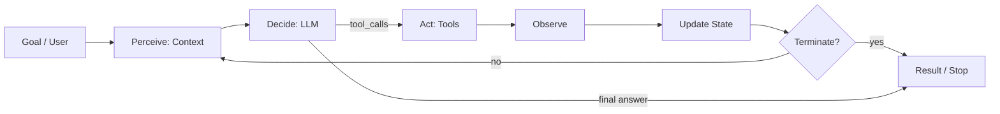
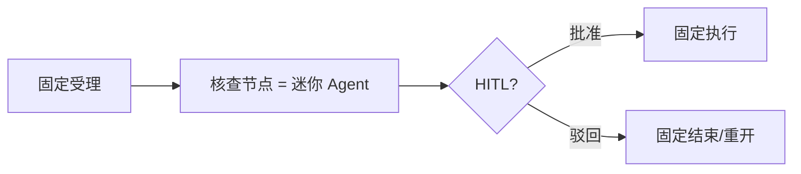
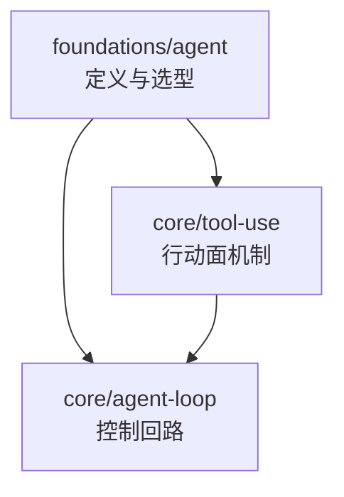

# Agent（Canonical）

> **一句话主题**：在工程上，Agent 是一个在目标约束下反复完成 **感知 → 决策 → 行动 → 观察回灌** 的可控闭环系统；模型负责不确定决策，运行时负责执行、预算、终止与审计。
>
> **状态**：Canonical · **Last reviewed**: 2026-10  
> **受众**：所有进入 Agent 工程的读者（第二站；读完 LLM 基础后）  
> **硬前置**：[LLM 基础](../llm/llm.md)  
> **下游枢纽**：[Tool Use](../../core/tool-use/tool-use.md) · [Agent Loop](../../core/agent-loop/agent-loop.md)

---

## 范围 / 非目标

**范围**：Agent 的工程定义；Chatbot / Workflow / Agent 选型；能力模型概览（工具、记忆、计划、协作）；自主度与人类在环；终止权；早期失败模式；与 Tool Use / Agent Loop 的接口关系；面试与引用。

**非目标（只链接，不写深文）**：

| 主题 | 去哪里 |
|------|--------|
| 工具 schema / 执行 / 观察契约 | [Tool Use](../../core/tool-use/tool-use.md) |
| 控制回路、预算、checkpoint、恢复 | [Agent Loop](../../core/agent-loop/agent-loop.md) |
| 规划 / 反思 / 校验策略 | [Reasoning & Planning](../../core/reasoning-planning/reasoning-planning.md) |
| 组件拓扑与生产架构组装 | [Agent Architecture](../../core/agent-architecture/agent-architecture.md) |
| Memory / RAG / Context 实现 | [memory](../../core/memory/memory.md) · [rag](../../core/rag/rag.md) · [context-engineering](../../core/context-engineering/context-engineering.md) |
| Multi-Agent 拓扑 | [`agent-types/multi-agent`](../../agent-types/multi-agent/README.md) |
| 评测 / 观测 / 安全 / 基础设施 | [`production/`](../../production/README.md) |
| 具体框架 API 教程 | 不写（框架仅作概念映射） |

**框架立场**：LangChain / LangGraph / OpenAI Agents SDK / 厂商托管 Agent 等 = implementation examples；概念先映射回本文与 Core Canonical，再谈产品 API。细节未核实处标 `TODO: Verify`。

---

## 1. 为什么先有这篇

读完 LLM 基础后，常见误区是把「能对话的模型」直接叫 Agent。工程上这会混淆三类完全不同的系统：

1. **Chatbot**：主要产出语言，副作用弱或没有。
2. **Workflow**：路径由代码/图预先定义，模型多在节点内局部决策。
3. **Agent**：在受控动作空间中由模型动态选择下一步行动，并通过观察修正信念。

本篇建立最小正确心智模型，使你能回答：

- 什么时候该上 Agent，什么时候不该？
- Agent 至少要有哪些能力维度？
- 自主度如何分级，人类与终止权放在哪？
- 早期最容易踩哪些坑？

更深机制留给 Core；本篇是 **定义与选型层**。

---

## 2. Agent 工程定义

### 2.1 一句话

**Agent** = 面向目标、在环境中通过工具/动作产生可观察副作用、并根据观察在预算内继续决策，直到满足终止条件的系统。

关键不是「有没有 LLM」，而是：

| 必要条件 | 含义 |
|----------|------|
| **目标（Goal）** | 可陈述的完成条件或可验收产物 |
| **动作空间（Actions / Tools）** | 模型可选择的受控能力 |
| **观察（Observations）** | 行动结果回灌，改变后续信念 |
| **闭环（Closed Loop）** | 决策 → 行动 → 观察 → 再决策 |
| **控制（Control）** | 预算、权限、终止、可审计 |

缺任意一项，通常应降级命名为 Chatbot、LLM App 或 Workflow。

### 2.2 感知–决策–行动闭环

经典控制直觉映射到 LLM Agent：

```text
Perceive（感知）  = 装配当前 Context：用户目标、历史、工具观察、记忆切片…
Decide（决策）    = LLM 在策略/约束下产出：最终回答 和/或 Tool Calls
Act（行动）       = Runtime / Tool Executor 执行受控副作用
Observe（观察）   = 规范化结果写回 State，成为下一轮感知输入
```



这与 [Agent Loop](../../core/agent-loop/agent-loop.md) 同构；本篇只定义 **概念闭环**，不展开状态机、预算计数器与恢复语义。

### 2.3 最小完备 Agent

最小可称为 Agent 的系统：

```text
Goal → Loop → Model ↔ Tools → Result
```

不需要独立 Planner、长期 Memory、Multi-Agent。先把 **工具面 + 回路 + 终止** 做对，再按评测加复杂度（见 [article-anthropic-building-effective-agents-2024](../../references/articles.md#article-anthropic-building-effective-agents-2024)）。

### 2.4 Agent ≠「更聪明的 Chatbot」

| | Chatbot | Agent |
|--|---------|-------|
| 主产物 | 文本 | 文本 **或** 经工具验证的世界状态变化 |
| 与环境关系 | 多为只读对话 | 读写环境（查询、改文件、调 API…） |
| 失败形态 | 胡说、偏题 | 空转、幻觉行动、工具滥用、越权副作用 |
| 工程重点 | Prompt / 安全回复 | Action 契约、预算、HITL、审计 |

把 Agent 当 Chatbot 做，会低估副作用风险；把 Chatbot 当 Agent 做，会过度工程。

### 2.5 工程定义 vs 学术定义

学术文献常强调「自主」「规划」「多智能体」「世界模型」。本仓库采用 **可交付工程定义**：

- 自主是 **可分级的控制参数**，不是绝对值。
- 规划是 **可选策略层**，不是 Agent 的定义条件（见 [Reasoning & Planning](../../core/reasoning-planning/reasoning-planning.md)）。
- Multi-Agent 是 **拓扑选项**，默认后置（见 [`multi-agent`](../../agent-types/multi-agent/README.md)）。

读者面试或读论文时，先问：「对方说的 Agent，是否包含可观察行动与控制闭环？」

---

## 3. Chatbot vs Workflow vs Agent

### 3.1 三分法

| 维度 | Chatbot / LLM App | Workflow | Agent |
|------|-------------------|----------|-------|
| **控制权** | 单次或短会话提示 | **代码/图预先定义路径** | **模型在回路中动态选动作** |
| **工具** | 可选、常单次或无 | 节点上固定调用 | 模型选择 + 执行器执行 |
| **状态** | 会话上下文为主 | 工作流引擎状态 | Run state + 可选 Memory |
| **终止** | 一次生成结束 | 到达终态节点 | 目标达成 / 预算耗尽 / 政策终止 |
| **可审计性** | 对话日志 | 路径可穷举 | 需轨迹 + 工具 IO + 政策版本 |
| **典型适合** | FAQ、写作、解释 | 合规流程、ETL+LLM | 探索性任务、路径不可穷举 |

Anthropic 将 **workflows**（预定义代码路径编排 LLM/工具）与 **agents**（模型动态决定过程与工具）区分，并建议从简单模式按需升级（[article-anthropic-building-effective-agents-2024](../../references/articles.md#article-anthropic-building-effective-agents-2024)）。本仓库沿用该区分，并在架构层展开（见 [Agent Architecture §3](../../core/agent-architecture/agent-architecture.md)）。

### 3.2 Agentic Workflow（混合）

**Agentic Workflow**：主干路径由 Workflow 固定，局部节点内嵌迷你 Agent Loop。

适合：整体合规路径必须可审计，局部需要智能探索（例如「受理 → 核查(Agent) → HITL → 执行」）。



命名建议：对外说「带 Agent 节点的 Workflow」，避免把整条链路都叫 Agent，导致权限与评测口径混乱。

### 3.3 选型决策树

按顺序问：

1. **路径能否穷举且稳定？**  
   - 是 → 优先 Workflow（或纯规则）。  
   - 否 → 继续。
2. **是否需要真实世界副作用或实时事实？**  
   - 否 → Chatbot / 检索增强问答通常够用。  
   - 是 → 继续。
3. **失败分支能否用固定状态机覆盖？**  
   - 是 → Workflow + 确定性错误处理。  
   - 否 → 考虑 Agent（或 Agentic Workflow）。
4. **副作用风险等级？**  
   - 高（支付、删改生产、对外发送）→ 必须 HITL / 政策门；可能整段仍用 Workflow 骨架。  
   - 中低 → Single Agent + 工具 allowlist 常够用。
5. **延迟与成本预算？**  
   - 极严 → 少步 Workflow / 单轮工具。  
   - 可接受多步探索 → Agent Loop。

### 3.4 选型反例（常见错误）

| 错误 | 后果 | 纠正 |
|------|------|------|
| 客服 FAQ 上全权 Agent | 成本高、幻觉行动、难审计 | Chatbot + 检索；必要时固定转人工 |
| 合规划定流程做成「自由 Agent」 | 不可证明路径 | Workflow / Agentic Workflow |
| 研究型开放任务死锁在固定图 | 图爆炸、维护失败 | Single Agent + 好工具面 |
| Demo 先上 Multi-Agent | 调试税、归因难 | 先穷尽 Single Agent |

### 3.5 一句话选型口诀

> **能枚举就 Workflow；只要说话就 Chatbot；路径开放且要动手，才上 Agent——且默认 Single。**

---

## 4. 能力模型（概览）

Agent 能力可沿四个主维度理解。本节只给 **选型级概览**；实现深文一律链 Core。

```text
                    ┌─────────────┐
                    │   Goal /    │
                    │  Policies   │
                    └──────┬──────┘
           ┌───────────────┼───────────────┐
           │               │               │
    ┌──────▼──────┐ ┌──────▼──────┐ ┌──────▼──────┐
    │   Tools     │ │   Memory    │ │  Planning   │
    │  (行动面)   │ │  (跨步记忆) │ │  (策略层)   │
    └──────┬──────┘ └──────┬──────┘ └──────┬──────┘
           │               │               │
           └───────────────┼───────────────┘
                           │
                    ┌──────▼──────┐
                    │ Collaboration│
                    │ (人 / 多Agent)│
                    └─────────────┘
```

### 4.0 上游 LLM 约束（必须内化）

Agent 的「能做什么」首先被 [LLM Canonical §4 Capabilities & Limits](../llm/llm.md) 卡住。选型时至少钉死：

| LLM 约束 | 对 Agent 设计的直接含义 |
|----------|-------------------------|
| 决策器 ≠ 执行器 | 副作用只信 Executor / 状态机，不信模型自述「已完成」 |
| 输出是概率的 | 需要校验、工具锚定、评测；不能把流畅当正确 |
| 上下文窗口是硬预算 | 「记得住」靠 State/Memory/外置存储 + Context 装配，不靠无限窗口 |
| 幻觉（含行动幻觉） | 高危动作必须可验证观测；禁止仅靠系统提示防注入 |
| 知识截止 | 实时/私有事实走 RAG 或工具，不靠换更大模型假装在线 |
| 指令遵循不完美 | 冲突指令、长上下文下会漂；硬约束放在 Loop/政策/工具鉴权 |
| 推理不可靠且昂贵 | 显式 Plan/Verifier 是可选策略（见 Reasoning），不是免费能力 |

深文：[llm.md](../llm/llm.md) §2–§4、§7–§8。本文其余能力维度都建立在这些限制之上。

### 4.1 工具（Tools）— 行动面

**是什么**：模型可调用的受控能力集合（查询、执行、通信、变更）。

**工程含义**：

- 没有工具，闭环无法「行动」，最多是多轮聊天。
- 工具质量（描述、schema、错误可行动性）往往比「更大模型」更杠杆。
- 权限、幂等、超时、观察归一化属于 Tool Use，不是 Prompt 技巧。

**深文**：[Tool Use](../../core/tool-use/tool-use.md)

**本篇只需记住**：动作空间由 **Registry + Schema + Executor** 定义；模型只产出调用意图。

### 4.2 记忆（Memory）— 跨步 / 跨会话信息

**是什么**：有选择地持久化并对未来决策可召回的信息策略。

**工程含义**：

- Run 内 transcript ≠ Memory；可随时从权威系统再查的事实未必该写入 Memory。
- 默认不该全写；写入要有出处、权限与遗忘。

**深文**：[Memory](../../core/memory/memory.md)  
**相关装配**：[Context Engineering](../../core/context-engineering/context-engineering.md) · [RAG](../../core/rag/rag.md)

**本篇只需记住**：Memory 是能力维度，**不是** Agent 的定义必要条件；最小 Agent 可以没有长期记忆。

### 4.3 计划（Planning）— 决策策略层

**是什么**：是否显式构造 Plan、何时重计划、是否反思/校验。

**工程含义**：

- ReAct 式逐步决策已是一种隐式计划；显式 Planner 是可选增强。
- 计划不能替代预算与终止（那是 Loop 的职责）。

**深文**：[Reasoning & Planning](../../core/reasoning-planning/reasoning-planning.md)

**本篇只需记住**：Planning = 策略；Loop = 控制结构。

### 4.4 协作（Collaboration）— 人与多 Agent

**是什么**：与人类（HITL）或其他 Agent 的分工、交接与汇总。

**工程含义**：

- 人类在环是控制面能力，不是失败补丁。
- Multi-Agent 增加通信、归因、成本税；默认拒绝，除非 Single Agent 评测证明瓶颈在职责冲突/上下文污染。

**深文**：HITL 见本文 §5；拓扑见 [`multi-agent`](../../agent-types/multi-agent/README.md) · 组装见 [Agent Architecture](../../core/agent-architecture/agent-architecture.md)

### 4.5 能力成熟度阶梯（建议）

| 级别 | 典型能力组合 | 何时升级 |
|------|--------------|----------|
| L0 | Chat + 可选单次工具 | FAQ / 写作 |
| L1 | Single Loop + Tools + 硬预算 | 开放路径、需探索 |
| L2 | + HITL / 政策门 | 中高风险副作用 |
| L3 | + 显式 Plan / Verify | 长任务、易偏航 |
| L4 | + Memory / RAG 选型 | 跨会话、知识密集 |
| L5 | + Multi-Agent / 复杂拓扑 | 有评测证据的职责拆分 |

**原则**：按评测与风险升级，不为「看起来高级」升级。

### 4.6 与 Prompt 的关系

Prompt / 系统指令是 Context 的一部分，影响决策分布，但：

- **不能**替代工具鉴权；
- **不能**替代终止预算；
- **不能**替代审计轨迹。

把「写更长系统提示」当成 Agent 能力升级，是早期常见幻觉。Prompt 深文见 [`core/prompt-engineering`](../../core/prompt-engineering/README.md)；运行时装配见 [Context Engineering](../../core/context-engineering/context-engineering.md)。

---

## 5. 自主度、人类在环、终止权

### 5.1 自主度是连续光谱

不要问「是不是自主 Agent」，问「在哪些动作上自主到哪一级」。

| 级别 | 名称 | 行为 | 适用 |
|------|------|------|------|
| A0 | Suggest | 只建议，人执行 | 高风险、探索期 |
| A1 | Prep | 准备草稿/变更集，人确认后执行 | 代码 PR、邮件 |
| A2 | Guarded Act | 低风险动作自动；高风险需批准 | 多数生产 Agent |
| A3 | Act within Policy | 政策内全自动；越界拒绝或升级 | 成熟工具面 + 强评测 |
| A4 | Open Act | 宽动作空间、弱门禁 | **默认禁止生产** |

自主度应 **按工具 / 按资源 / 按租户** 配置，而不是全局一个开关。

### 5.2 人类在环（HITL）模式

| 模式 | 触发 | 工程要点 |
|------|------|----------|
| **Approve** | 高危 tool_call 前暂停 | 展示参数摘要、影响面、可编辑参数 |
| **Review** | 终态前人工验收 | 区分「过程批准」与「结果验收」 |
| **Intervene** | 人可随时插入指令/取消 | 需协作式取消传到工具层 |
| **Teach** | 人纠正后写入偏好/规则 | 链 Memory 写入政策；防污染 |

HITL 不是「模型不行时的兜底」 alone：它是 **风险治理接口**。架构挂载点见 [Agent Architecture](../../core/agent-architecture/agent-architecture.md)；Loop 中断/恢复见 [Agent Loop](../../core/agent-loop/agent-loop.md)。

**托管 / SDK HITL 原语（机制级，Evergreen 2026-10-07）** — 概念映射到上表 Approve，**不是**产品 UX 教程：

| 产品面 | 可文档化机制 | 仍属产品默认 / UX |
|--------|--------------|-------------------|
| **OpenAI Agents SDK** | 工具声明 `needs_approval`（及 MCP `require_approval` 等）；命中且无已存决策时 **暂停执行**，结果带 `interruptions`；`RunState.approve` / `reject` 后用**同一顶层 agent + state** 恢复，而非新开用户回合。见 [doc-openai-agents-hitl](../../references/docs.md#doc-openai-agents-hitl)、[doc-openai-agents-guardrails](../../references/docs.md#doc-openai-agents-guardrails) | 默认哪些工具要批、宿主 UI 文案、超时升级策略 |
| **Anthropic Managed Agents** | toolset `permission_policy`：`always_allow` / `always_ask` / `auto`；`always_ask` 时会话暂停等待确认事件。文档：**agent toolset 默认 `always_allow`**；**MCP toolset 默认 `always_ask`**；`auto` **不是**人工检查点（安全则可能无人看见就执行）。见 [doc-anthropic-managed-agents-permissions](../../references/docs.md#doc-anthropic-managed-agents-permissions) | Console/webhook 体验、各内置工具默认矩阵细节 |

> TODO: Verify — 托管产品「开箱默认」与宿主 UX 对照表（随产品变）；主流框架命名对照仍见文末。

### 5.3 终止权（谁可以停）

终止必须是 **显式权利**，不能指望模型「自觉结束」。

| 终止源 | 含义 | 优先级建议 |
|--------|------|------------|
| **成功终止** | 目标验收通过 / 模型给出 final | 正常路径 |
| **预算终止** | 步数、时间、token、费用上限 | 硬护栏，通常高于模型意愿 |
| **政策终止** | 鉴权失败、安全规则、越权 | 立即停或降级 |
| **人类终止** | 取消、拒绝批准 | 应能打断 in-flight（尽力） |
| **异常终止** | 不可恢复错误 | 进入失败态 + 可观测 |

**原则**：**终止权属于控制面（Runtime / Policy），不属于模型自我声明。** 模型可以说「我做完了」；Runtime 必须独立验证是否允许停、是否真做完。

### 5.4 目标漂移与停止条件

开放任务易出现：

- 模型不断发现「还可以再优化」→ 空转；
- 用户目标模糊 → 无限澄清或擅自扩大范围。

工程对策（概念级）：

1. 把 Goal 写成可检验的验收条件（哪怕粗糙）。  
2. 步数/费用硬预算。  
3. 「无进展」检测（重复工具、重复结论）。  
4. 高风险范围扩大需 HITL。

机制细节在 Loop / Reasoning；本篇要求你在产品设计阶段就定义 **谁有权宣布完成**。

### 5.5 责任边界一句话

> 模型提出意图；执行器产生副作用；政策决定允不允许；人类保留否决与终止；轨迹让事后可追责。

---

## 6. 早期失败模式

新团队在「能跑 Demo」之后最常撞上三类失败。先学会识别信号，再下钻 Core。

### 6.1 空转（Idle / Spinning）

**现象**：多步循环无明显进展——重复同类查询、反复自我鼓励、在无关细节上消耗预算。

**信号**：

- 连续 N 步工具名/参数高度相似；
- 观察未改变 State 中的关键字段；
- token/费用上升但验收指标不动。

**根因方向**：

- Goal 不可检验；
- 缺少「无进展」终止；
- 工具返回噪声过大，模型无法更新信念；
- 过度依赖「再想一步」而无行动。

**缓解（选型级）**：硬预算 + 进展探针 + 收紧工具观察 + 必要时降级为 Workflow。深文见 Loop 终止与 Reasoning 重计划。

### 6.2 幻觉行动（Hallucinated Action）

**现象**：模型声称已执行某动作，或描述了从未发生的工具结果；或发明不存在的工具/参数。

**信号**：

- 最终回答含「已发送/已删除/已支付」，但无对应成功 Observation；
- tool_call 指向未注册名称；
- 把计划中的步骤当成已完成事实写入回复。

**根因方向**：

- 把模型自然语言当事实源；
- 未区分「意图」与「已执行」；
- UI 展示 assistant 文本而非工具轨迹。

**缓解（选型级）**：

- **世界真相以工具 Observation / 外部系统为准**；
- 对外副作用声明必须绑定成功证据；
- Schema 校验拒绝未知工具；
- 产品文案禁止在无证据时使用完成态动词。

### 6.3 工具滥用（Tool Abuse / Misuse）

**现象**：不必要地调用昂贵/危险工具；用错工具；参数越界；循环重试打爆依赖；通过工具做越权探索。

**信号**：

- 单位成功任务的工具调用数异常高；
- 高危工具调用占比上升；
- 4xx/权限错误被模型「换参硬试」；
- 同一幂等键缺失导致重复副作用。

**根因方向**：

- 动作空间过大、描述不清；
- 无 per-tool 配额与鉴权；
- 错误 Observation 不可行动（模型只能盲试）；
- 把安全指望系统提示。

**缓解（选型级）**：allowlist、最小权限、配额、幂等、错误可行动化；深文见 [Tool Use](../../core/tool-use/tool-use.md) 与 [`production/security`](../../production/security/README.md)。

### 6.4 相邻早期失败（简表）

| 失败 | 一句话 | 优先看 |
|------|--------|--------|
| 目标漂移 | 做着做着换题 | Goal 验收 + HITL |
| 观察爆炸 | 工具 dump 撑爆上下文 | Context Engineering |
| 过度自主 | A4 进生产 | 降自主度、政策门 |
| 过早 Multi-Agent | 调试税 > 收益 | 回退 Single |
| 无轨迹 | 出事不可追责 | Observability |

### 6.5 检测优先于「换更大模型」

早期失败大多是 **控制与契约** 问题。升级模型可能减轻，但不会 magically 给你终止权、鉴权与审计。排障顺序建议：

1. 轨迹是否完整（决策、工具 IO、政策）？  
2. 预算与终止是否硬？  
3. 工具观察是否可行动？  
4. 自主度是否匹配风险？  
5. 最后才考虑换模型或加策略层。

---

## 7. 与 Tool Use / Agent Loop 的关系

本篇 **只定义接口关系**，不重写机制。

### 7.1 分层一句话

```text
foundations/agent   = 定义、选型、能力光谱、控制哲学
core/tool-use       = 动作契约（schema → call → execute → observation）
core/agent-loop     = 控制回路（state、budget、terminate、recover）
```



### 7.2 依赖阅读顺序

1. 本文（知道何时叫 Agent、自主到哪一级）  
2. [Tool Use](../../core/tool-use/tool-use.md)（如何安全地「动手」）  
3. [Agent Loop](../../core/agent-loop/agent-loop.md)（如何循环、停、恢复）  
4. 再按需进入 Reasoning / Architecture / Memory / RAG / Context

### 7.3 概念交接表

| 本文概念 | Tool Use 中的落点 | Agent Loop 中的落点 |
|----------|-------------------|---------------------|
| 行动 | Tool Call / Executor | Decide 后的执行阶段 |
| 观察 | Observation 归一化 | State 更新与 Context 重建 |
| 终止权 | 工具超时/拒绝可触发终止 | Termination / Budget 硬护栏 |
| 幻觉行动 | 未知工具拒绝；无 obs 不当成事实 | 最终态与证据绑定 |
| HITL | 高危工具前拦截 | 中断、checkpoint、恢复 |

### 7.4 刻意不在此展开

- ReAct / Planner-Executor 控制流变体 → Loop  
- JSON Schema、并行工具、幂等键 → Tool Use  
- Reflection / Verification 策略 → Reasoning  
- Checkpoint 存储与 Worker 架构 → Loop / Architecture  

若你在本文寻找上述细节，说明应跳转，而不是在 foundations 复制一份。

---

## 8. 从 Demo 到可维护：最小实践清单

仍属 foundations 级，不替代 Production 深文。

### 8.1 第一个 Agent 的到位标准

- [ ] 书面 Goal / 验收条件（可粗糙）  
- [ ] 工具 allowlist + schema + 超时  
- [ ] 步数或费用硬预算  
- [ ] 轨迹：至少记录 tool_calls 与 observations 摘要  
- [ ] 高危动作的 HITL 或禁用  
- [ ] 明确成功/失败/取消终态  

缺任一项，建议仍称「工具增强 Demo」，勿宣称生产 Agent。

### 8.2 复杂度增加的触发条件

| 想加的东西 | 需要的证据 |
|------------|------------|
| 显式 Planner | 逐步 ReAct 偏航率高、长任务依赖里程碑 |
| Memory | 跨会话重复询问成本高，且事实稳定可验证 |
| RAG | 知识源大、需引用，且不只是「塞进 prompt」 |
| Multi-Agent | Single + 工具拆分仍上下文冲突，且评测增益 > 税 |
| 重框架图编排 | 分支/并行/汇合治理需求明确 |

### 8.3 与生产模块的接口

评测、观测、安全、基础设施是 **上线门槛**，不是「以后再说的优化」。本篇只要求你知道它们存在且必须单独设计：

- [`production/evaluation`](../../production/evaluation/README.md)  
- [`production/observability`](../../production/observability/README.md)  
- [`production/security`](../../production/security/README.md)  
- [`production/infrastructure`](../../production/infrastructure/README.md)

---

## 9. 常见误解速查

| 误解 | 纠正 |
|------|------|
| 「有 Function Calling 就是 Agent」 | 单次工具调用可以是 LLM App；Agent 需要闭环与控制 |
| 「Agent = Multi-Agent」 | 默认 Single；Multi 是拓扑选项 |
| 「自主越高越好」 | 自主度匹配风险；生产常见 A1–A3 |
| 「系统提示禁止危险操作即可」 | 政策与鉴权必须在执行器侧强制 |
| 「失败了加一个 Agent 分工」 | 先修工具、预算、观察、Goal |
| 「Memory 越大越智能」 | 默认不该全写；见 Memory Canonical |
| 「Workflow 过时了」 | 合规与稳定路径上 Workflow 往往更优 |

---

## 10. 面试题（约 45）

格式对齐仓库其他 Canonical：短答 / 详解要点 / 追问 / 常见错误 / 相关节。

### Fundamentals

**Q1. 用工程语言定义 Agent。**  
- **短答**：目标约束下，模型在受控动作空间中决策，执行产生观察并回灌，直至终止。  
- **详解**：强调闭环 + 控制，而非「更聪明的聊天」。  
- **追问**：缺观察回灌还叫 Agent 吗？  
- **常见错误**：把单轮 Chat 叫 Agent。  
- **相关**：§2。

**Q2. 感知–决策–行动分别对应系统哪一层？**  
- **短答**：Context 装配 / LLM 决策 / Tool Executor。  
- **详解**：观察写回 State 闭合回路。  
- **追问**：Memory 属于感知还是行动？  
- **常见错误**：认为模型自己执行工具。  
- **相关**：§2.2。

**Q3. 最小完备 Agent 需要什么？**  
- **短答**：Goal + Loop + Model + Tools + 终止。  
- **详解**：不必先有 Planner/Memory/Multi-Agent。  
- **追问**：没有工具呢？  
- **常见错误**：一上来画多智能体。  
- **相关**：§2.3。

**Q4. Agent 与 Chatbot 的本质区别？**  
- **短答**：是否以受控副作用与观察闭环完成目标。  
- **详解**：失败模式与工程重点不同。  
- **追问**：带检索的 Chatbot 算哪类？  
- **常见错误**：用「是否用了 GPT」区分。  
- **相关**：§2.4、§3。

**Q5. 学术「自主 Agent」与本仓库定义如何对齐？**  
- **短答**：自主是光谱；工程要求可终止可审计。  
- **详解**：规划/多智能体非定义必要条件。  
- **追问**：面试官追问 Russell & Norvig 时怎么答？  
- **常见错误**：无限抬自主。  
- **相关**：§2.5、§5。

### Selection

**Q6. 何时优先 Workflow 而非 Agent？**  
- **短答**：路径稳定可穷举、合规要可证明、失败分支可枚举。  
- **详解**：延迟敏感时也常选 Workflow。  
- **追问**：给一个反例。  
- **常见错误**：为了「AI」强行 Agent。  
- **相关**：§3.3。

**Q7. 什么是 Agentic Workflow？**  
- **短答**：固定主干 + 局部迷你 Agent 节点。  
- **详解**：命名上避免整链都叫 Agent。  
- **追问**：HITL 放哪一节？  
- **常见错误**：局部开放却无预算。  
- **相关**：§3.2。

**Q8. 给出客服退款场景的选型。**  
- **短答**：受理/执行固定；核查可 Agent；支付必须 HITL/政策。  
- **详解**：Agent 不得直达支付。  
- **追问**：部分退款失败如何补偿？  
- **常见错误**：单 Agent 全权退款。  
- **相关**：§3、§5。

**Q9. 研究型开放任务为何倾向 Agent？**  
- **短答**：路径不可穷举，需工具探索与观察修正。  
- **详解**：仍要硬预算防空转。  
- **追问**：如何定义验收？  
- **常见错误**：无终止的「自由探索」。  
- **相关**：§3.3、§6.1。

**Q10. 为什么默认不上 Multi-Agent？**  
- **短答**：通信、归因、调试、成本税高；先穷尽 Single。  
- **详解**：要有评测增益证据。  
- **追问**：什么信号才考虑拆？  
- **常见错误**：组织架构映射成 Agent 数。  
- **相关**：§4.4、§9。

### Capability Model

**Q11. 能力模型四维度是什么？**  
- **短答**：工具、记忆、计划、协作。  
- **详解**：各有深文；本篇只选型。  
- **追问**：哪一维是定义必要条件？  
- **常见错误**：四维齐活才叫 Agent。  
- **相关**：§4。

**Q12. 为什么说「工具面质量 > 盲目换大模型」？**  
- **短答**：错误可行动性与 schema 清晰度直接决定闭环能否收敛。  
- **详解**：链 Tool Use / 评测驱动改工具。  
- **追问**：如何评工具描述？  
- **常见错误**：只调温度。  
- **相关**：§4.1、§6.3。

**Q13. Memory 是否 Agent 必需？**  
- **短答**：否；跨会话价值高时才上。  
- **详解**：默认不该全写。  
- **追问**：与 State 区别？  
- **常见错误**：transcript 整存当 Memory。  
- **相关**：§4.2。

**Q14. Planning 与 Loop 如何分工？**  
- **短答**：Planning=策略；Loop=控制与终止。  
- **详解**：计划不能替代预算。  
- **追问**：ReAct 算 Planning 吗？  
- **常见错误**：认为有 Plan 对象才是 Agent。  
- **相关**：§4.3。

**Q15. L0–L5 成熟度如何使用？**  
- **短答**：按风险与评测升级，不跳级炫技。  
- **详解**：生产常见停在 L2–L3。  
- **追问**：从 L1 到 L2 的触发？  
- **常见错误**：Demo 直接 L5。  
- **相关**：§4.5。

**Q16. Prompt 能否充当安全边界？**  
- **短答**：不能单独充当；执行器侧强制。  
- **详解**：Prompt 只影响决策分布。  
- **追问**：系统提示与政策双重角色？  
- **常见错误**：「你是守法助手」当鉴权。  
- **相关**：§4.6、§5。

### Autonomy & Control

**Q17. 解释自主度 A0–A4。**  
- **短答**：从只建议到开放行动；生产默认避开 A4。  
- **详解**：按工具分级而非全局。  
- **追问**：邮件发送与日历查询如何分级？  
- **常见错误**：一个总开关。  
- **相关**：§5.1。

**Q18. HITL 的 Approve 与 Review 区别？**  
- **短答**：前者拦动作前；后者验结果。  
- **详解**：可组合。  
- **追问**：用户关闭审批页时系统状态？  
- **常见错误**：只有事后日志。  
- **相关**：§5.2。

**Q19. 谁拥有终止权？**  
- **短答**：控制面（预算/政策/人类），模型声明只是信号。  
- **详解**：成功终止仍需验收或证据。  
- **追问**：模型说完成但预算未到？  
- **常见错误**：指望模型自觉停。  
- **相关**：§5.3。

**Q20. 如何防止目标漂移？**  
- **短答**：可检验 Goal、无进展检测、扩范围 HITL、硬预算。  
- **详解**：产品层先定义完成权。  
- **追问**：用户目标模糊怎么办？  
- **常见错误**：无限澄清当进展。  
- **相关**：§5.4、§6.1。

**Q21. 「责任边界」一句话怎么讲？**  
- **短答**：模型意图、执行器副作用、政策允许、人否决、轨迹追责。  
- **详解**：对应组件所有权。  
- **追问**：审计最少字段？  
- **常见错误**：只存最终自然语言。  
- **相关**：§5.5。

**Q22. 取消如何设计（概念级）？**  
- **短答**：人类终止 → 状态机取消 → 尽力取消 in-flight 工具 → 补偿。  
- **详解**：支付等不可取消要人工对账队列。  
- **追问**：至少一次投递下的风险？  
- **常见错误**：只断 HTTP。  
- **相关**：§5.2–5.3；深文 Loop/Tool。

### Failure Modes

**Q23. 空转的检测信号？**  
- **短答**：重复工具、无关键 State 变化、费用升指标不动。  
- **详解**：设无进展终止。  
- **追问**：合法重试如何豁免？  
- **常见错误**：只加长超时。  
- **相关**：§6.1。

**Q24. 什么是幻觉行动？**  
- **短答**：声称已执行或发明未发生的工具结果。  
- **详解**：真相以 Observation 为准。  
- **追问**：UI 如何避免误导？  
- **常见错误**：信任 assistant 完成态动词。  
- **相关**：§6.2。

**Q25. 工具滥用与「合理多步探索」如何区分？**  
- **短答**：看是否逼近验收、错误是否可行动、高危占比与配额。  
- **详解**：用过程指标而非感觉。  
- **追问**：如何定 per-tool 配额？  
- **常见错误**：一律限制两步导致任务不可能。  
- **相关**：§6.3。

**Q26. 早期排障为何不先换大模型？**  
- **短答**：多数是控制与契约问题。  
- **详解**：轨迹→预算→观察→自主度→模型。  
- **追问**：什么时候模型升级是对的？  
- **常见错误**：不计成本换 SOTA。  
- **相关**：§6.5。

**Q27. 观察爆炸是什么？优先看哪篇？**  
- **短答**：工具/检索结果撑爆窗口导致决策退化；看 Context Engineering。  
- **详解**：本篇只点名。  
- **追问**：与 Memory 写入过量的区别？  
- **常见错误**：在 foundations 复制压缩算法。  
- **相关**：§6.4。

**Q28. 给出「幻觉行动」的产品文案规则。**  
- **短答**：无成功证据禁用完成态；展示工具状态。  
- **详解**：失败要可区分。  
- **追问**：部分成功怎么表述？  
- **常见错误**：统一「已处理」。  
- **相关**：§6.2。

### Relations & Design

**Q29. foundations/agent 与 Tool Use / Loop 的分层？**  
- **短答**：定义选型 / 行动契约 / 控制回路。  
- **详解**：阅读顺序 Agent→Tool→Loop。  
- **追问**：Architecture 插在哪？  
- **常见错误**：三篇互相复制。  
- **相关**：§7。

**Q30. 为什么 ReAct 细节不写在本文？**  
- **短答**：它是 Loop 控制流变体。  
- **详解**：本篇只保留闭环直觉。  
- **追问**：论文 ReAct 与工程 Loop 关系？  
- **常见错误**：把论文当唯一架构。  
- **相关**：§7.4；[paper-react-2022](../../references/papers.md#paper-react-2022)。

**Q31. 第一个 Agent 的到位标准列 3 项。**  
- **短答**：任意三：验收 Goal、allowlist+超时、硬预算、轨迹、高危 HITL、明确终态。  
- **详解**：缺则称 Demo。  
- **追问**：哪项对支付类不可妥协？  
- **常见错误**：只有漂亮 UI。  
- **相关**：§8.1。

**Q32. 何时引入显式 Planner？**  
- **短答**：逐步决策偏航高、需要里程碑的长任务。  
- **详解**：要有证据。  
- **追问**：Planner 失败如何降级？  
- **常见错误**：短任务强行两段式。  
- **相关**：§8.2。

**Q33. 生产模块与 foundations 的关系？**  
- **短答**：本文给控制哲学；Eval/Obs/Sec/Infra 是上线门槛深文。  
- **详解**：不在此写加固手册。  
- **追问**：最小观测字段？  
- **常见错误**：上线后补日志。  
- **相关**：§8.3。

### Advanced

**Q34. 按工具配置自主度的好处？**  
- **短答**：同一 Agent 可对只读自动、对写操作审批。  
- **详解**：降低「全开/全关」困境。  
- **追问**：动态临时提权流程？  
- **常见错误**：用户一句话提权到 A4。  
- **相关**：§5.1。

**Q35. 如何把「完成」做成可验证谓词？**  
- **短答**：验收条件绑定测试/查询/人工签核，而非模型自评。  
- **详解**：Runtime 检查谓词再成功终止。  
- **追问**：不可完全自动验收时？  
- **常见错误**：以「我认为完成」终止。  
- **相关**：§5.3–5.4。

**Q36. 空转与合法探索的边界设计。**  
- **短答**：进展定义（信息增益/状态字段/子目标）；超阈值则停或 HITL。  
- **详解**：允许有界重试。  
- **追问**：如何度量信息增益？  
- **常见错误**：步数到了才停、不问进展。  
- **相关**：§6.1。

**Q37. 幻觉行动在多工具并行下的风险。**  
- **短答**：部分成功时模型可能概括成全成功。  
- **详解**：按 call_id 对账；部分态显式化。  
- **追问**：UI 聚合策略？  
- **常见错误**：只看最后一句 summary。  
- **相关**：§6.2；Tool Use 并行。

**Q38. 说明「政策终止」为何优先于模型继续尝试。**  
- **短答**：安全与合规不可被探索目标覆盖。  
- **详解**：拒绝后可降级只读或转人工。  
- **追问**：与预算终止冲突谁先？  
- **常见错误**：让模型「再试一种绕过」。  
- **相关**：§5.3、§6.3。

**Q39. 将能力成熟度用于路线图管理。**  
- **短答**：里程碑绑 L 级与评测门禁；禁止无门禁跳级。  
- **详解**：对齐 practice-paths。  
- **追问**：客户要求 L5 怎么办？  
- **常见错误**：销售驱动架构。  
- **相关**：§4.5、§8。

**Q40. 对比「工具增强 Chatbot」与 L1 Agent。**  
- **短答**：前者多为单次/固定调用；后者多步闭环+终止。  
- **详解**：产品命名影响预期与责任。  
- **追问**：如何渐进迁移？  
- **常见错误**：营销统一叫 Agent。  
- **相关**：§3、§4.5。

### System Design / Interview Scenarios

**Q41. 设计企业内部「问数 + 下发变更」助手的形态。**  
- **短答**：问数可为 Chatbot/RAG；变更必须 Agentic Workflow + HITL。  
- **详解**：动作分级自主度。  
- **追问**：SQL 只读与 DDL 如何拆工具？  
- **常见错误**：同一 Agent 直接生产写。  
- **相关**：§3–§5。

**Q42. 设计编码助手的自主度阶梯。**  
- **短答**：建议补丁(A0)→生成 PR(A1)→测试绿自动小修(A2)→政策内提交(A3)。  
- **详解**：永不默认 A4 推主分支。  
- **追问**：如何绑 CI 证据？  
- **常见错误**：本地能跑就推生产。  
- **相关**：§5；[`coding-agent`](../../agent-types/coding-agent/README.md)。

**Q43. 线上费用飙升且任务成功率下降，你先查什么？**  
- **短答**：空转/工具滥用指标、预算是否生效、观察是否变噪、自主度是否被放开。  
- **详解**：再看模型与检索。  
- **追问**：要哪些仪表盘？  
- **常见错误**：先扩容推理集群。  
- **相关**：§6、§8.3。

**Q44. 给监管场景做「可证明路径」。**  
- **短答**：主干 Workflow；Agent 仅在无副作用分析节点；全轨迹与政策版本。  
- **详解**：终止与批准留痕。  
- **追问**：模型换版本如何回归？  
- **常见错误**：开放 Agent 事后解释。  
- **相关**：§3.2、§5。

**Q45. 从零做团队 Agent 能力建设的 90 天顺序。**  
- **短答**：定义与选型 → Tool Use → Loop/预算 → HITL → 评测/观测 → 按需 Memory/Plan → 最后才 Multi-Agent。  
- **详解**：每阶段有失败模式课。  
- **追问**：哪一步不可压缩？  
- **常见错误**：并行上框架生态与多智能体。  
- **相关**：全文；知识图主链。

---

## 11. Cross References

- 硬前置：[LLM 基础](../llm/llm.md)（能力/限制见本文 §4.0）  
- 下游主链：[Tool Use](../../core/tool-use/tool-use.md) · [Agent Loop](../../core/agent-loop/agent-loop.md)  
- 策略与组装：[Reasoning & Planning](../../core/reasoning-planning/reasoning-planning.md) · [Agent Architecture](../../core/agent-architecture/agent-architecture.md)  
- 三角：[Memory](../../core/memory/memory.md) · [RAG](../../core/rag/rag.md) · [Context Engineering](../../core/context-engineering/context-engineering.md)  
- 类型：[coding-agent](../../agent-types/coding-agent/coding-agent.md) · [browser-computer-use](../../agent-types/browser-computer-use/browser-computer-use.md) · [multi-agent](../../agent-types/multi-agent/multi-agent.md)  
- 生产：[evaluation](../../production/evaluation/evaluation.md) · [observability](../../production/observability/observability.md) · [security](../../production/security/security.md) · [infrastructure](../../production/infrastructure/infrastructure.md)  
- 导航：[knowledge-graph](../../docs/knowledge-graph.md) · [reading-paths](../../docs/reading-paths.md) · [phase-2-canonical-audit](../../docs/phase-2-canonical-audit.md)

---

## 12. References

- [article-anthropic-building-effective-agents-2024](../../references/articles.md#article-anthropic-building-effective-agents-2024)  
- [paper-react-2022](../../references/papers.md#paper-react-2022)  
- [paper-reflexion-2023](../../references/papers.md#paper-reflexion-2023)（反思作为策略钩子，非定义条件）  
- [talk-karpathy-software-changing-again-2025](../../references/talks.md#talk-karpathy-software-changing-again-2025)（Software 3.0 / partial autonomy / 人机校验环；对照 §5 自主度光谱）  
- [doc-openai-agents-hitl](../../references/docs.md#doc-openai-agents-hitl) · [doc-openai-agents-guardrails](../../references/docs.md#doc-openai-agents-guardrails) · [doc-anthropic-managed-agents-permissions](../../references/docs.md#doc-anthropic-managed-agents-permissions)  
- 机制依赖（不重复正文）：[Tool Use](../../core/tool-use/tool-use.md) · [Agent Loop](../../core/agent-loop/agent-loop.md) · [Reasoning & Planning](../../core/reasoning-planning/reasoning-planning.md)

> 不为凑数添加框架白皮书；框架行为以官方文档核实后记入 `research/open-source-analysis` 或 `research/industry-practices`。  
> TODO: Verify — 主流 SDK 对「agent vs workflow」产品命名与 HITL 原语的对照表。

---

## 13. Self-review / TODOs

- [x] 落点 `foundations/agent/agent.md`；中文 Canonical  
- [x] 覆盖：定义闭环、选型、能力模型概览、自主度/HITL/终止、早期失败、与 Tool/Loop 关系  
- [x] 约 45 面试题 + references + self-review  
- [x] 未写框架 API 教程；Multi-Agent / Production / Memory/RAG/Context/Loop 仅链接不重写  
- [x] 硬前置链接 `foundations/llm/llm.md`  
- [x] §4.0 回填上游 LLM 能力/限制交叉引用  
- [x] reading-paths R1 第一步已直链本文  
- [x] Evergreen 2026-10-07：OpenAI Agents HITL（`needs_approval` / interruptions / resume）与 Anthropic Managed Agents `permission_policy` 机制  
- [ ] TODO: Verify — 厂商 Managed Agents **产品默认 UX** / 开箱自主度对照（机制已记入 §5.2）
