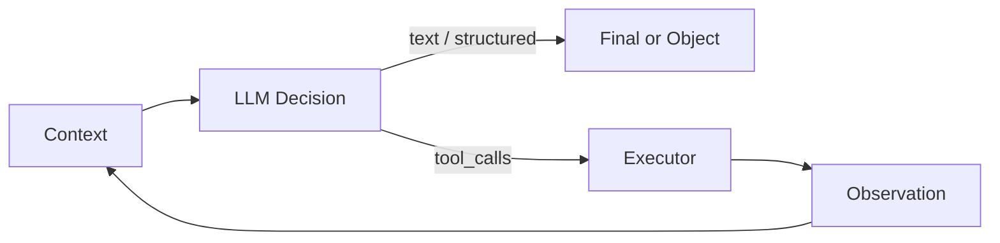

# LLM（Canonical）

> **一句话主题**：LLM 是 Agent 系统中的 **概率决策器**——在有限上下文预算内产出文本/结构化意图；**不执行副作用**，能力与失败模式共同决定 Agent 设计边界。
>
> **状态**：Canonical · **Last reviewed**: 2026-10  
> **受众**：准备进入 Agent 工程的工程师；不要求 ML 研究背景  
> **硬前置**：无

---

## 范围 / 非目标

**范围**：Token 与上下文窗口；成本直觉；补全 / Chat / Tool / Structured Output 接口形态；能力与限制（推理、幻觉、知识截止、指令遵循）；采样与可复现性（工程视角）；多模态如何进入 Agent；LLM 与 Agent 的关系；失败模式与权衡；面试。

**非目标**：

| 主题 | 去哪里 |
|------|--------|
| 预训练 / Transformer 教材级细节 | 本仓库不展开；需要时链 `references/` |
| 对齐算法深水（RLHF / RLAIF / Agent RL） | [`runtime/reinforcement-learning`](../../runtime/reinforcement-learning/README.md) |
| Inference 系统实现（批处理、KV cache、调度） | [`runtime/llm-inference`](../../runtime/llm-inference/README.md) |
| Prompt 措辞配方深文 | [`core/prompt-engineering`](../../core/prompt-engineering/README.md) |
| 每次调用塞什么（装配/压缩） | [Context Engineering](../../core/context-engineering/context-engineering.md) |
| 工具执行、鉴权、幂等 | [Tool Use](../../core/tool-use/tool-use.md) |
| 控制回路、预算硬护栏 | [Agent Loop](../../core/agent-loop/agent-loop.md) |
| 推理/计划策略层 | [Reasoning & Planning](../../core/reasoning-planning/reasoning-planning.md) |
| Agent 工程定义与形态选型 | [`foundations/agent`](../agent/README.md) |

---

## 1. Mental Model：工程师该怎么看 LLM

### 1.1 一句话

**LLM = 条件概率文本生成器 +（可选）结构化意图出口**。

给定输入（messages / prompt / 多模态块），模型对下一个 token（或下一段结构化字段）给出分布；采样后得到可见输出。工程上你把它当成：

```text
输入 Context（有限） → LLM → 输出（文本 | tool_calls | structured object）
                              ↑
                    运行时：采样参数、schema 约束、停止条件
```

### 1.2 三个必须钉死的命题

1. **LLM 是决策器，不是执行器**  
   它决定「说什么 / 调哪个工具 / 填什么参数」；真正改文件、调 API、写库由表侧 **Tool Executor / Runtime** 完成（见 [Tool Use](../../core/tool-use/tool-use.md)；官方口径一致：[doc-openai-function-calling](../../references/docs.md#doc-openai-function-calling)、[doc-anthropic-how-tool-use-works](../../references/docs.md#doc-anthropic-how-tool-use-works)）。

2. **输出是概率的，不是数据库查询**  
   同一输入可得到不同输出；「看起来自信」≠「正确」。生产系统必须用校验、工具锚定、评测与预算约束，而不是「相信模型」。

3. **上下文窗口是硬预算，不是无限记忆**  
   超出窗口的信息对单次调用不可见；「记得住」要靠 State / Memory / 外置存储 + Context 装配（见 [Context Engineering](../../core/context-engineering/context-engineering.md)）。

### 1.3 与 Agent 的最小关系图

```text
User Task
  ↓
State / Context Builder
  ↓
LLM（决策：final | tool_call | structured）
  ↓
若 tool_call → Executor → Observation → 回灌 Context → 再决策
若 final     → 返回用户（可再经 verifier）
```



**没有 Loop 的单次 LLM 调用**可以是产品（摘要、改写、分类）；**Agent** 把 LLM 放进受控循环，并依赖工具与状态（定义见 [`foundations/agent`](../agent/README.md)、机制见 [Agent Loop](../../core/agent-loop/agent-loop.md)）。Anthropic 建议从简单可组合模式起步（[article-anthropic-building-effective-agents-2024](../../references/articles.md#article-anthropic-building-effective-agents-2024)）。

---

## 2. Tokens · Context Window · 成本直觉

### 2.1 Token 是什么

**Token** = 模型读写文本的基本计价与长度单位（子词、字节对等分词结果，因模型/分词器而异）。

工程含义：

| 事实 | 含义 |
|------|------|
| 1 token ≠ 1 字 / 1 word | 中英、代码、空格、标点的折算不同 |
| 计费通常按 token | 输入 + 输出分开计价（多数 API） |
| 延迟与输出长度相关 | 生成越长，串行步数越多（粗直觉） |
| 窗口按 token 计 | 「塞得下」以 token 为准，不是字符数 |

**实践**：用目标模型的 tokenizer / 官方计数 API 估长度；跨模型迁移时重新计量。不同模型的 token 边界不可直接等同。

### 2.2 Context Window

**Context Window（上下文窗口）** = 单次调用中模型可见输入（及部分实现中与输出共享）的最大 token 容量。

```text
可用预算 ≈ context_window − reserved_for_output − system/tool_schema 开销
```

常见坑：

- **把「窗口很大」当成「什么都塞」** → 信号稀释、成本上升、中部信息更难被用到（[paper-lost-in-the-middle-2023](../../references/papers.md#paper-lost-in-the-middle-2023)；Context 文：[Context Engineering](../../core/context-engineering/context-engineering.md)）。
- **忘记 tool schema / 图像块也占预算** → 运行中途突然截断。
- **跨厂商数字不可比** → 同「128K」下有效可用与注意力行为仍可能差很多。

**More Context ≠ Better Context**（与 Anthropic 注意力预算叙事一致：[article-anthropic-context-engineering-2025](../../references/articles.md#article-anthropic-context-engineering-2025)）。

### 2.3 成本直觉（工程师版）

粗账：

```text
单次调用成本 ≈ (input_tokens × p_in) + (output_tokens × p_out)
Agent run 成本 ≈ Σ 各步调用 + 工具侧成本
```

经验法则：

1. **输出通常比输入贵**（多数价目表）；让模型「复读大段上下文」很贵。
2. **Agent 成本 ≈ 步数 × 每步上下文大小**；盲目加步、加窗会指数感变贵。
3. **缓存 / 前缀复用**可降输入价：稳定前缀在前、变动后缀在后（见 [doc-openai-prompt-caching](../../references/docs.md#doc-openai-prompt-caching)、[doc-anthropic-prompt-caching](../../references/docs.md#doc-anthropic-prompt-caching)；Evergreen 2026-10-07）。**机制已核**：OpenAI 默认 TTL ~30m、GPT-5.6+ 最低约 1024 tokens；Anthropic 默认 TTL 5m（可选 1h）、最低 token 按模型 512–4096。**计费倍率**仍 **TODO: Verify**（见 [evergreen-2026-10-caching-seed.md](../../docs/evergreen-2026-10-caching-seed.md)）。
4. **多模态**按图像/音频块折算 token，常远高于同信息量的文字摘要（价目 **TODO: Verify**）。

决策口诀：

| 目标 | 倾向 |
|------|------|
| 降本 | 减步、减窗、外置大结果、摘要/句柄、便宜模型做路由 |
| 提质 | 高信号证据、工具锚定、校验，而不是「再塞一点」 |
| 控延迟 | 短输出、流式、并行工具、避免串行废话 |

---

## 3. Generation 接口形态

Agent 工程面对的不是「一种 LLM」，而是一组 **调用契约**。四种形态可并存于同一产品。

### 3.1 Completion（补全）

**形态**：给一段前缀文本，模型续写。

```text
prompt → continuation
```

| 适合 | 不适合（通常） |
|------|----------------|
| 补全代码片段、模板填空、legacy 集成 | 多角色对话、带工具的 Agent Loop |

现代 Agent 栈多以 Chat/Messages 为主；补全仍出现在：嵌入式补全、某些开源 serving、需要精细控制停词的场景。

### 3.2 Chat / Messages

**形态**：有角色的消息序列（system / user / assistant / tool 等，名称因厂商而异）。

```text
[system, user, assistant, ..., user] → assistant（± tool_calls）
```

工程要点：

- **角色是协议，不是魔法**：system 并不自动获得绝对权威；策略与工具鉴权不能只靠「写在 system 里」。
- **历史是最大成本头**：多轮 Agent 必须裁剪/摘要（交给 Context Engineering）。
- **assistant 过去的 tool_calls + tool 结果**构成可审计轨迹，也是下一跳输入。

### 3.3 Tool / Function Calling

**形态**：在声明工具 schema 后，模型可产出结构化 **Tool Call**（name + arguments + id），由应用执行并回传结果。

```text
tools[] + messages → { content?, tool_calls? }
```

关键边界（勿在本文重写 Tool Use 正文）：

- 模型 **只产出调用意图**；执行在外侧（[doc-openai-function-calling](../../references/docs.md#doc-openai-function-calling)、[doc-anthropic-how-tool-use-works](../../references/docs.md#doc-anthropic-how-tool-use-works)）。
- Schema 质量 = 决策质量的一部分（描述、参数约束、错误可恢复性）→ [Tool Use](../../core/tool-use/tool-use.md)、[std-json-schema-2020-12](../../references/docs.md#std-json-schema-2020-12)。

对 LLM 基础文的含义：当你「打开工具」，模型能力面从「说话」扩展到「提议副作用」——**风险随之从文本幻觉升级为行动幻觉**。

### 3.4 Structured Output

**形态**：约束模型输出符合给定 schema（JSON Schema / 语法约束 / 厂商「严格模式」等），得到可机读对象，而不是自由散文。

```text
messages + response_schema → object（校验通过）
```

| 用途 | 注意 |
|------|------|
| 路由、分类、抽取、计划草稿、评测打分器 | 「格式正确」≠「语义正确」 |
| 降低正则抠字段的脆弱性 | 过严 schema 可能诱发胡填必填字段 |
| 与 Tool Call 参数生成同类问题 | 仍需业务校验与范围检查 |

**Evergreen 2026-10-07（机制级）**：OpenAI 区分 **Structured Outputs**（schema 遵从）与旧 **JSON mode**（仅合法 JSON）；推荐能用前者就用前者（见 [doc-openai-structured-outputs](../../references/docs.md#doc-openai-structured-outputs)）。Anthropic 提供 JSON outputs + `strict` tool use（见 [doc-anthropic-structured-outputs](../../references/docs.md#doc-anthropic-structured-outputs)）。

**Refusal / 非 schema 完成路径（机制级，同日复核）**：

| 厂商 | 安全拒绝 | 截断/未完成 | 工程处理 |
|------|----------|-------------|----------|
| **OpenAI** | 拒绝未必贴合你的 schema；响应带可检测的 **`refusal`**（Chat：message 字段；Responses：content part `type: "refusal"`，流式有 `response.refusal.delta`） | `max_tokens` / incomplete 等可使 JSON 不完整 | **先判 refusal / incomplete，再反序列化**；勿假设永远有合法对象 |
| **Anthropic** | `stop_reason: "refusal"`（HTTP 200，按生成 token 计费）；拒绝文案优先于 schema | `stop_reason: "max_tokens"` → 可能半截、不匹配 schema | 分支处理 refusal 与重试抬高 `max_tokens`；enum 大小写文档提示可能漂移 |

> TODO: Verify — 完整「模型 × API 面」矩阵与其它厂商边缘失败码/价目。

### 3.5 接口选型速查

| 需求 | 优先接口 |
|------|----------|
| 对用户自然语言回答 | Chat |
| 要副作用 / 查实时数据 | Tool Calling + Executor |
| 要稳定喂给下游代码 | Structured Output（+ 校验） |
| 极简续写 / 兼容旧栈 | Completion |

Agent 常见组合：**Chat + Tool Calling**；计划/路由层另加 **Structured Output**。

---

## 4. Capabilities & Limits

### 4.1 能力：LLM 真正擅长什么

对 Agent 工程师有用的能力面：

| 能力 | 工程用法 | 边界提醒 |
|------|----------|----------|
| **语言理解与生成** | 意图澄清、摘要、解释、多语 | 流畅 ≠ 事实正确 |
| **模式补全 / 代码** | 草稿、重构建议、测试骨架 | 必须跑测试/静态检查 |
| **指令遵循（有限）** | 格式、风格、工具协议 | 长上下文与冲突指令下会漂 |
| **工具选择与参数草稿** | Agent 的动作提议 | 需 schema + 鉴权 + 校验 |
| **浅层推理 / 分解** | 多步任务的中间痕迹 | 深推理不稳；见 Reasoning 文 |
| **多模态感知（若支持）** | 读图/读文档页 | 计价高；细节易漏 |

CoT 等提示可诱导中间步骤痕迹（[paper-cot-2022](../../references/papers.md#paper-cot-2022)）；ReAct 将推理与行动交错（[paper-react-2022](../../references/papers.md#paper-react-2022)）——这些是 **策略/提示范式**，不是「模型内部有可靠逻辑引擎」。策略深文见 [Reasoning & Planning](../../core/reasoning-planning/reasoning-planning.md)。

### 4.2 限制一：幻觉（Hallucination）

**幻觉** = 模型生成看似合理但 **无依据或与依据矛盾** 的内容（事实、引用、工具结果复述、甚至「已执行」的假动作）。

Agent 场景下的升级形态：

| 类型 | 表现 | 缓解（工程） |
|------|------|--------------|
| 事实幻觉 | 编造 API/法律/数字 | RAG/工具锚定；要求引用 |
| 忠实性幻觉 | 歪曲检索/工具返回 | 回传原文片段；对比校验 |
| 行动幻觉 | 声称已发邮件/已提交 | **唯 Executor 日志为真相** |
| 自信校准差 | 错得斩钉截铁 | 显式不确定度；禁止静默猜 |

**原则**：需要真的地方，用工具或人；模型文本默认 **不可信证据**。

### 4.3 限制二：知识截止（Knowledge Cutoff）

权重里的世界知识有 **训练截止日**；之后事件、私有数据、实时状态 **默认不可知**。

| 需求 | 做法 |
|------|------|
| 新闻/行情/库存 | 工具 / 检索 |
| 企业私有文档 | RAG + ACL（[RAG](../../core/rag/rag.md)） |
| 用户偏好跨会话 | Memory（[Memory](../../core/memory/memory.md)） |

**不要**把「换更大模型」当作知识截止的完整解。

### 4.4 限制三：指令遵循不完美

失败信号：

- 忽略 system 硬约束（尤其上下文很长或工具结果很大时）
- 冲突指令下任意站队
- 格式协议漂移（该 JSON 时夹杂解释）
- 安全/政策指令被用户或检索内容覆盖（注入面 → Security）

工程对策：**机器可校验的约束外置**（schema 校验、策略引擎、工具鉴权），提示只做补充。

### 4.5 限制四：推理不可靠且昂贵

- 算术、长依赖、精确定位、对抗性逻辑仍易错。
- 「多想一步」常增 token 与延迟；未必增正确率。
- 生产上把 **可验证步骤**交给工具/代码；把 LLM 推理当 **启发式**，用 Loop 预算兜底（[Agent Loop](../../core/agent-loop/agent-loop.md)）。

### 4.6 能力边界一览（给选型）

```text
可靠：在分布内的语言变换、有 schema 的草稿、有工具反馈的迭代
不可靠：无依据的事实断言、不可逆副作用的「自觉」、超长上下文中部细节
不可替代系统：权限、审计、幂等、计费、终止权
```

---

## 5. Sampling & Determinism（工程视角）

### 5.1 采样在做什么

解码时，模型给出下一 token 的分布；**采样参数**决定如何从分布取点。

常见参数（名称因 API 而异）：

| 参数 | 直觉 | 工程影响 |
|------|------|----------|
| **temperature** | 分布尖锐↔平坦 | 低→更稳、更重复；高→更散、更「有创意」 |
| **top_p** | 核采样：只在累积概率质量内采样 | 与 temperature 叠加时难调；勿盲目双开猛调 |
| **top_k** | 只保留概率最高的 k 个 | 类似截断长尾 |
| **max_tokens / max_output** | 硬停 | 防跑飞；Agent 每步都应设 |
| **stop / stop_sequences** | 遇序列停 | 协议边界；Tool 路径更靠结构化出口 |
| **seed**（若支持） | 尝试可复现 | **不保证**跨版本/跨硬件比特级一致 |

**Evergreen 2026-10-07**：OpenAI 文档称 `seed` + 固定参数可得 **mostly** 可复现输出，并用 `system_fingerprint` 追踪后端变更；**不保证**比特级一致（见 [doc-openai-advanced-usage](../../references/docs.md#doc-openai-advanced-usage)）。**Anthropic Messages API** 公开参数表/SDK 类型中 **无 `seed`**（复核于 Messages 参考与 SDK `message_create_params`）；降低方差靠固定模型快照与（若模型仍支持）低温度等，**仍不保证**比特级一致。**Gemini** `GenerationConfig.seed`：官方为 **best effort / mostly**——固定 seed 后对同 prompt/参数尽力复现，**Deterministic output isn't guaranteed**（见 [doc-gemini-seed](../../references/docs.md#doc-gemini-seed)）。绝对比特级一致对三家均 **非保证**。其它厂商继续 **TODO: Verify**。

### 5.2 「Determinism」在生产里的真实含义

| 期望 | 现实 |
|------|------|
| 同输入同输出 | 多数托管 API **不保证**；模型版本、负载、实现细节都会动 |
| 评测可复现 | 固定模型版本 + 低随机性 + 多次跑统计；金样用校验而非字符串全等 |
| Agent 轨迹可复现 | 记录 **完整输入、工具结果、参数、模型版本**；重放时工具侧也要可控 |

**工程结论**：把确定性预算花在 **校验与工具** 上，而不是迷信 temperature=0。

### 5.3 Agent 场景下的参数建议（启发式）

| 场景 | 倾向 |
|------|------|
| Tool 参数 / Structured 路由 | 低温 + schema；失败重试换策略而非狂加温度 |
| 对用户解释/文案 | 中低温度；品牌约束外置 |
| 头脑风暴 / 多样候选 | 提高多样性；**外层**选优或投票 |
| 安全关键决策 | 低温不够；要人审或策略引擎 |

### 5.4 与「多次采样」的关系

Self-consistency 类做法：多样本再投票——**成本 ×N**。Agent 里更常见的是：**一次决策 + 工具验证**，或 **小 N 候选只用于高价值步骤**。勿默认「全程 N 倍采样」。

---

## 6. Multimodal 概览（进 Agent 的方式）

### 6.1 是什么

部分模型接受 **图像 / 音频 / 视频 / 文件页** 等与文本一起作为输入（输出仍常以文本或 tool_calls 为主；原生多模态输出另议）。

### 6.2 进入 Agent 的典型路径

```text
原始模态
  →（可选）预处理：裁剪、OCR、ASR、降分辨率
  → 作为 message 块进入 Context
  → LLM 决策（描述 / 抽取 / tool_call）
  → 大结果外置；Context 留句柄或摘要
```

| 模式 | 说明 |
|------|------|
| **直喂模型** | 截图/PDF 页进窗口；实现简单；贵、易漏细节、有泄密面 |
| **工具感知** | `vision.describe` / `ocr` / `asr` 先结构化，再当文本证据 | 可控、可缓存、可鉴权 |
| **混合** | 关键帧直喂 + 其余工具化 | 常见生产折中 |

### 6.3 Agent 工程注意点

- **预算**：图像 token 计价与文本不同——计入 Context 预算（细节 **TODO: Verify** 各价目表）。
- **忠实性**：模型「看见」≠ 像素级可靠；计量、印章、小字易错 → 工具/人审。
- **安全**：用户图/文档可含注入（图中文字攻击）与敏感数据；按不可信输入处理。
- **观测**：日志勿默认落原图；保留哈希/句柄与模型描述。

多模态 **不改变**「LLM 不执行工具」的命题；只是决策输入更富。

---

## 7. 与 Agent 的关系：决策器 ≠ 执行器

### 7.1 职责切割

| 组件 | 职责 | 真相来源 |
|------|------|----------|
| **LLM** | 理解目标、选择下一步、生成参数/答复 | 无副作用真相 |
| **Tool Executor** | 鉴权、执行、超时、幂等、归一化观察 | 系统状态 / API |
| **Agent Loop** | 预算、终止、恢复、checkpoint | Run 状态机 |
| **Context Builder** | 策展可见信息 | 装配策略 |
| **Policy / Auth** | 允许做什么 | 权限系统 |

```text
LLM 可以说「我已删除生产库」
除非 Executor 真正执行了 delete —— 否则世界没变
```

### 7.2 何时「只要 LLM」 vs 「要 Agent」

| 只要 LLM（单次或浅多轮） | 要 Agent（Loop + Tools） |
|--------------------------|---------------------------|
| 改写、分类、摘要、草稿 | 需多步环境反馈 |
| 无副作用或副作用在人确认后 | 需查实时/私有数据并行动 |
| 错误代价低 | 错误代价高，需校验与终止权 |

选型叙事与 Anthropic「workflows vs agents、从简单开始」一致（[article-anthropic-building-effective-agents-2024](../../references/articles.md#article-anthropic-building-effective-agents-2024)）。形态定义交给 [`foundations/agent`](../agent/README.md)。

### 7.3 LLM 在 Loop 中的位置（只链不重写）

```text
build_context(state) → LLM.decide → (tool_calls? execute : finalize) → update state
```

细节：[Agent Loop](../../core/agent-loop/agent-loop.md)、[Tool Use](../../core/tool-use/tool-use.md)、[Context Engineering](../../core/context-engineering/context-engineering.md)。

---

## 8. 失败模式（Failure Modes）

### F1. 把流畅当正确

- **信号**：无引用仍斩钉截铁；用户追问出处后改口。  
- **缓解**：强制工具/检索；UI 区分「模型说」与「系统查」。

### F2. 行动幻觉

- **信号**：回复声称已完成；Executor 无对应 span。  
- **缓解**：UI/协议禁止「已完成」除非有 execution id；最终态以状态机为准。

### F3. 窗口溢出与静默截断

- **信号**：中后段指令丢失；工具 schema 被截断导致乱调工具。  
- **缓解**：预检 token；保留硬约束区；溢出策略显式（拒答/摘要/升窗）。

### F4. 中部遗忘 / 信号淹没

- **信号**：只遵开头结尾；中间约束失效（[paper-lost-in-the-middle-2023](../../references/papers.md#paper-lost-in-the-middle-2023)）。  
- **缓解**：短上下文、重排关键段、外置大块。

### F5. 指令冲突与注入

- **信号**：遵从不可信 tool/检索内容中的「忽略政策」。  
- **缓解**：信任标签；权限不靠服从；见 Security / Context。

### F6. 采样导致偶发事故

- **信号**：同流程偶发危险 tool 参数。  
- **缓解**：参数白名单、干跑、低温 + 校验；高危要人审。

### F7. 知识截止当实时

- **信号**：回答过时政策/价格并显得很新。  
- **缓解**：时间敏感必走工具；提示截止日只作弱提示。

### F8. Structured「胡填」

- **信号**：JSON 合法但字段是编的。  
- **缓解**：字段级校验、枚举限制、与工具结果交叉验证。

### F9. 成本/延迟爆炸

- **信号**：步数与上下文随会话线性/超线性涨。  
- **缓解**：步预算、上下文预算、便宜模型路由（Loop / Context）。

### F10. 版本漂移

- **信号**：评测金样集体失败；行为「突然变了」。  
- **缓解**：钉模型版本；回归集；变更审批。

---

## 9. Trade-offs

| 维度 A | 维度 B | 笔记 |
|--------|--------|------|
| 更大窗口 | 成本 / 延迟 / 中部利用 | 默认策展，而不是默认拉满 |
| 更强模型 | $/调用与延迟 | 路由：简单步用小模型 |
| 更高温度 | 稳定性 | Agent 动作路径偏稳 |
| 更多工具 | 选择难度与攻击面 | 工具要少而精（Tool Use） |
| 严格 Structured | 灵活性 | 对机器接口严，对用户话术松 |
| 多模态直喂 | 可控流水线 | 贵场景优先工具化感知 |
| 端到端自主 | 可控 workflow | 代价高时降自主度 |

**总权衡函数（概念上）**：

```text
Utility ≈ Success − λ_cost·$ − λ_lat·Latency − λ_risk·Risk
```

LLM 选型与参数是该函数的旋钮之一，不是全部。

---

## 10. 实践清单（落地）

**调用前**

- [ ] 明确本步要的接口：Chat / Tool / Structured  
- [ ] 估算 input+max_output；硬约束是否装得下  
- [ ] 工具与权限是否已配置（不要「先让模型保证」）

**调用时**

- [ ] 记录 model id/version、参数、request id  
- [ ] 设置 max 输出与超时  
- [ ] 流式若面向用户：协议上区分 content vs tool_calls

**调用后**

- [ ] Structured / tool args：schema + 业务校验  
- [ ] 禁止把模型自称状态当世界状态  
- [ ] 大观察外置；回灌短摘要（Context）

**评测**

- [ ] 任务成功、格式遵从、工具正确率、成本、延迟  
- [ ] 幻觉与注入红队样本  
- [ ] 模型升级回归

---

## 11. 与周边模块的边界（防重复）

| 问题 | 本文 | 他文 |
|------|------|------|
| Token/窗口/采样/幻觉基础 | ✅ | |
| 每次塞什么、压缩、爆炸观察 | 概述 | Context Engineering |
| 工具怎么执行与重试 | 接口层 | Tool Use |
| 何时停、预算、checkpoint | 提及 | Agent Loop |
| 计划/反思策略 | 链论文 | Reasoning & Planning |
| 检索管道 | 提及截止 | RAG |
| 服务端推理优化 | ❌ | llm-inference |
| 对齐训练 | ❌ | reinforcement-learning |

---

## 12. Interview Questions

### Beginner

**Q1. 什么是 Token？为什么工程师要关心？**  
- **短答**：模型计长度与计费的基本单位。  
- **详解**：影响窗口、成本、截断；≠字符数。  
- **追问**：中英同一句 token 数谁多？  
- **常见错误**：用字符数当窗口预算。  
- **相关**：§2。

**Q2. Context Window 是什么？**  
- **短答**：单次调用可见输入的最大 token 容量。  
- **详解**：超出部分本次不可见。  
- **追问**：输出是否占同一窗口？  
- **常见错误**：当成无限记忆。  
- **相关**：§2；Context Engineering。

**Q3. LLM 会自己执行工具吗？**  
- **短答**：不会；只产出结构化调用意图。  
- **详解**：应用侧执行并回传。  
- **追问**：server tools 例外怎么理解？  
- **常见错误**：以为 function calling 即自动副作用。  
- **相关**：§3.3；[doc-openai-function-calling](../../references/docs.md#doc-openai-function-calling)。

**Q4. Chat 接口与 Completion 接口差别？**  
- **短答**：Chat 是角色化消息序列；Completion 是前缀续写。  
- **详解**：Agent 多走 Chat+Tools。  
- **追问**：能否用 Completion 模拟 Chat？  
- **常见错误**：混用术语导致协议错乱。  
- **相关**：§3。

**Q5. 什么是幻觉？**  
- **短答**：流畅但无依据或与依据矛盾的生成。  
- **详解**：含行动幻觉。  
- **追问**：如何检测？  
- **常见错误**：只在「事实题」上谈幻觉。  
- **相关**：§4.2。

**Q6. 知识截止意味着什么？**  
- **短答**：权重内知识有训练时间边界。  
- **详解**：实时/私有靠工具与检索。  
- **追问**：微调能解决实时性吗？  
- **常见错误**：换大模型当唯一解。  
- **相关**：§4.3。

**Q7. temperature 大概干什么？**  
- **短答**：调节采样随机性/分布平坦度。  
- **详解**：低更稳，高更散。  
- **追问**：temperature=0 是否比特级确定？  
- **常见错误**：当作准确率旋钮。  
- **相关**：§5。

**Q8. Structured Output 解决什么问题？**  
- **短答**：让输出符合 schema，便于机器消费。  
- **详解**：不保证语义真。  
- **追问**：与 Tool Call 参数关系？  
- **常见错误**：合法 JSON = 业务正确。  
- **相关**：§3.4。

**Q9. 为什么说 LLM 是决策器不是执行器？**  
- **短答**：它提议动作与文本；世界变更靠运行时。  
- **详解**：真相在 Executor/状态。  
- **追问**：纯对话产品还要不要这分界？  
- **常见错误**：用回复文本当审计日志。  
- **相关**：§7。

**Q10. More Context 一定更好吗？**  
- **短答**：否；有注意力与中部利用问题。  
- **详解**：还增成本延迟。  
- **追问**：举一篇支撑论文？  
- **常见错误**：窗口开到最大当优化。  
- **相关**：§2；[paper-lost-in-the-middle-2023](../../references/papers.md#paper-lost-in-the-middle-2023)。

### Intermediate

**Q11. 估算一次 Agent 步的成本要素。**  
- **短答**：input/output token 价 × 量 + 工具成本。  
- **详解**：历史膨胀主导 input。  
- **追问**：如何降 input？  
- **常见错误**：只盯模型单价。  
- **相关**：§2.3。

**Q12. Tool Calling 相对「让模型输出 JSON 再自己 parse」的优势？**  
- **短答**：协议化、可多 call、与结果角色回灌标准。  
- **详解**：仍要校验。  
- **追问**：何时仍用 Structured Output？  
- **常见错误**：无 schema 描述就开工具。  
- **相关**：§3.3–3.4。

**Q13. 指令遵循失败的常见工程原因？**  
- **短答**：冲突指令、上下文过长、约束不可校验。  
- **详解**：硬约束外置。  
- **追问**：system 是否绝对优先？  
- **常见错误**：只靠加粗提示。  
- **相关**：§4.4。

**Q14. 如何向产品解释「模型说已发送」但没发？**  
- **短答**：行动幻觉；以执行日志为准。  
- **详解**：协议禁止无 id 的完成态。  
- **追问**：UI 如何展示？  
- **常见错误**：事后怪用户。  
- **相关**：§8 F2。

**Q15. top_p 与 temperature 同时调的风险？**  
- **短答**：交互难推理；搜索空间乱。  
- **详解**：先固定一个再扫另一个。  
- **追问**：评测如何设计？  
- **常见错误**：两边拉满。  
- **相关**：§5。

**Q16. 多模态进 Agent 的两种路径对比。**  
- **短答**：直喂 vs 工具感知。  
- **详解**：成本、可控、泄密面。  
- **追问**：发票验真用哪？  
- **常见错误**：无预算地塞原图。  
- **相关**：§6。

**Q17. 为什么 Context Builder 不能等于「把 history append」？**  
- **短答**：预算与信号质量；需选择压缩。  
- **详解**：链 Context 文。  
- **追问**：最小可行裁剪？  
- **常见错误**：无限 append。  
- **相关**：§2；Context Engineering。

**Q18. 说明「格式正确的 Structured 输出」仍可能业务错。**  
- **短答**：胡填枚举/伪造 id。  
- **详解**：交叉验证。  
- **追问**：如何测？  
- **常见错误**：只测 JSON Schema。  
- **相关**：§8 F8。

**Q19. Agent 里种子 seed 能替代轨迹日志吗？**  
- **短答**：不能；工具与版本仍变。  
- **详解**：完整记录输入与观察。  
- **追问**：法律审计要什么？  
- **常见错误**：只存 seed。  
- **相关**：§5.2。

**Q20. 知识截止与 RAG 的分工？**  
- **短答**：截止是权重边界；RAG 补外部证据。  
- **详解**：RAG 也有过期与权限问题。  
- **追问**：RAG 命中冲突怎么办？  
- **常见错误**：检索即真理。  
- **相关**：§4.3；RAG。

### Advanced

**Q21. 设计「不可信默认」的 LLM 输出处理管线。**  
- **短答**：分类型校验→权限→副作用闸→审计。  
- **详解**：文本/工具/结构分流。  
- **追问**：失败时降级？  
- **常见错误**：通通直接执行。  
- **相关**：§7–8。

**Q22. 长上下文下硬约束保留策略。**  
- **短答**：独立高优先级区；溢出拒答；重复关键约束。  
- **详解**：评测探针。  
- **追问**：与 Lost in the Middle 关系？  
- **常见错误**：约束埋在中部日志。  
- **相关**：§2、§8 F4。

**Q23. 何时用多样本投票 vs 工具验证？**  
- **短答**：可验证用工具；不可验证才考虑投票。  
- **详解**：成本模型。  
- **追问**：数学题？  
- **常见错误**：全程 self-consistency。  
- **相关**：§5.4。

**Q24. 模型升级的兼容性风险清单。**  
- **短答**：工具选择分布、遵从、token 计价、拒答边界。  
- **详解**：影子流量+回归。  
- **追问**：如何金丝雀？  
- **常见错误**：只看官方 changelog。  
- **相关**：§8 F10。

**Q25. 把 LLM 当分类器的校准问题。**  
- **短答**：自信偏差；要温度缩放或外置头部/规则。  
- **详解**：阈值阈值阈值。  
- **追问**：阈值不够时？  
- **常见错误**：用形容词当概率。  
- **相关**：§4。

**Q26. 流式输出与 Tool Call 的协议设计。**  
- **短答**：分通道；未完成 call 不执行；UI 不剧透半截参数。  
- **详解**：取消与半包。  
- **追问**：用户打断？  
- **常见错误**：边流边执行。  
- **相关**：§3、§10。

**Q27. 多工具时的选择过载如何从 LLM 侧缓解？**  
- **短答**：少而精工具；路由模型；动态子集。  
- **详解**：深文在 Tool Use。  
- **追问**：子集错误怎么办？  
- **常见错误**：一次挂 100 个工具。  
- **相关**：Tool Use；Anthropic 工具文。

**Q28. 解释 CoT 痕迹对 Agent 的利弊。**  
- **短答**：利：可观测中间；弊：泄密、费 token、假推理。  
- **详解**：链 Reasoning 文。  
- **追问**：是否必须对用户可见？  
- **常见错误**：把 CoT 当证明。  
- **相关**：[paper-cot-2022](../../references/papers.md#paper-cot-2022)。

**Q29. 图像注入攻击的最小防护。**  
- **短答**：当 untrusted；工具鉴权；敏感动作人审。  
- **详解**：OCR 文本同样不可信。  
- **追问**：与纯文本注入同构点？  
- **常见错误**：「图没有指令」。  
- **相关**：§6；Security。

**Q30. 为 LLM 网关设计限流与预算维度。**  
- **短答**：RPM、TPM、每 run 步数、$、工具次数。  
- **详解**：租户隔离。  
- **追问**：与推理集群限流关系？  
- **常见错误**：只限 HTTP 429。  
- **相关**：§2.3、§9；llm-inference。

### Expert

**Q31. 形式化「LLM 调用」为带契约的函数。**  
- **短答**：`f(context, tools, params) → (text|calls|obj, usage, meta)`。  
- **详解**：纯函数假说不成立因采样；契约在校验层。  
- **追问**：如何测幂等？  
- **常见错误**：当确定性 RPC。  
- **相关**：§1、§5。

**Q32. 跨供应商的消息 IR 设计要点。**  
- **短答**：内部角色/块类型 → 适配器；token 计数分模型。  
- **详解**：工具结果角色差异。  
- **追问**：如何测适配？  
- **常见错误**：存供应商原始 JSON 当唯一源。  
- **相关**：§3；Architecture。

**Q33. 论证「temperature=0 + seed」仍不足做合规重放。**  
- **短答**：后端实现、工具、数据、模型字节会变。  
- **详解**：要内容寻址日志与版本钉扎。  
- **追问**：重放失败谁负责？  
- **常见错误**：合同写「可复现」却无证据链。  
- **相关**：§5.2。

**Q34. 设计对抗「模型复读工具 dump」的成本控制。**  
- **短答**：观察截断；禁止 echo；摘要模型分治。  
- **详解**：评测 echo 率。  
- **追问**：用户要求原文？  
- **常见错误**：靠提示「别复读」。  
- **相关**：§2.3；Context。

**Q35. 何时应拒绝用 LLM 做决策？**  
- **短答**：硬实时、强合规规则、已有确定性算法更优。  
- **详解**：LLM 做解释层而非裁决层。  
- **追问**：灰区？  
- **常见错误**：凡事 LLM 中心。  
- **相关**：§7.2、§9。

**Q36. 将幻觉率与业务 KPI 挂钩的方法。**  
- **短答**：定义可自动判据（引用可解析、工具一致）；抽样人审。  
- **详解**：分场景 SLO。  
- **追问**：开放域问答？  
- **常见错误**：只用困惑度。  
- **相关**：§8；Evaluation。

**Q37. 分析「更大模型」对 Agent 步数的二阶效应。**  
- **短答**：单步更强可能减步，也可能因更敢探路而增步。  
- **详解**：要联合评测 $/成功。  
- **追问**：如何消融？  
- **常见错误**：只比单次 MMLU。  
- **相关**：§9。

**Q38. 提出 Context 信任标签与 LLM 解码约束的联合设计。**  
- **短答**：untrusted 区不可提升为政策；解码侧禁某些 tool。  
- **详解**：策略引擎优先。  
- **追问**：多跳间接注入？  
- **常见错误**：单靠提示隔离。  
- **相关**：Context；Security。

**Q39. 评测「指令遵循」时避免教条式字符串匹配。**  
- **短答**：约束可机器解释则断言；语言遵从用 LLM-as-judge 要校准。  
- **详解**：对抗改写集。  
- **追问**：多语言？  
- **常见错误**：金样过拟合措辞。  
- **相关**：§4.4。

**Q40. Audit 一个「LLM 包装成 Agent」的项目。**  
- **短答**：看执行是否外置、预算、校验、日志、终止权。  
- **详解**：对照本文 §7–10。  
- **追问**：只有 ChatUI？  
- **常见错误**：有 function call 即生产 Agent。  
- **相关**：§7；Agent 基础。

### System Design

**Q41. 设计公司级 LLM 接入层（Gateway）。**  
- **短答**：鉴权、路由、预算、观测、模型版本、脱敏、适配器。  
- **详解**：多租户配额与审计。  
- **追问**：如何支持流式与 tool？  
- **常见错误**：业务直连多家 SDK。  
- **相关**：§3、§10。

**Q42. 设计客服 Agent 的模型与接口分层。**  
- **短答**：路由小模型；解答+工具大模型；Structured 做工单字段。  
- **详解**：高危工具人审。  
- **追问**：成本帽？  
- **常见错误**：全程最强模型。  
- **相关**：§3、§9。

**Q43. 设计代码助手的上下文与多模态策略。**  
- **短答**：DIFF/错误日志优先；文件句柄 JIT；截图作辅证。  
- **详解**：禁整仓进窗。  
- **追问**：多文件重构？  
- **常见错误**：粘贴全仓库。  
- **相关**：§2、§6；Context；Coding Agent。

**Q44. 设计「可关机」的自主度旋钮（与 LLM 关系）。**  
- **短答**：LLM 只提议；策略层映射允许动作集；级别可配。  
- **详解**：与 Loop 终止权统一。  
- **追问**：用户临时提权？  
- **常见错误**：自主度写在 prompt 里。  
- **相关**：§7；foundations/agent。

**Q45. 从「单次 Chat Completion」演进到生产 Agent 的里程碑。**  
- **短答**：P0 校验与日志 → P1 工具+执行真相 → P2 预算与裁剪 → P3 评测红队 → P4 路由与多模。  
- **详解**：每步有回滚。  
- **追问**：不可妥协项？  
- **常见错误**：P0 直接上多智能体。  
- **相关**：§7、§10；[article-anthropic-building-effective-agents-2024](../../references/articles.md#article-anthropic-building-effective-agents-2024)。

---

## 13. Cross References

- 下游基础：[Agent 基础](../agent/README.md)  
- 核心机制：[Tool Use](../../core/tool-use/tool-use.md) · [Agent Loop](../../core/agent-loop/agent-loop.md) · [Context Engineering](../../core/context-engineering/context-engineering.md) · [Reasoning & Planning](../../core/reasoning-planning/reasoning-planning.md)  
- 知识与记忆：[RAG](../../core/rag/rag.md) · [Memory](../../core/memory/memory.md)  
- Prompt：[prompt-engineering](../../core/prompt-engineering/README.md)  
- Runtime：[llm-inference](../../runtime/llm-inference/README.md) · [reinforcement-learning](../../runtime/reinforcement-learning/README.md)  
- 生产：[Evaluation](../../production/evaluation/README.md) · [Observability](../../production/observability/README.md) · [Security](../../production/security/README.md)

---

## 14. References

- [doc-openai-function-calling](../../references/docs.md#doc-openai-function-calling)  
- [doc-openai-structured-outputs](../../references/docs.md#doc-openai-structured-outputs)  
- [doc-openai-prompt-caching](../../references/docs.md#doc-openai-prompt-caching)  
- [doc-openai-advanced-usage](../../references/docs.md#doc-openai-advanced-usage)  
- [doc-gemini-seed](../../references/docs.md#doc-gemini-seed)  
- [doc-anthropic-how-tool-use-works](../../references/docs.md#doc-anthropic-how-tool-use-works)  
- [doc-anthropic-tool-use](../../references/docs.md#doc-anthropic-tool-use)  
- [doc-anthropic-structured-outputs](../../references/docs.md#doc-anthropic-structured-outputs)  
- [doc-anthropic-prompt-caching](../../references/docs.md#doc-anthropic-prompt-caching)  
- [std-json-schema-2020-12](../../references/docs.md#std-json-schema-2020-12)  
- [article-anthropic-building-effective-agents-2024](../../references/articles.md#article-anthropic-building-effective-agents-2024)  
- [article-anthropic-context-engineering-2025](../../references/articles.md#article-anthropic-context-engineering-2025)  
- [paper-lost-in-the-middle-2023](../../references/papers.md#paper-lost-in-the-middle-2023)  
- [paper-cot-2022](../../references/papers.md#paper-cot-2022)  
- [paper-react-2022](../../references/papers.md#paper-react-2022)

---

## 15. Self-review / TODOs

- [x] 文首模板、范围/非目标、与 Agent「决策器≠执行器」钉死  
- [x] 合并原 README 五计划主题于单文件，未拆多文  
- [x] 未写预训练大全、对齐深水、Inference 实现；未重写 core Canonical 正文  
- [x] 失败模式、trade-offs、45 道面试题、Cross References、References  
- [x] 引用均落在已有 `references/`；不确定处标 TODO: Verify  
- [x] Evergreen 2026-10-07：Structured Outputs≠JSON mode；prompt caching 前缀策略；`seed`=mostly + fingerprint  
- [x] Evergreen 2026-10-07：OpenAI/Anthropic Structured Outputs **refusal 路径**机制；Anthropic 公开 API **无 seed**  
- [x] Evergreen 2026-10-07：Gemini `seed`=best-effort/mostly；OpenAI/Anthropic caching **TTL + 最低 token**（机制）；见 [evergreen-2026-10-caching-seed.md](../../docs/evergreen-2026-10-caching-seed.md)  
- [ ] TODO: Verify — 各模型 prompt caching / 多模态 **计费倍率 / 价目表数字**  
- [ ] TODO: Verify — Structured Outputs **完整模型矩阵**与其它厂商失败码  
- [ ] TODO: Verify — 其它非 OpenAI/Anthropic/Gemini 厂商的 `seed` 语义（若有）  
