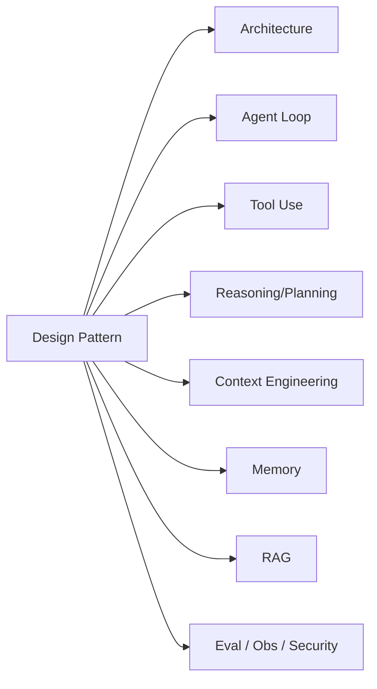

# Agent Design Patterns（Canonical）

> **一句话主题**：生产约束下可复用的 **Agent 结构模式**——把 Router、Tool-Loop、Plan-then-Act、HITL Gate、Eval Harness、Compaction Policy 等写成「适用条件 + 失败模式 + 与 Core 机制的挂载点」，而不是框架 API 清单。
>
> **状态**：Canonical · **Last reviewed**: 2026-10  
> **受众**：做 Agent 系统设计、模式选型与生产落地的工程师  
> **硬前置**：[Agent Architecture](../../core/agent-architecture/agent-architecture.md) · [Agent Loop](../../core/agent-loop/agent-loop.md) · [Tool Use](../../core/tool-use/tool-use.md)  
> **软前置**：[Reasoning & Planning](../../core/reasoning-planning/reasoning-planning.md) · [Context Engineering](../../core/context-engineering/context-engineering.md) · Eval / Obs / Multi-Agent 接口级了解

---

## 范围 / 非目标

**范围**：模式语言（如何描述一个模式）；与 Anthropic「简单可组合」主张的对齐；可复用结构模式目录（每项：上下文/问题/方案/适用/不适用/失败模式/检测信号/Core 挂载）；模式组合与选型决策；反模式；生产检查清单；面试题。

**非目标（机制定义链 Core Canonical，本文不重写）**：

| 主题 | Source of Truth |
|------|-----------------|
| Loop 状态机、终止、预算、checkpoint | [agent-loop.md](../../core/agent-loop/agent-loop.md) |
| 工具声明、鉴权、执行、幂等、ACI | [tool-use.md](../../core/tool-use/tool-use.md) |
| Reasoning / Planning / Reflection / Verification 策略语义 | [reasoning-planning.md](../../core/reasoning-planning/reasoning-planning.md) |
| Memory 读写、冲突、遗忘 | [memory.md](../../core/memory/memory.md) |
| RAG 摄入/检索管道 | [rag.md](../../core/rag/rag.md) |
| Context 装配、压缩算法细节、Observation Explosion | [context-engineering.md](../../core/context-engineering/context-engineering.md) |
| 组件拓扑与控制/数据面 | [agent-architecture.md](../../core/agent-architecture/agent-architecture.md) |
| Multi-Agent 组织深文 | [`multi-agent`](../../agent-types/multi-agent/README.md) |
| 评测指标与数据集全文 | [`evaluation`](../evaluation/README.md) |
| 安全威胁模型全文 | [`security`](../security/README.md) |

**框架立场**：LangGraph / Agents SDK / 厂商「agent patterns」= **implementation examples**，映射回本文模式名；不以框架类名当理论。

Anthropic 主张用简单可组合模式构建 Agent，区分 **workflows**（预定义编排）与 **agents**（模型动态决定过程与工具），并按评测增加复杂度（[article-anthropic-building-effective-agents-2024](../../references/articles.md#article-anthropic-building-effective-agents-2024)）。本文把该主张落地为 **带适用条件与失败模式的结构模式库**。

---

## 1. 什么是 Design Pattern（本仓库口径）

### 1.1 定义

**Agent Design Pattern** = 在一类反复出现的生产约束下，对 **控制流拓扑、状态所有权、策略挂载点与护栏** 的可复用解法，且满足：

1. 能画成图（节点 = 决策/执行/门闩；边 = 条件）  
2. 明确依赖哪些 Core 机制（Loop / Tools / Context / …）  
3. 声明 **适用条件** 与 **失败模式**（含检测信号）  
4. 可组合、可降级，不强制一次上齐

模式 ≠ 产品功能名；模式 ≠ 某论文提示词配方。

### 1.2 模式描述格式（强制）

每个模式按以下字段书写（后文目录遵循）：

| 字段 | 含义 |
|------|------|
| **上下文** | 出现在什么系统约束里 |
| **问题** | 若不采用会付出什么代价 |
| **方案** | 结构怎么接、状态谁拥有 |
| **适用条件** | 何时该用（可检验） |
| **不适用** | 何时应降级/拒绝 |
| **失败模式** | 常见崩坏方式 |
| **检测信号** | 日志/指标上如何发现 |
| **Core 挂载** | 只链机制，不重写 |

### 1.3 Workflow 模式 vs Agent 模式

```text
Workflow pattern：控制权主要在代码图（路由表、固定边、确定性门闩）
Agent pattern   ：控制权在模型决策（选工具、是否继续、是否重规划）
Hybrid          ：代码图框定边界，模型在框内决策（生产默认）
```

两者都可复用；差别是 **谁决定下一步**。详见 Loop Canonical 对 workflows vs agents 的区分；本文只谈结构落点。

### 1.4 与 Architecture / Loop / Reasoning 的分工

```text
Architecture  → 系统里有哪些层、谁拥有 State
Loop          → 一次 run 如何推进、何时停
Reasoning     → 决策质量如何被策略改善
Design Pattern→ 以上机制如何组装成可复用拓扑（本文）
```

---

## 2. 机制定义链（只挂载，不重写）

模式实现时必须调用下列接口级概念；细节以 Core 为准。



| 模式关心的问题 | 去哪里读机制 |
|----------------|--------------|
| 何时再决策、预算、恢复 | Loop |
| 工具如何执行与鉴权 | Tool Use |
| 要不要计划/校验 | Reasoning |
| 窗口塞什么、何时压缩 | Context |
| 跨会话写什么 | Memory |
| 语料怎么检索 | RAG |
| 组件放哪一层 | Architecture |

**硬规则**：本文出现「Memory / RAG / Loop」时，只描述 **挂载点与所有权**，不展开实现管道。

---

## 3. Anthropic 主张 → 本仓库模式映射

来源：[article-anthropic-building-effective-agents-2024](../../references/articles.md#article-anthropic-building-effective-agents-2024)。

| Anthropic 叙述（工程翻译） | 本仓库模式 | 控制权倾向 |
|----------------------------|------------|------------|
| Prompt chaining | Pipeline / Chaining | Workflow |
| Routing | Router | Hybrid |
| Parallelization | Fan-out / Aggregate | Workflow |
| Orchestrator–workers | Supervisor–Workers | Hybrid / Multi-Agent 接口 |
| Evaluator–optimizer | Verifier / Eval-Optimizer Loop | Hybrid |
| Autonomous agent（工具循环） | Tool-Loop | Agent |
| 简单起步、按评测加复杂度 | Eval Harness + 渐进组合 | 横切 |
| 好工具文档（ACI） | Tool Gateway（描述与执行统一入口） | 横切 |

**Caveats**：厂商文有产品叙事；本仓库要求每个模式有失败模式与降级路径，不以「看起来像 Agent」为目标。

---

## 4. 模式目录总览

| ID | 模式 | 一句话 | 主挂载 |
|----|------|--------|--------|
| P01 | Router | 先分类再进子策略/工具子集 | Architecture Policies |
| P02 | Pipeline / Chaining | 固定阶段串行，阶段间结构化交接 | Workflow + Loop 变体 |
| P03 | Tool-Loop | 模型在预算内反复 tool→observe→decide | Loop + Tool Use |
| P04 | Plan-then-Act | 先产 Plan 对象再执行 | Reasoning + Loop |
| P05 | Planner–Executor | 计划与执行角色分离 | Reasoning + Architecture |
| P06 | Verifier / Critic | 行动前后独立校验 | Reasoning Verification |
| P07 | Eval-Optimizer Loop | 生成→评分→修订直至阈值或预算 | Reasoning + Eval |
| P08 | HITL Gate | 高危动作前阻塞等人 | Loop interrupt + Tool |
| P09 | Human Escalation | 能力/置信不足时升级人类 | Loop + Policies |
| P10 | Tool Gateway | 统一工具入口（鉴权/审计/限流） | Tool Use |
| P11 | Controlled Memory Writer | 记忆写入闸门化 | Memory（只挂接口） |
| P12 | Compaction Policy | 长程上下文按策略压缩/外置 | Context（只挂策略） |
| P13 | Eval Harness | 模式变更的离线/回归门禁 | Evaluation |
| P14 | Fan-out Aggregate | 并行子任务再汇总 | Loop 并行变体 |
| P15 | Supervisor–Workers | 主管分解与聚合 | Multi-Agent 接口 |
| P16 | Budget Circuit Breaker | 硬预算与熔断 | Loop Budgets |
| P17 | Checkpoint Resume | 可中断可恢复 run | Loop Checkpoint |

下文按组展开；反模式见 §10。

---

## 5. 路由与流水线

### 5.1 P01 Router

**上下文**：意图多样、工具池大、延迟/成本敏感；或不同风险等级需不同护栏。  
**问题**：单一万能 Agent 导致工具 schema 膨胀、误调高危工具、延迟失控。  
**方案**：在进入主 Loop 前（或每步策略选择时）用规则 / 小模型 / 主模型分类，输出 `route_id` → 绑定工具子集、策略档位、预算档位。

```text
User Goal → Router → (route_id, tool_subset, strategy, budget_tier)
                  └→ Specialized Loop / Workflow
```

**适用条件**：

- 有稳定可枚举的意图/领域桶（≥2，且可评测）  
- 路由错误成本 < 全量工具暴露成本  
- 能定义「未知 → 安全默认桶」

**不适用**：

- 桶边界模糊且路由错误代价极高（先用 Tool-Loop + 强鉴权）  
- 仅 1–2 个工具、无延迟压力

**失败模式**：

| 失败 | 表现 | 缓解 |
|------|------|------|
| 静默错分 | 进错工具子集，任务失败却难归因 | 路由置信度 + 回退全量只读桶；记录 route_id |
| 过度细桶 | 维护爆炸、数据稀疏 | 合并低频桶；按评测证明拆分收益 |
| 路由本身成 Agent | 无限元推理 | 路由步预算 ≤1–2 次 LLM；超时走默认 |

**检测信号**：`route_accuracy` 离线集；线上 `route→success` 交叉表；错分后的人工标签队列。  
**Core 挂载**：Policies 路由；工具子集见 Tool Use；策略档见 Reasoning §Router-Based Decision。

---

### 5.2 P02 Pipeline / Chaining

**上下文**：任务可拆成稳定阶段（抽取→转换→生成→格式化），阶段契约清晰。  
**问题**：把可确定流程交给模型自由探索，导致不稳定与难调试。  
**方案**：代码编排阶段序列；每阶段 LLM/工具输入输出 schema 固定；失败在阶段内重试或短路。

```text
Stage1 → validate → Stage2 → validate → … → Final
```

**适用条件**：阶段边界稳定；中间产物可机器校验；合规要求可审计路径。  
**不适用**：探索性强、阶段顺序本身依赖模型发现。  
**失败模式**：阶段间隐式自然语言交接（解析脆）；把 Pipeline 伪装成「全自动 Agent」导致预期错位。  
**检测信号**：阶段失败率、schema 校验失败率、端到端延迟分解。  
**Core 挂载**：Workflow 侧；单阶段内仍可嵌套短 Loop。对齐 Anthropic prompt chaining。

---

## 6. 核心执行模式

### 6.1 P03 Tool-Loop

**上下文**：需要与环境交互才能收敛（查事实、改系统、跑测试）。  
**问题**：单轮 LLM 无法闭环；无预算循环会烧钱或死循环。  
**方案**：采用 Agent Loop Canonical 的「决策→工具→观察→状态更新→再决策」，配硬终止与预算。本文只定 **结构角色**：模型拥有步内决策权；Runtime 拥有预算与终止权。

```text
while not terminate:
  context = build_context(state)   # → Context Eng.
  decision = llm(context, tools)   # → Tool Use schema
  if tool_calls: observe = exec(tool_calls); update(state)
  else: finalize
```

**适用条件**：工具可观测且失败可回灌；目标可用终止条件表达；有步数/成本/时间预算。  
**不适用**：纯生成、无外部状态；或副作用不可逆且无 HITL（应先加 Gate）。  
**失败模式**：无进展空转；Observation Explosion（见 Context）；工具幻觉；预算形同虚设。  
**检测信号**：`steps_without_progress`、重复 tool 签名、token/步曲线、终止原因分布。  
**Core 挂载**：**整段机制以 [Agent Loop](../../core/agent-loop/agent-loop.md) + [Tool Use](../../core/tool-use/tool-use.md) 为准**；本文不重写。

---

### 6.2 P04 Plan-then-Act

**上下文**：多步任务、依赖关系明显、或需人类/政策审查计划。  
**问题**：边想边干导致全局不一致、难做门闩与回放。  
**方案**：先产出可序列化 **Plan 对象**（步骤、依赖、验收线索），再进入执行 Loop；计划失效则 Replan（语义见 Reasoning Canonical）。

```text
Goal → Plan(object) → [optional HITL/Policy] → Act(Tool-Loop) → Verify
```

**适用条件**：计划收益 > 计划成本（评测证明）；存在可检查的步骤验收；不可逆动作前需要可见意图。  
**不适用**：单步查询；环境变化极快导致计划秒级失效且无增量更新机制。  
**失败模式**：Plan 仅是散文（无法门闩）；计划膨胀；震荡重规划；「计划了但不执行」。  
**检测信号**：plan 版本数、replan 率、计划步骤完成率、计划→动作偏离度。  
**Core 挂载**：Plan 对象与失效 → Reasoning；执行回路 → Loop。对齐 Anthropic「先清晰再复杂」与 Plan-and-Solve 工程翻译。

---

### 6.3 P05 Planner–Executor

**上下文**：计划质量与执行技能冲突（长上下文计划 vs 窄工具执行）；或需不同模型档位。  
**问题**：同一上下文既规划又执行，导致工具噪声污染计划或计划抢执行 token。  
**方案**：角色分离——Planner 只写/改 Plan；Executor 只见近窗计划 + 工具子集；通过 State 交接。

```text
Planner(LLM_p) --Plan--> State --slice--> Executor(LLM_e + tools)
                              ^                |
                              +---- observations / verify ----+
```

**适用条件**：两角色有清晰接口；能防 Executor 绕过 Plan 调未授权工具（政策层）。  
**不适用**：延迟极严且单模型已够用；角色来回过多导致协调税。  
**失败模式**：Executor 忽略计划；Planner 无工具现实感（空想步骤）；双模型成本失控。  
**检测信号**：plan adherence；Planner/Executor token 比；未授权工具尝试次数。  
**Core 挂载**：Architecture 多角色；Reasoning Planner–Executor；Loop 作为 Executor 宿主。

---

## 7. 校验、优化与人机门闩

### 7.1 P06 Verifier / Critic

**上下文**：输出或副作用有客观/准客观验收（测试、schema、政策、引用）。  
**问题**：生成模型自夸成功；错误进入下游。  
**方案**：独立 Verifier（规则 / 测试 / 另一模型）在行动前或行动后给出 pass/fail + 理由；失败触发 repair 或 HITL。

**适用条件**：有可自动化的验收信号；误杀可接受或有申诉路径。  
**不适用**：无金标准且 Verifier 与 Generator 同偏见（盲信双模型）。  
**失败模式**：Verifier 被 prompt 注入；只验最终答案不验过程；异步审计窗口内已造成损害。  
**检测信号**：verify fail→repair 成功率；误杀率（人工抽样）；高危路径同步校验覆盖率。  
**Core 挂载**：Reasoning Verification；不可替代 Evaluation 体系。对齐 Anthropic evaluator–optimizer 的「检查」半边。

---

### 7.2 P07 Eval-Optimizer Loop

**上下文**：开放生成需迭代改进（文案、代码、检索答案），有可重复评分函数。  
**问题**：一次生成质量方差大；无上限修订烧预算。  
**方案**：`generate → score → revise` 循环，硬上限 N；分数不提升则早停。

**适用条件**：评分与业务相关且抗刷；N 小（通常 2–5）。  
**不适用**：评分昂贵或与人类偏好不对齐；安全关键输出（应 Verifier+HITL 而非「优化到过关」）。  
**失败模式**：分数 hacking；振荡修订；把 Eval Harness 离线指标误当成在线优化器。  
**检测信号**：每轮分数曲线、早停率、成本/质量帕累托。  
**Core 挂载**：Reasoning Reflection 边界；评分函数契约 → Evaluation 模块。

---

### 7.3 P08 HITL Gate

**上下文**：不可逆、高资金、高合规、外发通信等动作。  
**问题**：模型决策不可当最终授权。  
**方案**：在 Tool Executor **之前**插入门闩状态：`awaiting_human`；人类 approve/reject/edit；超时升级或安全失败。Gate 是控制流合法状态，不是异常。

```text
Decision(tool_call) → Policy → HITL Gate → (approved) Exec → Observation
                              └→ reject / timeout → safe terminal
```

**适用条件**：动作可清晰展示给人类（参数可读）；SLA 允许等待或异步续跑。  
**不适用**：纯只读低风险；或无人值班却要求同步阻塞（应改为异步队列 + 默认拒绝）。  
**失败模式**：Gate 可被工具侧旁路；审批 UI 藏关键字段；超时自动批准；审批者不在审计链。  
**检测信号**：门闩触发率、超时率、旁路尝试、审批延迟分布。  
**Core 挂载**：Loop interrupt/resume；Tool Use HITL tools；Policies allow/deny。

---

### 7.4 P09 Human Escalation

**上下文**：置信低、多次失败、超预算、或检测到注入/异常模式。  
**问题**：Agent 硬撑导致更大损害或用户体验崩坏。  
**方案**：显式 escalate 转移：打包轨迹摘要 + 当前假设 + 建议动作 → 人类队列；Agent 进入 paused/handed_off。

**与 HITL Gate 区别**：Gate 针对 **预定高危动作**；Escalation 针对 **运行时能力/风险触发**。可组合。

**适用条件**：有值班或工单系统；摘要足够人类接手。  
**不适用**：把 Escalation 当唯一质量策略（掩盖产品缺陷）。  
**失败模式**：升级洪水；摘要丢关键证据；升级后状态丢失无法续跑。  
**检测信号**：escalate 原因分布、接手后解决时延、误升级率。  
**Core 挂载**：Loop 终止原因；Observability 轨迹打包。

---

## 8. 网关、记忆闸与压缩策略

### 8.1 P10 Tool Gateway

**上下文**：多工具、多租户、需统一鉴权/限流/审计/幂等。  
**问题**：各处直接调 API → 权限漂移、难观测、难回放。  
**方案**：所有 tool_calls 经唯一 Gateway：`authz → validate → rate limit → execute → normalize observation → audit`。

**适用条件**：≥若干外部副作用工具；合规要求统一审计。  
**不适用**：本地单工具原型（可后补，但生产前必须收口）。  
**失败模式**：「调试通道」绕过 Gateway；observation 未归一化导致 Context 污染；把 Gateway 做成第二套业务逻辑迷宫。  
**检测信号**：旁路调用监控；鉴权拒绝率；幂等冲突率。  
**Core 挂载**：**执行管线细节见 Tool Use**；本文只定「单一入口」结构。

---

### 8.2 P11 Controlled Memory Writer

**上下文**：需要跨会话偏好/事实，但写入不可信（模型或工具结果可能错/毒）。  
**问题**：自动把对话全文写入 Memory → 双污染（错误固化 + 隐私扩大）。  
**方案**：Memory 写入必须经过闸门：候选抽取 → 验证（规则/冲突检测/HITL）→ 带出处与 TTL 提交。读取仍走 Memory Canonical 检索接口。

**适用条件**：有明确「值得记住」的类型；能定义冲突策略。  
**不适用**：单次会话任务；或把 transcript 当 Memory（应外置 State/对象存储）。  
**失败模式**：无出处写入；静默覆盖权威事实；写入路径可被注入。  
**检测信号**：写入拒绝率、冲突率、记忆导致的错误归因（eval 切片）。  
**Core 挂载**：**读写/冲突/遗忘机制见 [Memory](../../core/memory/memory.md)**；本文只定 Writer 闸门模式。

---

### 8.3 P12 Compaction Policy

**上下文**：长程 Tool-Loop / 研究 Agent，窗口与注意力预算吃紧。  
**问题**：无策略地截断会丢约束；无策略地全量保留会爆炸。  
**方案**：把压缩做成 **显式策略对象**（触发条件、保留优先级、摘要/外置、禁止丢弃集），挂在 `build_context` 管道；State 保留完整真相，Context 只持投影。

```text
触发：token > T | steps > K | observation_bytes > B
动作：summarize_tail | spill_to_store | drop_low_priority | keep_pins
禁止丢弃：系统约束、未完成 Plan 近窗、安全策略、幂等键句柄
```

**适用条件**：有可测的「压缩后任务成功率」；有 pin 列表。  
**不适用**：短会话；或用压缩掩盖工具 observation 设计不良（先修 Tool/Context）。  
**失败模式**：压缩掉目标/安全约束；摘要幻觉；过度频繁压缩抖动；把 Memory 当压缩垃圾桶。  
**检测信号**：compaction 次数、压缩前后成功率对照、pin 丢失事件、context anxiety 类行为（需自测）。  
**Core 挂载**：**算法与 Observation Explosion 见 [Context Engineering](../../core/context-engineering/context-engineering.md)**；相关文章 [article-anthropic-context-engineering-2025](../../references/articles.md#article-anthropic-context-engineering-2025)。本文只定 **策略挂载与所有权**（Policy 属 Runtime/Context Builder，不属 Memory 本体）。

---

## 9. 评测、并行、主管与护栏

### 9.1 P13 Eval Harness

**上下文**：任何模式变更（新 Router、加 Verifier、改 Compaction）都可能「感觉更好」但实际变差。  
**问题**：无门禁的模式迭代 = 生产赌运气。  
**方案**：固定任务集 + 轨迹采集 + 多维指标（成功/成本/延迟/安全）+ 发布门禁；模式以「通过 Harness 的增量」为单位演进。

```text
Change(pattern config) → Offline suite → Gate → Shadow → Canary → GA
```

**适用条件**：有可重复任务与判分；能切片（按 route、工具、风险）。  
**不适用**：仅 demo 剧本；或指标可被刷（需对抗集）。  
**失败模式**：训练集泄漏进评测；只看最终答案不看危险轨迹；门禁可跳过。  
**检测信号**：门禁阻断次数、切片回归、成本回归报警。  
**Core 挂载**：指标与数据集 → [`evaluation`](../evaluation/README.md)；轨迹 → Observability。对齐 Anthropic「按评测加复杂度」。

---

### 9.2 P14 Fan-out Aggregate

**上下文**：子任务独立（多源检索、多文件检查、多样本生成）。  
**问题**：串行浪费延迟；或并行无汇总会丢一致性。  
**方案**：代码扇出 N 路（可各带短 Loop）→ 汇聚节点（规则/LLM）→ 单一 State 更新。

**适用条件**：子任务低耦合；汇聚契约明确；有扇出预算。  
**不适用**：强依赖顺序；共享可变副作用无隔离。  
**失败模式**：部分失败未定义（all-or-nothing vs best-effort）；汇聚幻觉；扇出风暴。  
**检测信号**：扇出度、部分失败率、汇聚耗时。  
**Core 挂载**：Loop 并行变体；对齐 Anthropic parallelization。

---

### 9.3 P15 Supervisor–Workers

**上下文**：子域技能冲突或上下文互斥，单 Agent 工具/提示无法干净共存。  
**问题**：过早 Multi-Agent 带来协调税；过晚则单上下文腐化。  
**方案**：Supervisor 负责任务分解、派发、聚合与预算；Workers 窄工具窄提示；共享协议经 State/消息，不共享隐式脑内状态。

**适用条件**：评测证明增益 > 协调成本；职责稳定；有统一 Obs。  
**不适用**：任务可用 Router + 单 Loop 解决（默认拒绝）。  
**失败模式**：Supervisor 变成上帝 Agent；Worker 间隐式耦合；无统一预算。  
**检测信号**：跨 Worker 重试环、重复劳动率、端到端成本对比单 Agent 基线。  
**Core 挂载**：拓扑细节 → [`multi-agent`](../../agent-types/multi-agent/README.md)；对齐 Anthropic orchestrator–workers。

---

### 9.4 P16 Budget Circuit Breaker

**上下文**：所有生产 Loop。  
**问题**：重试/反思/工具失败导致成本与副作用失控。  
**方案**：多维硬预算（步数、token、墙钟、工具次数、金额）+ 熔断动作（stop / degrade / escalate）。

**适用条件**：永远适用（生产基线）。  
**不适用**：无（研究沙盒可放宽但须显式标记）。  
**失败模式**：软预算（只告警不停）；维度单一；熔断后状态不可解释。  
**检测信号**：终止原因=`budget_*` 占比；熔断后的用户可见性。  
**Core 挂载**：Loop Budgets（机制正文在 Loop）。

---

### 9.5 P17 Checkpoint Resume

**上下文**：长任务、HITL、进程可能被杀。  
**问题**：内存态 Loop 不可恢复 = 不可运营。  
**方案**：周期性将 State 检查点外置；`resume(run_id, event)` 从最近一致点继续；工具侧幂等键配合。

**适用条件**：run 可能跨分钟/小时；有副作用工具。  
**不适用**：纯无状态单轮。  
**失败模式**：检查点含秘密未加密；恢复时重复副作用；版本不兼容的 State schema。  
**检测信号**：恢复成功率、重复执行事故、检查点大小。  
**Core 挂载**：Loop Checkpoint（不重写）。

---

## 10. 反模式（Anti-Patterns）

| 反模式 | 症状 | 应替换为 |
|--------|------|----------|
| **上帝 Agent** | 全工具、全记忆、无路由 | Router + 工具子集 + 政策 |
| **无预算循环** | 步数/成本无限 | Budget Circuit Breaker |
| **隐式权限** | 靠系统提示「不要…」 | Tool Gateway + 硬鉴权 |
| **散文计划** | 计划不可校验门闩 | Plan 对象 + Verifier/HITL |
| **记忆吸尘器** | 全文写入 Memory | Controlled Memory Writer |
| **压缩当遗忘** | 用摘要冒充删除策略 | Compaction Policy ≠ Memory 遗忘 |
| **为 Agent 而 Agent** | 可用 Pipeline 却上自主循环 | 从 Workflow 起步，评测后再升 |
| **无门禁演进** | 改模式靠感觉 | Eval Harness |
| **旁路调试** | 生产仍留无审计入口 | 去掉旁路或同等护栏 |
| **Supervisor 套娃** | 多层主管无收益 | 压扁；单 Supervisor + Workers |

---

## 11. 选型决策（简图）

```text
任务可固定阶段？ ──yes──► Pipeline (± 阶段内短 Loop)
        │ no
        ▼
工具池大 / 风险分桶？ ──yes──► Router
        │
        ▼
需要环境交互？ ──no──► 单轮 / 轻 Workflow
        │ yes
        ▼
多步依赖或不可逆？ ──yes──► Plan-then-Act (± HITL Gate)
        │ no
        ▼
Tool-Loop + Budget + Tool Gateway
        │
        ├─ 长程窗口压力 ──► Compaction Policy（链 Context）
        ├─ 跨会话事实 ──► Controlled Memory Writer（链 Memory）
        ├─ 质量方差大且可评分 ──► Verifier / Eval-Optimizer
        ├─ 单上下文冲突 ──► 先 Router；仍失败再 Supervisor–Workers
        └─ 任何生产变更 ──► Eval Harness 门禁
```

**默认顺序（对齐 Anthropic）**：能 Workflow 就 Workflow → 加 Router → 加 Tool-Loop → 按评测加 Plan/Verify/HITL/Multi-Agent。

---

## 12. 组合规则与所有权

### 12.1 合法组合示例

| 组合 | 用途 |
|------|------|
| Router → Tool-Loop → Compaction Policy | 多意图长会话客服/助手 |
| Plan-then-Act → HITL Gate → Tool Gateway | 高风险操作 |
| Pipeline → 末段 Tool-Loop | 前半确定、后半探索 |
| Supervisor → Workers(Tool-Loop) → Aggregate | 研究/编码分解 |
| 任一模式 + Eval Harness | 发布路径强制 |

### 12.2 状态所有权（防打架）

| 数据 | 所有者 | 模式常见误用 |
|------|--------|--------------|
| Run State | Loop Runtime | 压缩时丢掉 State 真相 |
| Context 投影 | Context Builder | 与 State 双向脏写 |
| Plan 对象 | Reasoning/Planner 节点 | 只存在于某次 prompt |
| Memory 条目 | Memory 服务 + Writer 闸 | Tool-Loop 直接写库 |
| 审计日志 | Tool Gateway / Obs | 仅模型自述 |

### 12.3 伪代码：模式装配骨架

```python
# 示意：模式是配置与钩子，不是第二套 Runtime
def handle(goal, cfg):
    route = router(goal, cfg.routes)              # P01
    tools = tool_gateway.subset(route.tools)      # P10
    state = new_run(goal, budget=route.budget)    # P16
    if cfg.plan_then_act:
        state.plan = planner(goal)                # P04/P05
        if needs_hitl(state.plan): wait_hitl()    # P08
    while not state.terminate:
        ctx = build_context(state, policy=cfg.compaction)  # P12 → Context
        decision = llm(ctx, tools)
        decision = policy_check(decision)         # deny / hitl
        if decision.escalate: return escalate()   # P09
        obs = tools.execute(decision.calls)       # P03 via Loop
        state = update(state, obs)
        if cfg.verifier: state = verify_or_repair(state)  # P06
        checkpoint(state)                         # P17
    return finalize(state)
```

---

## 13. 生产检查清单

- [ ] 每个上线模式有适用条件文档与降级路径  
- [ ] 无预算 Loop 禁止进生产  
- [ ] 高危工具 100% 经 Tool Gateway；HITL 不可旁路  
- [ ] Compaction 有 pin 列表与压缩前后对照评测  
- [ ] Memory 写入有闸门与出处  
- [ ] 模式变更必须过 Eval Harness 门禁  
- [ ] 轨迹可回答：route、plan 版本、gate 决策、终止原因  
- [ ] Multi-Agent 仅在单 Agent 基线对照胜出后启用  
- [ ] 与 Core Canonical 链接完整，无复制第二份机制正文  

---

## 14. 失败模式速查（跨模式）

| 信号 | 可能模式问题 | 优先动作 |
|------|--------------|----------|
| 工具 schema 巨大、误调多 | 缺 Router / 子集 | 加 P01 |
| 步数高但无进展 | Tool-Loop 缺进度检测 | Loop 进度钩子 + P16 |
| 不可逆事故 | 缺 HITL / 鉴权 | P08 + P10 |
| 长程质量塌陷 | 缺/坏 Compaction | P12 + Context 审计 |
| 「记住了错事实」 | 无 Memory Writer 闸 | P11 |
| 改完模式指标暗跌 | 无 Harness | P13 |
| 成本陡增无收益 | 过早 Supervisor/双模型 | 回退单 Loop 基线 |

---

## 15. 与易混概念

| 说法 | 本仓库口径 |
|------|------------|
| 「我们用了 ReAct」 | 多为 P03 Tool-Loop 的一种提示/轨迹风格；机制仍是 Loop |
| 「上了 Multi-Agent」 | 仅当有 Supervisor–Workers 等真拓扑；Router ≠ Multi-Agent |
| 「做了 Memory」 | transcript ≠ Memory；须 P11 + Memory Canonical |
| 「Context 压缩」 | P12 是策略挂载；算法在 Context Engineering |
| 「有评测」 | 人工看几个例子 ≠ P13 Eval Harness |

---

## 16. 面试题（45）

### 概念与边界

**Q1. Design Pattern 与 Architecture 差在哪里？**  
- **短答**：Architecture 定层与所有权；Pattern 定可复用拓扑与挂载。  
- **详解**：同一架构可换多种模式配置。  
- **追问**：Loop 算模式还是机制？  
- **常见错误**：把框架类名当模式。  
- **相关**：§1、Architecture。

**Q2. Workflow 模式与 Agent 模式如何区分？**  
- **短答**：下一步由代码图还是模型决定。  
- **详解**：生产多为 Hybrid。  
- **追问**：Pipeline 内嵌短 Loop 算哪类？  
- **常见错误**：有 LLM 就叫 Agent。  
- **相关**：§1.3、Anthropic 文。

**Q3. 为何机制定义必须链 Core 而不能在 Patterns 重写？**  
- **短答**：一主题一位置；避免双源真相。  
- **详解**：Patterns 只写结构与适用/失败。  
- **追问**：发现 Loop 定义过时怎么办？  
- **常见错误**：本文再写一遍 Memory 管道。  
- **相关**：§2、质量标准。

**Q4. 映射 Anthropic「Building effective agents」到本仓库模式。**  
- **短答**：chaining→P02；routing→P01；parallel→P14；orchestrator→P15；evaluator–optimizer→P06/P07；agent→P03；评测驱动→P13。  
- **详解**：保留 Caveats。  
- **追问**：哪条主张最易被滥用？  
- **常见错误**：只背名单无适用条件。  
- **相关**：§3、article-anthropic-building-effective-agents-2024。

**Q5. Router 与 Supervisor 的边界？**  
- **短答**：Router 选桶/策略；Supervisor 分解、派发、聚合多 Worker。  
- **详解**：多数情况 Router 足够。  
- **追问**：何时升级？  
- **常见错误**：一层路由就叫 Multi-Agent。  
- **相关**：P01、P15。

### 路由与流水线

**Q6. 设计工具池 80+ 的 Router。**  
- **短答**：意图桶 + 工具子集 + 未知安全默认；离线 route_accuracy。  
- **详解**：路由步预算硬限制。  
- **追问**：错分回退策略？  
- **常见错误**：每请求用大模型深思路由。  
- **相关**：P01。

**Q7. 何时应用 Pipeline 而非 Tool-Loop？**  
- **短答**：阶段稳定且可机器校验时。  
- **详解**：探索段可嵌套短 Loop。  
- **追问**：阶段契约用什么表示？  
- **常见错误**：自然语言交接无 schema。  
- **相关**：P02。

**Q8. Router 失败模式「静默错分」如何检测？**  
- **短答**：route×success 交叉表 + 抽样人工标签。  
- **详解**：置信度低时升桶或 HITL。  
- **追问**：如何防标注偏差？  
- **常见错误**：只看整体成功率。  
- **相关**：P01、P13。

### Tool-Loop 与计划

**Q9. Tool-Loop 的硬前提是什么？**  
- **短答**：可观测工具、终止条件、多维预算。  
- **详解**：机制见 Loop Canonical。  
- **追问**：无进展如何定义？  
- **常见错误**：只设 max_tokens。  
- **相关**：P03、P16。

**Q10. Plan-then-Act 的 Plan 为何必须对象化？**  
- **短答**：才能门闩、校验、偏离度量与恢复。  
- **详解**：散文计划无法政策拦截。  
- **追问**：最小 Plan schema 字段？  
- **常见错误**：prompt 里「先想三步」冒充。  
- **相关**：P04、Reasoning。

**Q11. Planner–Executor 何时收益为负？**  
- **短答**：协调税与双模型成本 > 质量增益；或 Executor 常绕过计划。  
- **详解**：用 adherence 与评测证明。  
- **追问**：同模型两角色是否有意义？  
- **常见错误**：为架构图好看而拆。  
- **相关**：P05。

**Q12. Plan 失效与 Compaction 的交互？**  
- **短答**：压缩不得丢掉近窗 Plan 与 pin；失效检测读 State 非仅 Context。  
- **详解**：所有权分离。  
- **追问**：摘要幻觉导致假失效？  
- **常见错误**：压缩后当计划不存在。  
- **相关**：P04、P12。

### 校验与人机

**Q13. Verifier 与 Evaluation 模块差别？**  
- **短答**：Verifier 是运行时门闩；Evaluation 是体系化度量与门禁。  
- **详解**：可共用评分函数但生命周期不同。  
- **追问**：同步 vs 异步校验？  
- **常见错误**：混称「我们有 eval」。  
- **相关**：P06、P13。

**Q14. Eval-Optimizer 如何防分数 hacking？**  
- **短答**：对抗集、多指标、人工抽检、限制 N。  
- **详解**：安全路径禁止「优化到过关」。  
- **追问**：与 RL 过程奖励边界？  
- **常见错误**：单一 LLM-as-judge 无限循环。  
- **相关**：P07。

**Q15. HITL Gate 在状态机中如何表示？**  
- **短答**：`awaiting_human` 合法态；approve/reject/timeout 转移。  
- **详解**：见 Loop interrupt/resume。  
- **追问**：超时默认批准为何危险？  
- **常见错误**：当异常 catch。  
- **相关**：P08。

**Q16. HITL Gate vs Human Escalation？**  
- **短答**：Gate=预定高危动作；Escalation=运行时触发移交。  
- **详解**：可串联。  
- **追问**：升级摘要必含什么？  
- **常见错误**：混用导致审计不清。  
- **相关**：P08、P09。

**Q17. 如何防止 HITL 被旁路？**  
- **短答**：Gateway 强制；工具层无直连；政策先于执行。  
- **详解**：渗透测试「调试 API」。  
- **追问**：紧急工单通道如何同等审计？  
- **常见错误**：前端隐藏按钮当安全。  
- **相关**：P08、P10、Security。

### 网关、记忆、压缩

**Q18. Tool Gateway 最小责任集？**  
- **短答**：鉴权、校验、限流、执行、观察归一化、审计。  
- **详解**：业务规则宜薄。  
- **追问**：与 MCP 网关关系？  
- **常见错误**：各服务私自调工具。  
- **相关**：P10、Tool Use。

**Q19. Controlled Memory Writer 拒绝写入的典型理由？**  
- **短答**：无出处、冲突未决、隐私类型、低置信、超配额。  
- **详解**：机制见 Memory。  
- **追问**：用户显式「请记住」如何处理？  
- **常见错误**：模型说记住了就写库。  
- **相关**：P11。

**Q20. Compaction Policy 与 Memory 遗忘差在哪？**  
- **短答**：Compaction 管本次/本 run 窗口投影；遗忘管长期资产生命周期。  
- **详解**：勿互相替代。  
- **追问**：spill_to_store 算哪种？  
- **常见错误**：摘要进 Memory 当压缩完成。  
- **相关**：P12、Context、Memory。

**Q21. 列出 Compaction 禁止丢弃集（pins）。**  
- **短答**：安全/系统约束、未完成计划近窗、幂等键句柄、用户硬约束、高危审批上下文。  
- **详解**：可配置但默认严格。  
- **追问**：如何评测 pin 丢失？  
- **常见错误**：只 pin 系统提示一句。  
- **相关**：P12。

**Q22. Observation Explosion 应先修模式还是先压缩？**  
- **短答**：先修工具观察设计与归一化，再上 Compaction。  
- **详解**：压缩是缓解不是根治。  
- **追问**：检测信号？  
- **常见错误**：无限加窗。  
- **相关**：P03、P12、Context。

### 评测、并行、主管

**Q23. Eval Harness 的最小门禁指标？**  
- **短答**：任务成功、安全违规、成本、延迟；按 route 切片。  
- **详解**：轨迹级危险动作计数。  
- **追问**：如何防泄漏？  
- **常见错误**：只看 demo 通过。  
- **相关**：P13。

**Q24. 证明「加 Verifier」因果有效的实验？**  
- **短答**：同任务集 A/B；控模型与工具；看成功/成本/误杀。  
- **详解**：预注册指标。  
- **追问**：霍桑效应？  
- **常见错误**：只晒成功案例。  
- **相关**：P06、P13。

**Q25. Fan-out 部分失败策略怎么选？**  
- **短答**：按业务：all-or-nothing / best-effort / 法定人数。  
- **详解**：写进汇聚契约。  
- **追问**：已产生副作用如何补偿？  
- **常见错误**：忽略部分失败。  
- **相关**：P14。

**Q26. 何时引入 Supervisor–Workers？**  
- **短答**：单 Agent 因上下文/工具冲突失败，且评测增益>税。  
- **详解**：默认拒绝。  
- **追问**：试点范围？  
- **常见错误**：组织政治驱动。  
- **相关**：P15、Architecture。

**Q27. Budget Circuit Breaker 至少哪几维？**  
- **短答**：步数、token、墙钟、工具次数、金额（若有）。  
- **详解**：熔断动作可解释。  
- **追问**：反思次数算哪维？  
- **常见错误**：只有软告警。  
- **相关**：P16、Loop。

**Q28. Checkpoint 与 HITL 如何配合？**  
- **短答**：进入 Gate 前检查点；resume 带人类事件。  
- **详解**：工具幂等防重复。  
- **追问**：审批跨天 State 兼容？  
- **常见错误**：内存态等人。  
- **相关**：P08、P17。

### 反模式与权衡

**Q29. 识别上帝 Agent 的三个信号。**  
- **短答**：工具全集暴露、无 route、无预算分层。  
- **详解**：误调高危上升。  
- **追问**：重构第一步？  
- **常见错误**：再加系统提示约束。  
- **相关**：§10。

**Q30. 「为 Agent 而 Agent」如何用评测打回？**  
- **短答**：Pipeline/单轮基线对照；无显著增益不升级。  
- **详解**：对齐 Anthropic 简单优先。  
- **追问**：业务强要 Agent 品牌怎么谈？  
- **常见错误**：用复杂度证明先进。  
- **相关**：§3、§11、P13。

**Q31. 隐式权限为何不可接受？**  
- **短答**：模型可被诱导；提示非强制。  
- **详解**：Gateway 硬鉴权。  
- **追问**：与 jailbreak 红队关系？  
- **常见错误**：靠「你是负责任的 AI」。  
- **相关**：§10、P10、Security。

**Q32. 模式组合时 State 所有权冲突案例。**  
- **短答**：Compaction 写回污染 State；Memory Writer 绕过闸门。  
- **详解**：投影单向。  
- **追问**：如何在代码审查抓？  
- **常见错误**：到处 ad-hoc 摘要。  
- **相关**：§12.2。

**Q33. 延迟敏感场景的模式降级路径。**  
- **短答**：去 Supervisor→去多轮 Verify→Router+短 Tool-Loop→缓存。  
- **详解**：保留安全门闩。  
- **追问**：哪项最后才能去？  
- **常见错误**：为延迟关掉鉴权。  
- **相关**：§11。

**Q34. 成本敏感场景优先砍什么模式？**  
- **短答**：Eval-Optimizer 轮次、双模型 Planner–Executor、过度 Fan-out。  
- **详解**：保留 Budget 与 Gateway。  
- **追问**：如何用帕累托展示？  
- **常见错误**：先砍观测。  
- **相关**：P05、P07、P14。

**Q35. 安全关键路径的模式底线？**  
- **短答**：Gateway + HITL + 同步 Verifier + 全量审计；禁旁路。  
- **详解**：Escalation 优于硬撑。  
- **追问**：只读工具是否可放松？  
- **常见错误**：异步审计支付。  
- **相关**：P06、P08、P10。

### 综合与系统设计

**Q36. 把厂商「agent patterns」页映射回本仓库。**  
- **短答**：逐条对 P01–P17；标控制权与失败模式；缺则补评测。  
- **详解**：框架实现细节降级为例子。  
- **追问**：找不到对应项说明什么？  
- **常见错误**：照抄类名建目录。  
- **相关**：§3、§4。

**Q37. 审计开源 Agent 项目的模式成熟度清单。**  
- **短答**：预算、Gateway、HITL、checkpoint、compaction 策略、eval 门禁、反上帝。  
- **详解**：对照 §13。  
- **追问**：哪三项缺一不可生产？  
- **常见错误**：只看是否 Multi-Agent。  
- **相关**：§10、§13、open-source-analysis。

**Q38. 设计客服退款 Agent 的模式栈。**  
- **短答**：Router→Plan-then-Act→HITL Gate→Tool Gateway→Budget；轨迹进 Eval。  
- **详解**：Agent 不直达支付。  
- **追问**：部分退款失败？  
- **常见错误**：单 Tool-Loop 全权。  
- **相关**：P01、P04、P08、P10。

**Q39. 设计长程研究 Agent 的模式栈。**  
- **短答**：Tool-Loop + Plan 近窗 + Compaction Policy + Checkpoint + Verifier；慎用 Supervisor。  
- **详解**：证据外置，Context 留句柄。  
- **追问**：如何防目标漂移？  
- **常见错误**：单会话硬塞全文。  
- **相关**：P03、P04、P12、P17。

**Q40. 设计 Coding Agent 的模式栈。**  
- **短答**：Plan-then-Act + Tool-Loop(sandbox) + 测试 Verifier + 危险 git HITL + Compaction。  
- **详解**：链 coding-agent / sandbox README。  
- **追问**：flaky tests？  
- **常见错误**：模型自报已修好。  
- **相关**：P04、P06、P08。

### System Design

**Q41. 设计可插拔的 Pattern Runtime 配置面。**  
- **短答**：route 表、策略档、预算档、gate 规则、compaction policy 版本化；热更新需门禁。  
- **详解**：一次变更走 Eval Harness。  
- **追问**：错误配置回滚？  
- **常见错误**：代码硬编码模式。  
- **相关**：§12、P13。

**Q42. 设计模式级可观测性。**  
- **短答**：span 标 pattern_id；事件：route、plan_ver、gate、compact、escalate、budget_stop。  
- **详解**：与 Obs 模块对齐。  
- **追问**：高基数标签怎么控？  
- **常见错误**：只记最终答案。  
- **相关**：§13、Observability。

**Q43. 设计从 Demo Tool-Loop 到生产的模式里程碑。**  
- **短答**：P0 Loop+Tools → P1 Budget+Gateway → P2 Checkpoint → P3 Router/HITL → P4 Compaction/Memory Writer → P5 Eval Harness 门禁。  
- **详解**：迟上 Supervisor。  
- **追问**：哪步不可妥协？  
- **常见错误**：先画多智能体。  
- **相关**：§11、§13、practice-paths。

**Q44. 设计 Shadow 流量验证新 Router。**  
- **短答**：线上双跑不生效；比 route 分布与模拟成功；再 canary。  
- **详解**：安全路径禁止影子真执行。  
- **追问**：如何度量错分代价？  
- **常见错误**：影子直接调副作用工具。  
- **相关**：P01、P13。

**Q45. 设计「模式注册表」供多团队复用。**  
- **短答**：Pxx 元数据（适用/失败/挂载/版本）+ 参考配置 + 必过套件；禁止私自旁路。  
- **详解**：与本文目录同源。  
- **追问**：团队扩展自定义模式的准入？  
- **常见错误**：注册表变链接坟场。  
- **相关**：§1.2、§4、P13。

---

## 17. Cross References

```text
Design Patterns（本文）
        ↓ 挂载
Architecture / Loop / Tool Use / Reasoning
        ↓ 数据源接口
Context / Memory / RAG
        ↓ 生产横切
Evaluation / Observability / Security / Infrastructure
        ↓ 拓扑深文
Multi-Agent / Coding Agent
```

- [Agent Architecture](../../core/agent-architecture/agent-architecture.md)  
- [Agent Loop](../../core/agent-loop/agent-loop.md)  
- [Tool Use](../../core/tool-use/tool-use.md)  
- [Reasoning & Planning](../../core/reasoning-planning/reasoning-planning.md)  
- [Context Engineering](../../core/context-engineering/context-engineering.md)  
- [Memory](../../core/memory/memory.md) · [RAG](../../core/rag/rag.md)  
- [Evaluation](../evaluation/README.md) · [Observability](../observability/README.md) · [Security](../security/README.md)  
- [Multi-Agent](../../agent-types/multi-agent/README.md) · [Coding Agent](../../agent-types/coding-agent/README.md)

---

## 18. References

- [article-anthropic-building-effective-agents-2024](../../references/articles.md#article-anthropic-building-effective-agents-2024)  
- [article-anthropic-context-engineering-2025](../../references/articles.md#article-anthropic-context-engineering-2025)（Compaction 相关背景；机制在 Context Canonical）  
- [article-anthropic-writing-tools-for-agents-2025](../../references/articles.md#article-anthropic-writing-tools-for-agents-2025)（工具/ACI 与评测迭代）  
- [paper-react-2022](../../references/papers.md#paper-react-2022)（Tool-Loop 轨迹风格背景）  
- [paper-plan-and-solve-2023](../../references/papers.md#paper-plan-and-solve-2023)（Plan-then-Act 提示背景；生产需 Plan 对象）  
- [paper-reflexion-2023](../../references/papers.md#paper-reflexion-2023)（与 Eval-Optimizer/Reflection 边界；策略语义见 Reasoning）

---

## 19. Self-review / TODOs

- [x] 模式语言格式统一（适用条件 + 失败模式 + Core 挂载）  
- [x] 覆盖 Router / Tool-Loop / Plan-then-Act / HITL / Eval Harness / Compaction Policy 等  
- [x] 机制不重写 Memory / RAG / Loop；只链接  
- [x] 引用 article-anthropic-building-effective-agents-2024  
- [x] 45 面试题  
- [ ] TODO: Verify — 厂商托管 Agent 产品内置 pattern 名称与本文映射表（随产品变）  
- [ ] TODO: Verify — 框架默认是否暴露 compaction policy 配置面  
- [ ] 可选深潜拆文：`pattern-language.md`、`anti-patterns.md` 等（主文保持 SoT）  
