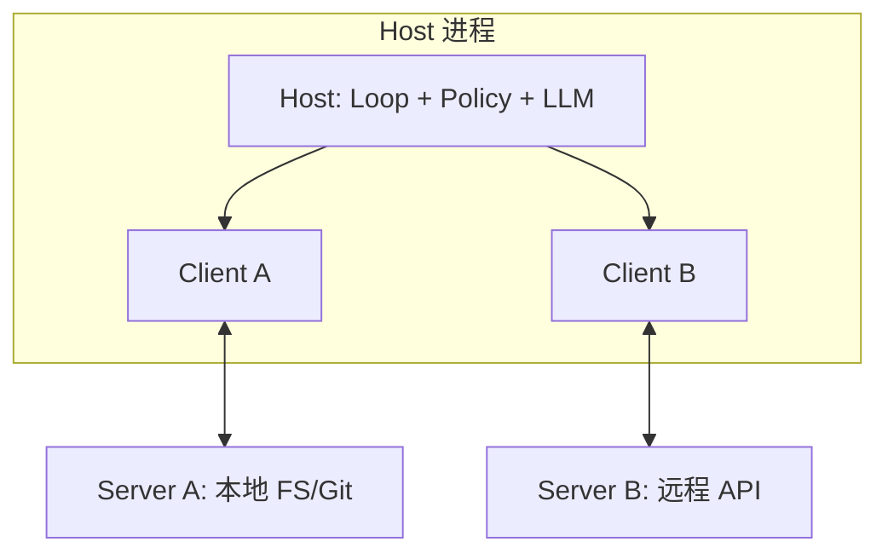

# MCP — Model Context Protocol（Canonical）

> **一句话主题**：MCP 是让 Host 应用与外部 Server 以标准方式交换 **Tools / Resources / Prompts** 的**互操作协议层**；它扩展工具生态，但不替代 Agent 内的 Tool Use 机制与 Agent Loop。
>
> **状态**：Canonical · **Last reviewed**: 2026-10  
> **受众**：要把可插拔工具/资源面接到 IDE、桌面或企业 Agent 的工程师  
> **硬前置**：[Tool Use](../../core/tool-use/tool-use.md)  
> **建议前置**：[Agent Loop](../../core/agent-loop/agent-loop.md)  
> **规范真相源**：[std-mcp-specification](../../references/docs.md#std-mcp-specification)

---

## 范围 / 非目标

**范围**：Host / Client / Server 心智模型；Tools / Resources / Prompts 职责划分；能力协商与会话生命周期（工程视角）；接入 Agent Loop 的集成模式；鉴权与信任边界；生态取舍（何时用 MCP、何时本地工具足够）；失败模式；生产接入清单与面试。

**非目标**：

| 主题 | 去哪里 |
|------|--------|
| Tool Calling 协议细节（schema 校验、幂等、observation 设计） | [Tool Use](../../core/tool-use/tool-use.md) |
| 控制回路、终止、checkpoint | [Agent Loop](../../core/agent-loop/agent-loop.md) |
| 完整威胁模型 / 提示注入全书 | [`production/security`](../../production/security/README.md) |
| 沙箱实现手册 | [`runtime/sandbox`](../../runtime/sandbox/README.md) |
| 第三方 MCP server 目录罗列 | 不写（可放 `references/`） |
| 「用 MCP 学做 Agent」入门教程 | 先读 Tool Use → Agent Loop |

**核心立场**：

- **MCP = 协议与互操作**；**Tool Use = Agent 内机制**；二者叠层，不互相替代。
- Host 拥有对话与策略；Server 只提供受隔离的能力面。
- 引入 MCP 要付**协议税**；没有多宿主/多服务器互操作需求时，本地 registry 往往更简单。

---

## 1. 知识模型：MCP 解决什么问题

### 1.1 定义

**Model Context Protocol（MCP）** 是一套基于 **JSON-RPC 2.0** 的开放协议，标准化 **LLM 应用（Host）** 与 **外部能力提供者（Server）** 之间如何：

1. 发现与调用 **Tools**（模型可执行的动作）
2. 读取/订阅 **Resources**（给用户或模型用的上下文与数据）
3. 暴露 **Prompts**（面向用户的模板化消息与工作流）
4. （可选）协商 **Sampling / Elicitation / Roots** 等客户端能力

规范概述与安全原则见 [std-mcp-specification](../../references/docs.md#std-mcp-specification)。TypeScript schema 为协议字段真相源；本文只提炼**工程可迁移的机制**，不复述规范全文。

### 1.2 为什么需要协议层（而不只是「再写一层 Tool Registry」）

| 仅内部 Tool Registry | 引入 MCP |
|----------------------|----------|
| 单一产品、工具由自家维护 | 多 Host（IDE / 桌面 / 聊天）共用同一 Server |
| 进程内函数指针即可 | 跨进程 / 远程服务，需传输与会话 |
| 发现与版本由产品私有约定 | 标准 `initialize` + capability 协商 |
| 生态扩展靠 SDK 适配 | 写一次 Server，多 Host 消费 |

MCP 的设计灵感接近 **Language Server Protocol（LSP）**：LSP 让语言智能跨编辑器复用；MCP 让「上下文与工具」跨 AI 应用复用。

### 1.3 MCP 不是什么

| 误解 | 纠正 |
|------|------|
| 「又一种 Function Calling」 | Function/Tool Calling 是模型↔应用的调用契约；MCP 是应用↔外部 Server 的互操作 |
| 「装了 MCP 就有 Agent」 | Agent 仍需要 Loop、预算、状态、终止；MCP 只提供可插拔能力面 |
| 「MCP 自带鉴权与最小权限」 | 协议提供能力面与部分授权扩展；**策略在 Host / 企业控制面** |
| 「该用的工具都该走 MCP」 | 核心、高频、强一致工具常应留在本地；MCP 适合边界与生态 |

### 1.4 与本仓库其他模块的叠层

```text
┌─────────────────────────────────────────────┐
│  Agent Loop（何时决策 / 终止 / 预算）         │
├─────────────────────────────────────────────┤
│  Tool Use（schema / 执行 / 观察 / 权限闸）    │
├─────────────────────────────────────────────┤
│  MCP Client（会话、发现、传输、结果适配）      │  ← 本文
├─────────────────────────────────────────────┤
│  MCP Server（tools/resources/prompts 实现）   │
└─────────────────────────────────────────────┘
```

即便工具经 MCP 暴露，Agent 内仍必须完成：schema 理解、鉴权、超时、归一化、Loop 回灌——这些在 [Tool Use](../../core/tool-use/tool-use.md) 与 [Agent Loop](../../core/agent-loop/agent-loop.md)。

---

## 2. Mental Model：Host / Client / Server

### 2.1 三角角色

规范架构采用 **client-host-server**（见 [std-mcp-specification](../../references/docs.md#std-mcp-specification) Architecture）：

| 角色 | 是什么 | 关键职责 |
|------|--------|----------|
| **Host** | LLM 应用进程（IDE、桌面助手、企业 Agent Runtime） | 创建 Clients；聚合上下文；执行安全策略与用户同意；对接 LLM / Loop |
| **Client** | Host 内、与**某一个** Server 的 1:1 连接器 | 会话、能力协商、消息路由、订阅；在 Server 之间维持隔离 |
| **Server** | 提供 Tools / Resources / Prompts 的本地进程或远程服务 | 聚焦能力实现；不读取完整对话；不窥探其他 Server |



**不变式（工程上应坚持）**：

1. **Client : Server = 1 : 1**；一个 Host 可有多个 Clients。
2. **完整对话历史留在 Host**；Server 只拿到完成其调用所需的最小上下文。
3. **跨 Server 编排只发生在 Host**；Server 不得默认「看见」彼此的工具或资源。
4. **同意与授权决策属于 Host（及用户）**，不是 Server 自称可信即可。

### 2.2 双向能力面

MCP 会话不是单向 RPC 目录：

| 方向 | 典型能力 |
|------|----------|
| Server → Client（Server features） | `tools`、`resources`、`prompts`、logging、completions… |
| Client → Server（Client features） | `sampling`（请 Host 代为调 LLM）、`elicitation`（向用户索取信息）、`roots`（暴露工作区根）… |

这意味着：**不可信 Server + 开启 Sampling** 可能让 Server 借 Host 的模型与用户数据做事。默认应关闭或强门禁（见 §6）。

### 2.3 能力协商（Capability Negotiation）

会话以 `initialize` 交换协议版本与 capabilities；双方**只使用已声明能力**。例如：

- Server 未声明 `tools` → Client 不得假设可 `tools/call`
- Server 声明 `tools.listChanged` → 可发工具列表变更通知
- Client 未声明 `sampling` → Server 不得发起采样请求

工程含义：连接成功 ≠ 功能可用；**发现失败**常表现为「连上了但 capability 为空 / 版本不兼容」（见 §8）。

### 2.4 传输（Transport）心智

规范把 JSON-RPC 消息落到进程间/网络上。按 **2025-11-25** 传输页（见 [std-mcp-specification](../../references/docs.md#std-mcp-specification) · Last checked 2026-10-07）：

| 形态 | 典型场景 | 注意 |
|------|----------|------|
| **stdio** | 本地子进程 Server（IDE 插件） | Clients SHOULD 尽可能支持；stderr 可日志，stdout 仅 MCP 消息 |
| **Streamable HTTP** | 远程 / 多租户 Server | 单 MCP endpoint（POST/GET）；可选 SSE 流；校验 `Origin`；会话头 `MCP-Session-Id` |
| **HTTP+SSE（历史）** | 旧客户端/服务器兼容 | 自 **2024-11-05** 起被 Streamable HTTP 取代；规范提供双向兼容迁移指引 |

集成时钉死协议版本号（HTTP 头 `MCP-Protocol-Version`）。传输选择不改变三角角色：远程 Server 仍是 Server；**信任边界随网络扩大**。

---

## 3. Tools / Resources / Prompts

三者都是 Server 可暴露的原语，但**控制权与消费路径不同**。混用是常见设计事故。

### 3.1 对照表

| 原语 | 主要控制者 | 语义 | 典型用途 | 进入 Agent 的路径 |
|------|------------|------|----------|-------------------|
| **Tools** | 模型（model-controlled） | 带 schema 的可调用动作；可有副作用 | 查库、改文件、调 API | → Tool Registry → Loop 执行 |
| **Resources** | 应用/用户（application-controlled） | 可寻址数据/上下文（URI） | 文件、票据、配置快照 | → Context 装配 / 用户面板；偶经工具链接 |
| **Prompts** | 用户（user-controlled） | 模板化消息与工作流入口 | 「填 PR 描述」「排障向导」 | → 用户选择后注入消息；非自动 tool call |

规范表述：Tools 面向模型自动发现与调用；Resources 提供上下文与数据；Prompts 提供模板化消息与工作流（见 [std-mcp-specification](../../references/docs.md#std-mcp-specification)）。

### 3.2 Tools（协议视角，不重写 Tool Use）

协议层最小操作：

- `tools/list`：发现（可分页；可 `listChanged` 通知）
- `tools/call`：调用（name + arguments）

结果侧要点（接入 Tool Use 时必须映射）：

- 内容可为 text / image / audio / resource_link / embedded resource；可有 `structuredContent`
- **协议错误**（未知工具、畸形请求）vs **工具执行错误**（`isError: true`）要分开映射到 Observation
- **annotations（含行为提示）默认不可信**，除非 Server 已进入信任集——规范明确要求 clients 如此对待

Host 侧仍须执行 Tool Use 全套闸门：参数校验、权限、超时、审计、observation 压缩。MCP 只把「远程实现」接到 executor 后端。

### 3.3 Resources

Resources 用 **URI** 标识可读（及可订阅）的数据。适合：

- 把大块只读上下文交给 Host 策展进 Context（链 [Context Engineering](../../core/context-engineering/context-engineering.md)）
- 给用户 UI 展示「可附加的上下文」，而不是每次都让模型猜工具参数
- 工具返回 `resource_link`，由 Host 决定是否继续 `resources/read`

**反模式**：把所有副作用都伪装成 Resource「读取」。有副作用 → 应是 Tool，并走同意与鉴权。

### 3.4 Prompts

Prompts 是**面向用户的模板**（可带参数），不是模型偷偷调用的隐藏系统提示仓库。

适合：

- 产品化工作流入口（「生成发布说明」「复现 bug 清单」）
- 降低用户空白框成本

**反模式**：

- 用 Prompts 偷偷注入不可见系统指令绕过用户同意
- 把本该是 Tool 的动作做成 Prompt，导致无审计调用轨迹

### 3.5 选择指南（一句话）

- 模型需要**决策是否行动** → **Tool**
- Host/用户需要**挂载数据** → **Resource**
- 用户需要**启动固定话术/流程** → **Prompt**

---

## 4. 会话生命周期（工程视角）

### 4.1 典型时序

```text
Host 创建 Client
  → Client↔Server: initialize（版本 + capabilities）
  → initialized 通知
  → tools/list | resources/list | prompts/list（按需）
  → （运行期）tools/call / resources/read / …
  → （可选）list_changed / 订阅通知 → 刷新本地缓存
  → 终止会话 / 杀掉本地进程
```

### 4.2 Host 必须维护的本地状态

对每个 Client/Server 连接，至少：

| 状态 | 用途 |
|------|------|
| 协议版本与协商 capabilities | 决定允许的方法集 |
| 工具/资源/提示的**快照**与版本/etag | 与模型上下文一致 |
| 传输会话标识（若有） | 重连与粘性 |
| 信任级别与权限策略绑定 | 决定默许/HITL/拒绝 |
| 超时、熔断、错误计数 | 可靠性 |

**不变式**：模型可见的 tool schema **必须**来自 Host 当前快照，而不是「上次连接的幽灵工具」。

### 4.3 动态列表变更

Server 可通知 `tools/list_changed`（resources/prompts 同理）。Host 应：

1. 重新 list（或增量协议，若已实现）
2. 重新跑权限过滤
3. 更新下一轮 `build_context` 的工具面
4. 审计「工具面漂移」——供应链信号之一

中途替换高危工具实现而不触发用户可见变更，是严重事故。

---

## 5. Wiring into Agent Loop

本节只谈**集成模式**；Loop 本体见 [Agent Loop](../../core/agent-loop/agent-loop.md)。

### 5.1 适配层位置

推荐把 MCP 接到 **Tool Executor 后端**，而不是让 Loop「直接懂 JSON-RPC」：

```text
Loop
  → list_tools(ctx) / execute_many(calls, ctx)     # Tool Use 接口
       → ToolRegistry（本地工具 + MCP 投影工具）
            → LocalHandlers
            → McpToolAdapter（client.tools/call → Observation）
```

对模型而言，MCP 工具与本地工具应呈现为**同一套内部 Tool IR**；供应商 Function Calling 细节仍由 Tool Use 适配。

### 5.2 集成模式

| 模式 | 做法 | 适用 | 风险 |
|------|------|------|------|
| **A. 启动时投影** | 连接 → list → 过滤 → 注册进 registry | 工具集稳定的 IDE/桌面 | 列表变更需刷新 |
| **B. 按需发现** | 先暴露 meta-tool / 检索，再延迟加载某 Server 工具 | 工具很多、多租户 | 多一轮；缓存一致性 |
| **C. 资源进 Context** | resources 由 Context Builder 选取注入，不全部变工具 | 大文档/票据 | 预算与注入面 |
| **D. Prompt 作 UX 入口** | 用户选 Prompt → 填参 → 注入消息后再进 Loop | 工作流产品 | 勿与系统提示混淆 |
| **E. 混合** | 核心路径本地；生态与长尾走 MCP | 生产默认推荐 | 两套运维面 |

### 5.3 伪代码（适配，非协议复述）

```python
def list_tools(ctx):
    local = local_registry.list(ctx)
    mcp = []
    for conn in ctx.mcp_connections:
        if not conn.caps.tools:
            continue
        for t in conn.cached_tools:
            if policy.allows(ctx.principal, conn, t):
                mcp.append(project_to_ir(conn.id, t))  # 名称加命名空间
    return local + mcp

def execute(call, ctx):
    if is_mcp(call):
        conn, name = resolve_mcp(call)
        policy.authorize(ctx, conn, name, call.args)   # Host 闸门
        raw = conn.client.call_tool(name, call.args, timeout=ctx.timeouts.tool)
        return normalize_mcp_result(raw)               # → Observation
    return local_registry.execute(call, ctx)
```

要点：

- **命名空间**：`server_id__tool_name` 或等价，避免跨 Server 重名碰撞
- **normalize**：把 `isError` / 协议错误映射为 Tool Use 的结构化 Observation
- **timeout**：在 Host 强制；不信任 Server 自觉
- **并行**：只读且无共享会话可变状态时可并行；写操作默认串行（Tool Use 已述）

### 5.4 Resources / Prompts 与 Loop 的衔接

```text
用户附加 Resource / Host 策略拉取
  → Context Engineering：编入本次 messages（或句柄）
  → Loop 步骤照常

用户选择 Prompt 模板
  → 展开为 user/system 消息片段
  → 进入同一 Loop；其后工具仍走 Tool Use
```

不要为 Resources 另写一套「伪 Loop」。

### 5.5 Sampling / Elicitation 与 Loop

**Evergreen 2026-10-07**（钉 [std-mcp-specification](../../references/docs.md#std-mcp-specification) · 版本锚点 `2025-11-25`）：

| 能力 | Capability | 核心方法 | 机制要点 |
|------|------------|----------|----------|
| **Sampling** | Client 声明 `sampling`（可选 `sampling.tools`） | `sampling/createMessage` | Server 经 Client 请求 Host 代跑 LLM；规范要求用户应对采样有明确同意与可控（是否采样、prompt、Server 可见结果） |
| **Elicitation** | Client 声明 `elicitation`（`form` / `url`；空对象 ≡ 仅 `form`） | `elicitation/create` | Form：带受限 JSON Schema 的结构化采集；URL（`2025-11-25` 引入）：敏感交互走站外 URL，不得经 MCP Client 传密钥 |

工程约束（机制层，非产品默认）：

- Sampling / Elicitation 都会插入**旁路控制流**；须独立预算与审计（谁发起、可见哪些 prompt、结果是否回传 Server）
- 不可信 Server：**默认拒绝** sampling；Elicitation 必须标明请求方 Server
- 规范：**不得**用 form mode 索取密码 / API key / token / 支付凭据；此类 MUST 用 URL mode；密钥不得进模型上下文
- 规范**不强制**具体 Host UX 形态（「Implementations are free to expose … any interface pattern」）

**TODO: Verify** — 各 Host 产品对 sampling / elicitation 的默认开关、审批 UI 与远程 MCP 授权流程（产品文档随版本变）。

### 5.6 Tasks / Skills / MCP Apps / 取消（机制钉点）

**Evergreen 2026-10-07** — 以下为公开规范可核实的方法与能力面；**不是**「所有 Host 默认已开」。

#### Tasks（基线 utilities · `2025-11-25` · **experimental**）

- 引入于协议版本 **2025-11-25**；规范标明 **experimental**，行为可能随后续版本演进。
- 双方须在 `initialize` 中声明 `tasks` capability；未声明则对端 **SHOULD NOT** 创建 task。
- 典型方法：`tasks/get`（轮询状态）、`tasks/result`（取终态结果）、`tasks/list`、`tasks/cancel`；可选通知 `notifications/tasks/status`。
- Server 侧可声明 `tasks.requests.tools.call`；工具级另有 `execution.taskSupport`：`required` / `optional` / `forbidden`（默认等同禁止）。
- Client 侧可声明 task 增强的 `sampling/createMessage`、`elicitation/create`。
- 与 Loop：异步句柄进 State；轮询/`tasks/result` 阻塞与 run 预算绑定；避免同步傻等分钟级工具。

#### 取消语义（基线 utilities）

| 场景 | 方法 | 要点 |
|------|------|------|
| 普通进行中请求 | **`notifications/cancelled`**（params：`requestId`，可选 `reason`） | 通知；接收方 SHOULD 停处理且**不**再发该请求的 response；迟到取消须容忍竞态 |
| Task 增强请求 | **`tasks/cancel`**（params：`taskId`） | **MUST** 用此法，**不得**用 `notifications/cancelled`；终态任务再取消 → `-32602` |
| `initialize` | — | Client **MUST NOT** 取消 initialize |

断连 ≠ 协议取消；Host 的 Loop cancel token 应显式映射到上述之一。

#### Skills over MCP（官方扩展 · SEP-2640 Final）

见 [doc-mcp-skills-extension](../../references/docs.md#doc-mcp-skills-extension)。

- 扩展 ID：`io.modelcontextprotocol/skills`；依赖基线 **Resources**。
- 必选方法：`skills/list`、`skills/get`；内容经 `resources/read`；可选 `resources/directory/read`（须声明 `directoryRead: true`）。
- Skill = 含 `SKILL.md` 的目录（遵循 Agent Skills 规格）；发现与检索走 MCP，**如何注入模型上下文由 Host 决定**。
- 规范明示：SDK / Host 支持仍在落地中——矩阵随客户端变。

#### MCP Apps（官方扩展）

见 [doc-mcp-apps-extension](../../references/docs.md#doc-mcp-apps-extension)。

- 工具经 `_meta.ui.resourceUri` 指向 **`ui://`** UI Resource；Host 拉取 HTML，通常在**沙箱 iframe** 内渲染。
- App↔Host 另有一套以 `ui/` 为前缀的 JSON-RPC（如 `ui/initialize`），传输多为 `postMessage`。
- **Host 支持因客户端而异**（扩展页列有部分产品；勿当全生态默认）。

**TODO: Verify** — 目标 Host / SDK 对 Tasks（experimental）、Skills、MCP Apps 的**版本钉扎可用性**与产品默认开关；勿把「规范存在」写成「你的运行时已开箱支持」。

---

## 6. Auth and Trust Boundaries

完整威胁模型见 [`production/security`](../../production/security/README.md)。此处只钉 **MCP 特有边界**。

### 6.1 信任域划分

```text
┌──────── Host Trust Domain ────────┐
│ 用户同意 · 策略引擎 · 凭证仓 · LLM │
│  Clients（相互隔离）               │
└─────────────┬─────────────────────┘
              │ transport + authn
┌─────────────▼─────────────────────┐
│ Server Trust Domain（每个 Server） │
│ 实现代码 · 上游 API · 本地文件系统  │
└───────────────────────────────────┘
```

原则（与规范 Security and Trust & Safety 对齐）：

1. **用户同意与控制**：数据共享与工具调用应可审查、可拒绝  
2. **数据隐私**：未经同意不把用户数据交给 Server，也不二次转发  
3. **Tool Safety**：工具≈任意代码执行；描述/annotations 默认不可信  
4. **Sampling 控制**：是否采样、发送什么 prompt、Server 能看什么结果——用户/Host 可控  

### 6.2 凭证放哪

| 做法 | 评价 |
|------|------|
| 把长期密钥塞进模型参数/Prompt | **禁止** |
| Server 自己持有上游凭据，Host 只持用户→Server 会话 | 常见；需约束 Server 出站 |
| Host 凭证仓代签，短时 token 下发 Server | 企业友好；实现复杂 |
| 用户 OAuth 到远程 MCP，按会话绑定 | 适合 SaaS；注意刷新与撤销 |

MCP **不免除**最小权限：即便 Server「能」列目录，Host 策略仍可禁止某工具或某参数模式。

### 6.3 远程 Server 额外风险

相对本地 stdio：

- 供应链：镜像/npm 包投毒、描述投毒诱导高危调用  
- 数据出境与日志留存  
- 中间人与错误 Origin 处理（HTTP 传输）  
- 多租户会话串线  

企业接入清单应包括：允许列表、签名/校验和、网络 egress、密钥轮转、审计导出。

### 6.4 与 Sandbox 的关系

- MCP Server 进程本身可能需要沙箱（尤其是「能执行代码」的 Server）  
- 即便 Server 在沙箱内，**返回给模型的 observation 仍是注入面**  
- 沙箱细节 → [`runtime/sandbox`](../../runtime/sandbox/README.md)

---

## 7. Ecosystem：何时用 MCP，何时本地工具足够

### 7.1 该用 MCP 的信号

- 同一能力要被 **多个 Host**（Cursor / Claude Desktop / 自研 Runtime…）复用  
- 工具由 **外部团队/厂商** 维护，希望标准发现与版本协商  
- 需要用户在产品里 **插拔连接** 集成（企业 IT 自助）  
- Resources/Prompts 也要标准化暴露，而不只是函数调用  

### 7.2 本地工具足够（甚至更好）的信号

- 单一产品、工具集小且稳定  
- 极低延迟 / 强事务 / 与 Loop 状态机深度耦合  
- 权限模型极特殊，标准投影会丢失语义  
- 团队还不具备 Server 供应链治理  

此时用内部 registry + Tool Use 即可；日后若要互操作，再把 handler **包一层 MCP Server** 露出。

### 7.3 决策表

| 问题 | 偏 MCP | 偏本地 |
|------|--------|--------|
| 消费者是几个产品？ | ≥2 或未知未来 Host | 1 |
| 谁维护实现？ | 外团队/开源生态 | 本团队 |
| 副作用危级别 | 可隔离 Server + HITL | 核心支付/账号路径 |
| 延迟预算 | 可容忍 IPC/网络 | 微秒～毫秒热路径 |
| 合规 | 需标准审计边界 | 已有内部控制面 |

### 7.4 生态使用纪律（代替「server 目录」）

本手册**不维护**第三方 Server 清单。接入任一 Server 前至少回答：

1. 发布者与更新渠道是否可验证？  
2. 默认工具权限是否过大？  
3. 描述是否可能诱导越权？  
4. 数据是否出境？日志是否含 PII？  
5. 失效时 Loop 如何降级？  

---

## 8. Failure Modes

### 8.1 发现失败（Discovery）

| 现象 | 可能原因 | 检测信号 | 处置 |
|------|----------|----------|------|
| 连不上 | 命令错误、端口、鉴权、防火墙 | dial/handshake 错误率 | 明确错误给用户；勿静默空工具面 |
| 连上无工具 | capability 未声明、list 失败、策略滤空 | `caps.tools=false` / list 空 | 区分「无能力」与「被策略拒绝」 |
| 版本不兼容 | 协议版本协商失败 | initialize 错误 | 钉版本；拒绝模糊降级 |
| 幽灵工具 | 缓存未随 `list_changed` 刷新 | 调用 unknown tool 激增 | 会话级快照 + 强制刷新 |

### 8.2 超时与卡死

- Server 阻塞、上游 API 挂起、stdio 子进程死锁  
- Host **必须**有 tool 级超时与 run 级预算（Loop）  
- 取消：发送取消通知 ≠ TCP 断开；断开也不应被默认为已取消——需明确协作取消（**Evergreen 2026-10-07**：普通请求用 `notifications/cancelled`；task 增强请求用 `tasks/cancel`，见 §5.6）

检测：p95/p99 调用延迟、超时占比、并行扇出导致的级联超时。

### 8.3 权限过大

| 模式 | 例子 | 缓解 |
|------|------|------|
| Server 权限过大 | 整个文件系统 + shell | 收窄 roots；拆 Server；OS 沙箱 |
| Host 投影过大 | 把高危工具默许给所有会话 | 租户/角色允许列表；默认 deny |
| 参数面过大 | `run_command(cmd: string)` | 拆成窄工具；参数正则/允许列表 |
| 信任迁移 | 只读 Server 更新后新增写工具 | 版本钉扎 + 变更审计 + 再同意 |

### 8.4 注入面（Injection Surfaces）

MCP 放大了 Tool Use 已有注入面：

1. **工具描述投毒**：诱导模型调用危险工具或泄露数据  
2. **Resource / tool 输出投毒**：不可信内容进入 Context（间接提示注入）  
3. **跨 Server 串谋**：Server A 的输出诱导调用 Server B（Host 必须做组合策略）  
4. **Sampling 滥用**：不可信 Server 借模型「思考」并回传敏感摘要  

缓解层次（细节链 Security）：标记 untrusted → 限制高危工具 → HITL → 出站策略 → 审计与红队题库。

### 8.5 其他常见故障

| 模式 | 说明 |
|------|------|
| **名称碰撞** | 两 Server 同名工具；无命名空间则错调 |
| **Observation 爆炸** | MCP 返回巨型文本/嵌入资源；撑爆 Context |
| **会话泄漏** | 远程会话 ID 复用导致串租户 |
| **部分失败误判** | 协议 200 但 `isError`；或相反 |
| **本地进程僵尸** | Host 崩溃未回收 stdio Server |

---

## 9. 生产接入清单

### 9.1 最小可行接入

1. 钉死协议版本与 SDK  
2. Host 策略：默认拒绝；显式允许 Server + 工具子集  
3. 投影到内部 Tool IR；统一 Observation  
4. 超时、重试（仅幂等）、审计字段齐全  
5. 评测集：发现、调用、错误回灌、权限拒绝、注入样本  

### 9.2 可观测性（要点）

每个 MCP 调用至少记录：

- `server_id` / 版本 / 传输  
- tool name（投影前后）  
- 延迟、错误类（协议 vs 执行）  
- 是否 HITL、是否被策略拒绝  
- 结果大小（bytes / tokens 估计）  

与 [`production/observability`](../../production/observability/README.md) 的 run/step/tool span 对齐。

### 9.3 与评测

- **契约测试**：对允许列表内 Server 的 list/call 黄金用例  
- **混沌**：超时、list_changed、错误 `isError`  
- **安全**：恶意描述与恶意 resource 内容  

评测体系正文 → [`production/evaluation`](../../production/evaluation/README.md)。

---

## 10. 实践建议（可执行）

1. **先 Loop / Tool Use，后 MCP**——协议解决复用，不解决控制回路。  
2. **核心路径本地化**——支付、账号、删除等不要首周交给随机 Server。  
3. **投影时加命名空间与信任标签**——模型看到的名字应可追溯到 Server。  
4. **annotations 当广告，不当策略**——是否只读/是否破坏性以 Host 策略为准。  
5. **Resources 走 Context 预算**——不要把整个仓库 read 进窗口。  
6. **把「连接了哪些 Server」当成安全配置**——与依赖清单同等治理。  
7. **失败要可降级**——某 Server 挂了，任务应能只读降级或请用户重连，而不是整 Agent 假死。

---

## 11. 面试题（45）

### Foundations

**Q1. 用一句话区分 MCP 与 Tool Use。**  
- **短答**：Tool Use 是 Agent 内调用机制；MCP 是跨应用暴露/消费能力的互操作协议。  
- **详解**：叠层关系见 §1.4。  
- **追问**：没有 MCP 能否做 Agent？  
- **常见错误**：把二者当成同义词。  
- **相关**：[Tool Use](../../core/tool-use/tool-use.md)、[std-mcp-specification](../../references/docs.md#std-mcp-specification)。

**Q2. Host / Client / Server 各是什么？**  
- **短答**：Host=应用与策略中心；Client=1:1 连接器；Server=能力提供者。  
- **详解**：完整对话在 Host；Server 隔离。  
- **追问**：为何 Client 与 Server 要 1:1？  
- **常见错误**：把 Host 和 Client 混为一个进程角色名。  
- **相关**：§2。

**Q3. 为什么说「Server 不应看到完整对话」？**  
- **短答**：最小披露与跨 Server 隔离；防数据泄漏与串谋。  
- **详解**：编排权在 Host。  
- **追问**：工具参数是否可能泄露对话？  
- **常见错误**：把整段 history 转发 Server「方便它理解」。  
- **相关**：§6。

**Q4. Tools / Resources / Prompts 如何分工？**  
- **短答**：动作 / 数据上下文 / 用户模板。  
- **详解**：控制者分别偏模型、应用、用户。  
- **追问**：副作用能否做成 Resource？  
- **常见错误**：全部做成 Tool。  
- **相关**：§3。

**Q5. MCP 为什么常类比 LSP？**  
- **短答**：都用标准协议让「能力」跨宿主复用。  
- **详解**：LSP=语言智能；MCP=上下文与工具。  
- **追问**：类比的限度在哪？  
- **常见错误**：以为 MCP 也是编辑器专用。  
- **相关**：§1.2、规范 Overview。

**Q6. Capability negotiation 解决什么？**  
- **短答**：双方声明可选能力，避免假设对方支持未实现特性。  
- **详解**：tools/resources/prompts/sampling 等。  
- **追问**：未声明 tools 时调用会怎样？  
- **常见错误**：连上 TCP 就当功能完备。  
- **相关**：§2.3。

**Q7. JSON-RPC 在 MCP 里扮演什么角色？**  
- **短答**：消息封装与请求/响应/通知语义。  
- **详解**：与具体传输分离。  
- **追问**：notification 与 request 差别？  
- **常见错误**：把 HTTP 状态码当唯一错误模型。  
- **相关**：[std-mcp-specification](../../references/docs.md#std-mcp-specification)。

**Q8. stdio 与 HTTP 传输如何选？**  
- **短答**：本地子进程偏 stdio；远程/多租户偏 **Streamable HTTP**（非已弃用的独立 HTTP+SSE 主路径）。  
- **详解**：信任域与运维模型不同；需兼容旧服务器时按规范 backwards-compat 探测。  
- **追问**：stdio 的 stdout 污染会怎样？  
- **常见错误**：远程明文 HTTP 传密钥；把历史 SSE 形态当现行唯一标准。  
- **相关**：§2.4；规范 transports（2025-11-25）。

**Q9. 为什么 annotations 默认不可信？**  
- **短答**：可能被恶意 Server 用来伪装「安全/只读」。  
- **详解**：策略以 Host 为准。  
- **追问**：可信 Server 是否可例外？  
- **常见错误**：UI 直接展示 annotation 为绿色安全徽章且无来源。  
- **相关**：规范 Tool Safety。

**Q10. MCP 能否替代权限模型？**  
- **短答**：不能。  
- **详解**：协议给能力面；允许列表/HITL/出站在 Host 与 Security。  
- **追问**：OAuth 接上是否等于最小权限？  
- **常见错误**：Q38 同类错误（见 Tool Use 文）。  
- **相关**：§6、[`production/security`](../../production/security/README.md)。

### Intermediate

**Q11. 如何把 MCP 工具投影进 Agent 的 Tool Registry？**  
- **短答**：list → 策略过滤 → 命名空间 → 内部 IR。  
- **详解**：execute 时再 call_tool 并 normalize。  
- **追问**：如何处理 list_changed？  
- **常见错误**：把 JSON-RPC 暴露给模型。  
- **相关**：§5。

**Q12. 协议错误与 `isError` 工具错误如何映射？**  
- **短答**：协议错偏基础设施；`isError` 偏业务/可修正，应回灌模型。  
- **详解**：与 Tool Use Observation 对齐。  
- **追问**：Unknown tool 要不要给模型看？  
- **常见错误**：一律抛异常中断 Loop。  
- **相关**：§3.2、Tool Use。

**Q13. 何时用按需发现（模式 B）？**  
- **短答**：工具很多或连接成本高时。  
- **详解**：先检索/元工具再加载。  
- **追问**：冷启动延迟如何掩盖？  
- **常见错误**：每步全量 list 所有 Server。  
- **相关**：§5.2。

**Q14. Resources 应进 Context 还是变成 Tool？**  
- **短答**：稳定只读大数据偏 Resource+Context；需模型决策的动作偏 Tool。  
- **详解**：可用 resource_link 桥接。  
- **追问**：如何防 Observation/Context 爆炸？  
- **常见错误**：resources/read 全仓库。  
- **相关**：§3.3、Context Engineering。

**Q15. Prompts 原语在产品里怎么用才正确？**  
- **短答**：用户显式选择的工作流模板。  
- **详解**：展开后进入同一 Loop。  
- **追问**：与系统提示版本管理关系？  
- **常见错误**：隐藏 Prompt 当后门系统指令。  
- **相关**：§3.4。

**Q16. 远程 MCP 的供应链风险有哪些？**  
- **短答**：包投毒、描述投毒、恶意更新、数据出境。  
- **详解**：允许列表、签名、钉版本、审计。  
- **追问**：如何做变更再同意？  
- **常见错误**：npm 最新版自动升级 Server。  
- **相关**：§6.3、Security supply-chain。

**Q17. 如何防止跨 Server 名称碰撞？**  
- **短答**：Host 级命名空间与稳定 server_id。  
- **详解**：审计用裸名，模型用限定名。  
- **追问**：Server 改名怎么办？  
- **常见错误**：仅靠工具名字符串全局唯一。  
- **相关**：§5.3、§8.5。

**Q18. Sampling 能力的主要风险？**  
- **短答**：Server 借用 Host 模型与数据。  
- **详解**：默认关；审批 prompt；限制回传。  
- **追问**：与普通 tool call 的预算如何分账？  
- **常见错误**：开箱启用 sampling 给所有 Server。  
- **相关**：§2.2、§5.5。

**Q19. Elicitation 为何不应把密钥送进模型？**  
- **短答**：密钥属于凭证仓/Server 会话，不是推理所需 token。  
- **详解**：URL/托管 UI 收集。  
- **追问**：模型如何知道「用户已授权」？  
- **常见错误**：让用户把 API key 粘贴进聊天。  
- **相关**：§5.5、§6.2。

**Q20. 设计 HITL 与 MCP 工具调用如何配合？**  
- **短答**：Host 在 `tools/call` 前按风险拦截；批准后同一幂等意图继续。  
- **详解**：规范建议敏感操作确认。  
- **追问**：批量并行调用如何确认？  
- **常见错误**：只确认一次后放行整个 Server。  
- **相关**：Agent Loop WaitingHuman、Tool Use。

### Advanced

**Q21. 画出 MCP 接入后的一次 Loop 步序。**  
- **短答**：build_context(含投影工具)→LLM→execute(MCP adapter)→normalize→state→终止检查。  
- **详解**：标明策略与超时位置。  
- **追问**：resource 注入发生在哪一步？  
- **常见错误**：Loop 内直接管理传输重连。  
- **相关**：§5、Agent Loop。

**Q22. 如何对 MCP 工具做租户隔离？**  
- **短答**：连接、凭证、允许列表、审计分区均按租户。  
- **详解**：禁止共享可变 Client 单例跨租户。  
- **追问**：同 Server 多租户如何路由？  
- **常见错误**：全局一个 API key。  
- **相关**：§6、Infrastructure。

**Q23. `list_changed` 风暴怎么治理？**  
- **短答**：去抖、版本号、限制刷新频率、熔断不良 Server。  
- **详解**：刷新期间钉住 in-flight 调用的 schema 版本。  
- **追问**：刷新时模型正并行调用怎么办？  
- **常见错误**：每次通知都清空并重载全部上下文。  
- **相关**：§4.3。

**Q24. 如何把 MCP 结果压缩进 Context？**  
- **短答**：沿用 Tool Use：截断、外置句柄、分页工具。  
- **详解**：embedded resource 默认不进模型全文。  
- **追问**：结构化 `structuredContent` 如何利用？  
- **常见错误**：原样转发多模态大包。  
- **相关**：Context Engineering、Tool Use Observation。

**Q25. 本地 stdio Server 的进程治理要点？**  
- **短答**：生命周期绑定、崩溃重启策略、僵尸回收、日志分离。  
- **详解**：资源限额与工作目录限制。  
- **追问**：Host 热更新时如何排空？  
- **常见错误**：泄漏成百个子进程。  
- **相关**：§2.4、§8.5。

**Q26. 给出「描述投毒」的检测思路。**  
- **短答**：描述 diff 审计、高危词/非常规工具组合告警、红队集。  
- **详解**：运行时仍靠权限闸。  
- **追问**：如何对开源 Server 做基线？  
- **常见错误**：只扫描代码不扫描述文本。  
- **相关**：§8.4、Security。

**Q27. MCP 与内部 Tool Platform 如何并存？**  
- **短答**：统一 IR；MCP 作适配器之一；策略中心唯一。  
- **详解**：见生态决策表。  
- **追问**：重复封装同一 upstream API 怎么办？  
- **常见错误**：两套权限系统漂移。  
- **相关**：§7、Tool Use Q43。

**Q28. 取消语义在 HTTP 传输上要注意什么？**  
- **短答**：断连≠取消；普通请求发 `notifications/cancelled`；task 增强请求发 `tasks/cancel`。  
- **详解**：**Evergreen 2026-10-07**（`2025-11-25` Cancellation / Tasks）；与 Loop cancel token 联动。  
- **追问**：已产生副作用的取消如何补偿？  
- **常见错误**：客户端超时后假设无副作用；对 task 误用 `notifications/cancelled`。  
- **相关**：§5.6、§8.2。

**Q29. 如何评测「该不该引入 MCP」？**  
- **短答**：数 Host、外部维护者、复用收益 vs 协议税与供应链成本。  
- **详解**：先试点一个非关键 Server。  
- **追问**：试点成功的退出标准？  
- **常见错误**：因流行而引入。  
- **相关**：§7、Tool Use Q38。

**Q30. 多 Host 场景下 Server 版本策略？**  
- **短答**：语义化版本 + 协议版本；兼容矩阵；贬低公告。  
- **详解**：Host 钉允许的 Server 版本范围。  
- **追问**：强制升级如何做用户沟通？  
- **常见错误**：Server 破坏性改名不改版本。  
- **相关**：§4、§7。

### Expert

**Q31. 设计企业 MCP Gateway。**  
- **短答**：统一入口做鉴权、允许列表、审计、速率限制、Schema 规范化。  
- **详解**：内网 Server 与公网 Server 分域。  
- **追问**：如何对 LLM 隐藏网关细节？  
- **常见错误**：Gateway 变成新的全能 Server。  
- **相关**：§6、§9。

**Q32. 论证「核心支付工具不应首周 MCP 化」。**  
- **短答**：协议税、供应链、延迟与一致性；本地 handler + 严格审计更可控。  
- **详解**：日后若要互操作再包一层。  
- **追问**：何种合规要求反而迫使走标准协议？  
- **常见错误**：一律 MCP 化以「架构先进」。  
- **相关**：§7。

**Q33. 如何做跨 Server 组合策略（防串谋）？**  
- **短答**：工具组合风险图；高危对需 HITL；不可信输出降低可信度标签。  
- **详解**：假设模型已妥协。  
- **追问**：只读+外发组合为何危险？  
- **常见错误**：单工具审批、忽略组合。  
- **相关**：§8.4、Security。

**Q34. 讨论 MCP 对「动态工具」审计的要求。**  
- **短答**：每次投影变更写审计；会话钉版本；禁止静默替换 handler。  
- **详解**：与合规留存对齐。  
- **追问**：如何对用户展示变更？  
- **常见错误**：只审计 call 不审计 list。  
- **相关**：§4.3、Tool Use 动态工具。

**Q35. Server 实现的安全基线（Server 侧）。**  
- **短答**：校验输入、访问控制、限流、输出消毒、最小上游权限。  
- **详解**：规范 Security Considerations。  
- **追问**：开源 Server 如何证明？  
- **常见错误**：信任「来自内网」就省略校验。  
- **相关**：规范 Tools Security、§6。

**Q36. 如何把 MCP 接入现有 Observability？**  
- **短答**：server_id 作为 span 属性；协议错/执行错分码；结果大小直方图。  
- **详解**：与任务成功率和工具成功率解耦看。  
- **追问**：如何定位「模型错 vs Server 错 vs 策略拒」？  
- **常见错误**：只打 LLM 日志。  
- **相关**：§9.2。

**Q37. 设计 MCP 故障时的降级状态机。**  
- **短答**：Available→Degraded(只读)→Unavailable(摘除投影)→Recovering。  
- **详解**：Loop 预算不因单 Server 重试耗尽。  
- **追问**：用户可见性如何设计？  
- **常见错误**：无限重连堵死事件循环。  
- **相关**：§8、Agent Loop。

**Q38. 分析「MCP 让 Agent 更安全」论断。**  
- **短答**：标准边界有助于治理，但不自动更安全；攻击面可能更大。  
- **详解**：安全来自 Host 策略与供应链，非协议本身。  
- **追问**：规范原则 vs 实现强制？  
- **常见错误**：合规勾选「支持 MCP」即通过安全评审。  
- **相关**：§6、规范 Trust & Safety。

**Q39. 长任务 / Tasks 扩展与 Loop checkpoint 如何协同？**  
- **短答**：异步句柄进 State；`tasks/get` 轮询 + `tasks/result` 取结果；Loop 可中断恢复；与预算绑定。  
- **详解**：**Evergreen 2026-10-07**：Tasks 在 `2025-11-25` 为 **experimental**；须双方声明 `tasks`；工具级看 `execution.taskSupport`。  
- **追问**：中途 elicitation（`input_required` / task 增强 `elicitation/create`）怎么做？  
- **常见错误**：HTTP 同步傻等分钟级工具；未协商 capability 就发 task。  
- **相关**：§5.6、Agent Loop persistent。  
- **TODO: Verify** — 你钉的 Host/SDK 是否已实现 Tasks（规范 experimental + 产品矩阵仍变）。

**Q40. 给出 MCP 红队题库的三类题。**  
- **短答**：恶意描述诱导；resource 间接注入；跨 Server 数据外带。  
- **详解**：每题定义期望闸门（拒/HITL/消毒）。  
- **追问**：如何自动化？  
- **常见错误**：只测 happy path 连接。  
- **相关**：§8.4、Evaluation、Security。

### System Design

**Q41. 设计 IDE Coding Agent 的 MCP 接入。**  
- **短答**：stdio 本地 Server + 工作区 roots；文件系统/Git 窄权限；核心编辑工具可本地。  
- **详解**：命令执行进沙箱；密钥文件默认拒绝。  
- **追问**：多根工作区怎么映射 roots？  
- **常见错误**：把 shell Server 默认对所有仓库开放。  
- **相关**：Coding Agent、Sandbox、§7。

**Q42. 设计企业「可插拔集成商店」后端。**  
- **短答**：目录元数据（非本文罗列）+ 签名发布 + 租户安装 + Gateway + 策略包。  
- **详解**：安装≠对模型暴露；还需投影策略。  
- **追问**：卸载后 in-flight 调用？  
- **常见错误**：商店上架即全局信任。  
- **相关**：§7.4、§9、Security。

**Q43. 设计客服 Agent：CRM 走本地，知识库检索走 MCP，是否合理？**  
- **短答**：合理——写路径本地强控；读知识可生态化。  
- **详解**：统一 IR 与审计；注入面标 untrusted。  
- **追问**：工单创建为何不宜先 MCP？  
- **常见错误**：全部远程化导致幂等与SLA失控。  
- **相关**：§7、RAG/Tool Use。

**Q44. 设计多区域远程 MCP 的延迟与一致性方案。**  
- **短答**：就近接入点、会话粘性、超时分级、只读缓存 list。  
- **详解**：写操作避免跨区双活无中心。  
- **追问**：列表缓存 TTL 与 list_changed 如何平衡？  
- **常见错误**：全球单一远端 + 无超时。  
- **相关**：§8.2、Infrastructure。

**Q45. 从 0 到 1 写一份 MCP 设计评审提纲。**  
- **短答**：目标 Host 数、信任模型、工具/资源/提示划分、投影与命名、策略、观测、降级、红队、退出标准。  
- **详解**：显式非目标：不替代 Loop/Tool Use。  
- **追问**：哪些指标证明试点成功？  
- **常见错误**：评审只贴规范链接无决策。  
- **相关**：全文、[`production/security`](../../production/security/README.md)。

---

## 12. References

- [std-mcp-specification](../../references/docs.md#std-mcp-specification) — 协议权威；Architecture / Tools / Resources / Prompts / Security / Client features  
- [doc-mcp-skills-extension](../../references/docs.md#doc-mcp-skills-extension) — Skills over MCP（`io.modelcontextprotocol/skills`）  
- [doc-mcp-apps-extension](../../references/docs.md#doc-mcp-apps-extension) — MCP Apps（`ui://` + Host iframe）  
- [Tool Use Canonical](../../core/tool-use/tool-use.md) — Agent 内工具机制  
- [Agent Loop Canonical](../../core/agent-loop/agent-loop.md) — 控制回路与预算  
- [Context Engineering](../../core/context-engineering/context-engineering.md) — Resource/Observation 装配  
- [`production/security`](../../production/security/README.md) — 威胁模型与供应链  
- [`runtime/sandbox`](../../runtime/sandbox/README.md) — 隔离执行  
- [`production/observability`](../../production/observability/README.md) — 追踪与审计  
- [`production/evaluation`](../../production/evaluation/README.md) — 评测门禁  
- [evergreen-2026-10-mcp.md](../../docs/evergreen-2026-10-mcp.md) — 本轮扩展机制复核报告  

---

## 13. Self-review / TODOs

- [x] 定位为互操作协议层；未写成 Agent 入门或 Tool Calling 复述  
- [x] Host / Client / Server 与 Tools / Resources / Prompts 已覆盖  
- [x] Wiring into Agent Loop；链 agent-loop / tool-use  
- [x] Auth / trust 链 Security；未重写完整威胁模型  
- [x] Ecosystem 取舍与 failure modes 已覆盖  
- [x] 45 面试题；引用 std-mcp-specification  
- [x] 未无限罗列第三方 server 目录  
- [x] 传输矩阵已按 2025-11-25 规范刷新：stdio + Streamable HTTP；HTTP+SSE 为历史兼容  
- [x] **Evergreen 2026-10-07** — sampling / elicitation / cancel / Tasks / Skills / MCP Apps 的**机制层方法名与 capability**已按公开规范钉死（§5.5–§5.6）  
- [ ] TODO: Verify — 目标 Host / SDK 对 Tasks（experimental）、Skills、MCP Apps 的版本钉扎可用性与默认开关  
- [ ] TODO: Verify — 各 Host 产品对 sampling / elicitation / 远程 MCP 授权 UX 的当前行为  
