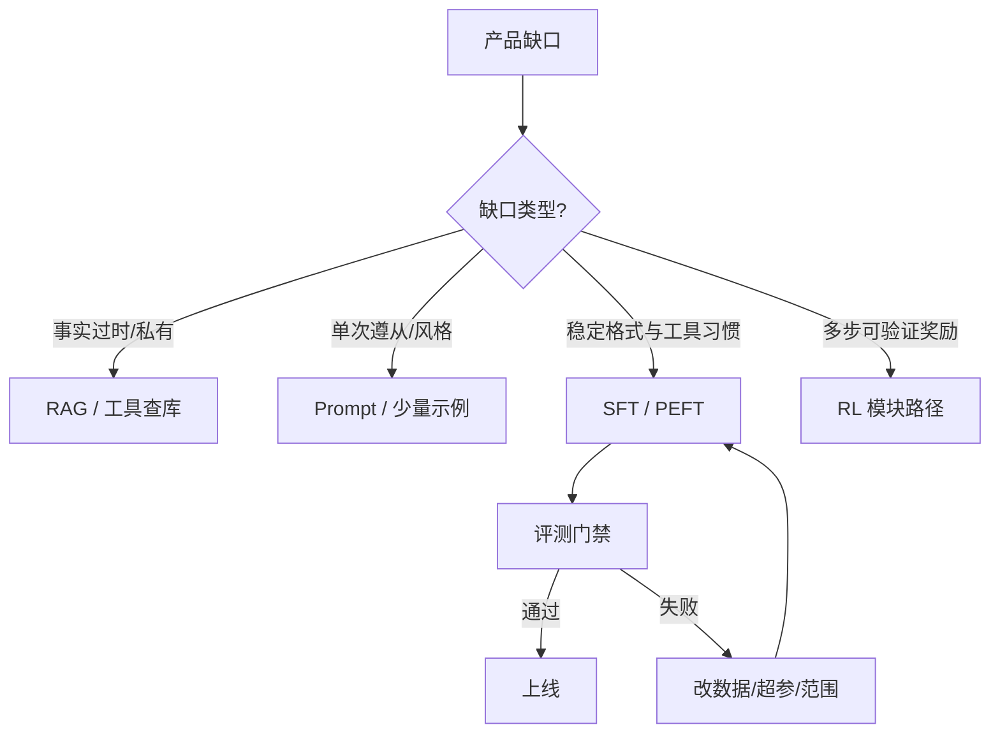

# Fine-tuning（Canonical）

> **一句话主题**：Fine-tuning 是用带标签（或可构造标签）的轨迹 **改变模型权重中的行为分布**，以服务 Agent 的工具调用格式、风格、领域流程；它不是知识注入的默认手段，也不是 RL。
>
> **状态**：Canonical · **Last reviewed**: 2026-10  
> **受众**：为 Agent 选型训练路径、构造 SFT 数据、评估回归风险的工程师  
> **硬前置**：[foundations/llm](../../foundations/llm/README.md)；建议同步 [Tool Use](../../core/tool-use/tool-use.md)、[Evaluation](../../production/evaluation/README.md)  
> **下游**：[reinforcement-learning](../reinforcement-learning/README.md)、生产评测门禁、Coding / 领域 Agent

---

## 范围 / 非目标

**范围**：何时微调 vs Prompt / Context / RAG；训练数据从哪来、怎么清洗与切分；SFT（含工具调用）工程要点；工具使用行为微调的直觉与反模式；适配器（LoRA 等）工程视角；灾难遗忘与工具过拟合等风险；与 RL / 偏好优化的边界；失败模式、评测门禁与面试题。

**非目标（只链接，不复制正文）**：

| 主题 | 去哪里 |
|------|--------|
| 工具 schema / 执行 / 鉴权 | [Tool Use](../../core/tool-use/tool-use.md) |
| Agent 控制回路 | [Agent Loop](../../core/agent-loop/agent-loop.md) |
| 检索与语料注入 | [RAG](../../core/rag/rag.md) |
| 窗口装配与压缩 | [Context Engineering](../../core/context-engineering/context-engineering.md) |
| 推理服务、吞吐延迟 | [llm-inference](../llm-inference/README.md) |
| 量化 / 蒸馏部署优化 | [model-optimization](../model-optimization/README.md) |
| RLHF / DPO / 轨迹级 RL | [reinforcement-learning](../reinforcement-learning/README.md) |
| 任务评测体系全文 | [evaluation](../../production/evaluation/README.md) |
| Prompt 文案技巧本体 | [Prompt Engineering](../../core/prompt-engineering/prompt-engineering.md) |

---

## 1. Overview：在系统中的位置

```text
Prompt / System Policy     = 运行时约束与说明（不改权重）
Context / RAG              = 把事实与材料塞进窗口（不改权重）
Fine-tuning (SFT/PEFT)     = 改权重中的行为先验（格式、风格、流程偏好）
RL / Preference Opt.       = 用反馈信号继续改策略（见 RL 模块）
Agent Loop + Tools         = 执行与控制（训练不替代）
```

```text
生产轨迹 / 标注数据
        ↓
  清洗 · 过滤 · 格式对齐
        ↓
     SFT / PEFT
        ↓
  回归评测门禁
        ↓
  影子流量 / 金丝雀
        ↓
   线上 Agent Runtime
```

**为什么 Agent 工程关心微调**：基座模型已会「说话」和一定程度的 tool calling，但产品常需要 **稳定格式、领域话术、工具选择先验、多步流程习惯**。这些若靠超长 system prompt 硬撑，会占预算、易漂移；若靠 RAG 塞事实，又解决不了「怎么选工具、怎么拒答、怎么收尾」。

**一句话分工**：

> Prompt/Context/RAG 改的是 **本次输入**；Fine-tuning 改的是 **模型默认会怎么生成**；RL 改的是 **相对反馈的策略**。三者可叠加，不可互相冒充。

---

## 2. Mental Model：统一对象

```text
Base Model
 ↓
Behavior Prior（格式 / 风格 / 工具习惯）
 ↓
Runtime Inputs（System · Messages · Tools · RAG）
 ↓
Generation Policy（采样得到的下一步 token / tool call）
 ↓
Executor / Loop
 ↓
Outcome →（可选）进数据飞轮
```

| 对象 | 定义 | 工程含义 |
|------|------|----------|
| **Base Model** | 预训练 +（可选）厂商对齐后的起点 | 选底座 = 选能力上限与许可 |
| **SFT** | 在示范轨迹上最大化似然 | 教「像什么样子」；不直接优化任务奖励 |
| **PEFT / Adapter** | 只训少量参数（如 LoRA） | 降成本、多租户适配、降低全参风险面 |
| **行为目标** | 期望的生成分布（格式、拒答、工具选择） | 必须可写成可评测用例 |
| **知识目标** | 事实/文档内容正确 | 默认优先 RAG/检索，而非塞进权重 |
| **轨迹 (Trajectory)** | 多轮 messages + tool calls + observations | Agent SFT 的自然单元 |
| **金标 / 弱标** | 人工示范 vs 过滤后的生产成功轨迹 | 质量决定上限；噪声决定回归 |
| **回归面** | 微调后不应掉的能力集 | 通用对话、旧工具、安全拒答、长文遵从 |



---

## 3. 概念边界（严格定义）

| 概念 | 是什么 | 不是什么 |
|------|--------|----------|
| **Fine-tuning** | 用优化算法更新（部分）权重以改变生成分布 | 改 system prompt；加检索；加规则引擎 |
| **SFT** | 对示范输出做监督学习（通常 token-level CE） | 直接优化「任务成功奖励」 |
| **Instruction Tuning** | 以指令-响应对为主的 SFT 形态 | 自动等于 Agent 工具能力 |
| **Tool-use SFT** | 示范含结构化 tool call / 多步轨迹 | 教会模型「执行」工具（执行仍在应用侧） |
| **PEFT** | 参数高效微调族（LoRA/QLoRA/Adapter…） | 无风险的魔法；仍会过拟合与遗忘 |
| **Continued Pretraining** | 在领域语料上续训语言建模 | 替代对齐；通常还要再 SFT |
| **RAG** | 运行时检索并注入证据 | 改权重；也不等于「领域微调」 |
| **Prompt Engineering** | 设计输入以诱导行为 | 永久写入权重 |
| **RL / Preference** | 用偏好或可验证奖励更新策略 | 「多采样几次选最好」的运行时技巧 |
| **蒸馏** | 用教师分布训练学生 | 本文不展开；见 model-optimization |

**关键不等式**：

```text
Fine-tuning ≠ RAG
Fine-tuning ≠ longer system prompt
SFT ≠ task reward optimization
Tool-use SFT ≠ tool execution
LoRA ≠ no catastrophic forgetting
Production success log ≠ clean SFT label
RLHF / DPO ≠ SFT（机制不同；可接力）
Evaluation ≠ Training（评测门禁 ≠ 训练损失）
```

---

## 4. 何时微调 vs Prompt / RAG

### 4.1 决策原则

先问三个问题：

1. **缺口是知识还是行为？** 知识（事实、政策条文、库存）→ RAG/工具；行为（格式、拒答边界、工具选择习惯、多步流程骨架）→ 才考虑 SFT。
2. **能否用运行时约束稳定解决？** 若 schema 校验、规则路由、少量 few-shot 已达评测目标 → 不微调。
3. **是否值得承担回归与运维成本？** 微调引入版本、评测矩阵、回滚、数据飞轮；不是「准确率 +2%」的免费午餐。

### 4.2 选型表

| 信号 | 优先手段 | 说明 |
|------|----------|------|
| 私有/易变事实 | RAG / 工具 | 权重里塞事实会过时且难审计 |
| 长文档问答 | RAG + Context | 微调记不住「整库」 |
| 输出 JSON/工具格式偶发错误 | Prompt + 校验 + 重试 | 先工程护栏 |
| 格式错误在护栏后仍系统性偏 | SFT | 把正确格式变成先验 |
| 品牌语气、固定话术 | Prompt 或轻量 SFT | 量小用 Prompt；多语言/多角色稳态用 SFT |
| 工具选择长期偏错（总爱搜/总爱写） | 路由规则 → 再 SFT | 先规则切开明显错类 |
| 新工具 API 刚上线 | Schema + 文档进 Context | 勿为每个 API 立即全量微调 |
| 合规拒答边界要极稳 | 策略引擎 + 评测；必要时 SFT | 单靠 Prompt 易被越狱话术绕开 |
| 多步任务成功率低且有可验证奖励 | 先评测与 Loop；再考虑 RL | 见 §12 |

### 4.3 何时「不要」微调

- 问题根因是 **工具失败、权限、超时、Loop 预算** —— 改 Runtime，不改权重。
- 数据 **少于可靠评测所需**（见 §5）：宁缺毋滥。
- 业务每周改流程：先 Prompt/配置中心，等流程稳定再固化为 SFT。
- 目标是「记住客户机密」：机密进权重 = 灾难；用检索 ACL + 工具。
- 基座已满足，只是上下文装错：见 Context Engineering。

### 4.4 组合拳（推荐默认）

```text
1) 定义可测行为规格 + 回归集
2) Prompt / 校验 / 路由把下限拉上来
3) RAG/工具解决事实面
4) 仍系统性偏差 → 小范围 PEFT
5) 有稳定可验证奖励与探索需求 → 再进 RL 模块路径
```

---

## 5. 数据：上限几乎由数据决定

### 5.1 Agent 相关数据形态

| 形态 | 内容 | 典型用途 |
|------|------|----------|
| 单轮指令-响应 | user → assistant 文本 | 风格、拒答、摘要 |
| 单轮 tool call | user → assistant(tool_call) | 格式与选工具入门 |
| 多轮含 observation | user/assistant/tool 交错 | 真实 Agent 行为 |
| 失败修复轨迹 | 错 call → 观察错误 → 纠正 | 教恢复，防「一次错就胡编」 |
| 拒答 / 升级人工 | 高风险请求 → 拒绝或 HITL | 安全边界 |
| 负例 / 对比（可选） | 错误示范标注为勿模仿 | 更接近偏好/对比学习；纯 SFT 慎用生硬负例 |

### 5.2 从生产轨迹到训练样本

```text
线上 Trajectory
 → 过滤（PII、密钥、越权、毒性）
 → 成功判定（外部 verifier，非模型自评）
 → 去重与近重复压缩
 → 格式规范化（与推理时 chat/tool template 一致）
 → 切分为可学习片段（保留必要前缀上下文）
 → 人工抽检分层（工具类 / 长度 / 风险级）
 → train / valid / holdout（holdout 永不进训练）
```

**成功判定必须外部化**：单元测试通过、工单关闭且无返工、人工验收标签、业务规则引擎。禁止「模型说完成了」当金标。

### 5.3 质量维度（比数量优先）

| 维度 | 差数据信号 | 改进 |
|------|------------|------|
| **格式一致性** | 同义工具多种调用写法 | 统一 tokenizer 模板与 schema |
| **工具真实性** | 虚构 tool name / 参数 | 对照 registry 校验 |
| **观察真实性** | 编造 observation | 只保留真实执行回灌 |
| **覆盖度** | 只覆盖快乐路径 | 补错误码、空结果、超时 |
| **难度校准** | 全是简单题 | 按难度分层配额 |
| **泄漏** | 评测题进训练 | 题面哈希/语义近邻检测 |
| **隐私** | 含账号、身份证、密钥 | 红线过滤 + 抽样审计 |

### 5.4 规模直觉（工程经验区间，非定理）

- **格式对齐 / 语气**：数百到数千高质量样本常够 PEFT 起步。  
- **多工具选择与多步习惯**：通常需要 **按工具×意图单元格** 都有代表，而非只看总条数。  
- **领域流程**：先覆盖主路径与 Top 失败模式，再堆长尾。  
- **继续堆数据却不涨评测**：先查标签噪声与模板不一致，再怪模型。

### 5.5 合成数据

可用强模型生成候选轨迹，但必须：

1. **执行校验**（能跑工具/测试的尽量跑）；  
2. **多样性约束**（防模式坍缩成同一话术）；  
3. **人工或规则抽检比例** 写进流水线；  
4. 标明 provenance，便于回归时剔除某批污染。

合成数据适合补覆盖；不适合单独定义「什么叫好 Agent」。

---

## 6. SFT 工程

### 6.1 目标函数在教什么

标准 SFT：在给定前缀下，最大化金标 continuation 的似然。对 Agent 这意味着：

- 教的是 **在相似上下文中复现示范行为**；  
- **不直接**优化「最终任务奖励」；  
- 若示范含冗长无效步骤，模型会学「啰嗦流程」。

因此：**示范即政策**。脏成功轨迹会固化坏习惯。

### 6.2 与推理模板对齐（最高频翻车点）

训练时的 chat template、tool call 序列化、特殊 token，必须与 **线上推理栈** 一致（含厂商 API 的隐式模板）。不一致时常见现象：

- 训练 loss 很好，线上格式全崩；  
- 模型「会说工具」但不会按 API 契约吐字段；  
- 多轮 tool 角色错位导致幻觉 observation。

**实践**：同一套渲染函数生成 train 样本与 eval harness 的 prompt。

### 6.3 损失掩码（Loss Mask）

| 通常计入损失 | 通常不计入（或谨慎） |
|--------------|----------------------|
| assistant 最终回答 | system / 用户原文 |
| assistant 的 tool_call token | tool observation 原文（多为环境事实） |
| 需要模型学会的中间解释（若产品需要） | 检索原文大段（易背诵） |

对 Agent：至少保证 **tool call 与关键决策 token** 被学习；对超长 observation，避免强迫模型「背诵」日志。

### 6.4 超参与训练动力学（工程清单）

- **学习率**：PEFT 通常高于全参量级直觉，但仍以 valid 行为指标为准，而非只看 loss。  
- **Epoch**：小数据多 epoch ≈ 背诵；监控 train/valid 行为鸿沟。  
- **序列长度**：截断策略会静默删掉关键 tool 轮次——截断前先按「保留决策点」切段。  
- **批次构造**：混合短单轮与长轨迹，防梯度被某一长度主导。  
- **检查点选择**：以 **回归套件 + 任务套件** 选 ckpt，不以最低 CE 独断。

### 6.5 全参 vs PEFT（LoRA 等）

| 维度 | 全参 SFT | PEFT（如 LoRA） |
|------|----------|-----------------|
| 成本 / 速度 | 高 | 较低 |
| 行为改变幅度 | 可更大 | 常够用；极端风格/领域有时不够 |
| 多适配器 | 难 | 天然适合多租户/多技能 |
| 遗忘风险 | 高（若数据窄） | 通常较低但仍存在 |
| 运维 | 大权重版本 | adapter 热插拔、可回滚 |

**Agent 默认建议**：先 PEFT + 强评测；只有 PEFT 饱和且数据质量已达上限时，再评估更大更新。

### 6.6 多适配器与路由

```text
请求特征 → 路由器（规则或小模型）
         → base + adapter_A（客服）
         → base + adapter_B（内部运维）
         → base（通用）
```

注意：路由错误 = 错误行为先验；路由器本身要可观测、可回滚。合并多个 LoRA 不是免费的，需单独评测。

### 6.7 发布流水线（最小闭环）

```text
数据版本 → 训练作业 → 候选 ckpt
 → 离线套件（通用 + 工具 + 安全 + 任务）
 → 影子流量对比（格式错误率、工具命中、人工偏好）
 → 金丝雀 → 全量
 → 持续抽样进飞轮（§9）
```

---

## 7. 工具使用行为微调：直觉

### 7.1 模型到底在学什么

结合 [Tool Use](../../core/tool-use/tool-use.md)：模型 **不执行** 工具；SFT 只改变：

1. **何时**发起 call vs 直接答；  
2. **选哪个** tool name；  
3. **参数**如何填（类型、枚举、省略可选字段）；  
4. **多步**时如何根据 observation 继续或停止；  
5. **失败**时重试、改参、换工具还是升级人工。

### 7.2 好的工具轨迹长什么样

- 决策可解释地对齐用户目标（不必长篇 CoT，但步骤经济）。  
- 参数可被 schema 验证；无虚构字段。  
- Observation 后行为 **条件化**：空结果 → 澄清或换查询，而非编造。  
- 在可答时停止；不无限工具循环。  
- 高风险动作前遵循产品政策（确认/HITL）——这些示范必须存在，否则模型学「直接干」。

### 7.3 常见错误示范 → 学到的坏政策

| 坏示范 | 学到的行为 |
|--------|------------|
| 每次都先 `search` 再答 | 过度工具化，延迟与费用上升 |
| 忽略报错继续瞎猜参数 | 无恢复策略的幻觉 call |
| 把 observation 当可改写小说 | 篡改事实回答 |
| 平行乱调互斥工具 | 状态撕裂 |
| 成功但多余的庆祝长文 | 冗长收尾 |
| 仅快乐路径 | 遇错即崩 |

### 7.4 「格式学习」vs「策略学习」

- **格式学习**：括号、字段名、并行 call 结构 —— 相对容易，数据一致性强时收敛快。  
- **策略学习**：选哪个工具、是否该拒答 —— 依赖覆盖与标签质量，更像「教政策」。  

工程上分开看指标：`schema_ok_rate` 与 `tool_choice_accuracy` / `task_success` 不要混成一个分数。

### 7.5 与 Runtime 护栏的分工

```text
SFT：提高「一次生成就大致正确」的先验
校验器：挡住非法 call（硬）
权限/沙箱：挡住越权执行（硬）
Loop 预算：挡住死循环（硬）
评测：挡住「看起来会用工具但不会完成任务」
```

**反模式**：指望 SFT 替代 schema 校验与鉴权。权重不是安全边界。

### 7.6 新工具上线策略

1. Schema + 文档进 Context / Tool Registry；  
2. 合成 + 少量人工轨迹做 **smoke SFT** 或仅 few-shot；  
3. 收集真实成功/失败轨迹；  
4. 达单元格覆盖阈值后并入主训练集；  
5. 回归旧工具集，防新工具过拟合（§10）。

---

## 8. Data Flywheel（生产 → 训练）

```text
线上 Agent
 → 轨迹存储（含工具、延迟、成本、结果标签）
 → 自动标签（测试、规则、业务结果）
 → 人工复审队列（争议/高风险）
 → 训练集增量
 → 定期重训 / 持续 PEFT
 → 门禁对比上一版
 → 发布
```

**飞轮健康指标**：

- 可训练样本占比（过滤后）；  
- 标签延迟（结果标签何时可用）；  
- 近重复率；  
- 各工具单元格覆盖；  
- 「新模型 vs 旧模型」在 holdout 上的胜率与安全回归。

**污染源**：提示注入成功案例、恶意用户教坏的「成功」、内部员工调试用的特殊后门话术。这些进训练 = 固化攻击面。

---

## 9. 与 Prompt / RAG 的协作架构

```text
           ┌── System Policy（运营可改）
User ──►   ├── RAG 证据（易变事实）
           ├── Tools Schema（能力面）
           └── Finetuned Prior（稳态行为）
                    ↓
                 LLM Generate
```

| 变化频率 | 放哪里 |
|----------|--------|
| 小时~天级政策文案 | Prompt / 配置 |
| 文档与票证 | RAG |
| API 字段 | Tool Schema + 校验 |
| 季度级话术/流程习惯 | SFT adapter |
| 奖励驱动的探索改进 | RL 路径 |

**同质内容不要三处维护**：同一拒答规则若既写进 Prompt 又靠 SFT 又写在规则引擎，漂移时无法归因。指定 **Source of Truth**。

---

## 10. 风险：灾难遗忘、过拟合工具、及其他

### 10.1 灾难遗忘（Catastrophic Forgetting）

**现象**：专域/工具数据上变强后，通用遵从、数学、旧领域、安全拒答变弱。  
**机制**：窄分布梯度主导参数更新，覆盖原行为盆地。  
**检测**：固定 **通用回归套件**（与任务套件分离）每版必跑。  
**缓解**：

- 混合回放（replay）通用/旧任务数据；  
- 限制更新幅度（PEFT、较小 LR、早停）；  
- 多能力联合训练配额；  
- 保留可回滚的 base + adapter 拓扑。

### 10.2 过拟合工具（Tool Overfitting）

**现象**：

- 对训练见过的工具名/参数模式极熟，换同义工具或 schema 小改即崩；  
- 无工具也强行 call；  
- 只擅长训练集 Top-N 工具，长尾工具「遗忘」；  
- 把某工具的副作用模式记成「万能答案」。

**检测**：

- 工具改名/改字段的 **扰动评测**；  
- held-out 工具零样本/少样本；  
- 「无需工具」题的误调用率；  
- 新工具上线后的选择混淆矩阵。

**缓解**：

- 训练中工具描述改写与同义 schema 增强（有限、可复现）；  
- 平衡采样长尾工具；  
- 显式示范「直接回答 / 拒用工具」；  
- Runtime 路由限制可见工具集，缩小决策空间。

### 10.3 其他高优先级风险

| 风险 | 信号 | 缓解 |
|------|------|------|
| **背诵训练语料** | 对用户复述内部工单/密钥片断 | PII 过滤；拒答回归；出力抽检 |
| **奖励黑客式示范** | 轨迹「成功」但钻了业务空子 | 成功定义收紧；红队用例 |
| **分布外崩溃** | 略新话术即格式崩 | 多样化 paraphrasing；保留 base 能力 |
| **安全对齐回退** | 越狱率上升 | 安全套件阻断发布 |
| **评估泄漏** | 线上指标虚高 | 密封 holdout；定期换题 |
| **多租户串味** | A 客户话术出现在 B | 分 adapter；数据隔离审计 |
| **成本幻觉** | 训练 loss↓ 产品↑投诉 | 北星指标绑任务成功与体验 |

### 10.4 风险与「再训一轮」的错误反应

指标掉了就加 epoch / 加 LR，常放大过拟合。正确顺序：**看失败案例归属（数据 / 模板 / 路由 / 权重）→ 修数据或护栏 → 再训**。

---

## 11. 失败模式（Symptom / Cause / Impact / Detection / Mitigation）

| ID | Symptom | Cause | Impact | Detection | Mitigation |
|----|---------|-------|--------|-----------|------------|
| F1 | 线上格式全错 | 模板不一致 | 工具全失败 | 训练/推理渲染 diff | 统一渲染库 |
| F2 | 专域↑通用↓ | 遗忘 | 投诉结构变化 | 回归套件 | replay + PEFT |
| F3 | 乱调工具 | 策略过拟合/示范偏 | 费用↑任务↓ | 误调用率 | 负向示范+规则门 |
| F4 | 遇错胡编 | 缺失败轨迹 | 事实错误 | 错误注入测 | 补修复轨迹 |
| F5 | 背出客户数据 | 脏数据进训 | 合规事故 | 出站 DLP/抽检 | 清洗+召回权重 |
| F6 | 新工具不会 | 覆盖不足 | 发布阻塞 | 单元格矩阵 | 飞轮补数 |
| F7 | ckpt 好看业务差 | 优化了 CE 非任务 | 空欢喜 | 任务套件选 ckpt | 指标对齐 |
| F8 | 越狱变容易 | 安全数据被冲掉 | 安全事故 | 安全套件门禁 | 安全 replay |
| F9 | 多 adapter 串 | 路由错/合并错 | 错品牌错权限 | 路由监控 | 强隔离+测试 |
| F10 | 飞轮毒化 | 注入/钻空成功入集 | 慢性退化 | provenance 审计 | 过滤+人工复核 |

---

## 12. 与 RL 的边界

### 12.1 机制对比

| | SFT | RL / 偏好优化 |
|--|-----|----------------|
| 信号 | 示范轨迹 | 奖励 / 偏好 / 可验证得分 |
| 学什么 | 模仿示范分布 | 提高期望回报（或偏好似然） |
| 典型风险 | 模仿坏示范、遗忘 | 奖励黑客、不稳定、探索副作用 |
| 数据需求 | 高质量示范 | 奖励模型或 verifier + 采样 |
| Agent 位置 | 先把格式与基本政策拉齐 | 在可评分任务上榨成功率 |

### 12.2 何时停在 SFT

- 主要痛点是格式、语气、基本工具契约；  
- 奖励稀疏或不可信（「看起来不错」的人工偏好噪声大）；  
- 环境副作用大，不能安全探索；  
- 还没有稳定的离线 verifier。

### 12.3 何时走向 RL 模块

- 已有 **可验证奖励**（测试通过、结构化校验、业务成功码）；  
- SFT 后策略仍在多步决策上系统性次优；  
- 能承受采样成本与安全约束的探索；  
- 评测与奖励定义已对齐（见 evaluation）。

### 12.4 易混点

```text
Reflexion / 语言反思 ≠ RL 更新权重
Best-of-N 采样选优 ≠ 训练完成
DPO/RLHF 流水线 ≠ 「再 SFT 一次」
过程奖励设计 ⊂ RL 主题，不是 SFT 默认章节
```

细节、奖励黑客、轨迹级 RL → [`runtime/reinforcement-learning`](../reinforcement-learning/README.md)。

### 12.5 推荐接力顺序

```text
护栏与 Loop 正确
 → Prompt/RAG 达基线
 → SFT/PEFT 稳格式与习惯
 → 强化 verifier
 →（可选）偏好/RL 优化多步策略
 → 全程回归门禁
```

---

## 13. Evaluation：微调专属门禁

详见 evaluation 模块；此处只列 **微调发布阻断项**。

| 套件 | 目的 | 阻断示例 |
|------|------|----------|
| 任务成功 | 北星能力 | 核心场景成功率显著下降 |
| 工具契约 | schema / 选工具 | `schema_ok` 或误调用超阈 |
| 通用回归 | 抗遗忘 | 通用集掉点超阈 |
| 安全 | 拒答/越狱 | 任一高危类回退 |
| 无工具题 | 抗过拟合工具 | 误调用率上升 |
| 扰动 | 抗背诵模式 | 同义改写崩溃 |
| 成本延迟 | 行为变啰嗦 | token/工具次数暴涨 |

**选 ckpt 协议**：预先写下「主指标 + 硬约束」，禁止事后改口径洗白候选。

---

## 14. Production Architecture（挂钩）

```text
[Data Lake / Trace Store]
        ↓
[Filter · Label · PII]
        ↓
[Dataset Registry (versioned)]
        ↓
[Trainer (PEFT/SFT)]
        ↓
[Model / Adapter Registry]
        ↓
[Eval Gates]
        ↓
[Inference Router] ──► Agent Loop ──► Tools / RAG
        ↓
[Observability · Feedback]
```

与周边模块：

- **Inference**：模板、批处理、适配器加载 —— [llm-inference](../llm-inference/README.md)  
- **Optimization**：量化与蒸馏是否破坏 tool 格式 —— [model-optimization](../model-optimization/README.md)  
- **Security**：训练数据投毒、权重泄漏 —— [security](../../production/security/README.md)  
- **Observability**：版本、adapter id、数据版本写入轨迹 —— [observability](../../production/observability/README.md)

---

## 15. Trade-offs（定性）

| 选项 | 得 | 失 |
|------|----|----|
| 只 Prompt | 快、可热修 | 占窗口；复杂行为不稳 |
| 只 RAG | 事实新鲜 | 不改工具习惯 |
| PEFT SFT | 稳态行为；可回滚 | 数据与门禁成本 |
| 全参 SFT | 表达力 | 贵、遗忘、运维重 |
| 早上 RL | 可能更高成功 | 不稳、黑客、贵 |
| 大飞轮自动入集 | 迭代快 | 毒化风险 |

---

## 16. 实践建议（可执行）

1. **先写行为规格与套件，再谈训练。**  
2. **模板单一真相**：渲染函数共用。  
3. **单元格覆盖**：工具 × 意图 × 失败模式。  
4. **默认 PEFT + replay 通用/安全数据。**  
5. **成功标签外部化**；合成数据必校验。  
6. **发布靠门禁不是靠 loss。**  
7. **新工具先 Runtime，后权重。**  
8. **机密不进权重。**  
9. **SFT 饱和再评估 RL。**  
10. **每次发布记录：数据版本、基座、adapter、套件分数。**

---

## 17. 算法伪代码（概念级）

```text
function BUILD_DATASET(traces, registry):
  samples = []
  for tr in traces:
    if not PASS_PII(tr): continue
    if not EXTERNAL_SUCCESS(tr): continue
    if not VALIDATE_TOOLS(tr, registry): continue
    msg = RENDER(tr)              # 与线上一致
    samples.append(MASK_LOSS(msg))
  return SPLIT(samples)           # train/valid/holdout

function TRAIN_SFT(base, dataset, peft_cfg):
  model = APPLY_PEFT(base, peft_cfg)
  for batch in dataset.train:
    loss = CROSS_ENTROPY(model, batch.tokens, batch.mask)
    UPDATE(model, loss)
    if STEP % N == 0:
      scores = EVAL_GATES(model)
      CONSIDER_CHECKPOINT(model, scores)
  return BEST_BY_GATES()

function RELEASE(candidate, current):
  if not GATES_PASS(candidate, current): return REJECT
  SHADOW(candidate)
  CANARY(candidate)
  return PROMOTE(candidate)
```

---

## 18. Interview Questions

### Beginner

**Q1. Fine-tuning 与改 system prompt 的本质区别？**  
- **短答**：前者改权重中的行为分布；后者只改单次输入。  
- **详解**：Prompt 可热修、占上下文；微调影响默认生成，需版本与评测。  
- **追问**：两者如何叠加？  
- **常见错误**：把「写了很长 prompt」叫微调。  
- **相关**：§1–3。

**Q2. 为什么私有知识默认用 RAG 而不是微调？**  
- **短答**：易变、可审计、可按权限检索；进权重难更新且有泄漏面。  
- **详解**：权重不是文档数据库。  
- **追问**：何种窄知识可考虑进 SFT？  
- **常见错误**：把整个企业wiki灌进续训当搜索。  
- **相关**：§4。

**Q3. SFT 优化的是什么目标？**  
- **短答**：示范 token 的似然，不是任务奖励。  
- **详解**：会模仿示范里的坏习惯。  
- **追问**：如何间接提升任务成功？  
- **常见错误**：以为 loss↓ 等于产品成功↑。  
- **相关**：§6.1。

**Q4. 模型微调后会自己执行工具吗？**  
- **短答**：不会；仍只产出 tool call，执行在应用侧。  
- **详解**：见 Tool Use 契约。  
- **追问**：SFT 改变了契约的哪一侧？  
- **常见错误**：混淆「会调用」与「会执行」。  
- **相关**：§7、Tool Use。

**Q5. LoRA 一类方法解决什么问题？**  
- **短答**：用少量可训参数适配，降成本、便多适配器。  
- **详解**：非零风险，仍可能过拟合/遗忘。  
- **追问**：何时考虑全参？  
- **常见错误**：LoRA = 一定不遗忘。  
- **相关**：§6.5。

**Q6. 举一个该用 Prompt 而不是微调的例子。**  
- **短答**：本周临时活动话术、紧急合规一句拒答。  
- **详解**：热修优于重训。  
- **追问**：若临时话术变永久怎么办？  
- **常见错误**：每周为文案重训。  
- **相关**：§4.3。

**Q7. 什么是灾难遗忘？**  
- **短答**：新任务训练后旧能力明显下降。  
- **详解**：窄数据梯度覆盖旧行为。  
- **追问**：如何检测？  
- **常见错误**：只看新任务指标。  
- **相关**：§10.1。

**Q8. 训练数据里的 observation 通常要不要算损失？**  
- **短答**：多数情况下不把环境事实当生成目标硬背。  
- **详解**：重点学 assistant 决策与 call。  
- **追问**：何种中间摘要可学？  
- **常见错误**：整段日志全算 CE。  
- **相关**：§6.3。

**Q9. 为何训练模板必须与推理一致？**  
- **短答**：特殊 token/角色格式不一致会导致能力「训了用不出」。  
- **详解**：统一渲染函数。  
- **追问**：厂商 API 隐式模板怎么办？  
- **常见错误**：离线用一套 ChatML、线上另一套。  
- **相关**：§6.2。

**Q10. 列出微调发布前至少三类门禁。**  
- **短答**：任务成功、工具契约、安全/通用回归。  
- **详解**：另加无工具误调用与成本。  
- **追问**：哪类应硬阻断？  
- **常见错误**：只看 BLEU/loss。  
- **相关**：§13。

### Intermediate

**Q11. 设计「工具×意图」数据覆盖矩阵的步骤。**  
- **短答**：列出工具与意图单元格→标优先级→补快乐/失败路径→设配额。  
- **详解**：用线上混淆矩阵指导长尾。  
- **追问**：单元格为空能否上线新工具？  
- **常见错误**：只看总样本数。  
- **相关**：§5、§7.6。

**Q12. 生产成功轨迹能否直接当金标？**  
- **短答**：不能直接；需外部成功定义、过滤、抽检。  
- **详解**：钻空成功会教坏。  
- **追问**：弱监督标签怎么用？  
- **常见错误**：凡 HTTP 200 都进训练集。  
- **相关**：§5.2、§8。

**Q13. 如何检测工具过拟合？**  
- **短答**：扰动 schema/改名、held-out 工具、无工具题误调用率。  
- **详解**：看混淆矩阵与费用。  
- **追问**：与灾难遗忘如何区分？  
- **常见错误**：只在原工具集上自嗨。  
- **相关**：§10.2。

**Q14. 合成工具轨迹的最小安全条件？**  
- **短答**：能执行则执行校验、多样性、抽检、provenance。  
- **详解**：禁止无校验教师幻觉 call。  
- **追问**：合成占比上限如何定？  
- **常见错误**：100% 合成当生产政策。  
- **相关**：§5.5。

**Q15. PEFT 多租户适配的主要风险？**  
- **短答**：路由错误、数据串味、合并适配器未测。  
- **详解**：隔离数据与监控 adapter id。  
- **追问**：共享底座如何定制？  
- **常见错误**：全局单模型硬编码客户名。  
- **相关**：§6.6、F9。

**Q16. 解释 loss 很好但任务成功率不动的三种原因。**  
- **短答**：模仿了非关键 token；标签与成功脱节；评测泄漏或分布不符。  
- **详解**：用行为指标选 ckpt。  
- **追问**：如何做归因？  
- **常见错误**：继续加 epoch。  
- **相关**：§6.4、§11。

**Q17. 新 API 字段上线，微调与 Context 谁先？**  
- **短答**：先 Schema+Context/校验；稳定后少量轨迹再并入 SFT。  
- **详解**：避免为每周 API 变更重训。  
- **追问**：字段改名如何防崩？  
- **常见错误**：仅靠旧权重记忆字段。  
- **相关**：§4、§7.6。

**Q18. 安全拒答数据在 SFT 中如何防止被冲掉？**  
- **短答**：安全 replay 配额 + 发布前安全套件硬门禁。  
- **详解**：专域数据比例设顶。  
- **追问**：与外部策略引擎如何分工？  
- **常见错误**：假定基座对齐永不回退。  
- **相关**：§10.1、§13。

**Q19. 描述数据飞轮的一个毒化场景与防护。**  
- **短答**：提示注入「成功」轨迹入集→模型更易服从注入。  
- **详解**：过滤+人工复核高风险+provenance。  
- **追问**：如何回溯删除毒批？  
- **常见错误**：全自动无审计入集。  
- **相关**：§8、F10。

**Q20. 何时应停止加 SFT 数据、转向改 Loop/工具？**  
- **短答**：失败归因显示超时、权限、预算、确定性 bug。  
- **详解**：权重解决不了系统错误。  
- **追问**：如何做失败归因仪表盘？  
- **常见错误**：一切问题重训。  
- **相关**：§4.3。

### Advanced

**Q21. 设计一套「无需工具」题，专门打工具过拟合。**  
- **短答**：纯闲聊/常识/已给足证据的题；指标=误调用率。  
- **详解**：与「必须工具」题成对。  
- **追问**：证据在 RAG 中时如何界定？  
- **常见错误**：全是必须搜的题。  
- **相关**：§10.2、§13。

**Q22. 长轨迹截断策略如何避免删掉关键决策点？**  
- **短答**：按窗口从尾部保留最近决策；或切成重叠片段并保留目标 call。  
- **详解**：监控截断导致的悬挂 tool 轮。  
- **追问**：与 Context 在线压缩的关系？  
- **常见错误**：头部截断丢掉用户约束。  
- **相关**：§6.4。

**Q23. 如何用回放数据缓解遗忘而不稀释专域？**  
- **短答**：配额采样：专域主比例 + 固定通用/安全 replay。  
- **详解**：动态上调被回归套件报警的类别。  
- **追问**：replay 过旧怎么办？  
- **常见错误**：全量混入导致专域学不动。  
- **相关**：§10.1。

**Q24. 讨论「示范即政策」对 Coding Agent 轨迹的含义。**  
- **短答**：含乱改文件却碰巧测过的轨迹会固化坏编辑策略。  
- **详解**：用测试+diff 质量过滤。  
- **追问**：flaky test 如何处理？  
- **常见错误**：凡 CI 绿就进集。  
- **相关**：§6.1、coding-agent。

**Q25. SFT 与 DPO 接力时，数据与门禁如何衔接？**  
- **短答**：SFT 打底格式→偏好对来自对比轨迹→门禁两阶段共用 holdout。  
- **详解**：RL 细节归 RL 模块。  
- **追问**：偏好噪声如何检测？  
- **常见错误**：跳过 SFT 直接上不稳定 RL。  
- **相关**：§12。

**Q26. 提出度量「策略学习」而非「格式学习」的指标。**  
- **短答**：tool_choice_accuracy、必要工具覆盖、多余调用率、任务成功。  
- **详解**：与 schema_ok 分离报表。  
- **追问**：多步归因为哪一步错？  
- **常见错误**：只报 JSON 合法率。  
- **相关**：§7.4。

**Q27. 多工具并行 call 的 SFT 数据要注意什么？**  
- **短答**：示范独立可并行的 call；避免示范冲突写。  
- **详解**：与 Runtime 并行执行语义一致。  
- **追问**：部分失败观察如何示范？  
- **常见错误**：串行示范却线上并行。  
- **相关**：§7、Tool Use。

**Q28. 如何审计微调是否「背诵」了训练集工单？**  
- **短答**：成员推断式抽检、密钥/工单号探针、出站 DLP。  
- **详解**：训练前脱敏是主防。  
- **追问**：发现泄漏如何应急？  
- **常见错误**：只依赖用户投诉。  
- **相关**：§10.3、Security。

**Q29. 设计影子流量对比微调模型的实验。**  
- **短答**：同请求双跑、比格式错误/工具/任务代理指标；控制延迟成本。  
- **详解**：预注册胜出规则。  
- **追问**：如何避免双跑副作用？  
- **常见错误**：影子也打生产写接口。  
- **相关**：§6.7、Sandbox。

**Q30. 解释为何「继续预训练领域语料」不能替代工具 SFT。**  
- **短答**：CPT 改语言分布，不教 tool call 契约与 Loop 决策。  
- **详解**：通常仍需指令/工具 SFT。  
- **追问**：CPT 何时有用？  
- **常见错误**：堆域语料指望会自动 function call。  
- **相关**：§3。

### Expert

**Q31. 形式化「行为缺口 vs 知识缺口」诊断流程。**  
- **短答**：同题提供金标证据时若仍错→行为/推理；无证据则错→知识。  
- **详解**：消融 Prompt/RAG/FT。  
- **追问**：二者同时存在怎么排期？  
- **常见错误**：一律微调。  
- **相关**：§4。

**Q32. 在不可微的业务规则下，如何构造可学示范？**  
- **短答**：规则引擎生成合规动作轨迹作银标；争议样例人工。  
- **详解**：规则仍是运行时 Source of Truth。  
- **追问**：规则变更如何失效旧数据？  
- **常见错误**：用过期规则轨迹训新政策。  
- **相关**：§5、§9。

**Q33. 讨论适配器热更新与 Agent 长会话一致性。**  
- **短答**：会话中途换 adapter 可能导致风格/工具先验跳变。  
- **详解**：会话粘滞版本或安全点切换。  
- **追问**：如何观测跳变？  
- **常见错误**：无版本钉扎的全局热更。  
- **相关**：§14。

**Q34. 设计对抗「训练数据投毒」的红队。**  
- **短答**：投毒诱使越权工具、背门话术、品牌篡改；期望过滤/门禁截获。  
- **详解**：供应链：标注商与合成管道。  
- **追问**：如何度量投毒成功率？  
- **常见错误**：只红队最终用户提示。  
- **相关**：§8、Security。

**Q35. 证明某次微调因果有效的实验设计。**  
- **短答**：同底座同护栏，随机 A/B；预注册指标；控工具与检索。  
- **详解**：非一次性前后对比沾沾自喜。  
- **追问**：霍桑与季节性？  
- **常见错误**：只晒精选 case。  
- **相关**：§13。

**Q36. 大规模工具注册表下，如何避免 SFT 成为「工具目录记忆」？**  
- **短答**：运行时只暴露相关工具子集；训练也按子集分布；检索工具描述。  
- **详解**：与 tool retrieval 架构配合。  
- **追问**：检索错工具怎么办？  
- **常见错误**：把上千工具 schema 塞进每条训练。  
- **相关**：§7、Tool Use。

**Q37. 分析量化/蒸馏后 tool 格式崩与微调的交互。**  
- **短答**：部署优化可能破坏稀有特殊 token；需在 **最终部署形态** 上回归。  
- **详解**：先定 serving 栈再选 ckpt。  
- **追问**：QLoRA 训练与 4bit 推理不一致？  
- **常见错误**：只在 bf16 上评工具。  
- **相关**：model-optimization。

**Q38. 多步轨迹上 credit assignment 在 SFT 中的局限。**  
- **短答**：SFT 均匀模仿逐步 token，不显式归功关键决策。  
- **详解**：故多步最优常需 RL/可验证奖励。  
- **追问**：能否用过滤「最优前缀」近似？  
- **常见错误**：指望更多 SFT epoch 解决探索。  
- **相关**：§12。

**Q39. 提出 Agent 微调的「可回滚」发布架构。**  
- **短答**：adapter 与数据版本不可变制品；路由权重可瞬间切回；会话粘滞。  
- **详解**：门禁产物与模型制品绑定。  
- **追问**：数据需删除（GDPR）时？  
- **常见错误**：只留最后一次全参覆盖式权重。  
- **相关**：§14。

**Q40. 审视开源「Agent 微调」项目的审计清单。**  
- **短答**：模板一致性、损失掩码、外部成功标签、回归套件、安全 replay、与 RL 边界是否吹嘘。  
- **详解**：对照本文 F1–F10。  
- **追问**：只有 notebook 无门禁如何评级？  
- **常见错误**：有 LoRA 脚本就当生产就绪。  
- **相关**：standards/open-source-analysis。

### System Design

**Q41. 设计企业内部「工具行为」PEFT 平台。**  
- **短答**：轨迹湖→过滤标注→数据集注册→训练→门禁→adapter 注册→路由；多租户隔离。  
- **详解**：观测数据/模型/适配器版本三联。  
- **追问**：如何做自助与审批？  
- **常见错误**：共享盘手滑覆盖权重。  
- **相关**：§8、§14。

**Q42. 设计 Coding Agent 的 SFT 数据与门禁。**  
- **短答**：轨迹含补丁+测试结果；门禁=隐藏测+安全+通用编辑回归；禁未验证绿。  
- **详解**：链 Sandbox 与 evaluation。  
- **追问**：多语言仓库如何分层？  
- **常见错误**：只学对话不学补丁。  
- **相关**：§7、coding-agent。

**Q43. 设计高风险金融 Agent：能微调什么、不能。**  
- **短答**：可微调话术与只读查询习惯；交易决策与限额必须规则/HITL；机密不进权重。  
- **详解**：安全套件+权限在工具层。  
- **追问**：偏好学习是否允许？  
- **常见错误**：用 SFT「记住」审批捷径。  
- **相关**：§4、§10、Security。

**Q44. 设计从 Prompt 基线迁移到 PEFT 的里程碑。**  
- **短答**：套件固化→数据单元格→小 PEFT→影子→金丝雀→减 prompt 冗余→飞轮。  
- **详解**：每步可回滚。  
- **追问**：哪一步不可跳过？  
- **常见错误**：首日全参+关校验。  
- **相关**：§4.4、§16。

**Q45. 设计「SFT vs RAG vs RL」选型评审会材料模板。**  
- **短答**：缺口诊断、成本、数据就绪、门禁、风险、回滚、为何不是另两者。  
- **详解**：强制写非目标与成功度量。  
- **追问**：争议如何升级？  
- **常见错误**：按团队偏好投票无证据。  
- **相关**：§4、§12、§15。

---

## 19. Cross References

```text
foundations/llm
      ↓
Fine-tuning（本文）──► reinforcement-learning
      ↓
Agent Runtime：Loop · Tool Use · RAG · Context
      ↓
Evaluation · Observability · Security
```

- [foundations/llm](../../foundations/llm/README.md) · [foundations/agent](../../foundations/agent/README.md)  
- [Tool Use](../../core/tool-use/tool-use.md) · [Agent Loop](../../core/agent-loop/agent-loop.md)  
- [RAG](../../core/rag/rag.md) · [Context Engineering](../../core/context-engineering/context-engineering.md)  
- [llm-inference](../llm-inference/README.md) · [model-optimization](../model-optimization/README.md)  
- [reinforcement-learning](../reinforcement-learning/README.md)  
- [evaluation](../../production/evaluation/README.md) · [observability](../../production/observability/README.md) · [security](../../production/security/README.md)  
- [coding-agent](../../agent-types/coding-agent/README.md)

---

## 20. References

- [doc-openai-function-calling](../../references/docs.md#doc-openai-function-calling)（工具契约；SFT 对齐对象）  
- [doc-anthropic-how-tool-use-works](../../references/docs.md#doc-anthropic-how-tool-use-works)  
- [doc-anthropic-tool-use](../../references/docs.md#doc-anthropic-tool-use)  
- [paper-react-2022](../../references/papers.md#paper-react-2022)（轨迹中交错推理与行动的数据形态背景）  
- [paper-reflexion-2023](../../references/papers.md#paper-reflexion-2023)（语言反思 ≠ 权重 RL；边界对照）  
- [article-anthropic-building-effective-agents-2024](../../references/articles.md#article-anthropic-building-effective-agents-2024)（先简单可组合，再加复杂度——同样适用于「先护栏后微调」）

> 厂商具体 fine-tuning API / 价格 / UI 易变，不在本文展开；落地时以当时官方文档为准（TODO: Verify 周期复核）。

---

## 21. Self-review / TODOs

- [x] 微调 ≠ Prompt ≠ RAG ≠ RL；Tool-use SFT ≠ 执行  
- [x] 选型表、数据、SFT 工程、工具行为直觉、风险、RL 边界齐全  
- [x] 失败模式、门禁、伪代码、45 面试题  
- [x] 未复制 Tool Use / RAG / RL 正文  
- [ ] TODO: Verify — 主要厂商 fine-tuning / batch API 能力矩阵  
- [ ] TODO: Verify — 偏好优化（DPO 等）与各家托管训练产品命名  
- [ ] TODO: Verify — 长上下文模型下「轨迹切段」经验阈值是否变化  
