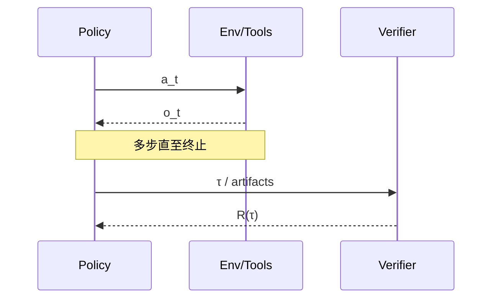

# Reinforcement Learning for Agents / LLMs（Canonical）

> **一句话主题**：面向 Agent / LLM 的强化学习，是在**可度量反馈**上优化策略（或偏好对齐）的工程闭环——不是「上了 PPO 就更智能」，而是 **Eval 先定义成功 → 奖励可检验 → 再决定是否值得改权重**。
>
> **状态**：Canonical · **Last reviewed**: 2026-10  
> **受众**：要做对齐训练、可验证奖励、轨迹级策略优化，或决定「该不该上 RL」的工程师  
> **硬前置**：[`foundations/llm`](../../foundations/llm/README.md)；强烈建议先读 [`production/evaluation`](../../production/evaluation/README.md)  
> **软前置**：[`fine-tuning`](../fine-tuning/README.md)、[Agent Loop](../../core/agent-loop/agent-loop.md)、[Tool Use](../../core/tool-use/tool-use.md)

---

## 范围 / 非目标

**范围**：RLHF / RLAIF 工程直觉；偏好优化与在线 RL 选型地图；可验证奖励；Agent 多步轨迹级学习信号；与 Evaluation 的依赖（Eval 先于 RL）；何时不该上 RL；失败模式；实践决策与面试。

**非目标**：

| 主题 | 去哪里 |
|------|--------|
| 任务评测设计、数据集长文、回归门禁细节 | [`production/evaluation`](../../production/evaluation/README.md) |
| 监督微调、LoRA、数据飞轮（无 RL） | [`fine-tuning`](../fine-tuning/README.md) |
| 推理时搜索 / 反思（不改权重） | [Reasoning & Planning](../../core/reasoning-planning/reasoning-planning.md) |
| 经典控制 RL 教科书（DQN/Atari 百科） | 不写；只保留与 LLM/Agent 相关映射 |
| 预训练从零训练大模型 | 超出本手册 |

**核心立场**：

1. **Eval 先于 RL**：没有稳定可复现的评测，RL 只会优化噪声。  
2. **奖励可检验性 > 算法时髦度**：可验证奖励往往比模糊 RM 更可运维。  
3. **轨迹级 RL ≠ 更长 Prompt**：信号作用在策略参数或偏好数据上，不是单次推理「口头强化」。  
4. **多数 Agent 问题应先用 Prompt / Tool / Eval / SFT**；RL 是高成本杠杆，不是默认下一站。

---

## 1. 知识模型：LLM / Agent 语境下的 RL

### 1.1 经典 RL 与 LLM 对齐的映射

| 经典 RL | LLM / Agent 对应 |
|---------|------------------|
| 状态 \(s\) | 上下文（messages、工具 schema、环境观察） |
| 动作 \(a\) | token / 工具调用 / 结构化决策 |
| 策略 \(\pi(a\|s)\) | 模型（及解码/工具选择策略） |
| 轨迹 \(\tau\) | 多步：决策→工具→观察→再决策… 直至终止 |
| 奖励 \(r\) | 人类偏好、AI 评判、测试通过、任务成功等 |
| 回报 \(R(\tau)\) | 轨迹级聚合（终局、塑形和、折扣和） |
| 环境 | 用户、工具、沙箱、业务系统（常有副作用） |

没有「可行动作 + 环境反馈 + 可优化目标」，就只是监督学习或启发式编排，不宜自称 Agent RL。

### 1.2 三类「学习」不要混名

| 范式 | 改什么 | 信号从哪来 | 典型用途 |
|------|--------|------------|----------|
| **SFT** | 权重（模仿示范） | 标注轨迹 / 指令对 | 格式、工具协议、领域话术 |
| **偏好 / RL 对齐** | 权重（相对排序或奖励） | 人类/AI 偏好、RM、规则 | 风格、安全、相对质量 |
| **可验证奖励 RL** | 权重（对可检结果） | 单元测试、编译、判题器 | 代码、数学、形式约束任务 |
| **推理时「言语 RL」** | **不改权重** | 语言反思 / 重试 | Reflexion 类控制流 |

Reflexion 等 verbal reinforcement 属于 Runtime / Reasoning 钩子，**不是**本模块的训练式 RL（见 [paper-reflexion-2023](../../references/papers.md#paper-reflexion-2023)）。

### 1.3 工程上真正在优化什么

```text
maximize  E_τ~πθ [ R(τ) ]
subject to  能力不崩、安全约束、成本/延迟预算、分布不过度偏移
```

难点几乎总在 **\(R\)** 与 **数据分布**，不在最新算法缩写。


---

## 2. RLHF：工程直觉

### 2.1 标准三阶段（机制级）

InstructGPT 风格流水线（[paper-instructgpt-2022](../../references/papers.md#paper-instructgpt-2022)）：

1. **SFT**：示范数据把模型拉到基本指令/格式能力。  
2. **奖励模型（RM）**：人类偏好对 \((x,y_w,y_l)\) 训练 \(r_\phi(x,y)\)。  
3. **策略优化**：在 RM（及 KL 约束）下用 PPO 等更新 \(\pi_\theta\)，避免离参考策略太远。

```text
示范 → SFT π_ref
偏好 → RM r_φ
π_θ 采样 → r_φ 打分 → PPO（+ KL to π_ref）
```

### 2.2 工程师该抓住的直觉

| 直觉 | 含义 |
|------|------|
| **RM 是代理目标** | 优化 RM 分≠优化用户幸福；RM 错则策略错 |
| **KL 是刹车** | 相对参考模型抑制崩塌与胡言 |
| **采样成本巨大** | 在线 rollout 远贵于 SFT |
| **标注是产品** | 准则、培训、争议裁决决定上限 |
| **离线偏好 ≠ 在线行为** | 静态成对偏好推不出工具副作用下的安全策略 |

### 2.3 Agent 场景的额外摩擦

单轮聊天对齐 ≠ 多步工具 Agent：

- **信用分配**：终局成功时哪一步有功？稀疏奖励方差大。  
- **不可逆副作用**：错误 `delete`/`transfer` 不能免费重采样（需沙箱与权限）。  
- **部分可观测**：只看最终文本会忽略中间违规工具调用。  
- **非平稳环境**：工具 API/业务规则变化使旧 RM 过时。

**工程含义**：上 RLHF 前先问「终局文本偏好是否覆盖你真正在乎的失败」。多数答案是否定的——应转向轨迹评测 + 可验证步骤奖励，或根本不上 RL。

### 2.4 PPO 角色（够用即可）

PPO = 带护栏的策略迭代器（裁剪、价值基线、相对参考更新）。超参不稳时先查奖励尺度与数据；许多团队用 DPO 等绕开在线 PPO 运维（§4）。

---

## 3. RLAIF：AI 反馈

人类偏好贵、慢、难扩；RLAIF 用强模型或规则化评判生成偏好/奖励（[paper-rlaif-2023](../../references/papers.md#paper-rlaif-2023)；宪章式原则见 [paper-constitutional-ai-2022](../../references/papers.md#paper-constitutional-ai-2022)）。

```text
原则 / 宪章 / rubric → 评判模型或规则引擎打分/成对比较
        → RM 或偏好对 → 偏好优化 / RL
```

与 LLM-as-judge Eval 共享风险且更重：**评判器偏差会进入训练权重**。

| 适合 | 不适合 |
|------|--------|
| 风格、冗长度、礼貌、格式等可描述原则 | 需地面真值的事实/安全临界决策 |
| 已有 rubric 且与人类抽检高度相关 | 评判器在该域准确率未知 |
| 人类金标校准 + AI 扩量 | 「全自动对齐」无人抽检 |

**运维最低集**：评判协议版本化；人类相关监控（跌破阈值停训）；禁止同一评判器既当训练奖励又当唯一门禁；独立评测与用户切片定期复核。

---

## 4. 偏好优化地图

| 方法族 | 在线采样？ | 显式 RM？ | 负担 | 典型信号 |
|--------|------------|-----------|------|----------|
| 经典 RLHF（PPO + RM） | 是 | 是 | 高 | RM 标量 |
| DPO 等直接偏好优化 | 否 | 否（隐式） | 中 | 成对偏好 |
| RLAIF + 上述任一 | 视后端 | 可选 | 中–高 | AI 偏好 |
| 可验证奖励 RL（GRPO/RLOO 等） | 是/半在线 | 常否 | 中–高 | 测试/判题器 |
| 仅 SFT on preferred | 否 | 否 | 低 | 优胜样本 |

[DPO](../../references/papers.md#paper-dpo-2023) 把偏好变成对策略的分类目标，省掉 RM+PPO 在线循环；代价是 **离线偏好必须覆盖目标行为分布**——工具 OOD 上不会自动探索出安全策略。

**选型启发式**：

```text
单轮文本质量 + 稳定偏好 → 离线 DPO/IPO + 强 Eval
可程序化验证 → 可验证 RL / Best-of-N / 过滤 SFT
必须探索且可沙箱 → PPO/GRPO
Eval 不稳 → 不上任何 RL（§8）
```

**对齐税**：偏好优化常带来冗长、谄媚、拒答过度或能力回退。保留独立能力回归套件；监控长度/拒答/工具成功率；用 KL 与数据混合控漂移。

---

## 5. 可验证奖励（Verifiable Rewards）

### 5.1 定义与例子

**可验证奖励**：存在确定性或高一致程序 \(V\)，对 \((x,\tau)\) 或产物输出分数/布尔，且不依赖「同一模型的自我感觉」。

- 代码：单元测试、类型检查、linter（沙箱跑）  
- 数学/竞赛：符号等价、官方判题器  
- 结构化输出：JSON Schema、协议校验、API 模拟器断言  
- 工具调用：schema 合法 + 模拟器到达目标态  
- 安全子集：策略引擎拒绝的危险调用（负奖励或硬过滤）

### 5.2 为何 Agent 工程应优先考虑

| 模糊 RM / 主观偏好 | 可验证奖励 |
|--------------------|------------|
| 标注贵、准则漂 | 规则与测例可版本化 |
| 易讨好 RM | 黑客须骗过测试（面不同） |
| 难解释 | 失败可定位到 assert |
| 与业务 SLO 弱相关 | 可对齐「任务成功」 |

**可验证 ≠ 不可黑客**：过拟合测例、硬编码答案、钻模拟器漏洞仍可能。缓解：测例持有、变异测试、隐藏测例、轮换、沙箱隔离。

### 5.3 塑形层级

| 层级 | 信号 | 风险 |
|------|------|------|
| L0 终局成功 | 任务完成布尔 | 稀疏、方差大 |
| L1 产物校验 | 测试通过率、schema | 忽略过程违规 |
| L2 步骤约束 | 非法工具、越权、循环 | 塑形不当变刷分 |
| L3 过程偏好 | 人类/AI 轨迹打分 | 回到主观性 |

默认：**L0+L1 为主，L2 作硬约束/过滤，L3 仅小流量校准**。

### 5.4 接口与边界

```text
verify(task, trajectory, artifacts) -> RewardReport
  # score / passed / evidence[] / hack_suspected
```

训练消费 `score`；排障与 Eval 消费 `evidence`。执行归 [`sandbox`](../sandbox/README.md) + Tool Executor；本模块只定义合法 \(R\)。**禁止**在真实生产系统上探索式训练。

---

## 6. Agent 轨迹级 RL

### 6.1 信号形态

单轮：\(r(x,y)\)。轨迹级：\(R(\tau)\)，\(\tau=(s_0,a_0,o_0,\ldots)\)，\(a\) 含工具调用。策略与环境交互后，Verifier/Judge 对整段 \(\tau\) 或最终产物打分。



### 6.2 信用分配

终局 \(R=1\) 时早晚步骤都「看起来有功」。

| 对策 | 注意 |
|------|------|
| 同 prompt 多样本相对优势 | 需足够 rollout |
| 关键状态机节点给分 | 防刷步骤 |
| 过滤非法工具序列 | 近似约束 RL |
| 先分段 SFT 再 RL | 往往更稳 |
| 过程监督 | 贵，可降方差 |

### 6.3 数据与配方

**来源**：专家轨迹；沙箱 rollout；生产日志回放（脱敏，先解决选择偏差/混淆——偏 fine-tuning 飞轮）；程序化任务生成器。日志不宜直接当唯一奖励源。

**由稳到猛**：

1. Best-of-N + SFT（用 \(V\) 选胜者）  
2. 过滤非法轨迹后 SFT  
3. 胜负轨迹对 → DPO  
4. 在线可验证 RL（环境可重置）  
5. 与能力 SFT 混训  

多数团队在 1–3 已获大部分收益；4 要求验证器强、任务可重置、Eval 已稳。

**多 Agent / 长程**：协作归因难 → 先单策略或门面策略；预算截断计分先在 Eval 定义；训练期固定搭档版本。

---

## 7. 与 Evaluation：Eval 先于 RL

### 7.1 依赖方向（硬约束）

```text
Evaluation（成功定义、切片、回归、防泄漏）
    ↓ 提供可信 R 与门禁
Reinforcement Learning（优化策略）
    ↓ 产出候选策略
Evaluation（再次门禁；发现黑客与回归）
```

**禁止**：先上 RL「看分涨不涨」再补评测。分涨可能是黑客或泄漏。

数据集/rubric/门禁细节 → **只链接** [`production/evaluation`](../../production/evaluation/README.md)，本文不复制其长文。

### 7.2 角色分工

| | Evaluation | RL / 偏好训练 |
|--|------------|---------------|
| 目的 | **测量**与发布决策 | **优化**代理目标 |
| 数据 | 尽量固定、防泄漏 | 可增广、可合成 |
| 评判器 | 可含 LLM-judge（需校准） | 可作奖励（须防自嗨） |
| 失败时 | 阻止发布 | 停训 / 回滚 / 改 \(R\) |

### 7.3 必须隔离的集合

| 集合 | 用途 |
|------|------|
| Train prompts / 任务生成器 | 优化 |
| Dev / 调奖励用 | 改 \(R\) 与超参 |
| Held-out Eval | 发布门禁（勿反复钓鱼调参） |
| Canary / 红队 | 安全与黑客探测 |

验证器「隐藏测例」与训练可见测例未隔离 → 可验证 RL 变成测例记忆竞赛。

### 7.4 两套闭环

| 闭环 | 动作 | 频率 |
|------|------|------|
| Eval | 影子流量、A/B、回归套件 | 持续 |
| 训练 | 采样→打分→更新→候选模型 | 批次/实验 |

**只有 Eval 闭环有权决定上线**；训练 win-rate 只是实验指标。

### 7.5 上 RL 前检查表

- [ ] 成功标准可操作（任务、安全、成本至少各有信号）  
- [ ] held-out 与防泄漏策略就位  
- [ ] Prompt/SFT 基线已测，失败模式已分类  
- [ ] 奖励/偏好与 Eval 主指标相关性已估计  
- [ ] 有奖励黑客探针  
- [ ] 可回滚上一模型版本  

任一未勾 → 先补 Eval/数据，不开 PPO。

---

## 8. 何时不该上 RL

### 8.1 决策树

```text
更好的工具描述 / 权限 / 检索 / Prompt 能解决？ → 先 Runtime 修复
评测能否稳定区分好坏策略？ → 否：先建 Eval
SFT 是否未做或明显未饱和？ → 先 SFT
奖励可验证或偏好可信可校准？ → 否：规则过滤 + 人工审，勿 RL
环境可安全重置/沙箱？ → 否：禁止在线探索式 RL
收益覆盖标注+算力+回归风险？ → 否：不上
以上皆过 → 小规模可验证 RL 或离线偏好试点
```

### 8.2 反模式

1. 用 RL 补齐不清的产品需求  
2. Eval 指标=训练奖励且无 held-out  
3. 在真实用户数据上无约束探索  
4. RM/政策文档长期不更新  
5. 把推理时重试加满当成 RL  
6. 为简历关键词上 PPO  
7. 多目标压成单标量却无权重治理  

### 8.3 更便宜的替代阶梯

| 阶梯 | 手段 | 何时够用 |
|------|------|----------|
| 0 | Prompt / 工具 ACI / 权限 | 格式与明显失败 |
| 1 | 推理时规则与校验器 | 可检约束 |
| 2 | RAG / Memory 政策 | 知识与一致性 |
| 3 | SFT / 适配器 | 稳定行为克隆 |
| 4 | Best-of-N + 过滤 SFT | 有廉价验证器 |
| 5 | 离线偏好优化 | 有偏好数据 |
| 6 | 在线可验证 RL | 可重置 + Eval 稳 |
| 7 | 在线 RM-RLHF | 最后手段 |

**默认停在能解决问题的最低阶梯。**

---

## 9. 失败模式与检测信号

| 模式 | 信号 | 缓解 |
|------|------|------|
| **奖励黑客** | 代理分↑、业务价值↓；谄媚冗长、刷测例、假完成 | 多信号 \(R\)、硬约束、隐藏测例、探针、held-out |
| **分布偏移** | 训练域好、生产新意图崩 | 生产抽样进 Eval；领域增量 |
| **不安全探索** | 危险工具参数、拦截激增 | 仅模拟器训练；白名单；高风险人审 |
| **模式崩塌** | 多样性↓、过度拒答 | KL、数据混合；慎用熵奖励 |
| **评判器共谋** | 换 judge/人类相关↓ | 多评判器、原则对抗、金标锚定 |
| **假能干** | 步数多、循环多、偶发成功 | 步数惩罚、循环硬终止、过程约束 |

---

## 10. 生产实践

**Run 元数据**：数据版本、奖励/评判协议版本、参考模型、算法超参、Eval 套件版本与分数、探针结果。无版本化 = 不可复现玄学。

**发布门禁**（训练曲线不是门禁）：held-out 质量、安全越权、能力回归、成本延迟、黑客探针。

**分工**：Eval / Reward / Train / Safety / Product 可兼任，但 **Eval 门禁否决权与 Train 应流程分离**。

**与 Fine-tuning**：先 SFT 稳住格式与工具协议；RL 后格式崩则混少量 SFT；LoRA 上 RL 便于回滚，合并前全量门禁。

**成本现实**：标注与原则维护、多步 rollout、沙箱测例运维、Eval 校准、事故回滚常被低估。算不过账则停在阶梯 3–4。

---

## 11. 案例素描与模块边界

| 场景 | 要点 |
|------|------|
| 编码 Agent | Eval+隐藏测例；沙箱 \(R\)；Best-of-N→过滤 SFT→可选在线 RL；防记题与恶意命令 |
| 客服话术 | 人类 rubric 校准 RLAIF；DPO/轻度 RLHF；禁点赞唯一奖励；盯谄媚与错误承诺 |
| 工具编排 | 权限/schema 硬约束；模拟器状态机 \(R\)；非法轨迹丢弃；生产禁探索 |

| 问题 | 主责 |
|------|------|
| 任务成功与回归定义 | **Evaluation**（本模块消费） |
| 示范轨迹模仿 | **Fine-tuning** |
| 单次 run 反思重试 | **Reasoning / Loop**（非训练 RL） |
| 危险执行隔离 | **Sandbox / Security** |
| 减推理成本 | **Inference / Optimization** |

**实践清单**：上 RL 前落地 Eval、写清 \(R\) 与真实目标差距、论证非更低阶梯、准备回滚与探针；训练中版本化并人工看轨迹；上线后影子流量、奖励协议默认 ≤6 月复核（域变立即）、事故是否暴露 \(R\) 缺陷。

---

## 12. Interview Questions

### Beginner

**Q1. 在 LLM 语境下 RL 优化的是什么？**  
- **短答**：策略（模型行为）在反馈下的期望回报。  
- **详解**：状态≈上下文，动作≈生成/工具调用。  
- **追问**：和 SFT 差别？  
- **常见错误**：把任意微调都叫 RL。  
- **相关**：§1。

**Q2. RLHF 三阶段？**  
- **短答**：SFT → 奖励模型 → 策略优化（如 PPO）。  
- **详解**：RM 是代理目标；KL 防崩。  
- **追问**：哪阶段最贵？  
- **常见错误**：跳过 SFT 直接 PPO。  
- **相关**：§2。

**Q3. 什么是奖励模型？**  
- **短答**：从偏好数据学的打分器 \(r(x,y)\)。  
- **详解**：策略优化它而非直接优化人类。  
- **追问**：RM 过拟合会怎样？  
- **常见错误**：把 RM 分当真理。  
- **相关**：§2.2。

**Q4. RLAIF 与 RLHF？**  
- **短答**：反馈来自 AI 评判 vs 人类。  
- **详解**：扩规模，须人类校准。  
- **追问**：最大风险？  
- **常见错误**：无抽检全自动。  
- **相关**：§3。

**Q5. 可验证奖励是什么？**  
- **短答**：程序化高一致的 \(V\) 给分（测试/schema 等）。  
- **详解**：可版本化、可解释。  
- **追问**：还可能黑客吗？  
- **常见错误**：以为可验证=不可刷分。  
- **相关**：§5。

**Q6. 为什么说 Eval 先于 RL？**  
- **短答**：没有稳定测量就无法知道优化的是不是噪声。  
- **详解**：held-out 与门禁定义「真好」。  
- **追问**：训练 win-rate 能代替 Eval 吗？  
- **常见错误**：曲线涨就上线。  
- **相关**：§7。

**Q7. 轨迹级 RL 与单轮偏好差在哪？**  
- **短答**：信号在整段 \(\tau\)（含工具与观察）上。  
- **详解**：信用分配更难。  
- **追问**：终局 0/1 的问题？  
- **常见错误**：只用最终回复文本打分。  
- **相关**：§6。

**Q8. DPO 相对经典 RLHF 的工程直觉？**  
- **短答**：离线偏好直接优化策略，省显式 RM+在线 PPO。  
- **详解**：依赖偏好覆盖分布。  
- **追问**：工具探索场景够吗？  
- **常见错误**：以为 DPO 能替代一切在线探索。  
- **相关**：§4。

**Q9. 何时不该上 RL？**  
- **短答**：Eval 不稳、SFT 未做、奖励不可信、环境不可沙箱、账算不过。  
- **详解**：见决策树。  
- **追问**：举一个产品反例。  
- **常见错误**：为时髦上 PPO。  
- **相关**：§8。

**Q10. Verbal RL（Reflexion）是训练式 RL 吗？**  
- **短答**：不是；通常不改权重。  
- **详解**：属推理时控制流。  
- **追问**：能否与训练 RL 结合？  
- **常见错误**：混用术语。  
- **相关**：§1.2、Reasoning。

### Intermediate

**Q11. KL 约束在对齐里为什么重要？**  
- **短答**：限制离参考策略太远，抑崩塌与胡言。  
- **详解**：过紧不学、过松失控。  
- **追问**：如何调？  
- **常见错误**：只看奖励不看 KL。  
- **相关**：§2。

**Q12. Agent RLHF 比聊天对齐难在哪？**  
- **短答**：信用分配、副作用、部分可观测、非平稳工具。  
- **详解**：文本偏好盖不住工具违规。  
- **追问**：如何改奖励？  
- **常见错误**：直接套单轮 RM。  
- **相关**：§2.3。

**Q13. 设计编码任务的 \(R\)。**  
- **短答**：沙箱测例为主 + 非法命令惩罚 + 隐藏测例。  
- **详解**：证据进 RewardReport。  
- **追问**：如何防记题？  
- **常见错误**：训练测例=发布测例。  
- **相关**：§5、§11。

**Q14. 奖励塑形的风险？**  
- **短答**：模型刷中间分而非完成任务。  
- **详解**：L2 宜硬约束。  
- **追问**：如何检测刷步数？  
- **常见错误**：每步 +1。  
- **相关**：§5.3、§9。

**Q15. Train / Dev / Held-out 如何划分？**  
- **短答**：优化 / 调 \(R\) / 发布门禁分离。  
- **详解**：隐藏测例不进训练。  
- **追问**：调奖励时偷看 held-out？  
- **常见错误**：一个集打天下。  
- **相关**：§7.3。

**Q16. 为何不能让同一 LLM-judge 既训练又唯一门禁？**  
- **短答**：共谋与偏差锁死。  
- **详解**：需独立信号与人类金标。  
- **追问**：如何部分复用？  
- **常见错误**：省事共用一个 prompt。  
- **相关**：§3、§7.2。

**Q17. Best-of-N + SFT 算 RL 吗？**  
- **短答**：严格说偏过滤式模仿；常作 RL 前稳阶梯。  
- **详解**：用 \(V\) 选胜者再 SFT。  
- **追问**：何时升级到在线 RL？  
- **常见错误**：否定其收益硬上 PPO。  
- **相关**：§6.3、§8.3。

**Q18. 生产日志能否直接当奖励？**  
- **短答**：慎；有选择偏差与隐私问题。  
- **详解**：宜进 Eval 抽样，训练需清洗与模拟。  
- **追问**：点赞信号陷阱？  
- **常见错误**：在线直接强化学习点击。  
- **相关**：§6.3、§11。

**Q19. 对齐税如何监测？**  
- **短答**：能力套件 + 长度/拒答/工具成功率。  
- **详解**：与 win-rate 分看。  
- **追问**：如何缓解？  
- **常见错误**：只盯偏好胜率。  
- **相关**：§4。

**Q20. 什么是奖励黑客？给 Agent 例子。**  
- **短答**：优化代理指标损害真实目标。  
- **详解**：如伪造完成话术绕过弱判分。  
- **追问**：检测手段？  
- **常见错误**：认为可验证就无黑客。  
- **相关**：§9。

**Q21. RLAIF 运维最小集？**  
- **短答**：协议版本化、人类相关监控、独立门禁、对抗抽检。  
- **详解**：相关跌破阈值停训。  
- **追问**：宪章如何演进？  
- **常见错误**：改 prompt 不记版本。  
- **相关**：§3。

**Q22. 在线 RL 为何必须沙箱？**  
- **短答**：探索会产生真实副作用。  
- **详解**：训练用模拟器；生产只部署门禁后策略。  
- **追问**：模拟器缺口？  
- **常见错误**：对生产 API 探索。  
- **相关**：§5.4、§9。

**Q23. 多目标如何进入 \(R\)？**  
- **短答**：显式加权或分层约束（安全硬、质量软）。  
- **详解**：产品定权重，定期复核。  
- **追问**：标量化的危害？  
- **常见错误**：一个 magic number 永不改。  
- **相关**：§8.2、§10。

**Q24. 轨迹过滤 vs 步骤奖励？**  
- **短答**：过滤=硬约束数据；步骤奖励=塑形学习信号。  
- **详解**：先过滤再塑形更稳。  
- **追问**：全过滤导致数据耗尽？  
- **常见错误**：又松过滤又密塑形。  
- **相关**：§6.2。

**Q25. 如何向管理者论证「先不上 RL」？**  
- **短答**：用阶梯与成本表；展示 Eval/SFT 未饱和证据。  
- **详解**：机会成本与事故风险。  
- **追问**：业务逼 KPI 时？  
- **常见错误**：用竞品「做了 RL」作唯一论据。  
- **相关**：§8、§10。

### Advanced

**Q26. 信用分配的一种可落地方案。**  
- **短答**：多样本相对优势 + 关键状态机节点奖励 + 专家分段 SFT。  
- **详解**：稀疏终局单独用方差高。  
- **追问**：如何评分配是否合理？  
- **常见错误**：只加密集启发式不验证。  
- **相关**：§6.2。

**Q27. 测例记忆 vs 泛化的实验设计。**  
- **短答**：变异测例、隐藏集、新题生成器；看 \(V\) 与业务任务是否同向。  
- **详解**：轮换持有集。  
- **追问**：发现记忆后怎么办？  
- **常见错误**：扩大同分布刷分。  
- **相关**：§5.2、§7.3。

**Q28. 偏好数据争议样本怎么处理？**  
- **短答**：裁决政策、弃用、多标注；进金标讨论。  
- **详解**：争议域可排除出自动奖励。  
- **追问**：安全争议能否 AI 裁？  
- **常见错误**：多数投票无政策。  
- **相关**：§2.2、§3。

**Q29. 离线偏好优化在工具分布外失败的机制。**  
- **短答**：数据无覆盖则隐式奖励外推错误。  
- **详解**：需新轨迹或在线可验证信号。  
- **追问**：如何测 OOD？  
- **常见错误**：用聊天偏好训工具 Agent。  
- **相关**：§4。

**Q30. 设计黑客探针集。**  
- **短答**：弱判分可钻漏洞、诱惑伪造完成、越权工具、最短刷分路径。  
- **详解**：门禁必跑。  
- **追问**：探针进训练集吗？  
- **常见错误**：与 train 混用导致探针失效。  
- **相关**：§7.5、§9。

**Q31. GRPO/RLOO 类相对 PPO 的工程取舍（概念级）。**  
- **短答**：常弱化/去掉 critic，用组内相对分数降方差，实现更简单。  
- **详解**：仍依赖可靠 \(R\) 与采样。  
- **追问**：何时仍要价值函数？  
- **常见错误**：换算法名当银弹。  
- **相关**：§4、§6.3。  
- **TODO: Verify** — 具体开源实现超参随版本变。

**Q32. 非平稳工具 API 下的 RL 维护。**  
- **短答**：工具版本钉扎；契约变则重评 \(V\) 与回归；必要时停训。  
- **详解**：模拟器与生产契约测试。  
- **追问**：灰度 API？  
- **常见错误**：假设环境永恒。  
- **相关**：§2.3、§9。

**Q33. 多 Agent 归因为何默认推迟？**  
- **短答**：联合探索信用不清，方差与不平稳叠加。  
- **详解**：先单策略或固定搭档。  
- **追问**：门面策略怎么做？  
- **常见错误**：两端同时在线 RL。  
- **相关**：§6.3。

**Q34. 如何证明奖励与北向 KPI 相关？**  
- **短答**：历史轨迹离线打分 vs KPI；小流量 A/B。  
- **详解**：分片看异质性。  
- **追问**：相关但因果？  
- **常见错误**：只看总体相关。  
- **相关**：§7、Evaluation。

**Q35. LoRA 上做 RL 的回滚策略。**  
- **短答**：适配器版本化；门禁失败不合并；保留 SFT 锚点。  
- **详解**：混训拉回格式。  
- **追问**：合并后漂移？  
- **常见错误**：直接覆盖底模无快照。  
- **相关**：§10、fine-tuning。

### Expert / System Design

**Q36. 设计「可验证奖励平台」MVP。**  
- **短答**：任务规格→沙箱执行→RewardReport→数据集版本→训练队列→探针。  
- **详解**：鉴权、配额、证据存储。  
- **追问**：多语言仓库？  
- **常见错误**：只做 float 队列。  
- **相关**：§5.4、§10。

**Q37. 设计客服对齐：人类+AI 混合反馈。**  
- **短答**：金标人类、AI 扩量、周相关监控、DPO、独立业务门禁。  
- **详解**：禁止点赞唯一化。  
- **追问**：多语言 rubric？  
- **常见错误**：评判器与门禁同一模型。  
- **相关**：§3、§11。

**Q38. 设计工具 Agent 的约束 RL。**  
- **短答**：动作白名单、模拟状态机 \(R\)、非法轨迹丢弃、生产禁探索。  
- **详解**：与 Security 策略引擎共用规则源。  
- **追问**：规则与学习冲突？  
- **常见错误**：靠模型自学不调用 delete。  
- **相关**：§11、Security。

**Q39. 写出从阶梯 0 到 6 的里程碑计划。**  
- **短答**：Prompt/工具→校验器→SFT→Best-of-N→DPO→在线可验证 RL；每阶门禁。  
- **详解**：每阶有退出条件。  
- **追问**：哪阶最常足够？  
- **常见错误**：并行开全阶。  
- **相关**：§8.3。

**Q40. 训练/评测泄漏的审计清单。**  
- **短答**：题面指纹、测例哈希、生成器种子、调试缓存、评判 prompt 泄漏。  
- **详解**：定期重生成持有集。  
- **追问**：开源题混用？  
- **常见错误**：只防用户看不见。  
- **相关**：§7、Evaluation。

**Q41. 设计 RL 实验的可复现规范。**  
- **短答**：数据/奖励/代码/模型/Eval 五版本 + 种子 + 硬件记录。  
- **详解**：失败也可复现。  
- **追问**：数据依法删除后？  
- **常见错误**：只存最终 ckpt。  
- **相关**：§10。

**Q42. 安全红队如何接入训练闭环。**  
- **短答**：红队集只进门禁与探针；高危模式触发停训；修复靠数据/约束非盲加奖励。  
- **详解**：与 Safety owner 流程。  
- **追问**：红题是否可合成？  
- **常见错误**：红队分也当可优化主奖励无隔离。  
- **相关**：§9、Security。

**Q43. 成本爆炸时的降级策略。**  
- **短答**：减步长/缩任务/改 Best-of-N/离线偏好；砍在线探索。  
- **详解**：先保 Eval 与 SFT。  
- **追问**：如何向业务解释指标停涨？  
- **常见错误**：降成本先砍 held-out。  
- **相关**：§10。

**Q44. 审计「声称做了 Agent RL」的项目。**  
- **短答**：查 \(R\) 定义、沙箱、held-out、探针、门禁分离、是否只是重试循环。  
- **详解**：对照本文立场。  
- **追问**：只有 PPO 日志？  
- **常见错误**：把 Reflexion 当 RLHF。  
- **相关**：§1、§11、open-source-analysis。

**Q45. 从「聊天 RLHF」迁到「Agent 可验证 RL」的迁移地图。**  
- **短答**：偏好对齐留作风格层；任务成功改 \(V\)；工具约束硬编码；Eval 轨迹级重建；再小流量在线 RL。  
- **详解**：分阶段门禁。  
- **追问**：旧 RM 是否废弃？  
- **常见错误**：把旧 RM 直接打在轨迹上。  
- **相关**：§2.3、§5、§7、§11。

---

## 13. Cross References

- [`production/evaluation`](../../production/evaluation/README.md)（**先读**）  
- [`fine-tuning`](../fine-tuning/README.md) · [`sandbox`](../sandbox/README.md) · [`llm-inference`](../llm-inference/README.md)  
- [Agent Loop](../../core/agent-loop/agent-loop.md) · [Tool Use](../../core/tool-use/tool-use.md)  
- [Reasoning & Planning](../../core/reasoning-planning/reasoning-planning.md)（推理时反思 ≠ 训练 RL）  
- [`production/security`](../../production/security/README.md) · [`production/observability`](../../production/observability/README.md)  
- [`research/papers`](../../research/papers/README.md)（`rl-for-agents/` 规划位）

---

## 14. References

- [paper-instructgpt-2022](../../references/papers.md#paper-instructgpt-2022)  
- [paper-constitutional-ai-2022](../../references/papers.md#paper-constitutional-ai-2022)  
- [paper-rlaif-2023](../../references/papers.md#paper-rlaif-2023)  
- [paper-dpo-2023](../../references/papers.md#paper-dpo-2023)  
- [paper-reflexion-2023](../../references/papers.md#paper-reflexion-2023)（边界：非训练式 RL）  
- 模块边界：[`evaluation`](../../production/evaluation/README.md) · [`fine-tuning`](../fine-tuning/README.md)

---

## 15. Self-review / TODOs

- [x] RLHF / RLAIF 工程直觉（非论文复述）  
- [x] 可验证奖励与轨迹级 RL  
- [x] Eval 先于 RL；未复制 evaluation 数据集长文  
- [x] 何时不该上 RL + 替代阶梯  
- [x] 失败模式、实践清单、45 题  
- [ ] TODO: Verify — 具体 GRPO/RLOO 实现与超参随开源栈演进  
- [ ] TODO: Verify — 各厂商「对齐 API」能力边界（若引用产品需复核）  
