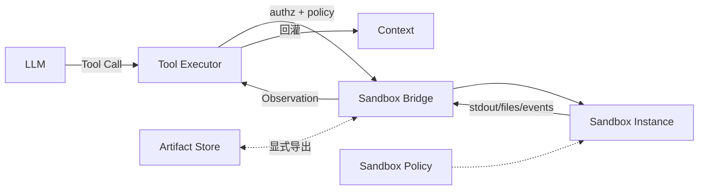

# Sandbox（Canonical）

> **一句话主题**：Sandbox 是 Agent **工具副作用的隔离执行平面**——用文件系统、网络、进程与权限边界，把不可信/半可信动作关进可回收、可审计、可预算的环境。
>
> **状态**：Canonical · **Last reviewed**: 2026-10  
> **受众**：实现 Tool Executor / Coding Agent 运行时 / 平台隔离层的工程师  
> **硬前置**：[Tool Use](../../core/tool-use/tool-use.md)  
> **软前置**：[Agent Loop](../../core/agent-loop/agent-loop.md)；后续与 Coding Agent、Security 交叉

---

## 范围 / 非目标

**范围**：Sandbox 定义与动机；隔离维度（文件系统 / 网络 / 进程 / 权限）；生命周期与快照；与 Tool Use / Agent Loop 的衔接契约；容器与微 VM 的工程直觉与选型；失败模式与观测信号；与 Security 的职责切分（本文只写机制挂钩）；实践建议与面试。

**非目标**：

| 主题 | 去哪里 |
|------|--------|
| 完整威胁模型、攻击者画像、资产清单 | [Security](../../production/security/security.md) |
| Prompt / Tool Injection 防护深文 | [Security](../../production/security/security.md) |
| 工具 schema、选择、结果回灌机制 | [Tool Use](../../core/tool-use/tool-use.md) |
| 控制回路、终止、checkpoint | [Agent Loop](../../core/agent-loop/agent-loop.md) |
| Coding 业务闭环（读改测修） | [Coding Agent](../../agent-types/coding-agent/coding-agent.md) |
| MCP 协议与生态目录 | [`protocols/mcp`](../../protocols/mcp/README.md) |
| 某厂商沙箱产品运维手册全文 | 厂商文档（本文只抽象机制） |

**立场**：Sandbox **不替代**鉴权与产品策略；它回答「允许执行时，副作用落在哪里、能走多远」。鉴权拒绝发生在 Executor **之前**；注入与社会工程治理在 Security。

---

## 1. 知识模型：什么是 Sandbox

### 1.1 定义

**Sandbox（沙箱）** 是一层 **受策略约束的执行环境**，用于运行 Agent 发起的工具副作用（代码、命令、浏览器动作、文件读写等），并保证：

1. **隔离（Isolation）**：默认不能触达宿主敏感资源与其它租户。  
2. **可约束（Policy）**：文件系统、网络、进程能力、资源额度可声明、可执行。  
3. **可回收（Lifecycle）**：创建、使用、冻结、销毁；状态可丢弃或显式导出。  
4. **可观测（Observability）**：谁、在什么策略下、做了什么、耗时/失败码可审计。

没有「策略边界 + 执行面」，只是「在服务器上跑了一下命令」，**不算**本手册意义下的 Sandbox。

### 1.2 Mental Model

把 Sandbox 想成 **副作用的囚笼 + 预算仪表盘**：

| 组件 | 角色 |
|------|------|
| **Harness / Control Plane** | Agent Loop、鉴权、工具路由、策略决策（在沙箱外） |
| **Sandbox / Data Plane** | 实际跑命令、读写文件、发包的地方 |
| **Policy** | 允许的挂载、出站、能力位、CPU/内存/时间 |
| **Bridge** | 把 Tool Call 参数送入沙箱、把 Observation 安全带出 |
| **Artifact Store** | 需要保留的产物（日志摘要、diff、构建物）在沙箱外持久化 |

OpenAI 将 **harness（控制面）** 与 **sandbox execution plane（执行面）** 拆开：前者拥有 loop / 工具路由，后者拥有文件系统、shell、端口与隔离实现（见 [doc-openai-sandbox-agents](../../references/docs.md#doc-openai-sandbox-agents)）。本手册采用同一切分。



### 1.3 为什么 Agent 特别需要 Sandbox

| 现实 | 工程含义 |
|------|----------|
| 模型生成的参数/代码不可信 | 不能在宿主进程直接 `eval` / 裸 `shell` |
| 工具可产生真实副作用 | 需要默认拒绝与显式放行 |
| Loop 会多步、反复试错 | 需要廉价重置与污染隔离 |
| 多租户 / 多会话并发 | 需要租户级与会话级边界 |
| Observation 会回灌模型 | 输出必须裁剪、脱敏、带错误码 |

**问题被解决的本质**：把「模型擅长的意图生成」与「系统必须兜底的副作用边界」解耦——与 Tool Use 的 RPC 模型一致，Sandbox 是 RPC **服务端的隔离宿主**（见 [tool-use.md](../../core/tool-use/tool-use.md)）。

### 1.4 Sandbox vs 相关概念

| 概念 | 是什么 | 不是什么 |
|------|--------|----------|
| **Sandbox** | 隔离执行平面 + 策略 | 鉴权本身；也不是威胁模型全文 |
| **Container** | 常见实现手段之一 | Sandbox 的唯一形态 |
| **微 VM / gVisor 类** | 更强内核隔离手段 | 自动等于「产品安全完备」 |
| **权限 / AuthZ** | 「这次调用允不允许」 | 「允许后副作用落点」 |
| **HITL 确认门** | 人审高危意图 | 替代隔离（二者互补） |
| **Workspace 挂载** | 把工作目录映射进沙箱 | 把宿主家目录裸露给 Agent |

### 1.5 何时必须上 / 何时可弱化

**必须（或极强建议）Sandbox**：

- 任意代码执行、shell、包安装  
- 读写用户仓库以外的敏感路径风险  
- 多租户共享算力  
- 浏览器 / Computer Use 类高副作用工具  

**可弱化（仍建议资源限额 + 审计）**：

- 纯只读、无网络的内部查询，且 Executor 在可信服务内完成  
- 已由下游系统（托管 DB / 受控 API）自身强约束的调用  

**反模式**：用「本地开发方便」当生产默认——开发机信任模型 ≠ 生产多租户信任模型。

---

## 2. 隔离维度

Sandbox 的强度由 **多个正交维度** 叠加，而不是一个布尔开关。

### 2.1 文件系统隔离

**目标**：控制可见路径、写范围、秘密文件可达性、跨会话污染。

| 机制 | 含义 | Agent 场景 |
|------|------|------------|
| 独立根 / chroot / 容器层 | 默认看不见宿主 FS | 代码执行默认态 |
| 只读系统层 + 可写工作区 | 镜像不可污染，工作区可重置 | 重复任务 |
| 显式挂载（bind / volume） | 按需映射 repo / 数据 | Coding Agent 工作区 |
| 秘密排除 | 不挂载 `.env`、kubeconfig、SSH key | 防泄漏 |
| 配额与 inode | 防写爆盘 | 构建/日志洪水 |
| 产物导出白名单 | 只有声明路径可拷出 | 防整盘拖出 |

**工程直觉**：

- **默认：最小可见**。需要 repo 就挂 `workspace/`，不要挂 `/`。  
- **读写分离**：工具可声明 `fs:read` vs `fs:write`；写路径再收窄到 `workspace/` 或 `tmp/`。  
- **会话污染**：上一步安装的包、改坏的文件会影响下一步——生命周期策略要明确（见 §4）。  
- **符号链接**：策略检查应跟真实路径（realpath），防止 `workspace/evil -> /etc`。  
- **设备节点**：默认不要暴露裸块设备或 `docker.sock`。

**挂载模式示例**：

```text
/          ← 只读镜像层（OS + 工具链）
/tmp       ← tmpfs，限额，销毁即没
/workspace ← bind：任务工作区（rw 或 ro 按工具）
/cache     ← 可选：只读共享包缓存
```

### 2.2 网络隔离

**目标**：控制出站（exfiltration / SSRF / 供应链拉取）与入站（预览端口暴露面）。

| 策略档位 | 行为 | 适用 |
|----------|------|------|
| **Deny-all** | 无任何网络 | 纯本地算、单测、解释器 |
| **Allowlist egress** | 仅许可域名/CIDR/端口 | 装包 registry、特定 API |
| **Authenticated proxy** | 出站经代理审计与改写 | 企业环境 |
| **No host network** | 禁止共享宿主网络命名空间 | 容器默认 |
| **Controlled ingress** | 仅映射需要的 preview 端口 | 本地服务预览 |

**工程直觉**：

- Agent「需要上网装依赖」≠「需要对整个公网任意出站」。  
- DNS、ICMP、IPv6、云实例 metadata IP 常被漏管——策略要当成一等公民。  
- 网络放行应 **按工具/任务类型** 配置，而不是全局永久开放。  
- 预览端口映射要短 TTL，并绑定到 run 所有者。

> 数据外泄的威胁分析正文在 Security；此处机制要求是：**出站默认关、放行可审计、拒绝可映射为 Observation**。

**网络 Profile 示例**：

```yaml
network_profiles:
  deny-all: { egress: [] }
  allowlist-npm:
    egress:
      - { host: registry.npmjs.org, ports: [443] }
      - { host: registry.yarnpkg.com, ports: [443] }
  allowlist-pypi:
    egress:
      - { host: pypi.org, ports: [443] }
      - { host: files.pythonhosted.org, ports: [443] }
```

### 2.3 进程与运行时隔离

**目标**：限制能力位、进程树、内核攻击面、跨租户爆破。

常见层次（由弱到强，简化）：

```text
同进程内「假沙箱」（语言级限制）
  → 进程 jail（子进程 + 丢权限 / chroot / rlimit）
  → 容器（namespace + cgroup + seccomp）
  → 用户态内核 / gVisor 类
  → 微 VM（独立 guest kernel）
```
强度与成本大致递增；选型见 §6。

| 控制点 | 作用 |
|--------|------|
| namespaces（pid/mnt/net/uts/ipc/user） | 看见的世界不同 |
| cgroups | CPU/内存/IO/pids 限额 |
| seccomp / syscall 过滤 | 砍危险系统调用 |
| capabilities 丢弃 | 去 `SYS_ADMIN` 等 |
| no-new-privileges / 非 root | 降低提权面 |
| 只读 rootfs + tmpfs | 减小持久化攻击面 |

**工程直觉**：语言级 sandbox（部分内置限制）**不够**对抗恶意原生代码与逃逸链；生产 Agent 的代码执行应至少到 **容器级**，高危多租户考虑 **gVisor / 微 VM**。强度与冷启动、密度、成本成反比（见 §6）。

**资源限额最低集**：

| 资源 | 为何必须 |
|------|----------|
| `timeout_ms` | 防死循环拖垮槽位 |
| `memory` | 防 OOM 邻居 |
| `cpu` / CFS quota | 防算力挤占 |
| `pids` | 防 fork 炸弹 |
| `disk` / inode | 防写满节点 |

### 2.4 权限与能力隔离（Policy 面）

Sandbox 内的「能跑」仍要叠一层 **产品权限**：

| 层 | 问题 | 典型落点 |
|----|------|----------|
| **AuthZ** | 此用户/租户能否调此工具？ | Tool Executor（沙箱外） |
| **Sandbox Policy** | 此实例挂哪些盘、能否出网、时限？ | Sandbox Manager |
| **OS Capability** | 进程是否有 root / 原始套接字？ | 运行时配置 |
| **HITL** | 破坏性动作是否需人确认？ | Loop / 产品策略 |

四层任一缺失都会出现「进了沙箱但仍越权」或「鉴权过了但副作用无笼」。Tool Use 已要求高危工具经沙箱策略执行（见 [tool-use.md §7](../../core/tool-use/tool-use.md)）；本文把策略对象钉死。

### 2.5 隔离维度检查表（发布前）

- [ ] FS：可见路径列表 + 写范围 + 秘密排除 + symlink 真实路径检查  
- [ ] Net：默认拒绝 + 显式 allowlist + metadata 防护  
- [ ] Proc：非特权 + seccomp/cgroup + 超时杀进程树  
- [ ] Policy：按工具/租户/任务模板版本化  
- [ ] Obs：sandbox_id、policy_id、拒绝原因可查询  
- [ ] Export：白名单路径；禁 docker.sock  

---

## 3. 与 Tool Use / Agent Loop 的衔接

### 3.1 在调用链中的位置

```text
LLM → Tool Call
     → AuthZ（允不允许）
     → Policy Resolve（用哪套沙箱策略）
     → Acquire / Create Sandbox
     → Execute（在沙箱内）
     → Collect Observation（裁剪/脱敏/错误码）
     → Release / Reuse / Destroy
     → 回灌 Context → 下一跳 Loop
```

Sandbox **不负责**选工具、不负责拼 schema；它只消费已授权的执行请求。细节契约见 [Tool Use](../../core/tool-use/tool-use.md)；Loop 预算与终止见 [Agent Loop](../../core/agent-loop/agent-loop.md)。

### 3.2 Bridge 契约（最小字段）

一次沙箱执行请求建议包含：

| 字段 | 含义 |
|------|------|
| `tool_call_id` / `run_id` / `step_id` | 关联轨迹 |
| `command` 或 `entrypoint` + `args` | 实际动作 |
| `workspace_ref` | 挂载哪份工作区 |
| `policy_id` / `policy_hash` | 策略版本可审计 |
| `timeout_ms` / `cpu` / `memory` | 资源预算 |
| `network_profile` | deny / allowlist 名 |
| `env_allowlist` | 显式注入的环境变量（禁秘密直灌除非密钥代理） |

返回至少：

| 字段 | 含义 |
|------|------|
| `exit_code` / `status` | 成功、超时、策略拒绝、OOM… |
| `stdout_digest` / `stderr_digest` | 裁剪后的文本或句柄 |
| `artifacts[]` | 允许导出的文件句柄 |
| `sandbox_id` / `duration_ms` | 观测与计费 |
| `policy_denial_reason?` | 映射给模型的可理解错误 |

### 3.3 Observation 规则（防上下文爆炸）

- **截断**：stdout/stderr 设硬上限；超限写句柄到 Artifact Store。  
- **结构化**：优先 `status + summary + paths`，避免整段二进制/巨型日志。  
- **不可信标记**：工具输出在 Context 中应按 untrusted 处理（注入深文见 Security；此处要求 Bridge **不**把原始输出当系统指令拼接）。  
- **策略拒绝 ≠ 模型故障**：用稳定错误码，让 Loop 决定重试、换工具或 HITL。

推荐状态枚举（示例）：

```text
ok | timeout | oom | policy_denied | infra_error | cancelled | nonzero_exit
```

### 3.4 哪些工具必须进沙箱

| 工具形态 | Sandbox 要求 |
|----------|--------------|
| `code_exec` / REPL | 强制；网络默认关 |
| `shell` / `bash` | 强制；命令允许列表或高危 HITL |
| `fs.write` / `apply_patch` | 工作区级隔离；秘密路径拒绝 |
| `browser` / computer-use | 独立配置文件 + 网络策略；链 browser 模块 |
| 托管 API 封装（只读） | 可不进重沙箱，但仍要 AuthZ + 超时 |
| MCP 远程工具 | 信任边界在远端；本地侧做出站与凭证隔离（协议细节见 MCP） |

### 3.5 伪代码：Executor × Sandbox

```python
def execute_tool(call, ctx):
    tool = registry.get(call.name)
    authz.require(ctx.principal, tool, call.args)  # 沙箱外

    policy = policy_resolver.resolve(tool, ctx)    # 租户/任务模板
    sb = sandbox_pool.acquire(policy, workspace=ctx.workspace)

    try:
        raw = sb.run(
            entry=tool.to_entrypoint(call.args),
            timeout_ms=policy.timeout_ms,
            network=policy.network_profile,
        )
        obs = normalize_observation(raw, max_bytes=policy.max_obs_bytes)
        metrics.record(call, sb, obs)
        return obs
    except PolicyDenied as e:
        return Observation.denied(str(e))
    except Timeout:
        sb.kill_tree()
        return Observation.timeout()
    finally:
        sandbox_pool.release(sb, mode=policy.lifecycle)  # reuse | destroy
```

---

## 4. 生命周期

### 4.1 状态机

```text
Requested → Provisioning → Ready → Running → (Idle) → Snapshotting?
         ↘ Failed
Ready/Idle → Destroyed
Running → TimedOut / OOMKilled → Destroyed 或 诊断快照后 Destroyed
```

| 状态 | 含义 |
|------|------|
| Provisioning | 拉镜像、建网、挂载、注入策略 |
| Ready | 可接受执行，尚未跑或空闲可复用 |
| Running | 有活跃进程 |
| Idle | 会话级复用中的空闲窗 |
| Snapshotting | 固化文件系统/内存以便恢复 |
| Destroyed | 资源释放；默认不可恢复 |

### 4.2 三种常见生命周期策略

| 策略 | 行为 | 优点 | 代价 |
|------|------|------|------|
| **Ephemeral per call** | 每次工具调用新建/销毁 | 污染面最小 | 冷启动延迟高 |
| **Session sticky** | 同一 Agent run 复用一个沙箱 | 装依赖、中间文件可留 | 需防污染与串扰 |
| **Snapshot / resume** | 关键点落快照，稍后恢复 | 长任务/预览友好 | 存储与一致性复杂 |

托管 Code Interpreter 类产品常把容器视为 **短生命周期**：OpenAI 现行文档为闲置约 **20 分钟**过期且关联数据不可恢复，内存档 `1g`（默认）/`4g`/`16g`/`64g`；重要产物须主动导出（见 [doc-openai-code-interpreter](../../references/docs.md#doc-openai-code-interpreter)，Evergreen 2026-10-07）。自建时应用同一心态：**默认可丢，显式才留**。

### 4.3 工作区与快照

- **Workspace**：用户/任务的权威文件树（常在沙箱外对象存储或宿主卷），沙箱内是挂载视图。  
- **Scratch**：沙箱内临时层，销毁即没。  
- **Snapshot**：某时刻 FS（有时含进程）镜像，用于 resume 或 fork 分支试错。  
- **Export**：仅白名单路径写回 Artifact Store / Workspace。

Coding Agent 典型模式：Workspace = git worktree；Scratch = `node_modules`/build；失败则丢 Scratch，保留 Workspace 上的受控 diff。

**快照一致性注意**：

- 外部副作用（已推送的 git、已发送的 webhook）**不能**靠快照回滚。  
- 密钥应在 resume 时 **重注入**，不要把长效密钥冻进快照。  
- 镜像版本变更后，旧快照可能不兼容——需版本钉扎。

### 4.4 并发与租户

- **一租户一池** 或强隔离队列，避免 noisy neighbor。  
- **一 run 一沙箱** 是安全默认；同租户复用需重置可写层。  
- **密钥**：短时注入或经 sidecar 代理，避免写进可导出层。

### 4.5 超时、取消与杀树

- 硬超时后必须 **杀进程树**（含孙子进程），回收 cgroup。  
- Loop 取消应传播到 Bridge（协作式 cancel + 最终 SIGKILL）。  
- 超时 Observation 应区分「用户代码慢」与「基础设施排队」。  
- 取消后计费/槽位应在 SLA 内释放。

---

## 5. 策略对象（Policy as Code）

### 5.1 建议字段

```yaml
policy_id: coding-agent-default@v3
isolation:
  runtime: container  # container | gvisor | microvm
filesystem:
  mounts:
    - path: /workspace
      source: workspace_ref
      mode: rw
  deny_globs: ["**/.env", "**/*.pem", "**/id_rsa"]
network:
  profile: deny-all   # 或 allowlist-npm
resources:
  timeout_ms: 120000
  cpu: "1"
  memory_mb: 2048
  pids: 256
  max_obs_bytes: 64_000
capabilities:
  drop_all: true
  add: []             # 默认空
lifecycle:
  mode: session_sticky
  idle_ttl_ms: 1200000
export:
  allow_paths: ["/workspace"]
```

### 5.2 版本化与审计

- 每次执行记录 `policy_hash`。  
- 变更走评审：放宽网络/挂载 = 安全变更。  
- 租户可覆盖子集，但不可突破平台上限（ceiling）。  
- 回滚应能一键切回上一 `policy_id`。

### 5.3 模板分层

| 模板 | 典型用途 |
|------|----------|
| `deny-net-ephemeral` | 数学/数据分析/单测 |
| `allowlist-pkg` | 需要 npm/pypi 的构建 |
| `repo-rw-session` | Coding Agent 会话 |
| `browser-isolated` | 浏览器工具专用配置 |

避免「一个超级策略打天下」。

---

## 6. 容器 / 微 VM：工程直觉

本节给选型直觉，不是某编排器教程。

### 6.1 对比轴

| 维度 | 进程 jail | 普通容器 | gVisor 类 | 微 VM |
|------|-----------|----------|-----------|-------|
| 隔离强度 | 低–中 | 中（共享宿主内核） | 较高（用户态内核拦 syscall） | 高（独立 guest kernel） |
| 密度 / 成本 | 最高 / 最便宜 | 高密度、便宜 | 中 | 较低密度、更贵 |
| 冷启动 | 极快 | 可很快（复用镜像） | 中 | 通常更慢（可优化） |
| 兼容性 | 好（近原生） | 最好 | 部分 syscall 不兼容 | 较好但栈更重 |
| 运维复杂度 | 低 | 低–中 | 中 | 高 |
| 适用直觉 | 可信内网弱隔离 | 多数 Coding / 解释器 | 多租户不可信代码 | 高威胁 / 强合规 |

### 6.2 选型启发式

1. **单租户内网、可信员工 Coding Agent**：加固容器 + 强 FS/Net 策略往往够用。  
2. **多租户执行不可信代码**：倾向 gVisor / 微 VM，并默认断网。  
3. **极致启动延迟（IDE 内联）**：预热池 + 会话 sticky；不要每次冷启微 VM 除非必要。  
4. **兼容性事故多**（奇异构建系统）：先在容器验证，再决定是否上更强运行时。  
5. **风险分级调度**：同一平台可按工具危险度选择 L1/L2/L3，而不是全局一刀切。

### 6.3 镜像与供应链（机制层）

- 使用 **最小、钉扎 digest** 的基础镜像。  
- 禁止沙箱内「任意 `curl | sh`」作为平台默认能力。  
- 包安装若放开，应走 allowlist registry + 缓存代理。  
- 构建镜像流水线：扫描 → 签名 → 准入。

供应链威胁模型正文在 Security；Sandbox 侧机制是：**只跑可信镜像、可写层可丢、出站受限**。

### 6.4 预热池与调度

```text
Pool[policy_class] → Ready instances
Acquire: 匹配 policy_hash + 资源 → 绑定 run_id
Release: 擦除可写层 或 销毁 → 回池 / 丢弃
Scale: 按排队延迟与拒绝率扩缩
```

关键指标：排队时间、冷启动比率、逃逸/拒绝误报、每租户并发上限命中率、销毁残留率。

### 6.5 本地开发 vs 生产

本地可接受轻量容器以便 DX，但 **禁止**把 `network=host` / 挂载 `$HOME` 的语义带进生产。产品应提供 **同一 Policy 接口** 的 local/prod 适配，而不是两套语义。

---

## 7. 失败模式

| 失败模式 | 症状 | 检测信号 | 缓解 |
|----------|------|----------|------|
| **策略过宽** | 可读秘密/任意出站 | 挂载与 egress 审计 | 收紧默认；秘密排除测试 |
| **策略过窄** | 合法任务全失败 | denial 率飙升 | 分模板；可解释错误码 |
| **会话污染** | 前序改动破坏后序 | 非确定性失败 | ephemeral / 重置可写层 |
| **冷启动雪崩** | 尖峰超时 | provision latency | 预热池、降级只读工具 |
| **僵尸进程 / 取消失效** | 槽位泄漏、仍计费 | pids、取消后耗时 | 杀树 + cancel token |
| **Observation 爆炸** | 上下文被日志淹没 | obs bytes | 截断 + 句柄 |
| **导出 / docker.sock** | 密钥拖出或逃逸到宿主 | export/配置扫描 | 白名单；ceiling 禁止 |
| **误判「有沙箱=安全」** | 跳过 AuthZ/HITL | 架构评审 | 四层权限模型（§2.4） |

### 7.1 残余风险（只列机制边界）

Sandbox **降低**但不消灭：

- 未知逃逸链（依赖运行时补丁）  
- 通过 **允许的出站** 做数据外带  
- 通过 **允许的写路径** 破坏工作区  
- 社会工程让用户批准危险 HITL  

这些进入 Security 的威胁模型与红队范围；Sandbox 模块负责把机制旋钮做齐、默认安全。

---

## 8. 与 Security 的边界

| 问题 | Sandbox（本文） | Security |
|------|-----------------|----------|
| 文件系统如何挂载？ | ✅ | 引用 |
| 出站如何默认拒绝？ | ✅ | 引用 |
| 攻击者如何用间接注入诱骗外传？ | 挂钩（拒绝/审计） | ✅ 正文 |
| 工具权限模型与确认门产品策略 | 执行侧落实 | ✅ 模型与案例 |
| 供应链投毒如何进镜像？ | 钉扎/最小镜像机制 | ✅ 治理 |
| 逃逸 CVE 响应流程 | 运行时升级挂钩 | ✅ 运营 |

**一句话**：Sandbox = **机制与默认值**；Security = **威胁、滥用案例与治理**。禁止在两边各维护一份互相漂移的「安全百科」。

本文 **故意不写**：完整攻击者画像、注入分类长文、红队剧本细节——见 [security.md](../../production/security/security.md)。

---

## 9. 生产设计要点

### 9.1 控制面组件

| 组件 | 职责 |
|------|------|
| Policy Service | 模板、租户覆盖、ceiling |
| Sandbox Manager | 生命周期、池化、调度 |
| Bridge / Executor Adapter | Tool Call ↔ 沙箱协议 |
| Artifact Store | 产物与大日志句柄 |
| Audit Log | 不可抵赖的执行记录 |
| Metrics / Traces | 延迟、拒绝、资源 |

与基础设施编排的关系见 [Infrastructure](../../production/infrastructure/infrastructure.md)（容量/节点），本文不展开集群安装。

### 9.2 可靠性

- 执行重试要小心：**非幂等副作用**（发邮件、推 git）不得盲目重跑。  
- 基础设施错误（拉镜像失败）与用户代码错误分码。  
- 区域故障时：失败快速 + Loop 可降级到无代码工具。  
- 禁止静默降级到「宿主直接执行」。

### 9.3 成本

成本驱动因子：实例时长、内存档位、磁盘、出站、快照存储、冷启动浪费。  
产品上对 Code Interpreter 类能力按内存档位计费是常见模式（见 [doc-openai-code-interpreter](../../references/docs.md#doc-openai-code-interpreter)）；自建应对齐 **可见的预算信号** 给 Loop（超时、并发槽）。

### 9.4 DX 权衡（Coding Agent）

秒级反馈与强隔离冷启动冲突 → 预热池 + session sticky；真实构建网络与出站风险冲突 → 缓存代理 + allowlist；整仓挂载与秘密/性能冲突 → 子目录 / sparse。深文业务闭环见 [Coding Agent](../../agent-types/coding-agent/coding-agent.md)。

### 9.5 评测（机制向）

- **拒绝正确性**：秘密路径、metadata IP、危险 syscall 必须拒绝。  
- **任务可达性**：常用构建/测试在对应模板下能完成。  
- **重置有效性**：污染后 ephemeral/重置可恢复基线。  
- **取消时效**：cancel 后进程与计费停止的 SLA。  
- **Observation 合同**：超长输出被截断且不炸 Loop。  
- **导出合同**：白名单外路径不可导出。

红队与注入场景库归 Security；此处保证隔离旋钮可测。

---

## 10. 实践建议（可执行）

1. **默认断网 + 最小挂载 + 非特权 + 硬超时**，再按模板放行。  
2. **AuthZ 在沙箱外**；沙箱内永不信任「模型说自己有权」。  
3. **Policy 版本化**；放宽变更当安全变更评审。  
4. **产物显式导出**；勿假设实例永存。  
5. **错误码稳定**，让 Loop/模型可恢复，而非只抛宿主异常栈。  
6. **本地与生产同一 Policy schema**，适配器不同。  
7. **先度量 denial 与 cold start**，再谈「体验不够就关掉隔离」。  
8. 与 [Tool Use](../../core/tool-use/tool-use.md) 对齐：高危工具强制 `sandbox.run`。  
9. 与 Coding Agent 对齐：工作区权威在 git/workspace，不在可丢弃层。  
10. 与 Security 对齐：机制旋钮齐了再写威胁故事，避免重复正文。  
11. **禁止**生产策略出现 `network=host`、挂载 `$HOME`/`docker.sock`；release 跑 §2.5 + §9.5。

---

## 11. Interview Questions

### Beginner

**Q1. 什么是 Agent 语境下的 Sandbox？**  
- **短答**：受策略约束的工具副作用隔离执行平面。  
- **常见错误**：把鉴权当沙箱。  
- **相关**：§1。

**Q2. Sandbox 和 Tool Use 谁先谁后？**  
- **短答**：先 AuthZ/选工具，再进沙箱执行。  
- **常见错误**：先跑再鉴权。  
- **相关**：§3、Tool Use。

**Q3. 为什么模型生成的代码不能直接在宿主跑？**  
- **短答**：参数不可信，副作用真实。  
- **常见错误**：「内网就没事」。  
- **相关**：§1.3。

**Q4. 文件系统隔离要控制什么？**  
- **短答**：可见性、写范围、秘密、配额、导出。  
- **常见错误**：挂载整个 `$HOME`。  
- **相关**：§2.1。

**Q5. 网络默认策略应是什么？**  
- **短答**：Deny-all，按需 allowlist。  
- **常见错误**：`network=host`。  
- **相关**：§2.2。

**Q6. 进程隔离常见手段？**  
- **短答**：namespace、cgroup、seccomp、丢 capability。  
- **常见错误**：只靠 `timeout`。  
- **相关**：§2.3。

**Q7. Ephemeral 生命周期是什么？**  
- **短答**：用完即毁，状态默认可丢。  
- **常见错误**：假设容器永存。  
- **相关**：§4。

**Q8. Workspace 和 Scratch 区别？**  
- **短答**：Workspace 权威可持久；Scratch 可丢。  
- **常见错误**：重要结果只留 Scratch。  
- **相关**：§4.3。

**Q9. Sandbox 能替代 HITL 吗？**  
- **短答**：不能；互补。  
- **常见错误**：有容器就免确认。  
- **相关**：§2.4、§8。

**Q10. Observation 为何要截断？**  
- **短答**：防上下文爆炸与泄密。  
- **常见错误**：整份构建日志回灌。  
- **相关**：§3.3。

### Intermediate

**Q11. 设计 Bridge 的最小请求/响应字段。**  
- **短答**：见 §3.2；必含 policy、超时、裁剪后输出。  
- **常见错误**：只返回 stdout 字符串。  
- **相关**：§3。

**Q12. 会话复用如何防污染？**  
- **短答**：重置可写层或按任务 fork；关键路径 ephemeral。  
- **常见错误**：无限期 sticky 无擦除。  
- **相关**：§4.2。

**Q13. allowlist 出站仍可能怎样出事？**  
- **短答**：经许可通道外带数据；供应链包恶意。  
- **常见错误**：allowlist `*`。  
- **相关**：§2.2、§7。

**Q14. 超时后如何保证真停？**  
- **短答**：杀进程树 + 回收 cgroup + 取消传播。  
- **常见错误**：只杀父进程。  
- **相关**：§4.5。

**Q15. Policy as Code 为什么要 hash？**  
- **短答**：审计「当时用的哪套边界」。  
- **常见错误**：只记「production」。  
- **相关**：§5。

**Q16. 容器与微 VM 怎么选？**  
- **短答**：按威胁/密度/冷启动；多租户不可信代码偏微 VM/gVisor。  
- **常见错误**：无差别一刀切。  
- **相关**：§6。

**Q17. 预热池的关键指标？**  
- **短答**：排队、冷启动比、拒绝率、租户并发上限。  
- **常见错误**：一个全局池混策略。  
- **相关**：§6.4。

**Q18. 秘密如何进执行环境？**  
- **短答**：短时注入或代理；不进可导出层；不挂密钥文件。  
- **常见错误**：把 `.env` bind mount。  
- **相关**：§2.1、§4.4。

**Q19. 策略拒绝应返回什么给模型？**  
- **短答**：稳定 denial code + 可操作说明，非宿主栈。  
- **常见错误**：返回完整策略 YAML。  
- **相关**：§3.3、§7。

**Q20. 本地 DX 与生产隔离如何统一？**  
- **短答**：同一 Policy schema，不同 runtime adapter。  
- **常见错误**：两套互不相干配置。  
- **相关**：§6.5、§10。

### Advanced

**Q21. 设计多租户代码执行池。**  
- **短答**：租户配额、强隔离运行时、deny-net 默认、审计分区、预热分档。  
- **常见错误**：共享可写缓存无隔离。  
- **相关**：§4.4、§6。

**Q22. Snapshot/resume 的一致性坑？**  
- **短答**：网络句柄、时间、密钥过期、外部副作用不可快照。  
- **常见错误**：当完整时间旅行。  
- **相关**：§4.2–4.3。

**Q23. 如何测试「秘密不可见」？**  
- **短答**：红线用例：列目录/读路径应失败；CI 固化。  
- **常见错误**：只测 helloworld。  
- **相关**：§9.5。

**Q24. Observation 句柄与安全下载？**  
- **短答**：鉴权 URL、短 TTL、可选扫描、审计。  
- **常见错误**：公共 bucket 开放。  
- **相关**：§3.3。

**Q25. 取消令牌跨异步队列如何设计？**  
- **短答**：run_id 绑定；worker 轮询/订阅 cancel；最终杀树。  
- **常见错误**：只取消前端动画。  
- **相关**：§4.5。

**Q26. 包缓存与隔离的张力？**  
- **短答**：只读共享缓存 + per-session 可写层；校验完整性。  
- **常见错误**：共用可写 npm cache。  
- **相关**：§6.3。

**Q27. Browser 工具的沙箱差异？**  
- **短答**：独立配置目录、独立网络策略、下载目录收窄。  
- **常见错误**：同一容器又跑浏览器又跑任意 shell 无分区。  
- **相关**：§3.4。

**Q28. 如何防止「有沙箱仍宿主导出」？**  
- **短答**：导出白名单、Bridge 拷贝、禁 docker.sock 挂载。  
- **常见错误**：挂载 docker.sock「图方便」。  
- **相关**：§2.1、§7。

**Q29. 资源限额被打满时的产品行为？**  
- **短答**：快速失败 Observation + 退避；勿拖死节点。  
- **常见错误**：无限排队。  
- **相关**：§7、§9。

**Q30. 将 Sandbox 指标接入 Loop 预算。**  
- **短答**：剩余并发槽、平均耗时、denial 计入 step 预算。  
- **常见错误**：Loop 不感知沙箱排队。  
- **相关**：§3、Agent Loop。

### Expert

**Q31. 形式化「默认安全」不变量。**  
- **短答**：无网、非特权、最小挂载、硬超时、导出白名单、policy_hash 必录。  
- **常见错误**：文档写了代码未强制。  
- **相关**：§2.5、§5。

**Q32. 逃逸缓解的分层（机制）。**  
- **短答**：减攻击面 + 强运行时 + 快速补丁 + 爆炸半径限制（租户/网络）。  
- **常见错误**：单靠一种运行时。  
- **相关**：§6、§7.1。

**Q33. 多区域故障下的降级。**  
- **短答**：只读工具继续；代码执行排队或区域切换；明确用户可见降级。  
- **常见错误**：降级=裸跑。  
- **相关**：§9.2。

**Q34. 审计日志最小完备集。**  
- **短答**：who/when/run/tool/policy_hash/sandbox_id/denial/egress summary。  
- **常见错误**：只记成功。  
- **相关**：§9.1。

**Q35. 微 VM 密度不够时如何演进？**  
- **短答**：按风险分级：高危微 VM，低危加固容器；任务分流。  
- **常见错误**：全量微 VM 拖垮成本。  
- **相关**：§6.2。

**Q36. 与 MCP 远程工具的信任边界。**  
- **短答**：远程执行面不在你进程内；本地控凭证与出站；策略声明「副作用在远端」。  
- **常见错误**：以为接了 MCP 就自带沙箱。  
- **相关**：§3.4、MCP README。

**Q37. 设计「策略放宽」的变更管控。**  
- **短答**：PR + 安全评审 + 金丝雀 + 可回滚；度量 denial/滥用。  
- **常见错误**：聊天里改生产策略。  
- **相关**：§5.2。

**Q38. Coding Agent 挂载 monorepo 的安全/性能折中。**  
- **短答**：子目录、忽略秘密 glob、sparse、只读先分析再开写。  
- **常见错误**：整仓 rw + 全网。  
- **相关**：§9.4。

**Q39. 如何避免把威胁模型写进 Sandbox 文？**  
- **短答**：本文停在机制与挂钩；案例与攻击者模型链 Security。  
- **常见错误**：两边各写注入长文。  
- **相关**：§8。

**Q40. 开源「Agent sandbox」模块 audit 清单。**  
- **短答**：四维隔离、生命周期、Bridge 合同、政策版本、取消杀树、导出白名单、测试。  
- **常见错误**：README 写 secure 无策略对象。  
- **相关**：§2.5、§10。

### System Design

**Q41. 设计 SaaS 数据分析 Agent 的代码执行沙箱。**  
- **短答**：ephemeral、deny-net、内存档位、产物导出、闲置 TTL、按秒计费信号。  
- **常见错误**：长驻可写全家桶。  
- **相关**：§4、§9、doc-openai-code-interpreter。

**Q42. 设计企业 Coding Agent 平台隔离。**  
- **短答**：session sticky + 加固容器/gVisor、repo 子树挂载、registry 代理 allowlist、HITL 推远程、全审计。  
- **常见错误**：开发者笔记本策略当生产。  
- **相关**：§6、§9.4。

**Q43. 设计可 resume 的长任务执行面。**  
- **短答**：快照 FS、外部副作用日志、密钥重注入、网络策略再施加。  
- **常见错误**：内存快照当万能。  
- **相关**：§4.2、doc-openai-sandbox-agents。

**Q44. 设计 Browser + Shell 双平面。**  
- **短答**：两策略两实例；共享仅限显式 artifact；分别网络档位。  
- **常见错误**：同一特权容器全能。  
- **相关**：§3.4、Q27。

**Q45. 从「Docker 包一层」演进到生产沙箱的里程碑。**  
- **短答**：P0 默认断网/超时/非特权 → P1 Policy 版本与审计 → P2 池化与模板 → P3 强运行时分级 → P4 评测/红线用例与 Security 对表。  
- **常见错误**：直接上微 VM 却仍挂载 docker.sock。  
- **相关**：§10、§8。

---

## 12. Cross References

- [Tool Use](../../core/tool-use/tool-use.md) · [Agent Loop](../../core/agent-loop/agent-loop.md)  
- [Agent Architecture](../../core/agent-architecture/agent-architecture.md) · [Context Engineering](../../core/context-engineering/context-engineering.md)  
- [Security](../../production/security/security.md) · [Observability](../../production/observability/README.md) · [Evaluation](../../production/evaluation/README.md)  
- [Infrastructure](../../production/infrastructure/infrastructure.md)  
- [Coding Agent](../../agent-types/coding-agent/coding-agent.md) · [Browser / Computer Use](../../agent-types/browser-computer-use/README.md)  
- [MCP](../../protocols/mcp/README.md) · [runtime/](../README.md)

---

## 13. References

- [doc-openai-sandbox-agents](../../references/docs.md#doc-openai-sandbox-agents) — harness vs execution plane；快照/端口/隔离直觉  
- [doc-openai-code-interpreter](../../references/docs.md#doc-openai-code-interpreter) — 沙箱容器、闲置过期、产物导出、资源档位  
- [doc-openai-function-calling](../../references/docs.md#doc-openai-function-calling) — 模型不执行工具；应用侧执行  
- [doc-anthropic-how-tool-use-works](../../references/docs.md#doc-anthropic-how-tool-use-works) — 执行与回灌在应用侧  
- [article-anthropic-building-effective-agents-2024](../../references/articles.md#article-anthropic-building-effective-agents-2024) — 按需增加复杂度；工具面可控  
- [article-anthropic-writing-tools-for-agents-2025](../../references/articles.md#article-anthropic-writing-tools-for-agents-2025) — 工具设计与评测迭代（执行面需可观测）  
- 边界：[Security](../../production/security/security.md)（威胁模型与注入深文）

---

## 14. Self-review / TODOs

- [x] Sandbox 定义与 harness/execution 切分  
- [x] FS / Net / Proc / 权限四维隔离  
- [x] 生命周期与 Tool Use 衔接  
- [x] 容器/微 VM 直觉与失败模式  
- [x] 与 Security 边界清晰；无威胁模型/注入深文  
- [x] 45 面试题 + references + README 指针  
- [x] Evergreen 2026-10-07：Code Interpreter 闲置 20min + 内存档；Sandbox Agents harness/execution 切分仍成立  
- [ ] TODO: Verify — 各云厂商 microVM 冷启动数量级（随产品变）  
- [ ] TODO: Verify — 托管 Sandbox Agents / Agents API 快照与 resume 的产品字段细节  
