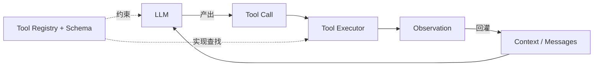
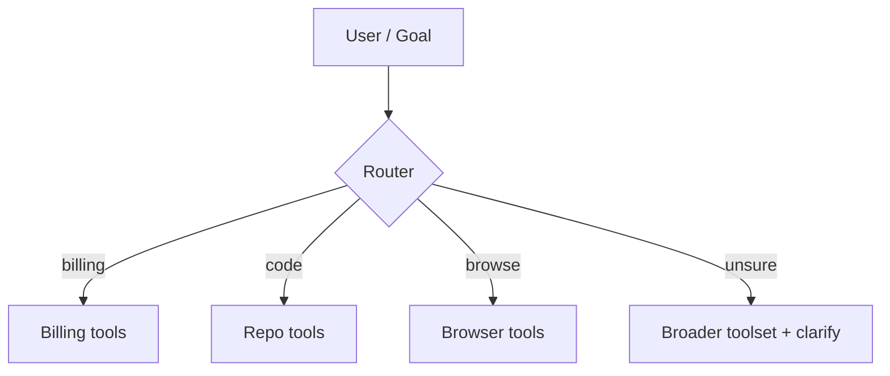
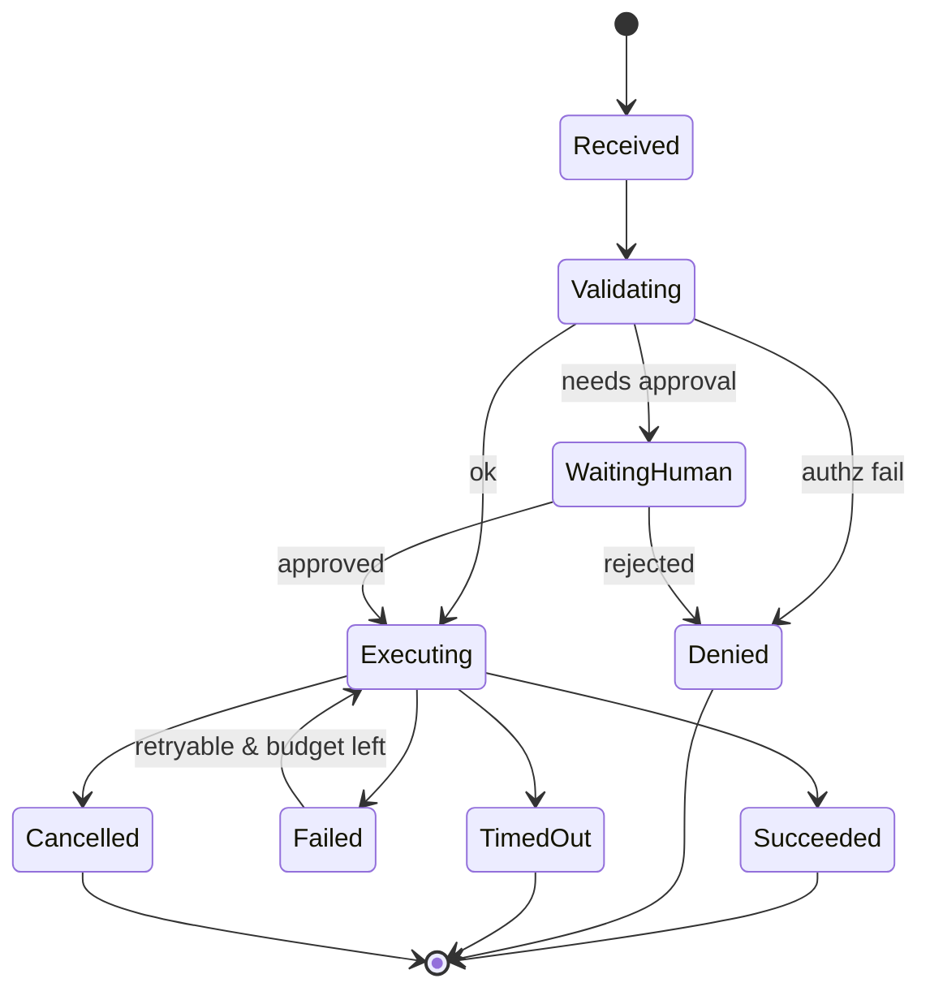
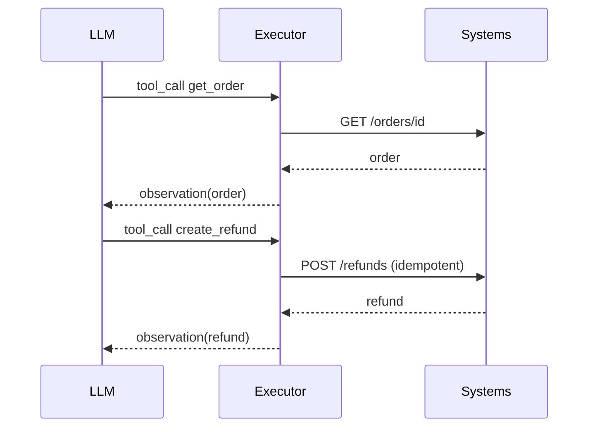

# Tool Use（Canonical）

> **一句话主题**：Tool Use 是让 LLM 通过**结构化调用契约**驱动外部能力，并由应用侧完成执行与观察回灌的机制。
>
> **状态**：Canonical · **Last reviewed**: 2026-10  
> **受众**：要实现或加固 Agent 工具面的工程师  
> **前置依赖**：[foundations/agent](../../foundations/agent/README.md)（建议同步了解 Prompt 基础）  
> **下游枢纽**：[Agent Loop](../agent-loop/agent-loop.md)

---

## 范围 / 非目标

**范围**：工具定义、schema、选择/路由、参数生成与校验、执行、观察、错误与重试、并行/串行/链式、权限与安全、观测与成本、典型工具形态，以及与 MCP / Agent Loop 的边界。

**非目标**：

- MCP 协议细节与生态目录 → [`protocols/mcp`](../../protocols/mcp/README.md)
- 沙箱隔离实现手册 → [`runtime/sandbox/sandbox.md`](../../runtime/sandbox/sandbox.md)
- 威胁模型全文 → [`production/security`](../../production/security/README.md)
- Agent 控制回路主体 → [`core/agent-loop`](../agent-loop/agent-loop.md)（本文只定义 Loop 所需的工具子系统）

---

## 1. 知识模型：Tool Use 是什么

### 1.1 定义

**Tool Use（工具使用）** 是一套工程契约：

1. 应用向模型**声明**可用工具（名称、描述、参数 schema、约束）。
2. 模型在生成过程中决定是否发出 **Tool Call**（结构化意图：调用哪个工具、带什么参数）。
3. **应用（或受控运行时）执行**该调用，得到 Observation（观察结果）。
4. 应用把 Observation **规范化**后写回对话/状态，供下一步决策。

官方表述的核心共识是：**模型不会自己「跑你的业务代码」；它只产出结构化调用请求**（见 [doc-openai-function-calling](../../references/docs.md#doc-openai-function-calling)、[doc-anthropic-how-tool-use-works](../../references/docs.md#doc-anthropic-how-tool-use-works)）。执行落在应用侧，或由厂商 **server-executed tools** / 沙箱托管面完成——仍不是模型进程内任意副作用。

### 1.2 动机：为什么需要 Tool Use

纯 LLM 工作流的能力边界：

| 能力 | 仅靠参数中的知识 | 借助 Tool Use |
|------|------------------|---------------|
| 实时/私有数据 | 弱或不可用 | 可查询 |
| 副作用（下单、改文件、发邮件） | 不能可靠完成 | 可受控执行 |
| 可验证动作 | 难 | 可用工具返回/测试断言 |
| 幻觉事实 | 高风险 | 可用检索/API 锚定 |

**问题被解决的本质**：把「模型擅长的决策/语言」与「系统擅长的确定性执行」解耦。

### 1.3 核心概念辨析（必须分清）

| 概念 | 是什么 | 不是什么 |
|------|--------|----------|
| **LLM** | 生成文本/结构化输出的模型 | 工具执行器 |
| **Tool** | 对外暴露的一项能力（语义 + 副作用边界） | schema 本身 |
| **Tool Schema** | 工具的机器可读接口描述（通常 JSON Schema） | 运行时实现 |
| **Tool Call** | 模型发出的一次调用意图（name + args + id） | 已执行完成的事实 |
| **Tool Executor** | 校验、鉴权、执行、归一化结果的运行时组件 | 模型 |
| **Observation** | 执行后回灌给模型的规范化结果（成功/失败/部分） | 原始日志全文（通常不宜） |
| **Agent Loop** | 反复「决策→行动→观察→更新状态」的控制回路 | 单次 tool call |



### 1.4 Mental Model

把 Tool Use 想成 **RPC + 策略层**：

- Schema = IDL
- Tool Call = RPC request（由不可靠的“智能客户端”生成）
- Executor = 带鉴权/超时/幂等的服务端
- Observation = RPC response（必须对下一跳决策友好）
- Agent Loop = 外层状态机，决定何时停止 RPC 循环

### 1.5 何时用 / 何时不用

**用 Tool Use，当**：

- 需要读写外部系统或产生真实副作用
- 需要可审计的行动轨迹
- 答案依赖实时/私有数据

**不用（或先别用），当**：

- 单次生成即可完成（摘要、改写、分类）
-  deterministic workflow 用普通编排更稳、更便宜
- 工具面尚未有权限/沙箱/评测，却要放开高危副作用

Anthropic 的工程建议是：从简单可组合模式起步，按评测证明收益再加复杂度（见 [article-anthropic-building-effective-agents-2024](../../references/articles.md#article-anthropic-building-effective-agents-2024)）。

---

## 2. Tool Calling vs Function Calling

历史上 OpenAI 早期 API 使用 `functions` 字段；现行文档将 **function calling 与 tool calling 作为同一能力的常用别名**，并统一在 `tools` 参数下描述可调用函数（见 [doc-openai-function-calling](../../references/docs.md#doc-openai-function-calling)）。Anthropic 文档同样写明 tool use *also called function calling*（见 [doc-anthropic-tool-use](../../references/docs.md#doc-anthropic-tool-use)）。

**工程口径（本手册）**：

- **Function Calling**：偏 API 史称 / 供应商术语，强调「模型生成函数名+参数」。
- **Tool Calling / Tool Use**：更通用的工程术语，覆盖函数、浏览器动作、代码执行、HITL 确认等「可执行能力」。
- **实现上**：两者都是「结构化调用意图 → 应用执行 → 结果回灌」。

不要在架构评审里把它们当成两套不同机制。

---

## 3. 工具定义与 Schema

### 3.1 Tool 定义（最小完备字段）

一个生产可用的工具定义至少包含：

| 字段 | 作用 |
|------|------|
| `name` | 稳定标识；变更需版本策略 |
| `description` | 告诉模型**何时用/不用**、副作用、返回含义 |
| `parameters` / `input_schema` | JSON Schema |
| `side_effect_class` | `read` / `write` / `destructive` / `external_comm`（工程扩展） |
| `authz` | 所需权限声明 |
| `timeout_ms` / `retry_policy` / `idempotent` | 执行策略 |
| `result_schema`（可选） | 规范化输出形状，利于校验与压缩 |

> 工具描述质量会显著影响调用成功率。Anthropic 强调对工具文档（ACI）与评测驱动迭代（见 [article-anthropic-writing-tools-for-agents-2025](../../references/articles.md#article-anthropic-writing-tools-for-agents-2025)）。

### 3.2 JSON Schema

工具参数几乎总是 **JSON Schema 对象**（`type: object` + `properties` + `required`）。标准基础见 [std-json-schema-2020-12](../../references/docs.md#std-json-schema-2020-12)。

**设计原则**：

1. **小而尖**：一个工具一件事；避免上帝工具。
2. **枚举优于自由文本**（状态、操作类型）。
3. **单位与时区显式**（`amount_cents`、`timezone`）。
4. **禁止把密钥/会话令牌放进模型可填参数**。
5. **description 写约束**：上限、幂等键、危险操作需要确认。

示例（示意，字段名随供应商略有差异）：

```json
{
  "name": "create_refund",
  "description": "为已支付订单创建退款。仅在用户明确要求退款且订单状态允许时使用。幂等键为 order_id+reason_code。",
  "parameters": {
    "type": "object",
    "additionalProperties": false,
    "properties": {
      "order_id": { "type": "string", "description": "订单 ID，形如 ord_..." },
      "reason_code": {
        "type": "string",
        "enum": ["duplicate", "fraudulent", "requested_by_customer"]
      },
      "amount_cents": { "type": "integer", "minimum": 1 }
    },
    "required": ["order_id", "reason_code"]
  }
}
```

**strict / schema-constrained tool args（机制级，Evergreen 2026-10-07）**

| 厂商 | 机制（文档可核） | 工程含义 |
|------|------------------|----------|
| **OpenAI** | function tools 可设 `strict: true`；底层借 Structured Outputs，schema 需满足支持子集；推荐开启。Responses 省略 `strict` 时可能尝试规范化，失败则回落 non-strict（响应上可见 `strict: false`）；Chat Completions 默认 non-strict。见 [doc-openai-function-calling](../../references/docs.md#doc-openai-function-calling) | 执行前仍做业务校验；勿假设「strict=语义正确」 |
| **Anthropic** | 工具定义顶层 `strict: true` → grammar-constrained sampling，保证 `tool_use.input` 贴合 `input_schema`；与 JSON Structured Outputs 可同用。见 [doc-anthropic-strict-tool-use](../../references/docs.md#doc-anthropic-strict-tool-use) | 部分内置 toolset 条目不接受 `strict`；复杂 schema 有编译/数量上限 |

> TODO: Verify — 完整「模型 × API 面 × strict 可用性/限制」兼容矩阵（随快照变，上线前自测）。

### 3.3 Tool Registry（工具注册表）

**Registry** 是 Source of Truth：

```text
name → { schema, handler, authz, policy, metrics_labels, version }
```

职责：

- 发现（discovery）与版本管理
- 将 name 解析到 executor handler
- 提供「可暴露给当前租户/用户」的工具子集
- 支撑动态工具（按会话加载）而不破坏审计

---

## 4. 发现、选择、路由

### 4.1 Tool Discovery

| 模式 | 说明 | 代价 |
|------|------|------|
| 静态全量注入 | 每次请求带齐 tools | 简单；工具多时吃 context |
| 权限过滤后注入 | 按用户/租户裁剪 | 生产默认推荐 |
| 分层/检索式发现 | 先检索相关工具再加载 | 工具超多时必要；增加一轮延迟 |

OpenAI 文档描述了在大量工具场景下可用 **tool search** 推迟加载（见 [doc-openai-tools](../../references/docs.md#doc-openai-tools)）。  
> **Evergreen 2026-10-07**：官方写明仅 `gpt-5.4` 及以后支持 `tool_search`。生产启用前仍核 **计费/配额** 与所绑 API 面（Responses / Agents）。  
> TODO: Verify — tool_search 价目与配额；Anthropic `tool_search` server tool 的触发边界与计费。

### 4.2 Tool Selection

选择发生在模型内部（给定 schema+对话），但工程可施加约束：

- `tool_choice=none/auto/required/specific`（供应商语义略有差异）
- 系统提示中的「优先用工具验证」策略
- 允许列表 / 风险分路由（见下）

**失败模式**：选错工具、该用不用、不该用却用、幻觉不存在的工具名。

### 4.3 Tool Routing

当工具池很大或跨系统时，引入 **Router**（可以是规则、小模型、或主模型前的分类器）：



路由降低 context 与误调用，但增加架构复杂度；先证明工具过多导致失败，再上路由。

---

## 5. 参数生成、校验、执行、观察

### 5.1 Argument Generation

模型根据 schema+上下文生成参数。内部上这是受约束的生成（有的栈用 grammar / JSON mode / constrained decoding）。

**工程含义**：

- 参数错误是常态，必须有校验与可恢复错误观察
- 缺少上下文时模型会「编造」ID —— 用检索工具先拿真实 ID

### 5.2 Argument Validation

**在执行前强制校验**（不要信任模型）：

1. JSON 可解析
2. JSON Schema validate（类型、required、enum、additionalProperties）
3. 业务校验（订单是否属于当前用户、金额不超过可退余额）
4. 安全校验（路径穿越、SQL 注入面、SSRF URL allowlist）

校验失败应返回 **结构化 tool error observation**，让模型有机会修正，而不是静默丢弃。

### 5.3 Tool Execution Pipeline（生产级伪代码）

```python
# 生产工具执行管线（示意）：校验 → 鉴权 → 配额 → 超时 → 执行 → 归一化 → 审计
from dataclasses import dataclass
from typing import Any
import json, time, uuid

@dataclass
class ToolCall:
    id: str
    name: str
    arguments: dict[str, Any]

@dataclass
class Observation:
    tool_call_id: str
    name: str
    ok: bool
    content: str          # 回给模型的文本/JSON 字符串（已裁剪）
    error_code: str | None
    latency_ms: int
    bytes_out: int

class ToolExecutor:
    def __init__(self, registry, authz, sandbox, metrics, audit):
        self.registry = registry
        self.authz = authz
        self.sandbox = sandbox
        self.metrics = metrics
        self.audit = audit

    def execute(self, call: ToolCall, ctx) -> Observation:
        t0 = time.perf_counter()
        tool = self.registry.get(call.name)
        if tool is None:
            return self._fail(call, "unknown_tool", "Tool not found", t0)

        # 1) 参数校验
        try:
            args = tool.validate(call.arguments)  # JSON Schema + business rules
        except ValidationError as e:
            return self._fail(call, "invalid_args", str(e), t0)

        # 2) 鉴权 / 权限
        decision = self.authz.authorize(ctx.user, tool, args)
        if decision == "deny":
            return self._fail(call, "forbidden", "Not permitted", t0)
        if decision == "require_human":
            return self._pending_hitl(call, args, t0)

        # 3) 幂等
        if tool.idempotent:
            cached = self.registry.idempotency_store.get(tool.idem_key(args, ctx))
            if cached:
                return cached

        # 4) 超时 + 取消 + 沙箱执行
        try:
            raw = self.sandbox.run(
                tool.handler, args, ctx,
                timeout_ms=tool.timeout_ms,
                cancel_token=ctx.cancel_token,
            )
        except TimeoutError:
            return self._fail(call, "timeout", "Tool timed out", t0)
        except CancelledError:
            return self._fail(call, "cancelled", "Cancelled", t0)
        except RetryableError as e:
            # 由上层 Loop 决定是否重试同一 call；此处只报告
            return self._fail(call, "retryable", str(e), t0)
        except Exception as e:
            return self._fail(call, "runtime", "Internal tool error", t0)

        # 5) 结果归一化 / 裁剪 / 脱敏
        obs = tool.normalize(call, raw, max_chars=tool.max_observation_chars)
        self.audit.record(ctx, call, obs)
        self.metrics.observe(tool.name, obs)
        if tool.idempotent and obs.ok:
            self.registry.idempotency_store.put(tool.idem_key(args, ctx), obs)
        return obs

    def _fail(self, call, code, msg, t0):
        ms = int((time.perf_counter() - t0) * 1000)
        return Observation(call.id, call.name, False,
                           json.dumps({"error": code, "message": msg}),
                           code, ms, 0)
```

### 5.4 Observation 与结果归一化

Observation 是给**下一跳模型**看的，不是给运维看的原始 dump。

| 策略 | 说明 |
|------|------|
| 结构化优先 | `{ok, data, error}` 固定信封 |
| 裁剪 | 截断长文本；大结果改存对象存储，回传句柄 |
| 脱敏 | 去掉密钥、PII、内部堆栈 |
| 错误可行动 | 告诉模型如何改参数，而不是只说 failed |
| 稳定排序 | 列表结果排序稳定，减少无抖动 |

### 5.5 错误、重试、超时、取消、幂等

| 机制 | 要点 |
|------|------|
| **错误分类** | `invalid_args` / `forbidden` / `timeout` / `retryable` / `fatal` / `upstream_4xx/5xx` |
| **Retry** | 仅对幂等+retryable；指数退避；绑定 `tool_call_id` 与幂等键；有最大次数 |
| **Timeout** | 工具级默认超时 + 全局 step 预算；超时必须可观测 |
| **Cancellation** | 用户取消/上游取消令牌；已产生副作用要有补偿或状态查询 |
| **Idempotency** | 写操作必须有幂等键（业务键或 `Idempotency-Key`）；重放返回同一逻辑结果 |

**状态机（单次 tool call）**：



---

## 6. 并行、串行、链式与依赖

### 6.1 Parallel tool calls

一次模型响应中包含多个 tool calls。适合**无依赖只读**查询。

- **好处**：降延迟  
- **风险**：写操作并行导致竞态；一个失败如何呈现；结果顺序与 message 拼接

生产默认：只允许标记为 `parallel_safe` 的工具并行；写操作串行化。

### 6.2 Sequential tool calls

跨多轮：call → observe → 再 call。适合有依赖的流程（先查订单，再退款）。

### 6.3 Tool chaining / dependency

两种实现：

1. **模型链式**（常见）：依赖由模型在 Loop 中显式处理  
2. **系统链式**：executor 内编排子步骤（更快但降低可观测透明度）

推荐：默认让依赖暴露在 Loop 轨迹中，便于调试与评测；仅对稳定子流程做系统内编排。



---

## 7. 权限、鉴权、沙箱、安全

### 7.1 Permissions vs Authorization

| | Permissions（权限模型） | Authorization（鉴权决策） |
|--|------------------------|---------------------------|
| 定义 | 工具/操作被声明需要哪些能力 | 在具体用户/租户/资源上是否允许本次调用 |
| 例子 | `refunds:write` | 「用户 U 能否退订单 O」 |

最小权限：默认只读；写/破坏性/外发通信单独放开。

### 7.2 Tool Sandboxing

执行隔离（文件系统、网络、进程）详见 [Sandbox Canonical](../../runtime/sandbox/sandbox.md)。  
Tool Use 层只要求：**高危工具必须经沙箱策略执行**，并把策略拒绝映射为 observation/error。

### 7.3 Tool Injection / Poisoning / Output Security

| 威胁 | 含义 | 缓解（概要，深文见 Security） |
|------|------|------------------------------|
| **Prompt/Tool Injection** | 不可信内容诱导模型滥调工具 | 权限最小化、确认门、分隔不可信数据、出站 allowlist |
| **Tool Poisoning** | 工具描述/返回被投毒，污染决策 | 签名与来源信任、描述变更审计、对返回做模式检测 |
| **Output 风险** | 工具输出含机密或恶意指令 | 脱敏、长度限制、把工具输出标为 untrusted |

> 安全细节的 Canonical 位置是 [`production/security`](../../production/security/README.md)；此处只定义工具面必须具备的挂钩。

---

## 8. 可观测性、延迟、成本、可靠性

### 8.1 Observability

每个 tool call 至少记录：

- `run_id`, `step_id`, `tool_call_id`, `name`
- 参数摘要（脱敏后）、结果摘要、错误码
- `latency_ms`, `retries`, `authz_decision`
- 上下游依赖（HTTP status、sandbox id）

深文见 [`production/observability`](../../production/observability/README.md)。

### 8.2 Latency / Cost / Reliability

| 维度 | 内部发生什么 | 生产含义 |
|------|--------------|----------|
| **延迟** | 模型生成 args + 网络/执行 + 再推理 | 并行只读；缓存；避免巨型 observation |
| **Token/成本** | schema 进上下文；observation 进历史 | 工具宜少而精；结果压缩；动态发现 |
| **可靠性** | 上游抖动、部分失败、幂等缺失 | 超时、重试、熔断、补偿事务 |

### 8.3 Streaming tool arguments（机制级，Evergreen 2026-10-07）

流式只改善 **UI/预览延迟**；执行契约不变：**缓冲完整参数 → 校验 → 再执行**。

| 厂商 | 文档机制 | 客户端义务 |
|------|----------|------------|
| **OpenAI Responses** | `stream=true` 时：`response.output_item.added`（含 name/`call_id`）→ 多次 `response.function_call_arguments.delta`（追加 `delta` 字符串）→ `response.function_call_arguments.done`（权威完整 `arguments`） | 按 `output_index`/`item_id` 聚合；**以 done 为准再 parse**；半截 JSON 不执行。见 [doc-openai-function-calling](../../references/docs.md#doc-openai-function-calling)、[doc-openai-streaming](../../references/docs.md#doc-openai-streaming) |
| **OpenAI Chat Completions** | `delta.tool_calls[i]` 按 `index` 累积 `function.arguments`；常仅首包带 `id` | 用 index 映射 call；完成后再执行 |
| **Anthropic Messages** | `content_block_start`（`tool_use`，`input: {}` 占位）→ `content_block_delta` / `input_json_delta`（`partial_json` 碎片）→ `content_block_stop` 后拼串再 parse；最终 `tool_use.input` 为对象 | 同：停块后再执行。见 [doc-anthropic-streaming](../../references/docs.md#doc-anthropic-streaming) |
| **Anthropic 细粒度** | 工具上 `eager_input_streaming: true` 可跳过服务端缓冲/校验以降 TTFT；碎片可能非法 JSON | 解析必须 guard；`max_tokens` 中断需重试/修复。见 [doc-anthropic-fine-grained-tool-streaming](../../references/docs.md#doc-anthropic-fine-grained-tool-streaming) |

> TODO: Verify — 跨模型矩阵（并行多 tool、微调模型、计费/配额）以当前价目与快照为准。

---

## 9. 动态工具与 MCP 边界

### 9.1 Dynamic tools

会话中按需注册/卸载工具（插件、用户连接的集成）。要求：

- 变更可审计
- 模型上下文与 registry 一致
- 旧 call id 不指向已卸载实现

### 9.2 MCP 关系（边界声明）

| | Tool Use | MCP |
|--|----------|-----|
| 层级 | **机制**：如何声明/调用/执行/回灌 | **协议**：如何跨进程/厂商标准化暴露 tools/resources/prompts |
| 问题 | Agent 内工具契约与执行管线 | 互操作、发现、传输、能力协商 |
| 本仓库位置 | `core/tool-use` | `protocols/mcp` |

**MCP 不取代 Tool Use**：即便工具经 MCP 暴露，Agent 内仍需要 schema 理解、鉴权、超时、归一化、Loop 回灌。规范见 [std-mcp-specification](../../references/docs.md#std-mcp-specification)。

---

## 10. 典型工具形态

| 类型 | 特点 | 工程要点 |
|------|------|----------|
| **API tools** | HTTP/gRPC 封装 | 超时、鉴权头不进模型、错误映射 |
| **Database tools** | 查询/有限写入 | 只读优先、行数限制、禁止任意 SQL（或强沙箱） |
| **Browser tools** | DOM/截图动作 | 脆弱选择器、等待、安全域；见 Browser Agent |
| **Code execution** | 解释器/命令 | **必须沙箱**；资源限额；输出裁剪 |
| **HITL tools** | `request_approval` | 阻塞/异步回调；超时升级；审计谁批了什么 |

HITL 不是「失败」，而是控制流中的合法状态（等待人类）。

---

## 11. 与 Agent Loop 的接口

Tool Use 向 Loop 暴露的最小接口：

```text
list_tools(ctx) -> schemas
execute_many(calls[], ctx) -> observations[]
```

Loop 负责：步数/预算、是否继续、如何把 observations 写入消息、何时终止。  
详见 [Agent Loop Canonical](../agent-loop/agent-loop.md)。

---

## 12. 评测（Tool Use 切片）

在完整 Agent 任务评测之外，单独度量：

- 工具选择准确率 / 误调用率
- 参数 schema 一次通过率
- 重试后成功率
- 平均工具延迟与 observation token
- 权限拒绝是否正确（安全真负例）

深文见 [`production/evaluation`](../../production/evaluation/README.md)。

---

## 13. 相关概念与文档

| 关系 | 文档 |
|------|------|
| Tool Use → 被 Loop 驱动 | [agent-loop.md](../agent-loop/agent-loop.md) |
| 推理/计划影响何时调用 | [reasoning-planning](../reasoning-planning/README.md) |
| Observation 如何进窗口 | [context-engineering](../context-engineering/context-engineering.md) |
| 跨会话状态 | [memory](../memory/README.md) |
| 协议互操作 | [mcp](../../protocols/mcp/README.md) |
| 隔离执行 | [sandbox](../../runtime/sandbox/sandbox.md) |
| 威胁模型 | [security](../../production/security/README.md) |
| 轨迹与审计 | [observability](../../production/observability/README.md) |
| 任务成功度量 | [evaluation](../../production/evaluation/README.md) |

---

## 14. Interview Questions

### Beginner

**Q1. 什么是 Tool Use？模型会执行工具吗？**  
- **短答**：应用声明工具，模型产出结构化调用；执行在应用或厂商托管运行时，不在「模型随意跑代码」。  
- **详解**：决策与确定性执行解耦。Anthropic 现行文档分三类：用户定义 client tools、Anthropic-schema client tools（应用执行）、server-executed tools（厂商执行）。  
- **追问**：server tools 与 client tools 混在同轮并行调用时控制权怎样交还？  
- **常见错误**：以为 API 返回 tool call 就等于已经副作用完成。  
- **相关**：Observation、Agent Loop。

**Q2. Tool 与 Tool Schema 的区别？**  
- **短答**：Tool 是能力；Schema 是该能力的接口描述。  
- **详解**：同一 Tool 可有版本化 schema；handler 是实现。  
- **追问**：description 为什么也是接口的一部分？  
- **常见错误**：把 JSON Schema 当成业务实现。  
- **相关**：Registry。

**Q3. Function Calling 和 Tool Calling 是两回事吗？**  
- **短答**：多为同一机制的不同称呼/历史 API 形态。  
- **详解**：现代文档常互换使用；工程上统一称 Tool Use。  
- **追问**：你们栈里 tools 数组里除了 function 还可能有什么？  
- **常见错误**：按名词设计两套执行器。  
- **相关**：[doc-openai-function-calling](../../references/docs.md#doc-openai-function-calling)。

**Q4. 一次成功的工具调用包含哪些阶段？**  
- **短答**：声明→选择→生成参数→校验→鉴权→执行→归一化→回灌。  
- **详解**：任一阶段失败都应变成可观测错误。  
- **追问**：哪一步绝对不能交给模型？  
- **常见错误**：跳过校验直接执行。  
- **相关**：Executor pipeline。

**Q5. 为什么工具结果要裁剪？**  
- **短答**：窗口与成本有限，原始 dump 会污染决策。  
- **详解**：大结果存外置句柄，回传摘要。  
- **追问**：裁剪过度会怎样？  
- **常见错误**：把完整 HTML/DB dump 塞回消息。  
- **相关**：Context Engineering。

**Q6. 什么是 Observation？**  
- **短答**：执行后对模型可见的规范化结果。  
- **详解**：它是 Loop 的感知输入，不是运维日志。  
- **追问**：错误 Observation 应包含什么？  
- **常见错误**：把 stack trace 原样喂给模型。  
- **相关**：Agent Loop。

**Q7. 只读工具和写工具为何要分开权限？**  
- **短答**：爆破半径；默认最小权限。  
- **详解**：写/破坏性操作常需 HITL 或强鉴权。  
- **追问**：如何在 schema 层表达危险性？  
- **常见错误**：一个 `run_sql` 通吃。  
- **相关**：Authorization。

**Q8. JSON Schema 在 Tool Use 里解决什么问题？**  
- **短答**：约束参数形状，降低胡填参数。  
- **详解**：仍需业务校验；schema 不是全能。  
- **追问**：`additionalProperties: false` 的价值？  
- **常见错误**：schema 过宽导致静默忽略关键字段。  
- **相关**：[std-json-schema-2020-12](../../references/docs.md#std-json-schema-2020-12)。

**Q9. 工具名幻觉是什么？怎么处理？**  
- **短答**：模型调用未声明工具。  
- **详解**：executor 返回 `unknown_tool`；收紧 tool_choice/描述；减少工具数。  
- **追问**：与参数幻觉的差异？  
- **常见错误**：忽略并让 Loop 空转。  
- **相关**：Registry。

**Q10. Tool Use 和 Chatbot 插件菜单有何不同？**  
- **短答**：前者由模型在闭环中自主/半自主选择并多步调用。  
- **详解**：关键是 observation 反馈进下一决策。  
- **追问**：何时应用该强制指定工具？  
- **常见错误**：把单次插件点击当成 Agent。  
- **相关**：Agent Loop。

### Intermediate

**Q11. 如何设计高质工具描述？**  
- **短答**：写清何时用/不用、副作用、返回语义、限制。  
- **详解**：用评测迭代描述；避免重叠工具。  
- **追问**：两个工具语义重叠会怎样？  
- **常见错误**：描述只写「获取数据」。  
- **相关**：[article-anthropic-writing-tools-for-agents-2025](../../references/articles.md#article-anthropic-writing-tools-for-agents-2025)。

**Q12. 并行 tool calls 的安全条件？**  
- **短答**：无写依赖、无共享可变状态、失败策略明确。  
- **详解**：写操作默认串行；并行只读聚合。  
- **追问**：一个并行分支超时怎么办？  
- **常见错误**：并行退款+更新余额。  
- **相关**：Idempotency。

**Q13. 幂等键应该怎么设计？**  
- **短答**：业务自然键或客户端幂等键，与重试绑定。  
- **详解**：同一意图重复执行返回同一逻辑结果。  
- **追问**：幂等键粒度太粗/太细的后果？  
- **常见错误**：仅靠 tool_call_id（模型重发可能变 id）。  
- **相关**：Retry。

**Q14. 校验失败应该抛给用户还是回给模型？**  
- **短答**：默认结构化错误 Observation 回给模型；对用户可另做 UX。  
- **详解**：让模型有机会改参；超过 N 次再升级人类。  
- **追问**：哪些错误不应让模型重试？  
- **常见错误**：校验失败直接终止且无原因。  
- **相关**：Failure modes。

**Q15. 动态工具注册有什么风险？**  
- **短答**：上下文与实现不一致、供应链、权限漂移。  
- **详解**：需要签名、审计、会话级快照。  
- **追问**：如何防止运行中替换 handler？  
- **常见错误**：热插拔无版本。  
- **相关**：MCP、Security。

**Q16. 工具路由何时值得引入？**  
- **短答**：工具很多导致选择错误或 context 爆炸时。  
- **详解**：先裁剪权限集；再检索式发现；最后学路由。  
- **追问**：路由错误如何降级？  
- **常见错误**：10 个工具就上复杂路由器。  
- **相关**：Discovery。

**Q17. Observation 太大时的生产做法？**  
- **短答**：截断+外置存储+句柄；或强制分页工具。  
- **详解**：提供 `read_next_page` / `get_artifact`。  
- **追问**：如何评测信息损失？  
- **常见错误**：静默截断关键字段。  
- **相关**：Context budget。

**Q18. HITL 工具在状态机里如何表示？**  
- **短答**：`WaitingHuman` 合法状态，带超时与拒绝路径。  
- **详解**：批准后继续同一意图（幂等）。  
- **追问**：异步审批跨小时如何 checkpoint？  
- **常见错误**：把等待当失败。  
- **相关**：Agent Loop interrupt/resume。

**Q19. 如何防止工具输出成为注入载体？**  
- **短答**：标记 untrusted、脱敏、限制可触发的高危工具、出站策略。  
- **详解**：不可信内容不可直接升权。  
- **追问**：检索工具返回「忽略之前指令」怎么办？  
- **常见错误**：信任所有 tool output。  
- **相关**：Security。

**Q20. 度量「工具可靠性」看哪些指标？**  
- **短答**：成功率、p95 延迟、重试率、错误码分布、schema 一次通过率。  
- **详解**：按工具名与租户切片。  
- **追问**：如何区分模型错与上游错？  
- **常见错误**：只看任务最终成功率。  
- **相关**：Evaluation、Observability。

### Advanced

**Q21. 请设计生产 ToolExecutor 的接口与不变式。**  
- **短答**：`execute(call,ctx)->obs`；校验/鉴权/超时/审计缺一不可。  
- **详解**：不变式：无鉴权不执行；无超时不执行；所有调用可追溯。  
- **追问**：批量 `execute_many` 的失败原子性？  
- **常见错误**：在 prompt 层「约定」安全。  
- **相关**：伪代码一节。

**Q22. 部分成功（partial completion）如何回传？**  
- **短答**：显式 `ok=false/partial` + 已完成/未完成字段。  
- **详解**：避免模型以为全成功继续下一步。  
- **追问**：补偿事务放 executor 还是 Loop？  
- **常见错误**：返回 200 但 body 含一半失败。  
- **相关**：Loop recovery。

**Q23. 代码执行工具的最小安全基线？**  
- **短答**：沙箱、网络默认关、CPU/内存/时间限额、输出裁剪、禁止特权挂载。  
- **详解**：与 Coding Agent 场景结合。  
- **追问**：是否允许出网装包？  
- **常见错误**：在宿主机直接 `eval`。  
- **相关**：Sandbox。

**Q24. 如何做跨工具的事务语义？**  
- **短答**：多数情况下用「编排+补偿」而非分布式事务。  
- **详解**：SAGA；每步幂等；状态机外显。  
- **追问**：何时需要两阶段提交？  
- **常见错误**：假设多 API 调用天然原子。  
- **相关**：Idempotency、Loop。

**Q25. Schema 演进如何不影响在途会话？**  
- **短答**：版本化 name 或 schema_version；会话钉住版本。  
- **详解**：双写兼容期；契约测试。  
- **追问**：如何下线旧工具？  
- **常见错误**：原地改必需字段。  
- **相关**：Registry。

**Q26. 工具层熔断与模型重试如何配合？**  
- **短答**：上游熔断时返回明确 `retryable=false/dependency_down`。  
- **详解**：避免模型紧打已经熔断的依赖。  
- **追问**：对用户怎么解释？  
- **常见错误**：5xx 让模型无限换参重试。  
- **相关**：Reliability。

**Q27. 多租户下工具注册表如何隔离？**  
- **短答**：租户级允许列表+凭证隔离+审计分区。  
- **详解**：防止跨租户 handler 或数据句柄泄漏。  
- **追问**：共享 SaaS 集成如何做？  
- **常见错误**：全局单例 API key。  
- **相关**：Infrastructure、Security。

**Q28. 何时把链式逻辑做进工具内部？**  
- **短答**：稳定、可测、无决策分支的子流程。  
- **详解**：一旦需要模型判断，应回到 Loop。  
- **追问**：可观测性如何保留？  
- **常见错误**：巨型 `do_everything` 工具。  
- **相关**：Anthropic ACI 建议。

**Q29. 评测驱动改进工具的闭环怎么建？**  
- **短答**：任务集→轨迹→错误聚类→改 schema/描述→回归。  
- **详解**：把工具当产品表面迭代。  
- **追问**：自动生成评测任务的风险？  
- **常见错误**：只凭感觉改 prompt。  
- **相关**：Evaluation。

**Q30. Tool Use 在流式输出下有何复杂性？**  
- **短答**：参数可能分片到达；需缓冲完整 JSON 再执行。  
- **详解**：OpenAI 用 function_call_arguments delta/done；Anthropic 用 `input_json_delta`/`partial_json`；细粒度流式可能未校验。见 §8.3。  
- **追问**：如何给 UI 展示「正在调用」？  
- **常见错误**：半截 JSON 就打 API。  
- **相关**：Inference streaming。  
- **TODO: Verify** — 跨模型并行/计费矩阵。

### Expert

**Q31. 给出「工具投毒」的攻击面与检测信号。**  
- **短答**：恶意描述/返回诱导；信号含异常工具组合、突增高危调用。  
- **详解**：供应链签名、描述 diff 审计、运行时策略。  
- **追问**：如何做红队题库？  
- **常见错误**：只防用户 prompt 不防 tool output。  
- **相关**：Security。

**Q32. 设计支持 1e4 工具的发现系统。**  
- **短答**：向量/关键词检索 + 权限过滤 + 延迟加载 + 缓存。  
- **详解**：控制每轮暴露数；监控选错率。  
- **追问**：冷启动与个性化？  
- **常见错误**：全量塞上下文。  
- **相关**：Discovery、MCP。

**Q33. 如何证明一次退款调用在法律审计上站得住？**  
- **短答**：不可篡改审计：谁、何时、参数、鉴权、幂等键、上游票据、HITL。  
- **详解**：轨迹与支付系统对账。  
- **追问**：模型「意图」是否要入库？  
- **常见错误**：只存最终自然语言回复。  
- **相关**：Observability。

**Q34. Agent 被间接注入后，工具层最后一道闸是什么？**  
- **短答**：鉴权+允许列表+HITL+出站策略，假设模型已妥协。  
- **详解**：zero-trust around tools。  
- **追问**：只读工具也会造成数据外泄吗？  
- **常见错误**：认为「模型很聪明所以安全」。  
- **相关**：Security、Sandbox。

**Q35. 讨论 observation 的信息论：最小充分统计。**  
- **短答**：回传使下一决策成功的最小信息。  
- **详解**：多余 token 既费钱也引入注入面。  
- **追问**：如何自动化压缩策略？  
- **常见错误**：越多 context 越好。  
- **相关**：Context Engineering。

**Q36. 多模型路由下工具契约如何保持稳定？**  
- **短答**：统一内部 Tool IR，对供应商做适配层。  
- **详解**：测试矩阵覆盖各模型的并行/strict 差异。  
- **追问**：严格 schema 失败如何降级？  
- **常见错误**：直接把供应商 JSON 当领域模型。  
- **相关**：Infrastructure。

**Q37. 长运行工具（分钟级）如何融入请求-响应 API？**  
- **短答**：异步作业+轮询/webhook 工具；Loop checkpoint。  
- **详解**：避免 HTTP 同步堵死。  
- **追问**：取消语义如何传播？  
- **常见错误**：同步傻等。  
- **相关**：Agent Loop persistent。

**Q38. 从零评估是否该引入 MCP。**  
- **短答**：有多宿主/多服务器互操作需求再引入；否则内部 registry 更简单。  
- **详解**：MCP 是协议税；收益是生态与标准发现。  
- **追问**：MCP 能否简化鉴权？  
- **常见错误**：用 MCP 替代权限模型。  
- **相关**：protocols/mcp。

**Q39. 工具层 SLO 如何设置？**  
- **短答**：按工具关键级别设可用性/延迟/正确性 SLO，并配置烧录告警。  
- **详解**：与任务级 SLO 解耦但关联。  
- **追问**：错误预算如何分给模型 vs 工具？  
- **常见错误**：只有模型延迟 SLO。  
- **相关**：Observability。

**Q40. 你如何在设计评审中否定一个「全能工具」提案？**  
- **短答**：用可测性、可鉴权性、可观测性、失败爆炸半径论证。  
- **详解**：拆成小工具+Loop 编排；引用 ACI 原则。  
- **追问**：拆太细的反例？  
- **常见错误**：情绪化反对而无指标。  
- **相关**：Writing tools for agents。

### System Design

**Q41. 设计企业 Support Agent 的工具面。**  
- **短答**：只读查询+受控写操作+HITL 退款；统一 executor。  
- **详解**：覆盖 registry、鉴权、幂等、观测、评测集。  
- **追问**：多系统工单如何防重复创建？  
- **常见错误**：直接给模型生产 DB 凭据。  
- **相关**：全文管道。

**Q42. 设计 Coding Agent 的工具权限模型。**  
- **短答**：工作区范围 FS、网络默认关、命令允许列表、测试命令优先。  
- **详解**：与 sandbox 联动；危险 git 推送需 HITL。  
- **追问**：如何防止读 `.env` 外泄？  
- **常见错误**：容器即安全。  
- **相关**：Sandbox、Coding Agent。

**Q43. 设计可插拔第三方集成的 Tool Platform。**  
- **短答**：IR+适配器+OAuth 凭证仓+租户策略+沙箱出站。  
- **详解**：对比自研 registry vs MCP 边界。  
- **追问**：集成商恶意 server 怎么办？  
- **常见错误**：信任所有第三方描述。  
- **相关**：MCP、Security。

**Q44. 设计工具调用的全局成本控制系统。**  
- **短答**：每用户/每 run 预算、工具单价、熔断、降级只读。  
- **详解**：把工具成本与模型 token 成本统一记账。  
- **追问**：突发流量如何排程？  
- **常见错误**：只限模型 RPM。  
- **相关**：Infrastructure。

**Q45. 设计从轨迹日志到工具改进的数据飞轮。**  
- **短答**：采集失败簇→人工/自动归类→改 schema→影子流量验证→全量。  
- **详解**：与微调/评测门禁衔接（链接，不展开）。  
- **追问**：隐私合规怎么做？  
- **常见错误**：日志含 PII 直接训练。  
- **相关**：Evaluation、Fine-tuning。

---

## 15. References

- [doc-openai-function-calling](../../references/docs.md#doc-openai-function-calling)
- [doc-openai-tools](../../references/docs.md#doc-openai-tools)
- [doc-openai-streaming](../../references/docs.md#doc-openai-streaming)
- [doc-anthropic-tool-use](../../references/docs.md#doc-anthropic-tool-use)
- [doc-anthropic-how-tool-use-works](../../references/docs.md#doc-anthropic-how-tool-use-works)
- [doc-anthropic-streaming](../../references/docs.md#doc-anthropic-streaming)
- [doc-anthropic-strict-tool-use](../../references/docs.md#doc-anthropic-strict-tool-use)
- [doc-anthropic-fine-grained-tool-streaming](../../references/docs.md#doc-anthropic-fine-grained-tool-streaming)
- [std-json-schema-2020-12](../../references/docs.md#std-json-schema-2020-12)
- [std-mcp-specification](../../references/docs.md#std-mcp-specification)
- [article-anthropic-building-effective-agents-2024](../../references/articles.md#article-anthropic-building-effective-agents-2024)
- [article-anthropic-writing-tools-for-agents-2025](../../references/articles.md#article-anthropic-writing-tools-for-agents-2025)
- [paper-react-2022](../../references/papers.md#paper-react-2022)（行动与推理交织的思想来源；Loop 侧详述）

---

## 16. Self-review / TODOs

- [x] 机制与 MCP/Sandbox/Security/Loop 边界已声明
- [x] 失败模式、权限、成本、生产管线已覆盖
- [x] 引用为可核对一级来源
- [x] Evergreen 2026-10-07：OpenAI/Anthropic 工具文档 Last checked；`tool_search`≥gpt-5.4；Anthropic 三类执行位  
- [x] Evergreen 2026-10-07：OpenAI/Anthropic tool `strict` 机制；Streaming tool args 事件契约（§8.3）  
- [ ] TODO: Verify — streaming/strict **完整模型矩阵**与计费/配额  
- [ ] TODO: Verify — 具体框架（LangGraph 等）中的工具节点语义，不在本文展开，避免把实现细节当协议
