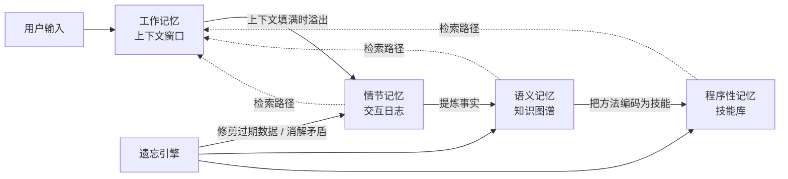

# Agent Memory 架构：五层记忆 Playbook

> **类型**：工程经验（Agent Memory 五层架构实战 Playbook 翻译整理）
> **概念主文**：[`concepts/core/memory/`](../../../concepts/core/memory/)
> **一句话**：记忆（而不是模型本身）才是 2026 年的瓶颈——用「工作记忆 + 情节记忆 + 语义记忆 + 程序性记忆 + 遗忘引擎」五层架构，把每次查询的 token 成本砍掉 90%，并让 Agent 真正「学会」跨会话积累经验。

---

## 摘要（Abstract）

你的 Agent 每天早上读同一批 12 个文件，得出同样的结论，并因此向你收取同样的 token 费用。模型两年内聪明了 10 倍，但它依然在每次会话结束后忘掉一切。

本文提出解决这个问题的**五层记忆架构**：

1. **工作记忆（Working Memory）**——上下文窗口，Agent 此刻看到的一切
2. **情节记忆（Episodic Memory）**——发生了什么，带时间戳与结果的交互日志
3. **语义记忆（Semantic Memory）**——什么是真的，实体、事实与关系构成的知识图谱
4. **程序性记忆（Procedural Memory）**——如何做事，沉淀为可复用技能的方法
5. **遗忘引擎（Forgetting）**——该删除什么，防止矛盾累积的清理机制

我们汇总了来自 **Mem0**（90% token 削减、91% 延迟下降）、**Snowflake**（单加一层本体即获 20% 准确率提升）以及多个生产系统的证据，说明：**在 2026 年，瓶颈是记忆，而不是模型**。本 playbook 提供实现代码、模板、决策框架与生产检查清单。

> **理论基础**：基于 CoALA 认知架构、Mem0、Anthropic 记忆系统、Snowflake 本体研究，以及 LangChain 生产工程资料。独立整理于 2026 年 9 月。

---

## 架构总览



数据流（而非独立存储）把五层串起来：工作记忆溢出 → 重要内容流入情节记忆 → 重复的情节模式蒸馏成语义事实 → 描述可靠方法的语义事实编码为程序性技能 → 遗忘引擎修剪全部三个长期层，防止陈旧与矛盾。

---

## 一、问题：规模化失忆

### 为什么世界上最聪明的模型会忘掉一切

每一次模型调用都从一个**空的上下文窗口**开始。上一次会话的发现、决策、纠正与偏好全部消失。

那个昨天花了 40 分钟调试迁移脚本的 Agent，今天不记得这个脚本存在过。它会读同样的文件、尝试同样的方法、撞上同样的死胡同，并向你收取同样的 token。

业界投入巨资让模型变得更聪明——更大的上下文窗口、更强的推理、更快的推理速度。**但缺乏记忆的智能就是《土拨鼠之日》**。一个每次对话都忘光的聪明同事不叫同事，他是一位每天早晨都要你重新简报一遍的昂贵顾问。

**CoALA 框架（Cognitive Architectures for Language Agents，语言智能体认知架构）**提供了这套词汇：工作记忆、情节记忆、语义记忆、程序性记忆。它们不是从心理学借来的隐喻，而是**工程分层**——每一层都有不同的存储、检索与过期特征。生产级 Agent 需要全部五层，包括一个防止矛盾累积的遗忘引擎。

### A. 遗忘的代价

**表 I — 遗忘的代价**

| 指标 | 无记忆 | 有记忆 | 来源 |
|------|--------|--------|------|
| 每次查询 token | 26,000 | 1,800 | Mem0 |
| 延迟 | 基线 | -91% | Mem0 |
| 准确率 | 基线 | +20% | Snowflake |
| 工具调用次数 | 基线 | -39% | Snowflake |
| 上下文重建 | 每次会话 | 从不 | 架构 |

---

## 二、第 1 层：工作记忆（Working Memory）

### 上下文窗口——Agent 此刻看到的一切

工作记忆就是上下文窗口，包含：系统提示词、当前对话、工具结果、检索到的文档、以及任何注入的状态。当上下文填满时，旧内容要么被截断、要么被压缩。**大多数 Agent 停在这里——这正是它们会遗忘的原因。**

### A. 工作记忆里有什么

**表 II — 工作记忆内容**

| 内容 | 用途 | 生命周期 |
|------|------|----------|
| 系统提示词 | Agent 身份与规则 | 每次调用 |
| 当前对话 | 任务上下文 | 当前会话 |
| 工具结果 | 有依据的数据 | 当前任务 |
| 检索到的文档 | RAG 上下文 | 当前查询 |
| 注入状态 | 记忆摘要 | 当前会话 |

### B. 溢出问题（The Overflow Problem）

当上下文窗口填满时，Agent 必须选择保留什么、丢弃什么。大多数系统**从头截断**——先删最旧的消息。这会摧毁任务定义、早期决策，以及通向当前状态的推理链。

更好的做法：**在重要内容丢失之前，先把它溢出到情节记忆**。

```python
# Listing 1 — 上下文溢出处理器
def handle_overflow(context, episodic_store, budget):
    if len(context.tokens) > budget * 0.85:
        # 在截断前保存重要内容
        decisions = extract_decisions(context)
        facts = extract_facts(context)
        episodic_store.save(decisions, facts)
        # 压缩上下文，保留最近内容 + 已保存的引用
        context.compact(keep_recent=budget * 0.6)
    return context
```

> **关键门禁数字**：当 token 数超过预算的 **85%** 时触发溢出；压缩时保留最近的 **60%** 预算作为「近期内容」。

---

## 三、第 2 层：情节记忆（Episodic Memory）

### 发生了什么——带时间戳与结果的交互日志

情节记忆记录 Agent 交互期间发生了什么：尝试了哪些任务、试过哪些方法、哪些成功、哪些失败、以及为什么。它是 Agent 的「经验日志」。没有它，Agent 会重复犯错、重新发现解决方案。

### A. 该存什么

不是所有东西都该进情节记忆。**该存**：任务描述与结果、工具调用及其结果、错误及其解决办法、决策及其推理、用户纠正与偏好。

**不该存**：冗长的推理链（压缩掉）、原始文档内容（按 ID 引用）、中间草稿（只保留最终版本与关键修改点）。

```python
# Listing 2 — 情节记忆记录
@dataclass
class Episode:
    task_id: str
    timestamp: datetime
    task_description: str
    approach: str
    outcome: str            # success | failure | partial
    key_decisions: list[str]
    errors_encountered: list[str]
    resolution: str
    user_feedback: str | None
    tokens_used: int
    duration_seconds: int
```

### B. 检索策略

当新任务到来时，Agent 应在开工前**先查询情节记忆中的相似历史任务**。相似度可通过任务描述嵌入、工具重叠度或显式标签来计算。检索到的情节会告诉 Agent：「这个任务和 task-042 类似，它上次失败是因为迁移脚本第 47 行有个拼写错误，直接跳到修复即可。」**这一次检索就能省掉整个调试会话。**

### C. 过期策略

没有过期策略的情节记忆会无限增长。旧情节会变得无关——代码库变了、API 更新了、用户偏好演进了。设定保留策略：

- 默认保留最近 **90 天**
- **高价值结果**的情节永久归档
- **例行情节** 30 天后过期
- 允许用户用显式「置顶（pin）」覆盖默认策略

---

## 四、第 3 层：语义记忆（Semantic Memory）

### 什么是真的——事实、实体与关系构成的知识图谱

语义记忆存储关于世界的持久事实：「用户偏好 TypeScript」「API 端点是 /v2/users」「生产数据库在 AWS us-east-1」。这些事实不会因会话结束而过期。它们是 Agent 累积的知识——从情节经验中蒸馏出来，存入可查询的存储。

### A. 实现：从 JSON 到图

**表 III — 语义记忆存储选型**

| 存储 | 最适合 | 规模上限 | 查询能力 |
|------|--------|----------|----------|
| JSON 文件 | 原型验证，<100 条事实 | 小 | 键查找 |
| SQLite | 单用户，<10K 条事实 | 中 | SQL 查询 |
| 向量数据库 | 相似性搜索 | 大 | 嵌入搜索 |
| 知识图谱 | 多跳推理 | 大 | 图遍历 |

### B. 本体层（The Ontology Layer）

Snowflake 的研究表明：**加一层本体**——一个定义实体类型、关系类型与校验规则的 schema——就把 Agent 准确率提升了 **20%**、工具调用减少了 **39%**。

本体并不复杂，它只是简单的定义：用户有名字与偏好，项目有所有者与截止日期，API 有端点与认证方式。这个 schema **约束 Agent 存什么、怎么查**，防止知识库退化成非结构化观察的垃圾场。

```python
# Listing 3 — 最小本体 Schema
ontology = {
    "entity_types": ["user", "project", "api", "config"],
    "relation_types": ["prefers", "owns", "depends_on", "located_at"],
    "validation": {
        "user.prefers":   {"target": "string", "expires": "90d"},
        "project.owns":   {"target": "user",   "required": True},
        "api.located_at": {"target": "string", "required": True},
    }
}
```

### C. 冲突消解（Conflict Resolution）

当 Agent 得知用户现在偏好 Python 而非 TypeScript 时，它必须**更新**语义记忆，而不是追加第二条偏好。冲突消解是保持语义记忆一致性的操作：

- **检测重复**（detect duplicates）
- **合并兼容事实**（merge compatible facts）
- **取代过时事实**（supersede outdated ones）
- **标记真正的矛盾供人工复核**（flag genuine contradictions for human review）

没有冲突消解，语义记忆会累积矛盾，从而产生自相矛盾的 Agent 行为。

---

## 五、第 4 层：程序性记忆（Procedural Memory）

### 如何做事——有效的方法，保存为可复用技能

程序性记忆存储方法。Agent 试了三种部署前端的方法，其中一种成功了。那个方法就变成一个**可复用技能**：一个有名字的方法，带步骤、工具、前置条件与成功标准。下次任务出现时，Agent 直接加载技能，跳过试错直达有效路径。

### A. 技能结构

```python
# Listing 4 — 程序性记忆技能
@dataclass
class Skill:
    name: str
    trigger: str            # 何时使用这个技能
    steps: list[str]
    tools_required: list[str]
    preconditions: list[str]
    success_criteria: str
    failure_modes: list[str]
    version: int
    last_used: datetime
    success_rate: float
```

### B. 技能晋升（Skill Promotion）

不是每个成功的方法都配成为技能。**只有满足以下条件才晋升**：

1. 任务**至少每周复现一次**
2. 方法**至少成功过 3 次**
3. 步骤能**无歧义地描述**
4. 所需工具**可靠可用**

一次侥幸的成功只是「情节（episode）」，不是「技能（skill）」。晋升门槛防止程序性记忆被脆弱、依赖上下文的临时方法填满。

### C. 技能版本化（Skill Versioning）

当部署流程改变时，旧技能就失效了。像软件一样给技能做版本化：更新步骤、递增版本号、保留旧版本以便回滚、针对当前环境重新校验。

> **一个过期的技能比没有技能更糟**——它会产出「自信的错误行为」。

---

## 六、第 5 层：遗忘（Forgetting）

### 该删除什么——没有人会构建、却最重要的一层

一个永不遗忘的 Agent 会累积矛盾：用户从纽约搬到了伦敦，Agent 却还在推荐布鲁克林的餐厅；API 从 v1 迁移到了 v2，Agent 却还在调 v1，因为两个端点都存在于语义记忆里；部署流程变了，Agent 却还照着旧技能走，因为它历史上成功率更高。

### A. 遗忘不是 Bug

在人类认知里，**遗忘是一种特性**：

- 防止无关记忆淹没相关记忆
- 让过时事实衰减，从而消解矛盾
- 通过修剪不再重要的信息，降低认知负担

Agent 记忆系统需要同样的机制——一个**有意识的遗忘引擎**，负责修剪、取代与消解。

### B. 三种遗忘操作

**表 IV — 遗忘操作**

| 操作 | 做什么 | 何时使用 |
|------|--------|----------|
| 过期（Expiration） | 删除超过阈值的事实 | 例行清理 |
| 取代（Supersession） | 用新版本替换旧事实 | 事实变化时 |
| 矛盾消解（Contradiction resolution） | 标记冲突事实供复核 | 两个事实都「当前」时 |

```python
# Listing 5 — 遗忘引擎
def forget(memory, rules):
    # 过期旧情节
    for ep in memory.episodic:
        if ep.age > rules.episodic_ttl:
            memory.archive(ep)

    # 取代过时的语义事实
    for fact in memory.semantic:
        newer = memory.find_newer(fact)
        if newer:
            fact.status = 'superseded'
            fact.superseded_by = newer.id

    # 标记矛盾
    conflicts = memory.find_conflicts()
    for c in conflicts:
        memory.flag_for_review(c)
```

---

## 七、生产证据与实战模式

### A. Mem0：90% token 削减

Mem0（51K+ GitHub stars）实现了一个**位于应用与 LLM 之间的记忆层**。它不再把整段对话历史塞进每次 API 调用，而是抽取相关事实存入持久化存储。下一次查询到来时，只注入相关事实——通常是 **1,800 token 而不是 26,000**。

结果：每次查询 **token 减少 90%**，延迟降低 **91%**。每个报告过指标的生产用户，记忆层都在部署第一天就回本了。

### B. Snowflake：本体胜过蛮力

Snowflake 的 AI 工程团队在内部数据平台上对比了「有/无本体层」的 Agent 表现。本体定义了实体类型（表、列、用户、查询）、关系类型（owns、depends_on、queries）与校验规则。有了本体，Agent 准确率提升 **20%**、工具调用减少 **39%**。

**本体并没有给 Agent 增加它没有的信息，它只是把已有信息组织起来，让 Agent 能高效地找到并使用。**

### C. Anthropic：作用域隔离的记忆

Anthropic 的 Claude 实现了**严格的项目级隔离**记忆。存进一个项目记忆的事实，对其他项目不可见。这防止了交叉污染——一个编码 Agent 的偏好不会泄漏到一个写作 Agent 的风格里。

该架构把记忆当作**一等安全边界**，而不只是一个便利特性。每个记忆存储都有自己的读写权限、过期策略与审计轨迹。

### D. 前沿 Agent 的差距（The Frontier Agent Gap）

对 SWE-bench 等基准的研究显示：**前沿模型在需要超过 20 次工具调用的真实长程任务上只达到 62.2%**。首要失败模式不是推理，而是**上下文丢失**——Agent 走到第 15 步时，已经忘了第 3 步发现了什么。

多步任务需要记忆，而记忆需要**架构**，不只是一个更大的上下文窗口。

### E. 常见记忆反模式

**表 IV-B — 记忆反模式**

| 反模式 | 为何失败 | 修复 |
|--------|----------|------|
| 什么都存 | 噪声淹没信号 | 只存决策与结果 |
| 永不过期 | 矛盾累积 | 30–90 天 TTL + 关键内容置顶 |
| 没有 schema | 存储变成垃圾场 | 加带类型 + 校验的本体 |
| 没有检索 | 记忆存在却不用 | 每个任务前先查询 |
| 一个大而全的存储 | 跨项目泄漏 | 按项目/域隔离记忆 |
| 没有版本化 | 过期技能引发错误 | 技能版本化 + 保留回滚 |
| 存原始上下文 | 昂贵、噪声、庞大 | 抽取事实、压缩上下文 |

### F. 记忆税（The Memory Tax）

记忆不是免费的。每次检索都增加延迟，每条存储的事实都消耗存储，每次遗忘操作都需要计算。架构必须自我证明价值：**如果记忆检索省下的 token 超过了维护记忆系统的成本，架构就回本了。** Mem0 的数字（90% token 削减）说明这做得到，但前提是**有纪律地存储**——而不是什么都存。

### G. 模板：记忆配置文件

```yaml
# Template 1 — 记忆系统配置
MEMORY_CONFIG:
  episodic:
    store: ./memory/episodes.jsonl
    max_entries: 1000
    ttl_days: 90
    retrieve_top_k: 5
  semantic:
    store: ./memory/facts.db
    ontology: ./memory/schema.yaml
    conflict_policy: keep_newer
    audit_stale_days: 90
  procedural:
    store: ./memory/skills.yaml
    promotion_threshold: 3
    version_history: 5
  forgetting:
    schedule: daily
    expire_episodes: 30d
    supersede_on_conflict: true
    flag_contradictions: true
```

### H. 模板：带记忆的系统提示词

```text
# Template 2 — 带记忆的系统提示词
你拥有一个持久化记忆系统。
开始任何任务前：
  1. 查询情节记忆中的相似历史任务
  2. 把相关的语义事实加载进上下文
  3. 检查是否存在针对该任务类型的程序性技能
完成任何任务后：
  1. 把结果保存进情节记忆
  2. 抽取新的持久事实存入语义记忆
  3. 若该方法已成功 3 次以上，提议将其晋升为技能

永远不要假设你「记得」上一个会话的某件事。
始终查询记忆。记忆是真相来源，不是你的训练数据。
```

---

## 八、完整架构：五层如何协同工作

**表 V — 五层架构**

| 层 | 存什么 | 检索方式 | 过期方式 | 实现 |
|----|--------|----------|----------|------|
| 工作记忆 | 当前上下文 | 始终加载 | 调用结束 | 上下文窗口 |
| 情节记忆 | 发生了什么 | 按相似度 | 30–90 天 | 日志存储 |
| 语义记忆 | 什么是真的 | 按实体/查询 | 取代时 | 图/数据库 |
| 程序性记忆 | 如何做事 | 按触发匹配 | 版本更新时 | 技能存储 |
| 遗忘 | 该删除什么 | 定时 | 持续 | 清理引擎 |

各层通过**数据流**而非独立存储交互：工作记忆溢出 → 流入情节记忆 → 重复情节模式蒸馏成语义事实 → 可靠方法编码为程序性技能 → 遗忘引擎修剪全部三个长期层。

---

## 九、构建路径：一周上生产

### 从最便宜、最能解决最大痛点的层开始

**表 VI — 7 天构建路径**

| 天 | 构建内容 | 验收测试 |
|----|----------|----------|
| 1 | 加情节日志：把任务结果存进 JSON | Agent 能回忆起昨天的失败 |
| 2 | 加检索：开工前先查日志 | Agent 能跳过已知死胡同 |
| 3 | 加语义存储：抽取持久事实 | Agent 记住用户偏好 |
| 4 | 加本体：定义实体/关系类型 | 存储按 schema 校验 |
| 5 | 从重复成功中沉淀程序性技能 | Agent 使用已保存的方法 |
| 6 | 加遗忘：过期旧情节、取代事实 | 存储中无矛盾 |
| 7 | 接通溢出：上下文 → 情节 → 语义 | 完整流水线端到端跑通 |

### A. 第 1–2 天：先做情节记忆

从最简单的情节记忆开始：把每个任务结果追加到一个 JSON 文件。开工前读最近 10 条，把摘要注入上下文。**光这一步就能防止 Agent 重蹈昨天的覆辙。** 实现成本是每次会话一次文件写 + 一次文件读。

### B. 第 3–4 天：语义记忆

从情节记忆中抽取持久事实：用户偏好、项目配置、API 端点、团队约定。存进简单的键值格式或 SQLite 表。开工前把相关事实注入上下文。现在 Agent 无需每次会话都被告知，就记得用户偏好 TypeScript。

### C. 第 5–6 天：技能与遗忘

当同一任务类型用同一方法成功 3 次，就把该方法存为命名技能。当事实冲突时，保留较新的、把较旧的标记为已取代。当情节超过 30 天时，归档。现在系统会**学习、记忆、并自我清理**。

### D. 第 7 天：接通完整流水线

连接所有层：上下文溢出触发情节保存，情节模式触发语义抽取，语义方法触发技能创建，遗忘引擎每天运行。

**验收测试**：跑一个需要「第 7 天还记得第 1 天决策」的多会话任务。如果 Agent 无需重读原始文件就能记住，流水线就通了。

---

## 十、实现模式：每一层的生产代码

### A. 用 JSONL 做情节记忆

最简单的情节存储是一个 JSONL 文件——每行一个 JSON 对象，每个任务后追加。JSONL 天然 append-only，意味着并发写入不会损坏数据。每一行包含 Listing 2 里的情节记录。检索时读最近 N 条，或按任务描述关键字过滤。

```python
# Listing 6 — 情节存储实现
class EpisodicStore:
    def __init__(self, path='memory/episodes.jsonl'):
        self.path = path

    def save(self, episode):
        with open(self.path, 'a') as f:
            f.write(json.dumps(asdict(episode)) + '\n')

    def retrieve(self, query, top_k=5):
        episodes = [json.loads(l) for l in open(self.path)]
        scored = [(ep, similarity(query, ep['task_description']))
                  for ep in episodes]
        scored.sort(key=lambda x: x[1], reverse=True)
        return [ep for ep, _ in scored[:top_k]]
```

### B. 用 SQLite 做语义记忆

生产级语义记忆用 SQLite：它提供持久性、查询能力、以及零基础设施。schema 定义实体类型、关系类型与事实记录。每条事实都有来源（产生它的情节）、时间戳、以及状态（active / superseded / flagged）。这就是**最小可行的知识图谱**。

```sql
-- Listing 7 — 语义存储 Schema
CREATE TABLE facts (
    id INTEGER PRIMARY KEY,
    entity TEXT NOT NULL,
    entity_type TEXT NOT NULL,
    relation TEXT NOT NULL,
    value TEXT NOT NULL,
    source_episode TEXT,
    created_at TIMESTAMP DEFAULT CURRENT_TIMESTAMP,
    status TEXT DEFAULT 'active',
    superseded_by INTEGER REFERENCES facts(id)
);
```

### C. 用 YAML 做程序性记忆

技能存为 YAML 文件——每个技能一个文件。文件包含触发条件、步骤、所需工具与成功标准。Agent 启动时加载所有技能触发条件，与到来的任务做匹配。匹配命中时，把完整技能作为指令集加载进工作记忆。

```yaml
# Listing 8 — 技能文件格式
name: deploy-frontend
trigger: 'deploy frontend to production'
version: 3
last_used: 2026-09-01
success_rate: 0.92
steps:
  - run: npm run build
  - verify: build/index.html exists
  - run: aws s3 sync build/ s3://prod-bucket
  - verify: curl https://app.example.com returns 200
preconditions:
  - AWS credentials configured
  - npm dependencies installed
failure_modes:
  - build failure: check node version
  - s3 permission denied: check IAM role
```

### D. 完整记忆流水线

```python
# Listing 9 — 带记忆的 Agent Loop
def agent_with_memory(task, memory):
    # 1. 检查程序性记忆是否有匹配技能
    skill = memory.procedural.match(task)
    if skill and skill.success_rate > 0.8:
        return execute_skill(skill, task)

    # 2. 检查情节记忆中的相似历史任务
    episodes = memory.episodic.retrieve(task, top_k=3)

    # 3. 加载相关语义事实
    facts = memory.semantic.query(task.entities)

    # 4. 注入工作记忆并执行
    context = build_context(task, episodes, facts)
    result = llm.call(context)

    # 5. 把结果保存进情节记忆
    memory.episodic.save(Episode(task, result))

    # 6. 抽取新事实存入语义记忆
    new_facts = extract_facts(result)
    memory.semantic.store(new_facts)

    # 7. 检查技能晋升条件
    if memory.episodic.count_successes(task.type) >= 3:
        memory.procedural.promote(task.type)

    return result
```

> **执行顺序要点**：先查技能（成功率 > 0.8 直接执行）→ 再查情节（top_k=3）→ 再加载语义事实 → 执行 → 回写情节 → 抽取语义 → 检查晋升（成功 ≥ 3 次）。

---

## 十一、决策框架：何时加哪一层

**表 VII — 记忆决策框架**

| 问题 | 加这一层 | 先别加 |
|------|----------|--------|
| Agent 重蹈昨天的覆辙 | 情节记忆 | 知识图谱 |
| Agent 忘记用户偏好 | 语义记忆（键值） | 完整本体 |
| Agent 重新发现同样的解决方案 | 程序性记忆 | 技能市场 |
| 旧事实与新事实矛盾 | 遗忘引擎 | 完整版本化系统 |
| Agent 每次会话重读同样的文件 | 语义 + 情节 | RAG 流水线 |
| token 成本太高 | 记忆摘要（Mem0 模式） | 自定义嵌入 |

---

## 十二、生产检查清单

**表 VIII — 生产就绪检查清单**

| # | 要求 | 缺失时的后果 |
|---|------|--------------|
| 1 | 情节日志保存任务结果 | Agent 重复犯错 |
| 2 | 新任务前的情节检索 | 死胡同被重新探索 |
| 3 | 持久事实的语义存储 | 偏好被遗忘 |
| 4 | 本体 schema 校验条目 | 存储变成垃圾场 |
| 5 | 语义事实的冲突消解 | 矛盾累积 |
| 6 | 从重复成功沉淀程序性技能 | 方法被重新发现 |
| 7 | 带回滚的技能版本化 | 过期技能引发错误 |
| 8 | 情节的过期策略 | 存储无限增长 |
| 9 | 上下文溢出处理器 | 重要内容被截断 |
| 10 | 遗忘引擎按计划运行 | 旧数据污染决策 |

---

## 十三、局限性

### A. 记忆 ≠ 理解

存储事实并不保证 Agent 能正确使用它们。一条语义记忆「用户偏好 TypeScript」帮不上忙，如果 Agent 无法把这个偏好转化成代码生成决策。**记忆增强模型的推理，但不替代它。** 记忆架构让更多信息可用，模型仍然必须对它们做推理。

### B. 遗忘可能丢失重要上下文

过于激进的过期策略会删掉包含关键一次性决策的情节；过于保守的策略又会累积噪声。正确的平衡取决于领域：**医疗 Agent 应保留情节数年；编码 Agent 可以在 30 天后过期大多数情节。** 让用户置顶那些永远不该过期的重要情节。

### C. 语义记忆需要维护

事实会变。API 会迁移。团队会重组。偏好会演进。1 月还准确的语义记忆，到 9 月可能就危险地错了。定期审计：把存储的事实与当前现实对比；标记 90 天未被确认的事实；让用户直接纠正事实。

---

## 十四、多智能体系统中的记忆

当多个 Agent 协作时，记忆就变成了**协调机制**。Agent A 发现一个事实，Agent B 10 分钟后需要它。没有共享记忆，B 从零重新发现；有共享语义记忆，B 查询存储即可立刻找到。**记忆系统替代了整个类别的 Agent 间通信。**

### A. 共享 vs 私有记忆

**表 VII-B — 多智能体系统的记忆作用域**

| 记忆作用域 | 对谁可见 | 用例 |
|------------|----------|------|
| 私有情节 | 仅所属 Agent | 内部推理历史 |
| 私有语义 | 仅所属 Agent | Agent 专属偏好 |
| 共享语义 | 工作流内所有 Agent | 项目事实、API 端点 |
| 共享程序性 | 工作流内所有 Agent | 通用部署方法 |
| 全局语义 | 系统内所有 Agent | 组织级配置 |

### B. 读者-写者问题

当两个 Agent 同时更新同一条语义事实时，一次写入会覆盖另一次。记忆系统需要并发策略：

- **last-write-wins**：简单但有损
- **merge-on-conflict**：复杂但完整
- **single-writer-per-entity**：简单且安全

对大多数生产系统，**single-writer-per-entity（每个实体单一写者）是正确的默认值**：每条事实由一个 Agent 拥有，其他 Agent 只读不写。

### C. 记忆作为共享大脑

在 SpaceXAI Playbook 架构中，Manager Bot 维护一份所有任务、所有者、状态与截止日期的**账本（ledger）**。这份账本**就是共享语义记忆**。专家 Bot 读它来理解有哪些工作可用，并把结果写回去。

账本替代了基于对话的协调：**Agent 之间不互相发消息，它们读写同一个共享存储。** 结果是一个能扩展的系统，避免了直接 Agent-to-Agent 消息的 N² 通信问题。

---

## 十五、何时不该加记忆

**表 VII-C — 何时加记忆**

| 场景 | 加记忆？ | 原因 |
|------|----------|------|
| 一次性任务（格式化这段文本） | 否 | 没什么要记 |
| 从相同数据生成日报 | 是 | 记住格式偏好 |
| 客服工单分诊 | 是 | 记住客户历史 |
| 创意头脑风暴 | 否 | 新鲜感比历史更重要 |
| 多会话调试 | 是 | 必须记住试过什么 |
| 批量数据处理 | 否 | 天然无状态 |
| 个人助理 | 是 | 偏好、日历、联系人 |
| 代码评审 | 是 | 记住过往评审模式 |

**判定标准**：如果 Agent 记住了上次发生的事，会产生更好的结果吗？

- 是 → 加记忆
- 任务天然无状态（批处理、一次性格式化）→ 记忆徒增复杂度而无价值
- 任务受益于累积知识（调试、个人助理、客服）→ **记忆是你可做的最高 ROI 投资**

---

## 十六、记忆系统对比

**表 VII-D — 记忆系统版图**

| 系统 | 类型 | Stars | 关键特性 |
|------|------|-------|----------|
| Mem0 | 记忆层 | 51K+ | 90% token 削减 |
| Zep | 长期记忆 | 3K+ | 时序知识图谱 |
| LangMem | LangChain 记忆 | 1K+ | 热/温/冷存储 |
| Claude Memory | 内置 | N/A | 项目级隔离 |
| 自定义 JSON | DIY | N/A | 完全可控、零依赖 |

**最简单的生产路径**：先用自定义 JSON（第 1 天）→ 验证架构可行（第 2–7 天）→ 需要规模、搜索与托管基础设施时再迁移到 Mem0 或 Zep。

> **在验证模式之前就上框架，会把集成时间浪费在一个可能不适合你工作流的架构上。**

---

## 十七、进阶记忆模式

### A. 层次化摘要（Hierarchical Summarization）

当情节记忆增长到数千条时，原始检索会变得噪声化。层次化摘要把旧情节压缩成递增时间尺度的摘要：

- **日摘要** ← 单条情节
- **周摘要** ← 日摘要
- **月摘要** ← 周摘要

Agent 查询「最近的详细情节 + 更早时段的压缩摘要」，从而在不无限增长存储的情况下，同时获得近期精度与长期上下文。

```python
# Listing 10 — 层次化摘要
def summarize_hierarchy(episodes, llm):
    # 按天分组
    by_day = group_by_date(episodes)
    daily_summaries = []
    for day, day_eps in by_day.items():
        if len(day_eps) > 5:
            summary = llm.summarize(day_eps)
            daily_summaries.append(DailySummary(
                date=day, summary=summary,
                episode_count=len(day_eps),
                key_outcomes=[e.outcome for e in day_eps]
            ))
            # 归档原始情节
            for ep in day_eps:
                ep.status = 'archived'
    return daily_summaries
```

### B. 记忆感知路由（Memory-Aware Routing）

在多智能体系统中，记忆可以驱动任务路由。新任务到来时，路由器查询情节记忆，找出哪个 Agent 对相似任务最有经验。**在相似历史任务上成功率最高的 Agent 获得分配。** 这是通过记忆实现的隐式专业化——Agent 不是靠显式角色分配，而是靠累积经验发展出专长。

```python
# Listing 11 — 记忆感知路由器
def route_by_memory(task, agents, memory):
    best_agent = None
    best_score = 0
    for agent in agents:
        past = memory.episodic.retrieve(
            query=task.description,
            agent_id=agent.id, top_k=5)
        success_rate = sum(
            1 for ep in past if ep.outcome == 'success'
        ) / max(len(past), 1)
        if success_rate > best_score:
            best_score = success_rate
            best_agent = agent
    return best_agent or agents[0]  # 默认第一个
```

### C. 矛盾检测流水线

语义记忆中的矛盾是**沉默的杀手**。Agent 存了「deploy target: staging」，后来又存了「deploy target: production」，却没有取代第一条。两条事实都处于 active 状态。Agent 可能根据检索顺序使用任意一条。

矛盾检测流水线周期性运行，比较同一 entity-relation 对的所有 active 事实，要么自动消解（保留较新的），要么标记人工复核。

**表 X — 矛盾类型与消解**

| 冲突类型 | 检测方式 | 自动消解 | 人工复核 |
|----------|----------|----------|----------|
| 同实体、不同值 | entity+relation 精确匹配 | 保留较新 | 值接近时 |
| 否定（Negation） | 语义相似度 + 否定检测 | 始终标记 | 始终 |
| 作用域冲突 | 一个泛化、一个具体 | 保留具体 | 作用域重叠时 |
| 时序冲突 | 同一事实、不同时间范围 | 保留最近 | 两者都当前时 |

### D. 热/温/冷存储分层

不是所有记忆都需要相同的访问速度：

- **热记忆（Hot）**：上下文内、即时访问 —— 当前任务状态、活跃用户偏好、最近 3 条相关情节
- **温记忆（Warm）**：一步检索、100–500ms —— 最近 30 天的全部情节日志、活跃语义事实、当前程序性技能
- **冷记忆（Cold）**：归档、1–5s —— 旧情节、被取代的事实、废弃的技能

分层同时降低延迟与成本。

**表 XI — 热/温/冷存储分层**

| 层 | 访问时间 | 存储 | 内容 | 成本 |
|----|----------|------|------|------|
| 热 | 0ms（上下文内） | 上下文窗口 | 当前状态、top-3 情节 | token 成本 |
| 温 | 100–500ms | SQLite / Mem0 | 30 天情节、活跃事实 | 低 |
| 冷 | 1–5s | S3 / 归档 | 旧情节、被取代事实 | 极低 |

---

## 十八、按领域的记忆配置

**表 XII — 按 Agent 类型的记忆配置**

| Agent 类型 | 主要层 | 保留期 | 关键事实类型 |
|------------|--------|--------|--------------|
| 编码 Agent | 程序性 + 情节 | 90 天 | 构建命令、模式、失败 |
| 客服 Agent | 语义 + 情节 | 1 年 | 客户历史、偏好 |
| 研究 Agent | 语义 + 情节 | 永久 | 来源、发现、方法 |
| 个人助理 | 语义 | 永久 | 偏好、联系人、日程 |
| DevOps Agent | 程序性 + 语义 | 30 天 | 部署步骤、基础设施状态 |
| 销售 Agent | 情节 + 语义 | 1 年 | 交易历史、联系人、备注 |

### A. 编码 Agent

编码 Agent 从**程序性记忆**获益最大。部署流程、测试命令、lint 规则、能通过评审的代码模式——这些方法在成功使用 3 次后就该存为技能。情节记忆捕获调试会话：试过什么、什么失败了、什么修好了。语义记忆存储项目事实：用哪个框架、哪个版本、哪些模式被禁止。遗忘引擎过期 90 天以上的情节，但**永久保留技能**。

### B. 客服 Agent

客服 Agent 需要**长期的语义记忆**。客户姓名、账户类型、历史问题、偏好的沟通风格、升级历史，必须跨数月持久化。情节记忆记录每次交互：客户问了什么、解决了什么、升级了什么。

与编码 Agent 的关键区别：**保留期必须长得多（至少 1 年），遗忘引擎必须保守**——删除客户历史造成的体验，比保留陈旧数据更糟。

### C. 研究 Agent

研究 Agent 需要**永久的语义记忆**。来源、发现、假设、矛盾、以及论文之间的连接，构成一个随时间增值的知识图谱。情节记忆记录读了哪些论文、抽取了什么、哪些搜索查询产出了有用结果。程序性记忆捕获研究方法：如何搜索、如何评估、如何综合。

> **研究场景下，遗忘引擎永远不该过期语义事实——改为取代过时的发现。**

---

## 十九、测试你的记忆系统

### A. 失忆测试（The Amnesia Test）

在会话 1 告诉 Agent 一个事实，关闭会话。打开会话 2，让 Agent 回忆这个事实。如果它做不到，情节或语义记忆就没在工作。**这是任何记忆系统的最小可行测试。**

### B. 矛盾测试（The Contradiction Test）

存两条冲突事实：「用户偏好 Python」和「用户偏好 TypeScript」。问 Agent 用户偏好哪个语言。如果它**自信地回答其中一个、却不承认冲突**，矛盾检测就没在工作。正确行为：**标记冲突，让用户来消解。**

### C. 陈旧测试（The Staleness Test）

存一条 30 天 TTL 的事实。等待（或模拟）31 天。问 Agent 这条事实。如果它仍使用这条已过期的事实，遗忘引擎就没在运行。正确行为：事实应已过期，Agent 应表示自己没有当前信息。

### D. 技能晋升测试（The Skill Promotion Test）

同一任务类型成功完成 3 次。第 4 次尝试时，验证 Agent 是否使用已保存的技能，而非从头重新规划。如果它重新规划，程序性记忆就没被触发。正确行为：Agent 加载技能并遵循其步骤，只有在前置条件不满足时才偏离。

### E. 负载测试（The Load Test）

给情节记忆塞 10,000 条。测量检索延迟。如果检索超过 **500ms**，存储需要索引、或检索算法需要优化。对语义记忆，插入 5,000 条事实，验证冲突检测仍在 **1 秒内**完成。

> **在 100 条时工作、在 10,000 条时失败的记忆系统，不算生产就绪。**

### 记忆系统测试清单

- [ ] Agent 能回忆上一个会话的事实（失忆测试）
- [ ] Agent 能检测冲突事实（矛盾测试）
- [ ] 过期事实不再被使用（陈旧测试）
- [ ] 重复成功触发技能（晋升测试）
- [ ] 10K 条时检索 < 500ms（负载测试）
- [ ] 遗忘引擎按计划运行（cron 测试）
- [ ] 多会话任务保持进度（连续性测试）
- [ ] 跨项目事实不泄漏（隔离测试）

---

## 二十、结论

模型聪明了 10 倍，但它依然在每次会话后忘掉一切。**记忆——而非智能——才是 2026 年的瓶颈。**

五层架构解决这个问题：工作记忆处理当前回合，情节记忆处理发生了什么，语义记忆处理什么是真的，程序性记忆处理如何做事，遗忘引擎处理该删除什么。

证据是具体的：**Mem0 通过把每次查询从 26,000 token 降到 1,800 token，砍掉了 90% 的 token 用量与 91% 的延迟；Snowflake 加一层本体就获得 20% 准确率、少 39% 工具调用。记忆在第一天就回本。**

务实建议：**从情节记忆开始**——一个保存任务结果、并在开工前查询它们的 JSON 文件。这只需几分钟构建，却立刻能防止 Agent 重蹈昨天的覆辙。然后加持久事实的语义记忆，再加有效方法的程序性技能，最后加保持一切干净的遗忘引擎。

这套架构是**复利**的：每一层都让其他层更有价值。

> 「明天它还会读那十二个文件、得出同样的结论、收你同样的 token——除非你给它记忆。」

---

## 附录：关键术语表

**表 IX — 术语表**

| 术语 | 定义 |
|------|------|
| 工作记忆（Working memory） | 上下文窗口：Agent 本回合看到的一切 |
| 情节记忆（Episodic memory） | 交互日志：发生了什么、何时、结果如何 |
| 语义记忆（Semantic memory） | 持久事实：实体、关系、偏好 |
| 程序性记忆（Procedural memory） | 可复用技能：有效方法，保存以备复用 |
| 遗忘引擎（Forgetting engine） | 清理系统：过期、取代、消解矛盾 |
| 本体（Ontology） | 定义实体类型与关系类型的 schema |
| CoALA | 语言智能体认知架构（Cognitive Architectures for Language Agents）框架 |
| 技能晋升（Skill promotion） | 把重复成功转化为可复用流程 |
| 取代（Supersession） | 用新版本替换过时事实 |

---

## 参考文献

1. LangChain, "Agent Memory Systems for Production," blog.langchain.com, 2026.
2. T. Sumers et al., "Cognitive Architectures for Language Agents (CoALA)," 2024.
3. Mem0, "Memory Layer for AI Agents," mem0.ai, 2026. 51K+ GitHub stars.
4. Snowflake, "Ontology-Enhanced Agent Memory," Snowflake Engineering, 2026.
5. A. Richards, "Why Your Agent Needs to Forget," AI Engineering Blog, 2026.
6. Anthropic, "Building Effective AI Agents," anthropic.com, Dec. 2024.
7. Anthropic, "Claude Memory Architecture," Claude Docs, 2026.
8. Zep, "Long-Term Memory for AI Agents," getzep.com, 2026.
9. M. Hashimoto, "My AI Adoption Journey," mitchellh.com, Feb. 2026.
10. A. Ng, "Agentic Design Patterns," DeepLearning.AI, 2024–2026.

> **来源说明**：本文是对公开工程资料、学术研究与生产案例的独立综合整理，与 Anthropic、Mem0、Snowflake 或任何其他组织无隶属关系、亦未经其背书。所有代码示例为教学清晰起见做了改编，图表为原创。
