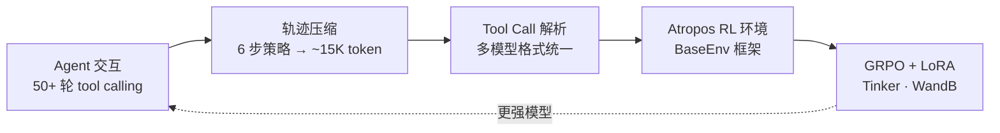

# Agentic RL：Hermes RL 训练与轨迹系统

> **类型**：工程经验（Hermes / Nous Research 实战拆解）  
> **概念主文**：[`concepts/runtime/reinforcement-learning/`](../../../concepts/runtime/reinforcement-learning/)  
> **一句话**：用 Agent 采集交互轨迹 → 压缩与格式化 → 程序化奖励 → GRPO + LoRA，构成「产品即数据飞轮」的研究闭环。

---

## 定位与闭环

Hermes 的定位既是面向终端用户的 Agent 产品，也承担 Nous Research 训练下一代 tool-calling 模型的研究基础设施角色。

Agent 与用户的每次交互——从接收任务、工具调用到最终完成——都会形成一条行为轨迹（trajectory），经过压缩与格式化之后可作为强化学习训练数据。

**用 Agent 采集数据，再以这些数据训练更强的模型，构成了 Hermes 项目的研究闭环。**



---

## 速览：RL 训练数据管线

### 主流程链路

| 阶段 | 要点 |
|------|------|
| Agent 交互 | 50+ 轮 tool calling |
| 轨迹压缩 | 6 步策略 → 约 15K token |
| Tool Call 解析 | 11 种模型格式 |
| Atropos RL 环境 | BaseEnv 框架（非 Gymnasium） |
| GRPO + LoRA 训练 | Tinker 服务 · WandB 指标 |

```text
Agent 交互 → 轨迹压缩 → Tool Call 解析 → Atropos RL 环境 → GRPO + LoRA 训练
```

### 三层继承架构

继承关系：`BaseEnv(Atropos)` → `HermesAgentBaseEnv` → `具体环境`

| 层级 | 说明 |
|------|------|
| BaseEnv (Atropos) | Worker 调度、WandB |
| HermesAgentBaseEnv | Agent Loop、ToolContext |
| 具体环境 | 实现 5 个抽象方法 |

> **抽象方法清单**：`setup()` · `get_next_item()` · `format_prompt()` · `compute_reward(item, result, ctx)` · `evaluate()`

### ToolContext 程序化奖励验证

```text
ctx.terminal("pytest -v") → exit_code==0 → reward=1.0
ctx.read_file(path) · ctx.write_file(path, content)
ctx.web_search(query) · ctx.browser_navigate(url)
ctx.call_tool(name, args) — 对同一沙箱的完整工具访问权
```

| 特点 | 说明 |
|------|------|
| 奖励形态 | **非 learned reward model** |
| 验证方式 | 程序化验证（pytest / 文件检查 / Web 验证） |

### 轨迹压缩 6 步策略

> 实现：`trajectory_compressor.py`

1. 保护首轮（system + human + gpt + tool）
2. 保护末 4 轮
3. 压缩中间工具结果
4. 按需裁剪（仅压缩到目标预算即停）
5. LLM 摘要替换（gemini-3-flash）
6. 保留 tool_call 配对结构

| 默认参数 | 值 |
|----------|-----|
| `target_max_tokens` | 15250 |
| `summary` | 750 |
| tokenizer | Kimi-K2-Thinking |
| 输出格式 | JSONL ShareGPT |

### RL 训练工具（10 个）

`rl_list_environments` · `rl_select_environment` · `rl_start_training` · `rl_check_status`（30min 限速） · `rl_stop_training` · `rl_test_inference` + 其余 4 个工具

### 三大内置 Benchmark

| Benchmark | 参数说明 |
|-----------|----------|
| TBLite | 100 任务，Modal 沙箱，r=0.911 与 TB2 相关 |
| TerminalBench 2 | 89 任务，per-task Docker |
| YC-Bench | 长期策略，0.5×survival + 0.5×funds |

### 训练进程拓扑

```text
run-api (Atropos API)
  → launch_training.py（Tinker trainer + 推理服务器 port 8001）
  → environment.py serve
```

> 并发规模说明见下文：早期稿给出过线程池 128、Atropos workers 2048 等数字；以当前 `atroposlib` 源码为准，不宜当作固定契约。

---

## 1. Agent RL 训练前沿

### 1.1 训练范式演进

大语言模型的训练范式经历了四个阶段，每一阶段在数据形态与优化目标上均发生明显变化：

**表：训练范式对比**

| 范式 | 数据来源 | 优化目标 | 主要局限 |
|------|----------|----------|----------|
| SFT | 人类标注的示例对 | 最大化条件似然（模仿人类） | 上限受制于标注质量 |
| RLHF | 人类偏好比较 | 最大化奖励模型得分 | 奖励模型易被过拟合 |
| RLAIF | AI 模型的偏好判断 | 最大化 AI 评估得分 | AI 评估存在系统性偏差 |
| Agent RL | Agent 交互轨迹 | 任务完成度与效率 | 动作空间大、奖励稀疏、轨迹长度不可控 |

Agent RL 相较前三种范式，训练数据不再是静态文本对，而是包含工具调用与执行结果的多步交互轨迹。由此带来三个主要工程挑战：

1. **动作空间规模较大** — 一个拥有数十种工具、每种工具若干参数的系统，其组合数量理论上极大  
2. **奖励稀疏** — 通常仅在任务完成时获得明确的正向信号，中间步骤的贡献难以自动判定  
3. **轨迹长度不可控** — 简单任务可能三轮完成，复杂任务则可能延伸到数十轮甚至上百轮  

### 1.2 相关工作：合成轨迹与在线 RL

以 ASTRA（Automated Synthesis of Agent Trajectories）为代表的研究方向，尝试从 MCP 工具图中自动合成多步交互数据：不依赖人工标注，让模型在沙箱环境中自主探索并保存成功轨迹，用于 SFT warm-up；随后再在真实环境中做 online RL 精调。

这一「SFT + online RL 联合训练」路径与 Hermes 训练管线采用的思路相近。

> **说明**：Hermes 源码并未直接引用 ASTRA 论文，本节仅将其作为背景介绍；Hermes 提供的轨迹收集、格式化与压缩基础设施，从工程实现上可支撑类似流程的数据需求。

### 1.3 Hermes 的应对策略

**表：Agent RL 挑战与应对**

| 挑战 | Hermes 的应对策略 |
|------|-------------------|
| 动作空间大 | 通过 toolset 分组与概率分布采样限制可用工具子集 |
| 奖励稀疏 | ToolContext 提供沙箱访问能力，支持程序化验证（pytest、文件与网络检查等） |
| 轨迹长度不可控 | `trajectory_compressor.py` 将任意长度轨迹压缩至目标 token 预算 |
| 异构模型格式 | 若干 Tool Call 解析器把不同模型的原始输出统一为标准结构 |
| 训练编排复杂 | `rl_*` 系列工具串联环境发现、启动、监控和结果回收流程 |

训练范式的讨论明确了训练数据的形态，而要把这些数据实现为可执行的训练管线，还需要相应的 RL 环境。

---

## 2. Hermes RL 环境实现

### 2.1 三层继承架构

Hermes 的 RL 环境基于 Nous Research 开发的 Atropos 框架构建，并未采用 Gymnasium 的标准接口。

这一取舍主要源于两种交互模式的差异：Agent RL 的一个「step」可能包含多轮 LLM 调用、异步工具执行以及长上下文管理，难以直接映射为 Gymnasium `step(action) → (observation, reward, done)` 的单步交互。

环境系统采用三层继承：

| 层级 | 职责 |
|------|------|
| **BaseEnv**（`atroposlib`） | Server 管理、Worker 调度、WandB 集成；暴露 `serve` / `process` / `evaluate` 三个 CLI 子命令 |
| **HermesAgentBaseEnv**（Hermes 扩展） | terminal 后端配置、工具解析（`_resolve_tools_for_group()`）、Agent Loop 编排、ToolContext 创建 |
| **具体环境**（用户实现层） | 覆写五个抽象方法：`setup()`、`get_next_item()`、`format_prompt()`、`compute_reward()`、`evaluate()` |

每个具体环境通过 `compute_reward()` 定义奖励函数，其入参 `ctx` 是 ToolContext 实例，可以访问与模型工作时同一沙箱——终端、文件、Web 搜索、浏览器导航等——因此，reward 函数可在该沙箱内直接运行测试（例如 `ctx.terminal("pytest -v")`）来验证结果。

这种程序化验证方式省去了训练 learned reward model 的成本，也减少了由此引入的系统性偏差。

### 2.2 AgentResult 数据模型

`AgentResult` 是 Agent Loop 单次执行的结果对象，位于 `atroposlib` 的 `environments/agent_loop.py`。其字段大致如下：

```python
# 位置: atroposlib 中的 environments/agent_loop.py
@dataclass
class AgentResult:
    messages: List[Dict[str, Any]]          # 完整对话历史（OpenAI 消息格式）
    managed_state: Optional[Dict[str, Any]] # ManagedServer 状态（仅 Phase2），否则为 None
    turns_used: int = 0                     # LLM 调用轮数
    finished_naturally: bool = False        # 模型是否自然停止调用工具
    reasoning_per_turn: List[Optional[str]] # 每轮抽取到的推理内容
    tool_errors: List[ToolError]            # 工具执行错误记录
```

工具执行由共享的 `ThreadPoolExecutor` 完成，并通过 Agent Loop 配置项控制线程池规模。这里需要区分两个层级的并行机制：

| 并行层 | 粒度 | 作用 |
|--------|------|------|
| 工具执行线程池 | 细 | 单个 Agent Loop 内部的工具调用 |
| Atropos worker 调度 | 粗 | 决定并行 rollout 的数量 |

二者的默认值由 `atroposlib` 与具体环境的配置决定，训练时可以根据机器规格调整。

> **并发规模说明**：书稿早期版本给出了具体的 128 与 2048 数字。由于这两个值在 `atroposlib` 版本之间存在变更，本书不将其作为固定值，读者以自己使用的 `atroposlib` 版本源码为准。

### 2.3 两阶段运行模式

RL 环境支持两种运行模式：

#### Phase 1 — OpenAI Server 模式

用于评估与 SFT 数据生成。

- 通过 `server.chat_completion()` 调用兼容 OpenAI 协议的推理服务（VLLM、SGLang、OpenRouter 等）
- tool call 由服务端直接解析，客户端接收的 `ChatCompletion` 对象已经包含结构化的 `tool_calls`，无需在本地再次解析
- 此时 ManagedServer 使用占位实现

#### Phase 2 — VLLM ManagedServer 模式

用于 RL 训练循环（GRPO + LoRA）。

- 通过 `/generate` 端点获取包含精确 token id 和 logprobs 的原始文本
- 需要客户端侧的 Tool Call 解析器将模型生成的自由文本转换为结构化 `tool_calls`

### 2.4 Tool Call 解析器

不同大语言模型输出 tool call 的格式存在差异。`atroposlib` 中的 `environments/tool_call_parsers/` 提供了针对多种模型系列的解析器，包括 Hermes/ChatML、DeepSeek V3 系列、Qwen 系列、Llama 3、Mistral、GLM 4.x、Kimi K2、LongCat 等。

**表：常见 Tool Call 解析器**

| 解析器类别 | 模型系列 | 典型格式标记 |
|------------|----------|--------------|
| hermes | Hermes / ChatML | `<tool_call>...JSON...</tool_call>` |
| deepseek_v3 / deepseek_v3_1 | DeepSeek V3、V3.1 | `<｜tool_call｜>...JSON...` 及其变体 |
| qwen / qwen3_coder | Qwen、Qwen3 Coder | `✦FUNCTION✦name\n✦ARGS✦json` 及其变体 |
| llama3_json | Llama 3 | `<function=name>json</function>` |
| mistral | Mistral | `[TOOL_CALLS] [{"name": ...}]` |
| glm45 / glm47 | GLM-4.5 / GLM-4.7 | 智谱专有格式 |
| kimi_k2 | Kimi K2 | Moonshot 专有格式 |
| longcat | LongCat | 自定义格式 |

要点：

- 解析器均通过统一的 `parse()` 接口从模型原始文本中抽取结构化工具调用
- **Phase 1** 中这些解析器不启用（服务端已经处理过）；只有在 **Phase 2** 的 ManagedServer 模式下才会被调用
- 解析器通过注册表模式接入，新增模型系列解析器时无需修改核心代码
- 该清单会随模型系列的更新而扩展，读者以当前 `atroposlib` 版本中 `environments/tool_call_parsers/` 目录的实际文件为准

### 2.5 RL 训练工具集

Hermes 通过一组以 `rl_` 前缀命名的工具，向 Agent 提供了训练管理接口：

**表：RL 训练工具集**

| 工具 | 主要功能 |
|------|----------|
| `rl_list_environments` | 通过 AST 扫描发现 BaseEnv 子类 |
| `rl_select_environment` | 选择环境并加载可配置字段 |
| `rl_get_current_config` | 返回当前可修改字段与锁定字段 |
| `rl_edit_config` | 修改非锁定配置项 |
| `rl_start_training` | 生成 YAML 并按顺序拉起若干训练进程 |
| `rl_check_status` | 查询训练状态与 WandB 指标（内置调用速率限制） |
| `rl_stop_training` | 按依赖倒序终止进程（env → trainer → API） |
| `rl_get_results` | 汇总并回传最终 WandB 指标 |
| `rl_list_runs` | 列出全部训练运行 |
| `rl_test_inference` | 通过 OpenRouter 对环境做快速推理测试 |

该工具集在 `hermes-agent` CLI 中通过 `hermes rl` 子命令注册入口（`hermes-agent/hermes_cli/main.py` 中的 `_AGENT_COMMANDS` 列表），默认未启用，具体实现由 `atroposlib` 与训练插件在运行时装载（参见 `hermes-agent/tools/delegate_tool.py`、`hermes-agent/cron/scheduler.py`、`hermes-agent/skills/autonomous-ai-agents/hermes-agent/SKILL.md` 等文件中对 rl toolset 的引用）。

#### 启动顺序与训练算法

`rl_start_training` 启动时按依赖顺序拉起三个进程：

```text
Atropos API Server（run-api）
  → Tinker Trainer（launch_training.py，同时启动推理服务）
  → Environment（environment.py serve）
```

进程之间需等待前置服务就绪，等待时间由环境配置决定。

| 项 | 说明 |
|----|------|
| 训练算法 | GRPO（Group Relative Policy Optimization）+ LoRA adapters |
| 权重与优化 | 模型权重、前向-反向传播、优化器步骤由 **Tinker** 服务托管 |
| 可修改配置 | 如 `group_size`、`batch_size`、`wandb_name` 等 |
| 锁定配置 | 如 `tokenizer_name`、`lora_rank`、`learning_rate` 等基础设施参数 |

在允许调节训练规模的同时，避免误改复现所需的关键参数。

环境框架和训练工具解决了「如何收集轨迹」与「如何训练模型」的问题。但 Agent 交互产生的原始轨迹长度通常为 5 万到 20 万 token，难以直接纳入训练 batch。下一节说明如何在保留训练信号的前提下，将轨迹压缩到可用的长度。

---

## 3. 轨迹压缩与数据生成

### 3.1 ShareGPT 格式与压缩的必要性

Hermes 采用 ShareGPT 格式的 JSONL 文件保存轨迹。每一行是一个 JSON 对象，除 `conversations` 数组外，还包含 `timestamp`、`model`、`completed` 字段（`hermes-agent/agent/trajectory.py` L44–L49；`hermes-agent/website/docs/developer-guide/trajectory-format.md`）。

`conversations` 内的角色遵循 ShareGPT 约定：

| 原始角色 | ShareGPT 角色 |
|----------|---------------|
| system | system |
| user | human |
| assistant | gpt |
| tool | tool |

一次复杂的 Agent 交互可能产生数十轮对话，总 token 数达 **5 万到 20 万**；但训练样本通常需要控制在目标 token 预算内。

- **直接截断**：可能丢失末尾包含任务完成信号的内容  
- **全部保留**：则难以放入训练 batch  

因此需要一套压缩策略。

### 3.2 六步压缩策略

`hermes-agent/trajectory_compressor.py` 采用六步策略进行压缩：

```python
# 位置：hermes-agent/trajectory_compressor.py L7–L14 / L335–L341
"""
Compression Strategy:

1. Protect first turns (system, human, first gpt, first tool)
2. Protect last N turns (final actions and conclusions)
3. Compress MIDDLE turns only, starting from 2nd tool response
4. Compress only as much as needed to fit under target
5. Replace compressed region with a single human summary message
6. Keep remaining tool calls intact (model continues working after summary)
"""
```

配置数据类 `CompressionConfig` 位于同一文件 L82–L123，主要默认值如下：

```python
# 位置：hermes-agent/trajectory_compressor.py L82–L123
@dataclass
class CompressionConfig:
    tokenizer_name: str = "moonshotai/Kimi-K2-Thinking"
    trust_remote_code: bool = True

    target_max_tokens: int = 15250
    summary_target_tokens: int = 750

    protect_first_system: bool = True
    protect_first_human: bool = True
    protect_first_gpt: bool = True
    protect_first_tool: bool = True
    protect_last_n_turns: int = 4

    summarization_model: str = "google/gemini-3-flash-preview"
    temperature: float = 0.3
    max_retries: int = 3
    retry_delay: int = 2

    num_workers: int = 4
    max_concurrent_requests: int = 50
    per_trajectory_timeout: int = 300
```

#### 关键约束：tool_call 配对

六步策略包含一项重要约束：压缩后的轨迹里，每一条 `tool_call` 消息必须仍能配对到对应的 `tool_result`——否则训练数据的格式一致性被破坏，模型可能学习到不正确的 tool calling 结构。

被压缩掉的中间段落会由一条消息代替：

```json
{"from": "human", "value": "[CONTEXT SUMMARY]: …"}
```

其内容由 LLM 生成（默认 `google/gemini-3-flash-preview`），概括这段被折叠区间的因果链。

#### Token 计数与回退

Token 计数使用 HuggingFace `AutoTokenizer` 加载 `moonshotai/Kimi-K2-Thinking`；若 tokenizer 加载失败，则回退为「约 4 个字符 ≈ 1 token」的粗略估算（`trajectory_compressor.py` L463–L467）：

```python
# 位置: hermes-agent/trajectory_compressor.py L463-L467
def count_tokens(self, text: str) -> int:
    ...
    try:
        return len(self.tokenizer.encode(text))
    except Exception:
        return len(text) // 4  # fallback: 粗略估计
```

#### 摘要前截断

在生成摘要之前，长度超过 3000 字符的单轮内容还会被进一步截断，只保留头部 1500 字符与尾部 500 字符（`trajectory_compressor.py` L582–L584），以控制摘要提示词长度：

```python
# 位置: hermes-agent/trajectory_compressor.py L582-L584
if len(value) > 3000:
    value = value[:1500] + "\n...[truncated]...\n" + value[-500:]
```

### 3.3 压缩配置的选择依据

| 配置项 | 默认 / 建议 | 依据 |
|--------|-------------|------|
| `target_max_tokens` | **15250** | 适用于常见的 16K SFT/RL 训练序列窗口（预留约 750 token 给系统开销） |
| 更长窗口示例 | **29000** | `hermes-agent/datagen-config-examples/trajectory_compression.yaml` 适配 32K 训练窗口 |
| `protect_last_n_turns` | **4** | 通常可保留：最后一次 tool call、该次的 result、Agent 的收尾回复以及可能的用户确认——这四轮消息里通常包含任务完成的关键信号 |

选择 **LLM 摘要** 而非纯规则压缩，主要原因是规则压缩（直接删除中间轮次）会切断因果链——例如「第 3 步发现了 bug，导致第 7 步修改了相应文件」这类跨轮次的语义关联。

LLM 摘要在保留因果链的同时会引入一定的 API 调用成本；相较于人工标注或轨迹重采的成本，这一开销通常仍在可接受范围。

### 3.4 程序化奖励验证

Hermes 的 reward 使用程序化验证而非训练一个 learned reward model。抽象接口位于 `HermesAgentBaseEnv`：

```python
# 位置: atroposlib 中的 environments/hermes_base_env.py（或其派生环境）
@abstractmethod
async def compute_reward(
    self, item: Item, result: AgentResult, ctx: ToolContext
) -> float:
    """Score the rollout. Returns float (typically 0.0 to 1.0)."""
```

#### ToolContext 验证方法

| 方法 | 用途 |
|------|------|
| `ctx.terminal(command, timeout)` | 在模型使用过的同一沙箱中执行命令 |
| `ctx.read_file(path)` / `ctx.write_file(path, content)` | 文件级检查 |
| `ctx.web_search(query)` / `ctx.browser_navigate(url)` | 网络检索 / 浏览 |
| `ctx.call_tool(name, args)` | 调用任意 Hermes 工具 |

#### 具体环境的 reward 典型实现

| 环境 | 判定方式 |
|------|----------|
| TerminalTestEnv | 检查指定路径是否创建了预期文件 |
| HermesSweEnv | 通过 `pytest -v` 是否通过判定 |
| YC-Bench | 计算 `0.5×survival + 0.5×normalised_funds` 的复合分数 |

需要注意的是，`terminal_tool.py` 与配置文档在讨论 `delegate_task` 的并发时也提到，TerminalBench2Env、HermesSweEnv 这类 RL/benchmark 环境会通过 `register_task_env_overrides()` 为每个 `task_id` 注册独立的 Docker/Modal 镜像（`hermes-agent/tools/terminal_tool.py` L1063、L1135；`hermes-agent/website/docs/user-guide/configuration.md` L271），这是程序化 reward 得以并行运行的沙箱基础。

### 3.5 内置 Benchmark

Hermes 生态内置若干标准评估集，用于衡量 Agent 在不同维度上的能力：

**表：内置 Benchmark**

| Benchmark | 评估维度 | 沙箱 | 评分方式 |
|-----------|----------|------|----------|
| TBLite | 终端操作熟练度（TerminalBench 2 的加速代理） | Modal 云沙箱 | 二分 pass/fail |
| TerminalBench 2 | 复杂终端任务 | Modal 云沙箱 + 每任务 Docker 镜像 | 二分 pass/fail（测试套件验证） |
| YC-Bench | 长期策略连贯性 | 本地终端 | 复合分数（生存 + 资金） |

补充说明：

- **TBLite** 定位为 TerminalBench 2 的轻量代理，通过一组难度校准过的子任务在保持较高相关性的同时缩短评测时间（`hermes-agent/tests/tools/test_modal_sandbox_fixes.py` 顶部注释即以 “TBLite baseline” 命名）
- **YC-Bench** 关注一个与 TerminalBench 完全不同的维度：让 Agent 扮演早期 AI 创业公司的负责人，在多轮战略决策中保持连贯性并追踪其资金与生存状况
- 三个 benchmark 的任务数量、难度分布与具体评分公式请以对应仓库的 README 与配置文件为准

---

## 小结

RL 训练与轨迹系统使 Hermes 从「使用模型」扩展到「参与模型训练」。

将这套研究基础设施部署到真实环境——从 VPS 到 GPU 集群的部署适配、多平台网关的生产化配置、监控与故障排查——是下一章的主题。
