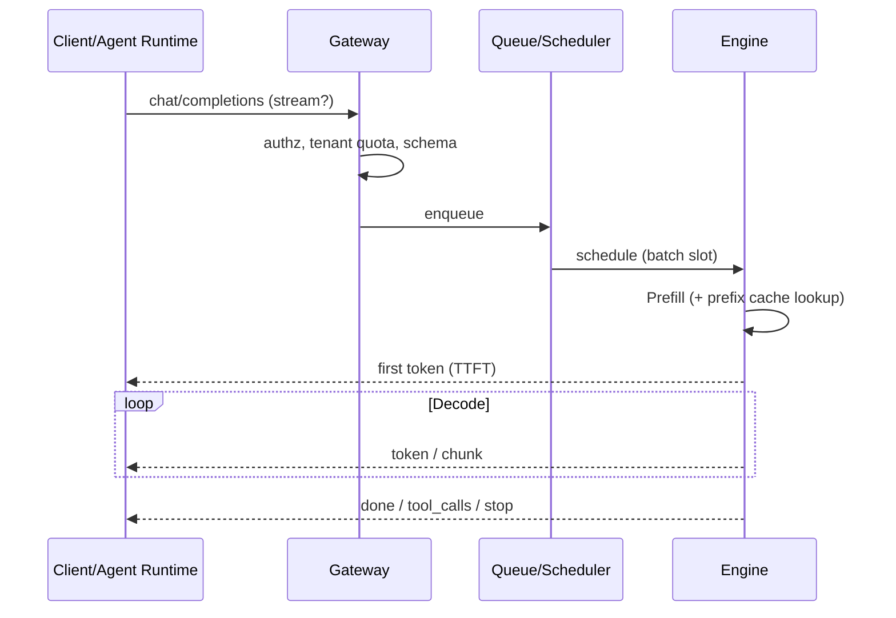
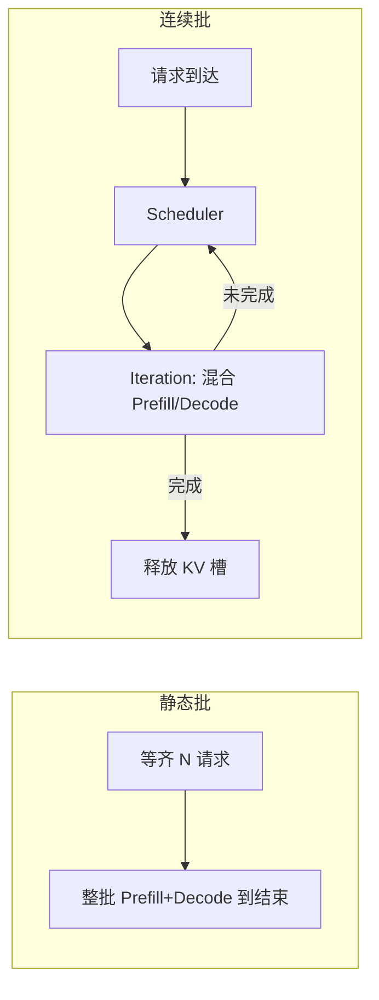
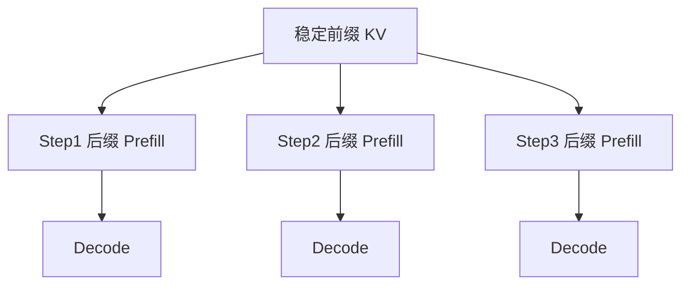
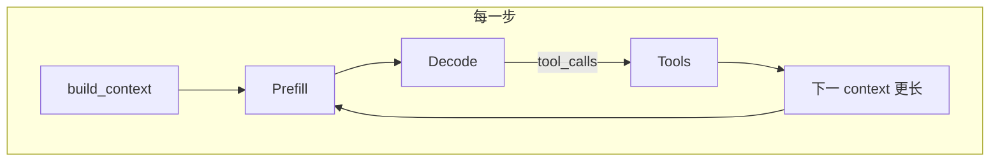

# LLM Inference（Canonical）

> **一句话主题**：LLM Inference 是把「一次模型调用」变成可调度、可缓存、可流式、可限流的**服务侧系统**——用 Prefill/Decode、批处理、KV/前缀缓存与队列配额解释 Agent 多步回路里的延迟、吞吐与成本结构。
>
> **状态**：Canonical · **Last reviewed**: 2026-10  
> **受众**：实现 / 选型 LLM 网关、容量规划、为 Agent Runtime 调延迟与成本的工程师  
> **硬前置**：[`foundations/llm`](../../foundations/llm/README.md) 的 token/窗口直觉；建议已读 [Agent Loop](../../core/agent-loop/agent-loop.md)  
> **软前置**：[Context Engineering](../../core/context-engineering/context-engineering.md)（前缀稳定性）；[`model-optimization`](../model-optimization/README.md)（量化/投机等质量–成本旋钮，本文不展开）

---

## 范围 / 非目标

**范围**：Prefill vs Decode；TTFT / TPOT / 端到端延迟；静态与连续批处理；KV Cache 与前缀缓存；流式与工具中断；限流 / 队列 / 背压；多租户隔离与公平性；与 Agent Loop 预填成本的关系；路由与降级接口；观测指标；失败模式；45 道面试题。

**非目标**：

| 主题 | 去哪里 |
|------|--------|
| 量化、蒸馏、投机解码算法深文 | [`model-optimization`](../model-optimization/README.md) |
| CUDA kernel / 算子手册 | 不写 |
| 集群拓扑、K8s、GPU 采购百科 | [`production/infrastructure`](../../production/infrastructure/README.md) |
| Loop 控制流、终止、checkpoint | [Agent Loop](../../core/agent-loop/agent-loop.md) |
| Context 策展与压缩策略正文 | [Context Engineering](../../core/context-engineering/context-engineering.md) |
| 评测体系全文 | [`evaluation`](../../production/evaluation/README.md) |

**立场**：Inference 解释 **单次/并发调用如何被服务**；Agent Loop 解释 **为何会反复调用**。两者必须合在一起做容量与产品 SLA，但知识落点分开。

---

## 1. 知识模型：一次调用在引擎里发生什么

### 1.1 Prefill 与 Decode

自回归 Transformer 服务几乎总是两阶段：

| 阶段 | 做什么 | 算力特征 | 用户感知 |
|------|--------|----------|----------|
| **Prefill（预填）** | 对输入 prompt 做前向，建立各层 **KV Cache** | 偏 **compute-bound**；延迟近似随输入长度增长 | 决定 **TTFT**（首 token 前等待） |
| **Decode（解码）** | 逐 token 生成；每步读已有 KV，追加新 KV | 偏 **memory-bound**；吞吐受显存带宽与批大小约束 | 决定 **TPOT** / 流式体感 |

```text
Prompt tokens ──▶ Prefill ──▶ KV₀ ──▶ Decode t1 ──▶ Decode t2 ──▶ …
                                      │
                                      └─ 流式：尽早吐出 t1（TTFT 结束）
```

**工程含义**：

- 拉长 prompt（肥 observation、整仓粘贴、未压缩 transcript）→ **预填变贵**，TTFT 上升，GPU 时间被 Prefill 占满。  
- 拉长 completion（长 CoT、啰嗦最终答）→ **Decode 步数**增加，端到端与成本上升。  
- Agent **每一步**几乎都是「再 Prefill + 再 Decode」；缓存命中可砍掉部分 Prefill。

### 1.2 请求生命周期（服务视角）



Gateway 负责契约与配额；Engine 负责批与 KV；两者之间用队列吸收突发——这是多租户与限流的物理落点。

### 1.3 Mental Model（必须记住）

把推理服务想成 **共享 GPU 上的抢占式批处理机**：

- **KV Cache** = 每个活跃序列的「工作集」显存  
- **Batch** = 同一时刻一起 Decode 的序列集合  
- **前缀缓存** = 跨请求复用稳定前缀的 KV  
- **配额** = 谁能占用多少并发槽位 / tokens / 队列深度  

Agent 不是「偶尔调一次 API」的客户端——它是 **高频、变长、可中断** 的负载生成器。

---

## 2. 延迟结构：TTFT、TPOT、E2E

### 2.1 定义

| 指标 | 定义 | 主要驱动 |
|------|------|----------|
| **TTFT** (Time To First Token) | 请求发出 → 首个输出 token（或首个有效 chunk）到达 | 排队 + Prefill + 调度间隙 |
| **TPOT** (Time Per Output Token) | 稳态下相邻输出 token 的间隔（或等价：生成阶段平均每 token 时间） | Decode 批大小、模型、硬件、是否投机解码 |
| **E2E Latency** | 请求发出 → 最终 stop / 完整响应 | TTFT + (#output tokens − 1) × TPOT + 尾部收尾 |
| **Throughput** | 系统 tokens/s 或 requests/s | 批效率、显存、队列是否饱和 |
| **Goodput** | 在 SLA 内完成的有效吞吐 | 吞吐 − 超时/取消/错误 |

流式场景下，用户体感 ≈ **TTFT 是否可交互** + **TPOT 是否流畅**；非流式则只剩 E2E。

### 2.2 分解公式（工程近似）

```text
E2E ≈ T_queue + T_prefill(L_in) + T_decode(L_out) + T_network
T_prefill ≈ α · L_in          # 未命中缓存时；命中则按未命中后缀
T_decode  ≈ β · L_out / B_eff # B_eff = 有效批大小；β 含 memory bandwidth 因子
```

Agent 相关修正：

```text
Task_E2E ≈ Σ_steps (T_queue_i + T_prefill_i + T_decode_i + T_tool_i)
```

优化「任务延迟」时，**减步数**与**减每步 Prefill**往往比抠 5% TPOT 更有效——但服务侧仍必须把 TTFT/TPOT 做好，否则每步都被放大。

### 2.3 SLA 该盯哪条曲线

| 产品形态 | 优先 SLA | 原因 |
|----------|----------|------|
| 聊天 / Coding Agent 交互 | p95 **TTFT** + p95 **TPOT** | 体感在首字与流畅度 |
| 批量离线摘要 | **吞吐** / 成本 per 1M tokens | 可容忍排队 |
| Tool 密集 Agent | TTFT + **工具间隙后的二次 TTFT** | 每步都像「新请求」 |
| 结构化 JSON 短输出 | TTFT + 小 L_out | Decode 短；Prefill 占比高 |

**常见错误**：只报「平均 tokens/s」——Agent 负载下平均吞吐好看，p95 TTFT 已不可用。

### 2.4 排队延迟不可忽视

当并发超过可调度批容量：

```text
T_queue ≈ f(arrival_rate, service_rate, priority, tenant_caps)
```

限流不是「拒绝用户」的对立面——它是 **保护 TTFT 尾部** 的手段。无队列上限的系统会在过载时让所有人的 TTFT 一起崩。

---

## 3. 批处理（Batching）

### 3.1 为什么要批

Decode 阶段单序列往往吃不满 GPU 算力，却吃满 **KV 带宽与显存**。把多条序列的 Decode step 拼进同一 iteration，可提高硬件利用率与 tokens/s。

代价：同批内最长/最慢者拖累；调度不公会导致交互请求被批处理「饿死」。

### 3.2 静态批 vs 连续批

| 模式 | 行为 | 优点 | 缺点 |
|------|------|------|------|
| **静态批（Static）** | 凑齐一批再一起跑完 | 实现简单 | 短请求等长请求；TTFT 差 |
| **连续批 / 迭代级批（Continuous / In-flight）** | 每个 Decode iteration 动态加入/退出序列 | TTFT 更好；吞吐高 | 调度与 KV 管理复杂 |

Orca 等工作推动了 iteration-level 调度思想；现代开源引擎（如 vLLM 系）普遍采用连续批 + 分页 KV（见 [paper-orca-2022](../../references/papers.md#paper-orca-2022)、[paper-pagedattention-2023](../../references/papers.md#paper-pagedattention-2023)）。



### 3.3 Prefill 与 Decode 的调度张力

- **大 Prefill**（Agent 长上下文）会短暂独占算力，抬高他人 TTFT。  
- 引擎常把 Prefill 切 chunk、或限制同时 Prefill 数，以保护交互 Decode。  
- 产品侧：对「超长 prompt」设硬上限与独立队列，避免一只肥请求拖垮租户池。

### 3.4 批处理对 Agent 的含义

| Agent 行为 | 批处理效应 |
|------------|------------|
| 多用户多 Agent 并发 | 连续批提高密度；需公平调度 |
| 单用户多步串行 | 步间常释放批槽；**每步重新排队** |
| 并行子 Agent | 同时占多个槽位；易触发租户并发帽 |
| 流式 + 早停 | 序列提前退出批，利于吞吐 |

**实践**：容量规划用「**同时活跃序列数** × 平均 KV 占用」而不是「QPS」——Agent 一步可能很长，QPS 低估显存压力。

---

## 4. KV Cache

### 4.1 是什么

注意力层为每个 token 缓存 Key/Value，Decode 时复用，避免对已生成前缀重复全量注意力计算。没有 KV Cache，自回归服务不可用。

### 4.2 显存是一等公民

```text
KV_bytes ≈ L_layers × 2 × L_seq × d_kv × bytes_per_elem × batch_or_pages
```

（具体因子随 GQA/MQA、量化 KV、分页策略变化；公式用于数量级直觉。）

| 压力源 | 后果 |
|--------|------|
| 上下文变长 | 每序列 KV 线性涨 |
| 并发序列多 | 总 KV 池耗尽 → 拒答 / 抢占 / 换出 |
| 未分页的碎片 | 显存浪费，有效并发下降 |

PagedAttention 将 KV 存成非连续页，降低碎片、提高并发（[paper-pagedattention-2023](../../references/papers.md#paper-pagedattention-2023)）。工程决策：**并发上限往往由 KV 池决定，而非「GPU 算力还空着」**。

### 4.3 KV 与多步 Agent

同一次 HTTP 请求内的 Decode：KV 自然增长。  
Agent **跨工具步** 的下一次调用：默认是 **新请求**——除非网关/引擎提供：

- **前缀缓存**（跨请求复用公共前缀 KV）  
- **会话亲和 + 常驻前缀**（自建引擎）  
- 厂商 **prompt caching**（按计费/TTL 规则）

否则每一步都对几乎完整 transcript **重做 Prefill**——这是 Agent 账单里「输入 token 反复计价」的物理真相。

### 4.4 失败模式

- **KV OOM**：突发长上下文或并发尖峰。  
- **缓存击穿**：前缀微调导致全未命中（见 §5）。  
- **过期/错误复用**：错误地把不同租户或不同模型版本的 KV 当命中（安全事故）。

---

## 5. 前缀缓存（Prefix Cache / Prompt Cache）

### 5.1 思想

若多个请求共享相同 token 前缀，Prefill 可复用该前缀的 KV，只计算 **后缀增量**。命中时：

- TTFT 下降（少算 Prefill）  
- 输入侧成本可能下降（视厂商计费）  
- 引擎吞吐上升（少占 Prefill 算力）

### 5.2 命中条件（工程约束）

| 约束 | 说明 |
|------|------|
| **字节/Token 级前缀相同** | 任何插入、重排、动态时间戳都会打断 |
| **模型与版本一致** | 权重变则 KV 无效 |
| **位置从 0 对齐** | 稳定块必须放在最前连续区 |
| **TTL / 容量驱逐** | 冷前缀会被踢出 |

**Context 设计直接决定命中率**（与 [Context Engineering Q22](../../core/context-engineering/context-engineering.md) 呼应）：

```text
[稳定 system + 工具 schema + 政策]  ← 尽量不变，利于缓存
[会话摘要 / 记忆切片]              ← 中频变化
[最近 turns / 本步 observation]    ← 高频变化，放后
```

**反模式**：把 `request_id`、精确时间、用户名随机盐塞进 system 最前——前缀每请求必变，缓存形同虚设。

### 5.3 Agent Loop 下的命中形态

| 场景 | 期望 |
|------|------|
| 同租户同 Agent 定义的多用户 | 共享 system+tools 前缀 |
| 同 run 多步 | 公共前缀 + 增长的 transcript 后缀；部分厂商按「可缓存块」计费 |
| 每步重写 system | 命中率崩溃 |
| 工具 schema 巨变 | 前缀失效；应版本化工具集 |



### 5.4 Self-review / Verify

- **机制级（Evergreen 2026-10-07）**：OpenAI 自动前缀缓存 + 可选 breakpoint；Anthropic `cache_control`；稳定前缀在前。见 [doc-openai-prompt-caching](../../references/docs.md#doc-openai-prompt-caching) / [doc-anthropic-prompt-caching](../../references/docs.md#doc-anthropic-prompt-caching)。  
- **TTL / 最低 token（已核，2026-10-07）**：OpenAI — `ttl` 默认且仅支持 `30m`（最近 write/reuse 后至少 30 分钟）；GPT-5.6+ 最低 **1024** visible tokens，更早模型随请求设置而变。Anthropic — 默认 **5 分钟**（命中刷新），可选 **`ttl: "1h"`**；最低可缓存长度按模型 **512 / 1024 / 2048 / 4096**（官方表；未达则静默不缓存）。扩展：[evergreen-2026-10-caching-seed.md](../../docs/evergreen-2026-10-caching-seed.md)。  
- 仍待复核：**计费倍率**数字；网关侧自建前缀缓存与多租户隔离的精确一致性规则。  

不阻塞机制理解：把「稳定前缀靠前」当作默认纪律即可。

---

## 6. 流式（Streaming）与工具中断

### 6.1 流式交付什么

流式把 Decode 的 token/chunk **边生成边推送**，把「E2E 才可见」变成「TTFT 后持续可见」。

| 收益 | 代价 |
|------|------|
| 改善交互体感 | 客户端状态机更复杂 |
| 可早停省 Decode | 部分聚合逻辑（完整 JSON）变难 |
| 利于取消传播 | 半截 tool_call 参数需容错 |

### 6.2 与 Tool Use 的交错

Agent 常见模式：流式文本 → 检测到 `tool_calls` → **中断生成** → 执行工具 → 新请求再 Prefill。

```text
stream tokens…
  └─ finish_reason=tool_calls 或解析到完整 call
        → cancel further decode（若仍在生成）
        → execute tools
        → next LLM call (prefill again)
```

要点：

- **不要**为了「好看流式」强制模型先废话再调工具——浪费 Decode，延迟工具开始时间。  
- 网关应支持 **客户端 cancel** → 引擎停止 Decode、释放 KV。  
- 半截 JSON 参数：以协议层 framing（独立 tool call 事件）为准，不要猜。

### 6.3 流式下的观测

分别打点：

- `ttft_ms`  
- `time_to_first_tool_call_ms`（若适用）  
- `tpot_ms` / `output_tokens_per_s`  
- `cancel_rate`、`partial_response_rate`

Agent 产品还要打 `inter_step_gap_ms`（工具结束 → 下一首 token），它常被误算进「模型慢」。

---

## 7. 限流、队列与背压

### 7.1 为什么限流是一等功能

GPU 池是硬资源。无限接纳 → KV 池耗尽 / TTFT 爆炸 / 级联超时 → Agent Runtime 重试 → **重试风暴**。

### 7.2 限流维度

| 维度 | 控制什么 | 典型用途 |
|------|----------|----------|
| **RPM / RPS** | 请求速率 | 防刷、平滑突发 |
| **TPM** (tokens/min) | 输入+输出 token 速率 | 贴近真实算力/账单 |
| **并发 in-flight** | 同时占 KV 的序列数 | 保护显存 |
| **队列深度 / 最大等待** | 接纳但未开跑的请求 | 保护 TTFT SLA |
| **Burst + 令牌桶** | 短时突发 | UX 友好 |

Agent 负载特征：**低 RPS、高 TPM、高并发尖峰**（多步 + 并行工具触发的扇出）。只配 RPM 不够。

### 7.3 背压策略

```text
过载信号 → 延长排队 / 429 + Retry-After / 降级到小模型 / 拒绝新 run
         → Agent Runtime 必须可识别并停止盲目重试
```

| 策略 | 适用 |
|------|------|
| 快速失败 429 | 交互；让客户端换区或降级 |
| 有界队列 + 超时 | 平滑微突发；超时返回明确错误 |
| 租户公平排队 | 多租户防吵闹邻居 |
| 优先级（交互 > 批） | 同集群混部 |

### 7.4 与 Agent Loop 预算对齐

Loop 已有 step/time/token/cost budget（见 Agent Loop）。Inference 限流是 **基础设施预算**；两者应对齐：

- Runtime 在收到 429/503 时计入「基础设施故障」而非「模型蠢」→ 触发降级或暂停，而不是空转反思。  
- 不要把限流重试做成无限 `for`；用指数退避 + 总 deadline。

---

## 8. 多租户

### 8.1 隔离目标

| 目标 | 手段 |
|------|------|
| **性能隔离** | 每租户并发/TPM 帽、独立队列、优先级 |
| **数据隔离** | 缓存键含 tenant + model + 前缀哈希；禁止跨租户 KV 命中 |
| **计费隔离** | 按 tenant 计量 prompt/completion/cache hit |
| **故障隔离** | 吵闹租户熔断，不拖垮全局调度 |

### 8.2 吵闹邻居（Noisy Neighbor）

典型：某租户批量跑长上下文 Agent，占满 KV 池 → 其他租户 TTFT 飙升。

缓解：

1. 硬并发与 TPM 帽  
2. Prefill 重量加权（长 prompt 消耗更多「调度代币」）  
3. 批/交互分池或分优先级  
4. 可观测：按 tenant 的 `kv_bytes`、`queue_wait_p95`

### 8.3 缓存与安全

前缀缓存命中必须在 **相同信任域** 内。多租户共享引擎时：

- 缓存键 = `hash(model_id, tenant_id or cache_namespace, prefix_tokens)`  
- 公共系统提示若跨租户共享，需确保 **无租户机密** 嵌入该前缀  
- 任何「全局热前缀」都要安全评审

### 8.4 产品映射

| 产品概念 | Inference 映射 |
|----------|----------------|
| Workspace / Org | tenant 配额桶 |
| 用户级公平 | 二级帽，防单用户打爆 org |
| 内部批任务 | 低优先级队列 |
| VIP / 付费档 | 更高并发与更短最大排队 |

---

## 9. 与 Agent Loop 的预填成本关系

### 9.1 核心等式

```text
LoopCost ≈ Σ_i ( PrefillCost(context_i) + DecodeCost(completion_i) + ToolCost_i )
```

其中 `context_i` 通常 ≈ 系统前缀 + 工具 schema + 历史 + 本步观察，随步数近似 **单调变长**（除非压缩）。

因此：

- **步数 ↑** → 调用次数 ↑ → Prefill 次数 ↑  
- **每步 context ↑** → 单次 Prefill ↑（二次放大）  
- **前缀缓存命中** → 边际 Prefill 近似只付「新后缀」  
- **肥 observation** → Prefill 与注意力质量双杀（Context Engineering）

### 9.2 为什么 Agent 比单轮聊天更伤 Prefill

| 单轮聊天 | Agent Loop |
|----------|------------|
| 一次 Prefill | N 次 Prefill |
| 历史较短 | transcript + 工具结果膨胀 |
| 可接受一次长等待 | 每步都要可交互 TTFT |
| 缓存收益一次性 | 缓存收益跨步、跨用户复利 |



### 9.3 优化顺序（推荐）

对任务级延迟/成本，按杠杆排序：

1. **减少无效步**（Loop 终止、工具质量、计划）——控制论问题  
2. **压缩/外置 observation**（Context）——减小 L_in  
3. **稳定前缀以吃缓存**——减小重复 Prefill  
4. **批处理与容量**——降 T_queue、提吞吐  
5. **模型优化**（量化/投机/小模型路由）——见 model-optimization  
6. **抠单 token TPOT**——在 1–5 之后

### 9.4 预填成本的产品计量

建议在 Runtime 暴露：

| 指标 | 用途 |
|------|------|
| `prefill_tokens_per_step` | 发现膨胀 |
| `cache_hit_ratio` | 验证前缀纪律 |
| `ttft_p95_per_step` | 交互 SLA |
| `cumulative_prompt_tokens` | 账单与 budget |
| `steps × mean_prefill` | 任务级成本模型 |

**口诀**：Agent 的模型费 ≈ **反复预填的税** + **解码的税**；很多人只看见后者。

---

## 10. 路由、超时、降级（接口级）

Inference 模块定义 **策略接口**；具体模型目录与评测在 Evaluation / 各 Agent Type。

| 策略 | 机制 | 何时 |
|------|------|------|
| **模型路由** | 按任务/风险/长度选模型 | 简单步用小模型 |
| **超时** | 连接/首包/总时长分层超时 | 防挂死 |
| **Fallback** | 主模型 5xx/429 → 备模型或只读模式 | 可用性 |
| **截断保护** | 超窗拒绝或强制压缩后再送 | 防引擎 400 风暴 |

```text
try primary(model_A, deadlines)
catch RateLimit | Timeout | Unavailable:
  if budget_allows: fallback(model_B) else fail_run(partial)
```

与 Loop 的关系：降级是 **Executor 策略**，不是「再 Reflect 一次」的借口。

---

## 11. 成本–延迟权衡

### 11.1 三维

| 维度 | 代理指标 |
|------|----------|
| 延迟 | TTFT / TPOT / Task_E2E |
| 成本 | $/1M in·out、GPU 时、缓存读写 |
| 质量 | 任务成功、工具正确率、安全 |

### 11.2 常见旋钮（本模块）

| 旋钮 | 延迟 | 成本 | 备注 |
|------|------|------|------|
| 提高并发批 | 吞吐↑，过载时 TTFT↑ | 单 token 成本↓ | 要配额 |
| 前缀缓存 | TTFT↓ | 常↓ | 纪律要求 |
| 流式早停 | E2E↓ | Decode↓ | 产品逻辑 |
| 更短 max_tokens | E2E↓ |↓ | 可能截断质量 |
| 更小模型 | 通常↓ |↓ | 质量风险 → optimization/评测 |
| 量化/投机 | 见下游模块 | 见下游 | **本文不展开算法** |

### 11.3 Agent 特有权衡

- **并行子 Agent**：墙钟↓，并发槽与账单↑。  
- **更长思考**：可能少步，但单次 Decode↑；需评测。  
- **每步更大上下文**：命中率假象（更「全」）vs Prefill 税。

---

## 12. 生产观测清单

### 12.1 黄金信号

- 流量：QPS、TPM、in-flight、队列深度  
- 延迟：TTFT/TPOT/E2E 的 p50/p95/p99  
- 错误：4xx/5xx、OOM、超时、取消  
- 饱和：GPU util、KV 池使用率、调度等待  
- 缓存：prefix hit rate、平均 reused tokens  
- 租户：Top-N 消耗、被限流次数  

### 12.2 与 Agent Trace 关联

每次模型调用带：`run_id`、`step`、`tenant`、`model`、`cache_hit`、`prompt_tokens`、`completion_tokens`。  
才能回答：「任务贵在第几步的 Prefill？」——否则只有网关平均数。

### 12.3 告警建议

| 条件 | 动作 |
|------|------|
| TTFT p95 超 SLO | 查队列/Prefill 重量/吵闹租户 |
| KV 使用 > 阈值 | 降并发帽、拒长上下文 |
| 429 飙升 | 扩容或上游降级 |
| cache hit 骤降 | 查前缀是否被打散（发布变更） |

---

## 13. 失败模式与检测

| 失败 | 信号 | 缓解 |
|------|------|------|
| 过载雪崩 | 全租户 TTFT↑、超时↑ | 有界队列、负载卸除 |
| 重试风暴 | 相同 run 重复 Prefill | Runtime 统一 backoff、幂等键 |
| 前缀抖动 | hit rate↓、账单↑ | 发布门禁检查 system 稳定性 |
| 流式半截工具调用 | 解析错误、重复执行 | 事件级 framing、取消语义 |
| 租户饿死 | 小租户等待长 | 公平队列 / 最小带宽保证 |
| 长尾 Prefill | 单请求占满 | Prefill chunking、长度帽 |
| 缓存误命中 | 串租户/错模型 | 键设计与安全测试 |
| 只优化吞吐 | 交互崩溃 | 分队列、分 SLO |

---

## 14. 与 Model Optimization 的边界

```text
llm-inference     = 服务与调度：批、缓存、流、配额、延迟结构
model-optimization = 模型侧加速/压缩：量化、蒸馏、投机解码、小模型策略
```

| 问题 | 落点 |
|------|------|
| 为什么多步 Agent 账单爆炸？ | 本文 §9 + Context/Loop |
| INT8/FP8 如何影响质量？ | model-optimization |
| 投机解码如何改 TPOT？ | model-optimization（机制接口可回链本文 TPOT） |
| 连续批如何配置？ | 本文 |
| 该不该上量化？ | 多目标权衡在 optimization；容量数字用本文指标验证 |

**禁止**：在本文展开量化校准、蒸馏损失、draft 模型训练细节。

---

## 15. 实践建议（可执行）

1. **先测量**：按 step 打 TTFT、prompt tokens、cache hit。  
2. **前缀纪律**：稳定块前置；动态块后置；变更走版本。  
3. **为 Agent 配限额**：并发 + TPM + 最大 prompt；别只抄聊天 RPM。  
4. **过载可观测且可降级**：429 带语义；Runtime 会停。  
5. **流式 + 取消** 作为默认交互路径。  
6. **容量用 KV 与活跃序列** 建模，而不是只用 QPS。  
7. **任务级优化优先减步与减 L_in**，再谈引擎微优。  
8. **多租户缓存键含命名空间**；公共前缀无机密。  
9. **SLO 分交互/批**；混部必分优先级。  
10. **与 Loop budget 对齐**：基础设施错误不等于推理失败。

---

## 16. 最小伪代码：Runtime 侧调用

```text
function CallModel(tenant, messages, tools, opts):
  assert_within_window(messages, tools)
  enforce_quota(tenant, estimate_tokens(messages), opts.max_tokens)
  deadline = opts.deadline

  try:
    stream = gateway.chat(
      model=route(opts),
      messages=messages,
      tools=tools,
      stream=true,
      cache_namespace=tenant.cache_ns,
      timeout=deadline)
    return ConsumeStream(stream, on_cancel=opts.cancel_token)
  catch RateLimited as e:
    maybe_backoff_or_fallback(e)
  catch Timeout:
    cancel_remote(); raise
```

```text
function AgentStepCostModel(steps):
  cost = 0
  for s in steps:
    prefill = s.prompt_tokens * price_in * (1 - s.cache_discount)
    decode  = s.completion_tokens * price_out
    cost += prefill + decode + s.tool_cost
  return cost
```

---

## 17. 面试题（45）

### Foundations

**Q1. Prefill 与 Decode 的本质区别？**  
- **短答**：Prefill 处理输入并建 KV（偏算力）；Decode 逐 token 追加（偏显存带宽）。  
- **详解**：决定 TTFT vs TPOT 的主导项。  
- **追问**：为何长 prompt 伤 TTFT 更明显？  
- **常见错误**：把两者都叫「推理时间」不加区分。  
- **相关**：§1。

**Q2. 什么是 TTFT / TPOT？**  
- **短答**：首 token 时间 / 每输出 token 时间。  
- **详解**：E2E ≈ TTFT + (L_out−1)×TPOT。  
- **追问**：流式与非流式谁更关心 TTFT？  
- **常见错误**：只用平均 tokens/s 做 SLA。  
- **相关**：§2。

**Q3. KV Cache 解决什么问题？**  
- **短答**：避免 Decode 时重复计算历史注意力。  
- **详解**：以显存换算力；并发受 KV 池限制。  
- **追问**：GQA 如何影响 KV 大小（直觉）？  
- **常见错误**：以为 KV 只存在于训练。  
- **相关**：§4。

**Q4. 为什么 Decode 常 memory-bound？**  
- **短答**：每步算量相对小，却要搬大量 KV。  
- **详解**：批处理通过共用权重读摊销带宽。  
- **追问**：提高 batch 为何能提吞吐？  
- **常见错误**：认为加 GPU 核数一定线性降 TPOT。  
- **相关**：§1、§3。

**Q5. 连续批与静态批差别？**  
- **短答**：连续批按 iteration 动态进出；静态批齐步走。  
- **详解**：连续批改善 TTFT 与利用率。  
- **追问**：实现难点在哪？  
- **常见错误**：把「动态批大小」当成连续批全部含义。  
- **相关**：§3、Orca。

**Q6. PagedAttention 的动机？**  
- **短答**：分页管理 KV，减碎片、提并发。  
- **详解**：类 OS 虚拟内存直觉。  
- **追问**：页大小权衡？  
- **常见错误**：当成量化技术。  
- **相关**：§4、[`paper-pagedattention-2023`](../../references/papers.md#paper-pagedattention-2023)。

**Q7. 前缀缓存命中的必要条件？**  
- **短答**：相同模型下从位置 0 开始的 token 前缀完全一致。  
- **详解**：动态字段打散前缀即未命中。  
- **追问**：工具 schema 变更影响？  
- **常见错误**：以为「语义相似」即可命中。  
- **相关**：§5。

**Q8. 流式如何改善体验？**  
- **短答**：暴露 TTFT 后的增量；支持早停与取消。  
- **详解**：不降低总 compute，但改善体感与可中断性。  
- **追问**：对工具调用解析的挑战？  
- **常见错误**：认为流式一定更便宜。  
- **相关**：§6。

**Q9. 为何 Agent 需要 TPM/并发限流而不只 RPM？**  
- **短答**：Agent 低请求率、高 token 与长占用 KV。  
- **详解**：RPM 掩盖 Prefill 重量。  
- **追问**：如何定义「重量」？  
- **常见错误**：照搬聊天机器人限流。  
- **相关**：§7。

**Q10. 多租户下前缀缓存的安全要点？**  
- **短答**：缓存键含租户/命名空间；公共前缀无机密。  
- **详解**：误命中是数据泄漏。  
- **追问**：共享 system 提示如何评审？  
- **常见错误**：全局一个热缓存。  
- **相关**：§8。

### Intermediate

**Q11. 写出 Task_E2E 与单步延迟的关系。**  
- **短答**：各步 queue+prefill+decode+tool 之和。  
- **详解**：串行步不可简单用吞吐抵消。  
- **追问**：哪些工具可并行？  
- **常见错误**：只用单次 E2E 估任务。  
- **相关**：§2、§9。

**Q12. 肥 observation 如何同时伤害延迟与质量？**  
- **短答**：抬高 Prefill/TTFT/成本，并稀释注意力。  
- **详解**：链 Context Engineering。  
- **追问**：外置句柄策略？  
- **常见错误**：只怪「模型变笨」。  
- **相关**：§9、Context。

**Q13. 连续批下大 Prefill 的吵闹效应？**  
- **短答**：占算力抬高他人 TTFT。  
- **详解**：chunked prefill / 分队列。  
- **追问**：如何计量 Prefill 重量？  
- **常见错误**：只限输出长度。  
- **相关**：§3、§8。

**Q14. 设计租户公平队列的关键要素。**  
- **短答**：每租户帽、加权公平、优先级、最大等待。  
- **详解**：防饿死与防垄断。  
- **追问**：批任务与交互如何混部？  
- **常见错误**：全局 FIFO。  
- **相关**：§7、§8。

**Q15. 缓存命中率骤降如何排查？**  
- **短答**：查发布是否打散前缀、模型版本、TTL、键变更。  
- **详解**：对比 hit tokens 分布。  
- **追问**：灰度如何验证？  
- **常见错误**：先扩容 GPU。  
- **相关**：§5、§12。

**Q16. `time_to_first_tool_call` 为何值得单独打点？**  
- **短答**：工具密集 Agent 的体感关键路径。  
- **详解**：与纯文本 TTFT 不同。  
- **追问**：如何优化？  
- **常见错误**：只盯最终答 TTFT。  
- **相关**：§6。

**Q17. 429 后 Agent Runtime 的正确行为？**  
- **短答**：退避、尊重 Retry-After、可降级；禁紧循环重试。  
- **详解**：计入 infra 失败。  
- **追问**：与 Reflect 的边界？  
- **常见错误**：当模型错误去反思。  
- **相关**：§7、§10。

**Q18. 为何容量规划看「活跃序列 × KV」？**  
- **短答**：显存瓶颈在 KV 工作集。  
- **详解**：QPS 忽略长占用。  
- **追问**：如何估平均 L_seq？  
- **常见错误**：按 GPU util 100% 估并发。  
- **相关**：§3、§4。

**Q19. 流式取消未传播的后果？**  
- **短答**：Decode 空转占 KV，浪费钱并挤占他人。  
- **详解**：协作式 cancel 到引擎。  
- **追问**：工具已触发如何补偿？  
- **常见错误**：只关客户端连接。  
- **相关**：§6。

**Q20. 前缀应如何分区以服务 Agent？**  
- **短答**：稳定 system/tools → 中频记忆摘要 → 高频近窗。  
- **详解**：最大化跨请求/跨步复用。  
- **追问**：多 Agent 共享前缀？  
- **常见错误**：每步重写整段 system。  
- **相关**：§5。

**Q21. Goodput 与 Throughput 差别？**  
- **短答**：Goodput 只计 SLA 内有效完成。  
- **详解**：过载时吞吐虚高、Goodput 崩溃。  
- **追问**：如何定义有效？  
- **常见错误**：用 tokens/s 做唯一成功指标。  
- **相关**：§2。

**Q22. 输入计价为何在 Agent 中被放大？**  
- **短答**：每步重送增长 transcript，Prefill 反复计价。  
- **详解**：缓存折扣是对冲。  
- **追问**：压缩与缓存谁先？  
- **常见错误**：只盯输出单价。  
- **相关**：§9。

**Q23. 分层超时怎么设？**  
- **短答**：连接 / 首包(TTFT) / 总时长分离。  
- **详解**：首包超时触发快失败或降级。  
- **追问**：长 Decode 任务？  
- **常见错误**：单一 60s 糊弄。  
- **相关**：§10。

**Q24. 并行子 Agent 对推理池的压力？**  
- **短答**：同时占用多序列槽与 TPM。  
- **详解**：需扇出预算。  
- **追问**：如何限扇出？  
- **常见错误**：只限父 run 的 RPM。  
- **相关**：§3、§8。

**Q25. 何时该分「交互队列」与「批队列」？**  
- **短答**：SLO 冲突时（TTFT vs 吞吐）。  
- **详解**：权重或物理分池。  
- **追问**：同一租户两类流量？  
- **常见错误**：靠运气混部。  
- **相关**：§7、§11。

### Advanced

**Q26. 给出 cache_discount 下的步骤成本模型。**  
- **短答**：prefill_tokens×price×(1−hit_fraction)+completion×price_out。  
- **详解**：hit_fraction 按计费规则定义。  
- **追问**：部分命中如何算？  
- **常见错误**：假设 100% 命中。  
- **相关**：§9、§16。

**Q27. 设计防重试风暴的网关+Runtime 协议。**  
- **短答**：明确 429/503、Retry-After、idempotency key、客户端抖动。  
- **详解**：服务端去重。  
- **追问**：流式中断半截？  
- **常见错误**：自动无限重试。  
- **相关**：§7、§13。

**Q28. Prefill chunking 的利弊？**  
- **短答**：利：保护交互 TTFT；弊：拉长本请求 TTFT、实现复杂。  
- **详解**：调度公平性工具。  
- **追问**：chunk 大小如何选？  
- **常见错误**：当成量化。  
- **相关**：§3。

**Q29. 如何检测吵闹邻居？**  
- **短答**：租户维度 KV、queue wait、prefill tokens 占比。  
- **详解**：自动降帽。  
- **追问**：误杀正当高峰？  
- **常见错误**：只看全局 GPU util。  
- **相关**：§8、§12。

**Q30. 推理 SLA 与 Loop budget 如何对齐？**  
- **短答**：infra 错误码映射到 Loop 的可恢复/不可恢复策略。  
- **详解**：共享 deadline。  
- **追问**：部分成功产物？  
- **常见错误**：两套互不理睬的超时。  
- **相关**：§7、§9、Loop。

**Q31. 为什么「更大上下文模型」不能替代前缀缓存纪律？**  
- **短答**：窗大仍付 Prefill 与注意力税；缓存减重复算。  
- **详解**：More context ≠ cheaper。  
- **追问**：与 Lost in the Middle？  
- **常见错误**：靠窗口解决成本。  
- **相关**：§5、§9、Context。

**Q32. 设计多模型路由的最小安全门闩。**  
- **短答**：能力标签、风险级、超时、回落、审计。  
- **详解**：禁止无门禁的随机路由。  
- **追问**：评测如何绑？  
- **常见错误**：只比单价。  
- **相关**：§10、§11。

**Q33. KV 池将满时的卸载策略比较。**  
- **短答**：拒新 / 抢占低优先 / 换出（若支持）/ 降 max context。  
- **详解**：交互优先。  
- **追问**：抢占对 Agent checkpoint？  
- **常见错误**：静默拉长排队到超时。  
- **相关**：§4、§13。

**Q34. 说明 Inference 与 model-optimization 的分工。**  
- **短答**：服务调度 vs 模型压缩/加速算法。  
- **详解**：TPOT 改善可能来自投机解码，但机制落点在 optimization。  
- **追问**：联调指标？  
- **常见错误**：一篇文档写尽 CUDA+量化+限流。  
- **相关**：§14。

**Q35. 如何用在线数据验证「稳定前缀」改动？**  
- **短答**：A/B 看 hit rate、TTFT、$/task、任务成功率。  
- **详解**：发布门禁。  
- **追问**：质量回归？  
- **常见错误**：只看命中率不顾质量。  
- **相关**：§5、§12。

### System Design

**Q36. 设计面向 Coding Agent 的推理网关。**  
- **短答**：流式、取消、高 TPM、前缀缓存、交互优先队列、按 step 追踪。  
- **详解**：工具中断路径一等公民。  
- **追问**：长 diff observation？  
- **常见错误**：按博客聊天 Demo 配限额。  
- **相关**：§6–§9。

**Q37. 设计多租户 SaaS 的配额体系。**  
- **短答**：org/user 两级；RPM+TPM+并发；公平队列；账单。  
- **详解**：批/交互分档。  
- **追问**：超售策略？  
- **常见错误**：单一人人平等无帽。  
- **相关**：§7、§8。

**Q38. 设计 Agent 任务级成本预测器。**  
- **短答**：估 steps、每步 L_in 增长、cache、L_out、工具费。  
- **详解**：用于预算熔断。  
- **追问**：如何校准？  
- **常见错误**：用单次调用均价。  
- **相关**：§9、§16。

**Q39. 设计过载时的降级状态机。**  
- **短答**：正常→限流→切小模型→只读/拒新 run→恢复。  
- **详解**：与 Loop partial 对齐。  
- **追问**：用户可见性？  
- **常见错误**：直接全站 500。  
- **相关**：§10、§13。

**Q40. 设计前缀缓存服务的键与驱逐。**  
- **短答**：键含 model/ns/hash；LRU+TTL；租户配额。  
- **详解**：安全测试串租户。  
- **追问**：超大前缀？  
- **常见错误**：只按字符串 LRU 无隔离。  
- **相关**：§5、§8。

**Q41. 自建引擎 vs 托管 API 的决策框架。**  
- **短答**：比控制力、缓存/批定制、运维成本、合规、峰值。  
- **详解**：Agent 重 Prefill 时自建可能更值。  
- **追问**：混合架构？  
- **常见错误**：只比标价 $/1M。  
- **相关**：§11、Infrastructure。

**Q42. 为「研究型长程 Agent」选 SLA。**  
- **短答**：可放宽 TTFT，严控 $/task 与超时；批队列。  
- **详解**：与交互 Coding 分池。  
- **追问**：用户中途接管？  
- **常见错误**：一套 SLO 打天下。  
- **相关**：§2、§11。

**Q43. 设计端到端追踪：从 UI 到 GPU 调度。**  
- **短答**：trace id 贯穿 Runtime step、网关、引擎 iteration 指标。  
- **详解**：关联 cache hit。  
- **追问**：采样率？  
- **常见错误**：两套无关联日志。  
- **相关**：§12、Observability。

**Q44. 评估连续批调度是否伤及某类 Agent。**  
- **短答**：看长 Prefill 任务的 TTFT 与饿死率；必要则分池。  
- **详解**：负载回放。  
- **追问**：如何构造回放？  
- **常见错误**：合成短 prompt 压测。  
- **相关**：§3、§13。

**Q45. 从「直接调厂商 SDK」演进到推理平台的里程碑。**  
- **短答**：P0 超时取消与配额 → P1 观测 TTFT/TPM → P2 前缀纪律与缓存 → P3 多租户公平 → P4 路由降级与任务成本模型。  
- **详解**：每阶段有门禁指标。  
- **追问**：不可妥协项？  
- **常见错误**：P0 直接自研引擎内核。  
- **相关**：§15。

---

## 18. Cross References

- [`foundations/llm`](../../foundations/llm/README.md)  
- [Agent Loop](../../core/agent-loop/agent-loop.md) · [Tool Use](../../core/tool-use/tool-use.md)  
- [Context Engineering](../../core/context-engineering/context-engineering.md)  
- [`model-optimization`](../model-optimization/README.md)  
- [`production/infrastructure`](../../production/infrastructure/README.md) · [`observability`](../../production/observability/README.md) · [`evaluation`](../../production/evaluation/README.md)

---

## 19. References

- [paper-orca-2022](../../references/papers.md#paper-orca-2022)  
- [paper-pagedattention-2023](../../references/papers.md#paper-pagedattention-2023)  
- [repo-vllm](../../references/repos.md#repo-vllm)  
- [article-anthropic-context-engineering-2025](../../references/articles.md#article-anthropic-context-engineering-2025)（前缀/上下文纪律上游）  
- [agent-loop.md](../../core/agent-loop/agent-loop.md) · [context-engineering.md](../../core/context-engineering/context-engineering.md)

---

## 20. Self-review / TODOs

- [x] Prefill/Decode、TTFT/TPOT、批处理、KV/前缀缓存、流式、限流、多租户  
- [x] 与 Agent Loop 预填成本关系专章  
- [x] 链 model-optimization；无量化深文  
- [x] 失败模式、观测、伪代码、45 题  
- [x] Evergreen 2026-10-07：机制见 [doc-openai-prompt-caching](../../references/docs.md#doc-openai-prompt-caching) / [doc-anthropic-prompt-caching](../../references/docs.md#doc-anthropic-prompt-caching)（前缀稳定、breakpoint/`cache_control`）  
- [x] Evergreen 2026-10-07：OpenAI/Anthropic **TTL + 最低可缓存 token** 机制已核（§5.4；[caching-seed](../../docs/evergreen-2026-10-caching-seed.md)）  
- [ ] TODO: Verify — 各模型 caching **计费倍率**数字  
- [ ] TODO: Verify — 网关自建前缀缓存一致性规则  
